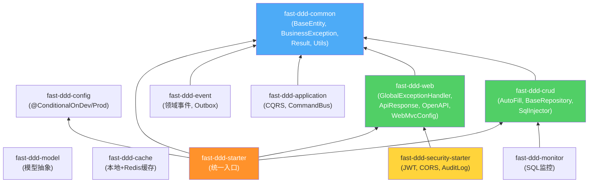
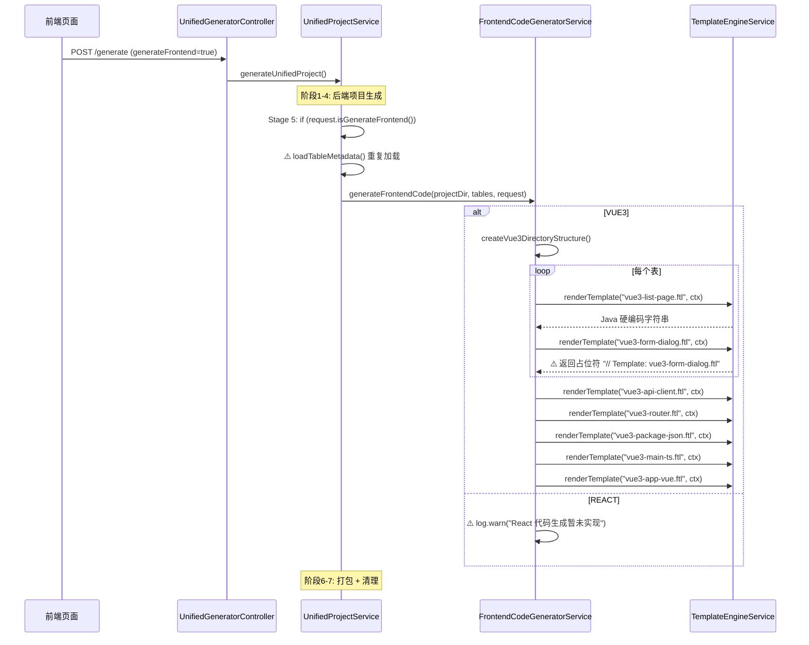
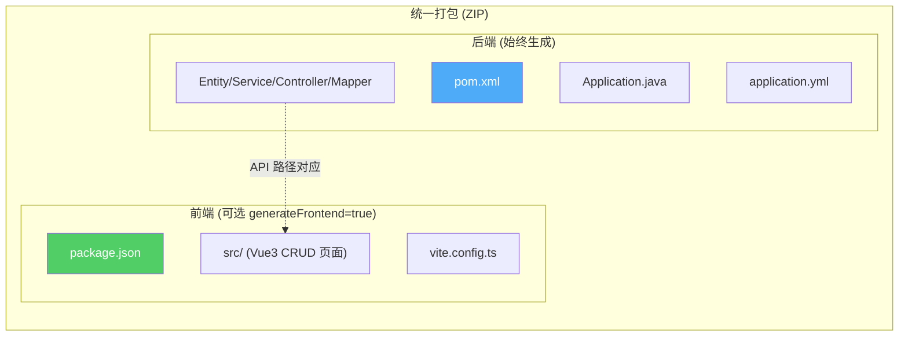

# FastDDD 一体化生成器代码评审报告（修订版 v2）

> **评审范围**: `UnifiedGeneratorController` → `UnifiedProjectService` → 全链路模板  
> **评审日期**: 2026-02-13  
> **评审角色**: Java 高级工程师 / 系统架构师 / 产品专家  
> **修订说明**: v2 版本基于对 FastDDD 全部 14 个模块的深度分析，修正了 v1 中"大量基础设施代码缺失"的误判。**核心发现：框架模块已通过 Spring Boot AutoConfiguration 提供了绝大部分基础设施，真正的问题在于生成器未正确引入和配置这些模块。**

---

## 一、FastDDD 模块全景分析

> [!IMPORTANT]
> **关键发现**: FastDDD 已经是一个成熟的模块化框架，之前评审中标记为"缺失"的基础设施代码，绑大部分已由框架模块提供并通过 Spring Boot AutoConfiguration 自动激活。问题不是"没有这些能力"，而是"生成器没有正确引入"。

### 1.1 模块能力矩阵

| 模块 | 提供的核心能力 | 自动配置类 | 激活方式 |
|------|--------------|-----------|---------|
| **fast-ddd-common** | `BaseEntity` (id/createdAt/updatedAt/createdBy/version/deleted), `BusinessException`, `SystemException`, `Result`, `PageResult`, 7个工具类 | `FastDddCommonAutoConfiguration` | ✅ `AutoConfiguration.imports` |
| **fast-ddd-web** | `GlobalExceptionHandler` (12种异常), `ApiResponse`, `WebMvcConfig`, `OpenApiConfiguration`, `Knife4jConfiguration`, `JacksonConfig`, `SmartResponseAdvice`, `BaseController` | `FastDddWebAutoConfiguration` | ✅ `AutoConfiguration.imports` |
| **fast-ddd-crud** | `AutoFillMetaObjectHandler`, `BaseRepository`, `BaseServiceImpl`, `FastDddSqlInjector` (批量插入/更新), `CurrentUserProvider` | `FastDddCrudAutoConfiguration` | ✅ `AutoConfiguration.imports` |
| **fast-ddd-security-starter** | `SecurityFilterChain` (JWT+CORS), `JwtTokenProvider`, `JwtAuthFilter`, `JwtAccessDeniedHandler`, `PasswordEncoder`, `AuditLogAspect`, `CorsProperties` | `FastDddSecurityAutoConfiguration` | ✅ `spring.factories` |
| **fast-ddd-config** | `@ConditionalOnDev`, `@ConditionalOnProd`, `@ConditionalOnProfile` 等条件注解 | `FastDddConfigAutoConfiguration` | ✅ `AutoConfiguration.imports` |
| **fast-ddd-application** | CQRS 支持 (Command/Query Handler), `CommandBus`, `QueryBus` | Auto-configured | ✅ `AutoConfiguration.imports` |
| **fast-ddd-event** | 领域事件发布/订阅, Outbox 模式, 异步事件 | Auto-configured | ✅ `AutoConfiguration.imports` |
| **fast-ddd-cache** | 本地缓存 + Redis 缓存配置 | Auto-configured | ✅ `AutoConfiguration.imports` |
| **fast-ddd-monitor** | SQL 慢查询监控, `SqlMetricsCollector`, `SqlMonitoringController` | `SqlMonitoringAutoConfiguration` | ✅ `AutoConfiguration.imports` |
| **fast-ddd-model** | 模型层抽象 | Auto-configured | ✅ `AutoConfiguration.imports` |
| **fast-ddd-search** | 搜索引擎集成 | Auto-configured | ✅ `AutoConfiguration.imports` |
| **fast-ddd-starter** | 统一 starter 入口 | `FastDddStarterAutoConfiguration` | ✅ `AutoConfiguration.imports` |

### 1.2 模块依赖层次图



---

## 二、v1 评审结论修正

### 2.1 原始"缺失项"重新评估

| v1 标记为缺失 | 实际状态 | 提供模块 | 正确评估 |
|:---:|:---:|:---:|:---|
| `GlobalExceptionHandler` | ✅ **已有** | `fast-ddd-web` | 12种异常全覆盖，含 `CommandValidationException` 专项处理 |
| `ApiResponse` / `ResultCode` | ✅ **已有** | `fast-ddd-web` | 完整的 `ApiResponse<T>` + `Result` + `PageResult` |
| `CORS 配置` | ✅ **已有** | `fast-ddd-security-starter` | 配置化 CORS，支持 `CorsProperties` + 开发环境自动禁用 |
| `MybatisPlusConfig` / `MetaObjectHandler` | ✅ **已有** | `fast-ddd-crud` | `AutoFillMetaObjectHandler` + `FastDddSqlInjector` 自动配置 |
| `SecurityConfig` | ✅ **已有** | `fast-ddd-security-starter` | 完整的 `SecurityFilterChain` + JWT + CORS 全链路 |
| `JwtTokenProvider` | ✅ **已有** | `fast-ddd-security-starter` | JWT 签发/验证/刷新 + `JwtProperties` 配置化 |
| `Swagger/OpenAPI 配置` | ✅ **已有** | `fast-ddd-web` | `OpenApiConfiguration` + `Knife4jConfiguration` 自动分组 |
| `BasePO/BaseEntity` | ✅ **已有** | `fast-ddd-common` | `BaseEntity<ID>` (id/createdAt/updatedAt/createdBy/version/deleted) |
| `WebMvcConfig` | ✅ **已有** | `fast-ddd-web` | Jackson 消息转换器配置 |
| `日志切面` | ✅ **已有** | `fast-ddd-security-starter` | `AuditLogAspect` + `@AuditLog` 注解 |
| 多环境配置 | ❌ **真缺失** | — | 仅生成单个 `application.yml` |
| Dockerfile | ❌ **真缺失** | — | 无容器化支持 |

> [!CAUTION]
> **v1 的核心误判**: 将"框架模块已提供但生成器未引入"错误地判断为"完全缺失"。实际上只要在 `pom.xml.ftl` 中正确引入相应模块依赖，这些能力就会通过 Spring Boot AutoConfiguration 自动激活，**无需生成任何额外的 Java 代码**。

---

## 三、真正的问题：生成器未正确引入模块

### 3.1 `pom.xml.ftl` 依赖分析

当前模板 [pom.xml.ftl](file:///d:/usr/workspace_2026/agent%20teams/fastddd/fastddd-templates/src/main/resources/templates/project/pom.xml.ftl) 的依赖引入情况：

| 依赖 | 是否引入 | 条件 | 问题 |
|-----|---------|------|------|
| `fast-ddd-web` | ✅ 始终引入 | 无条件 | ✅ 正确 |
| `fast-ddd-application` | ✅ RICH 模型引入 | `modelType == "RICH"` | ✅ 正确 |
| `fast-ddd-crud` | ⚠️ 按模块选择 | `module == "crud"` | ⚠️ **应设为默认引入** — 几乎所有项目都需要 |
| `fast-ddd-cache` | ✅ 按模块选择 | `module == "cache"` | ✅ 正确 |
| `fast-ddd-event` | ✅ 按模块选择 | `module == "event"` | ✅ 正确 |
| `fast-ddd-search` | ✅ 按模块选择 | `module == "search"` | ✅ 正确 |
| `fast-ddd-monitor` | ✅ 按模块选择 | `module == "monitor"` | ✅ 正确 |
| `fast-ddd-common` | ❌ **未引入** | — | 🔴 **被 web 间接依赖，但显式声明更规范** |
| `fast-ddd-security-starter` | ❌ **未引入** | — | 🔴 **无法通过模块选择引入安全能力** |
| `fast-ddd-config` | ❌ **未引入** | — | 🟡 **条件注解模块缺失** |
| `fast-ddd-starter` | ❌ **未引入** | — | 🟡 **统一 starter 未被考虑** |

### 3.2 `application.yml.ftl` 配置分析

当前模板 [application.yml.ftl](file:///d:/usr/workspace_2026/agent%20teams/fastddd/fastddd-templates/src/main/resources/templates/project/application.yml.ftl) 的配置覆盖：

| 配置项 | 是否覆盖 | 问题 |
|-------|---------|------|
| `server.port` | ✅ | — |
| `spring.datasource` | ✅ | 多数据库支持 |
| `mybatis-plus` | ✅ | 基础配置 |
| `fastddd.cache` | ✅ 按模块 | — |
| `fastddd.event` | ✅ 按模块 | — |
| `fastddd.monitor` | ✅ 按模块 | — |
| `fast-ddd.security.jwt.*` | ❌ **缺失** | 🔴 安全模块无默认配置 — JWT 密钥/过期时间等 |
| `fast-ddd.security.cors.*` | ❌ **缺失** | 🔴 CORS 允许源/方法等无配置 |
| `spring.profiles.active` | ⚠️ 硬编码 `dev` | 🟡 无多环境切换指引 |
| `mybatis-plus.mapper-locations` | ❌ **缺失** | 🟡 XML Mapper 文件扫描路径 |
| `fastddd.web.openapi.*` | ❌ **缺失** | 🟡 OpenAPI 文档标题/描述等 |

### 3.3 `Application.java.ftl` 分析

当前模板 [Application.java.ftl](file:///d:/usr/workspace_2026/agent%20teams/fastddd/fastddd-templates/src/main/resources/templates/project/Application.java.ftl) 仅包含 `@SpringBootApplication`：

```java
@SpringBootApplication
public class ${className} {
    public static void main(String[] args) {
        SpringApplication.run(${className}.class, args);
    }
}
```

> [!NOTE]
> 因为 FastDDD 模块全部通过 `AutoConfiguration.imports` / `spring.factories` 自动配置，`Application.java` 确实**不需要**额外注解或配置类。这不是问题——这恰恰是 Spring Boot starter 模式的优势。

---

## 四、前端项目初始化分析

> [!IMPORTANT]
> **v2 遗漏点**: 前端 UI 有"同时生成前端项目"选项，生成器**确实已实现**前端项目的初始化能力，但存在多处问题需要补强。

### 4.1 前端生成开关与配置

`UnifiedProjectRequest` 中的前端相关字段：

| 字段 | 类型 | 默认值 | 说明 |
|------|------|--------|------|
| `generateFrontend` | `boolean` | `false` | 前端代码生成总开关 |
| `frontendFramework` | `FrontendFramework` 枚举 | `VUE3` | 前端框架选择 (`VUE3` / `REACT`) |
| `useTypeScript` | `boolean` | `true` | 是否使用 TypeScript |

### 4.2 调用链路



### 4.3 Vue3 生成结构（实际产出）

当 `generateFrontend = true` 且 `frontendFramework = VUE3` 时，在项目根目录下生成 `frontend/` 子目录：

```
my-project/
├── pom.xml                          ← 后端项目
├── src/main/java/...                ← 后端代码
├── frontend/                        ← 🆕 前端项目
│   ├── package.json                 ← Vue3 + ElementPlus + Pinia + Axios
│   ├── vite.config.ts               ← Vite 构建配置
│   ├── index.html                   ← 入口 HTML
│   ├── public/                      ← 静态资源
│   └── src/
│       ├── main.ts                  ← 应用入口 (ElementPlus+Pinia+Router)
│       ├── App.vue                  ← 根组件
│       ├── api/                     ← API 客户端（按表生成）
│       │   └── user.ts              ← CRUD API (axios)
│       ├── views/                   ← 页面（按表生成）
│       │   └── user/
│       │       ├── userList.vue     ← 列表页 (ElementPlus Table)
│       │       └── components/
│       │           └── UserFormDialog.vue  ← ⚠️ 仅占位符内容
│       ├── components/              ← 公共组件（空）
│       ├── router/                  ← 路由配置
│       │   └── index.ts             ← ⚠️ 空路由数组
│       ├── stores/                  ← Pinia 状态管理（空）
│       ├── utils/                   ← 工具函数（空）
│       └── assets/                  ← 资源文件（空）
```

### 4.4 前端生成的问题清单

| # | 级别 | 问题 | 位置 | 说明 |
|---|------|------|------|------|
| 1 | 🔴 | **`vue3-form-dialog.ftl` 没有对应的生成方法** | `TemplateEngineService` L62 | `switch` 的 `default` 分支返回 `"// Template: vue3-form-dialog.ftl"`，生成的表单对话框是空文件 |
| 2 | 🔴 | **路由配置为空** | `generateVue3Router()` L330-341 | 路由数组是空的 `routes: []`，没有根据表生成路由条目，尽管接收了 `tables` 参数 |
| 3 | 🔴 | **React 完全未实现** | `FrontendCodeGeneratorService` L197-200 | 仅一行 `log.warn`，前端 UI 的 React 选项会静默失败 |
| 4 | 🟡 | **重复加载表元数据** | `UnifiedProjectService` L327-328 | 阶段4已加载过 `tables`，阶段5又调用 `loadTableMetadata()` 重新查询数据库 |
| 5 | 🟡 | **模板用 Java 字符串硬编码** | `TemplateEngineService` L68-411 | Vue3 模板不是 `.ftl` 文件，而是 Java 代码中的 text block。维护困难、无法热更新 |
| 6 | 🟡 | **API 基础 URL 硬编码** | `generateVue3ApiClient()` L275 | `'http://localhost:8082/fast-ddd-demo'` 写死，应改为环境变量 |
| 7 | 🟡 | **列表页表格列未动态生成** | `generateVue3ListPage()` L105 | 注释写着 `<!-- 表格列将通过配置动态生成 -->`，但实际没有生成列定义 |
| 8 | 🟢 | **缺少 tsconfig.json** | 前端项目结构 | TypeScript 项目缺少 `tsconfig.json` 和 `tsconfig.node.json` |
| 9 | 🟢 | **缺少 .env 文件** | 前端项目结构 | 缺少 `.env.development` / `.env.production` 环境配置 |
| 10 | 🟢 | **缺少请求拦截器** | API 客户端 | 每个 API 文件都创建独立 axios 实例，缺少统一的请求/响应拦截器（JWT Token 注入等） |

### 4.5 前端生成与后端生成的关系



> [!NOTE]
> 前端项目作为 `frontend/` 子目录打包在同一个 ZIP 内，与后端项目**并列存放**而非嵌套。这种 monorepo 结构合理，但缺少文档说明用户如何分别启动前后端。

---

## 五、AS-IS vs TO-BE（修正版）

````carousel
**当前生成结构 (AS-IS)**
```
my-project/
├── pom.xml              ← 缺 security/common/config 依赖
├── README.md            ← ✅
├── frontend/            ← ⚠️ 可选，但有多处问题
│   ├── package.json
│   ├── vite.config.ts
│   └── src/             ← FormDialog 占位/路由为空/缺 tsconfig
└── src/main/
    ├── java/com/example/app/
    │   ├── Application.java       ← ✅ 仅此即可，AutoConfig 自动生效
    │   ├── entity/User.java       ← ✅ 代码生成器产出
    │   ├── service/UserService.java
    │   ├── controller/UserController.java
    │   └── mapper/UserMapper.java
    └── resources/
        └── application.yml        ← 缺 security/cors/openapi 配置
```
<!-- slide -->
**理想生成结构 (TO-BE)**
```
my-project/
├── pom.xml              ← 补齐: security, common, config 依赖
├── README.md
├── Dockerfile           ← 🆕 容器化支持
├── frontend/            ← ✅ 完善的 Vue3/React 项目
│   ├── package.json / vite.config.ts / tsconfig.json
│   ├── .env.development / .env.production
│   └── src/             ← 完整 CRUD 页面 + 路由 + 拦截器
└── src/main/
    ├── java/com/example/app/
    │   ├── Application.java       ← 无需改动，AutoConfig 已足够
    │   ├── entity/User.java       ← ✅ 代码生成器产出
    │   ├── service/UserService.java
    │   ├── controller/UserController.java
    │   └── mapper/UserMapper.java
    └── resources/
        ├── application.yml        ← 补齐: security/cors/openapi 配置
        ├── application-dev.yml    ← 🆕 开发环境配置
        └── application-prod.yml   ← 🆕 生产环境配置
```
<!-- slide -->
**关键差异说明**
> 与 v1 报告的最大区别：**不需要在生成项目中新增任何 Java 配置类**。
>
> FastDDD 的模块化设计已经将所有基础设施封装在各模块中：
> - `GlobalExceptionHandler` → 由 `fast-ddd-web` 自动配置
> - `SecurityFilterChain` → 由 `fast-ddd-security-starter` 自动配置
> - `AutoFillMetaObjectHandler` → 由 `fast-ddd-crud` 自动配置
> - `OpenApiConfiguration` → 由 `fast-ddd-web` 自动配置
>
> **只需确保 `pom.xml` 引入正确的依赖 + `application.yml` 包含正确的配置即可。**
````

---

## 六、修正后的优先级行动计划

### P0 — 立即修复（仅模板改动）

| # | 改动 | 文件 | 工作量 |
|---|------|-----|-------|
| 1 | `pom.xml.ftl` 增加 `fast-ddd-security-starter` 可选依赖 | [pom.xml.ftl](file:///d:/usr/workspace_2026/agent%20teams/fastddd/fastddd-templates/src/main/resources/templates/project/pom.xml.ftl) | 10行 |
| 2 | `pom.xml.ftl` 将 `fast-ddd-crud` 设为默认依赖（非可选） | 同上 | 5行 |
| 3 | `application.yml.ftl` 增加 security/jwt/cors 配置段 | [application.yml.ftl](file:///d:/usr/workspace_2026/agent%20teams/fastddd/fastddd-templates/src/main/resources/templates/project/application.yml.ftl) | 20行 |
| 4 | `application.yml.ftl` 增加 OpenAPI 配置段 | 同上 | 10行 |
| 5 | `application.yml.ftl` 增加 `mybatis-plus.mapper-locations` | 同上 | 3行 |

### P1 — 增强（新增模板文件）

| # | 改动 | 文件 | 工作量 |
|---|------|-----|-------|
| 6 | 新增 `application-dev.yml.ftl` 模板 | 新文件 | 15行 |
| 7 | 新增 `application-prod.yml.ftl` 模板 | 新文件 | 20行 |
| 8 | 新增 `Dockerfile.ftl` 模板 | 新文件 | 25行 |
| 9 | `UnifiedProjectRequest` 增加 `enableSecurity` 布尔字段 | [UnifiedProjectRequest.java](file:///d:/usr/workspace_2026/agent%20teams/fastddd/fastddd-studio-server/src/main/java/com/gallop/fastddd/demo/dto/unified/UnifiedProjectRequest.java) | 5行 |

### P2 — 前端生成修复

| # | 改动 | 文件 | 说明 |
|---|------|-----|------|
| 10 | 补充 `vue3-form-dialog.ftl` 生成方法 | [TemplateEngineService.java](file:///d:/usr/workspace_2026/agent%20teams/fastddd/fastddd-studio-server/src/main/java/com/gallop/fastddd/demo/service/TemplateEngineService.java) | `switch` 缺少 case，生成的是占位符 |
| 11 | 修复路由生成，根据 tables 动态填充 routes | 同上 `generateVue3Router()` | 当前 `routes: []` 为空 |
| 12 | 列表页 el-table-column 根据表字段动态生成 | 同上 `generateVue3ListPage()` | 当前只有注释 |
| 13 | 提取 axios 拦截器到 `utils/request.ts` | 新增生成逻辑 | 统一 JWT Token 注入 + 错误处理 |
| 14 | 增加 `tsconfig.json` / `.env` 文件生成 | `FrontendCodeGeneratorService` `generateMainFiles()` | TypeScript 项目必需 |

### P3 — 持续优化（代码层修复）

| # | 改动 | 文件 | 说明 |
|---|------|-----|------|
| 15 | 修复 `generateCodeForTable()` 路径逻辑 | [UnifiedProjectService.java](file:///d:/usr/workspace_2026/agent%20teams/fastddd/fastddd-studio-server/src/main/java/com/gallop/fastddd/demo/service/UnifiedProjectService.java#L274-L320) | 简化为统一 `projectDir.resolve(relativePath)` |
| 16 | 移除 `@Transactional` | 同上 L160 | 纯文件操作不需要事务 |
| 17 | 删除空方法 `generateConfigFiles()` | [ProjectInitializrService.java](file:///d:/usr/workspace_2026/agent%20teams/fastddd/fastddd-studio-server/src/main/java/com/gallop/fastddd/demo/service/ProjectInitializrService.java#L62-L71) | 空实现造成误导 |
| 18 | 修复 `getProgress()` TODO | [UnifiedGeneratorController.java](file:///d:/usr/workspace_2026/agent%20teams/fastddd/fastddd-studio-server/src/main/java/com/gallop/fastddd/demo/controller/UnifiedGeneratorController.java#L137-L146) | 硬编码 percentage=0 |
| 19 | 避免重复加载 `loadTableMetadata()` | [UnifiedProjectService.java](file:///d:/usr/workspace_2026/agent%20teams/fastddd/fastddd-studio-server/src/main/java/com/gallop/fastddd/demo/service/UnifiedProjectService.java#L326-L331) | 前端代码生成时重复查询数据库 |
| 20 | Vue3 模板从 Java 字符串迁移到 `.ftl` 文件 | `TemplateEngineService` 全文件 | 维护困难，无法热更新 |

---

## 七、结论（修正版）

> [!TIP]
> **FastDDD 框架的模块化设计是优秀的** — 通过 Spring Boot AutoConfiguration + starter 模式，新项目只需引入 Maven 依赖即可获得全套基础设施能力，无需编写任何配置类代码。

**真正的问题在三个方面**：

1. **后端模板 `pom.xml.ftl`** — 缺少 `fast-ddd-security-starter` 依赖选项，`fast-ddd-crud` 应设为默认
2. **后端模板 `application.yml.ftl`** — 缺少 security/jwt/cors/openapi 配置段和多环境配置
3. **前端生成半成品** — FormDialog 为空占位符、路由为空、表格列不动态生成、缺 tsconfig、React 未实现

修复后端模板（约 **50 行改动**）+ 修复前端生成（约 **150 行改动**），即可让生成的项目达到：
- ✅ SpringBoot 直接启动可运行
- ✅ 全局异常处理自动生效
- ✅ 统一响应体自动包装
- ✅ JWT + CORS 安全配置就绪
- ✅ MyBatis-Plus 自动填充生效
- ✅ Swagger/Knife4j API 文档可访问
- ✅ SQL 慢查询监控可用
- ✅ Vue3 前端项目 `npm install && npm run dev` 可直接启动
- ✅ CRUD 页面与后端 API 自动对接
