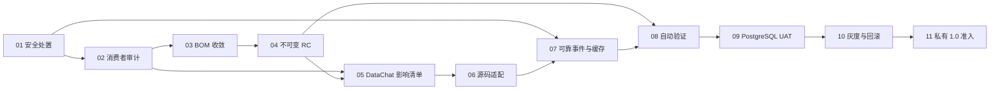

# FastDDD 1.0 业务系统升级执行步骤

> 版本：1.0
>
> 日期：2026-08-12
>
> 适用对象：FastDDD Framework 私有 1.0 与 DataChat 首个试点
>
> 主方案：[业务系统升级与试点实施方案](BUSINESS_SYSTEM_UPGRADE_PLAN.md)

## 使用规则

按编号顺序执行。一个步骤未满足完成定义，不进入下一个依赖步骤；每一步单独提交、验证、独立 review，并将证据回填主方案的业务系统登记表。本文是执行清单，不授权跳过安全处置、发布门禁或 UAT。

## 执行总览

## 01. 处置 DataChat 凭据风险（P0）

**目标**：关闭已发现的受跟踪配置凭据风险，建立不含有效默认值的配置方式。

**前置**：无。

**执行**：

1. 由每项凭据的系统所有者吊销并轮换；记录凭据类型、所有者、轮换时间与确认编号，不记录秘密内容。
2. 从受跟踪配置、示例、测试资源和部署描述中移除可用默认值，改为环境变量或受管密钥引用。
3. 提供可提交的无敏感 `.example` 配置和本地忽略的实际配置方式。
4. 扫描当前分支、Git 历史、CI/CD 输出、已发布制品及可访问日志；形成范围和处置记录。
5. 在 CI 加入阻断式密钥扫描，并验证构建日志脱敏。
6. 提供忽略的 `.env` 与可提交的 `.env.example`；应用明确加载本地 `.env`，并在文档中写明根目录/启动模块目录的加载规则。
7. 若旧 YAML 使用 `${ENV:旧默认值}`，迁移 `.env` 时只写最终值或已轮换的新值，禁止复制整个嵌套占位表达式。

**完成定义**：全部凭据已轮换且负责人确认生效；扫描无未处置有效凭据；CI 可阻断新增泄露；按文档启动时本地配置可被读取且不发生循环占位符解析。

**禁止**：把凭据原文复制进 issue、文档、测试、提交信息或终端输出；以“开发配置”作为不轮换理由。

## 02. 审计真实消费者与发布约束（P0）

**目标**：把“有多个业务系统引用 Framework”的事实转化为可决策的消费者清单。

**前置**：步骤 01 完成。

**执行**：

1. 列出每个业务系统、负责人、当前 Framework 坐标、部署状态、数据库/中间件、升级窗口和回滚负责人。
2. 标记 `DEVELOPMENT`、`TEST_UAT`、`PRODUCTION`、`RETIRED` 或 `UNKNOWN`，不得用推断替代确认。
3. 对每个生产系统确认是否调用已改变的 ID/CRUD/Security/Event API；不能立即迁移的系统登记支持边界。
4. 根据审计结果重新确认是否允许继续删除旧公共契约；存在生产消费者时采用兼容层或推迟删除。

**完成定义**：`fastddd-consumers.yaml` 与实际系统清单一致，DataChat 状态不再为 UNKNOWN；架构负责人确认破坏性变更策略。

## 03. 收敛 Framework BOM（P1）

**目标**：使 `fastddd-bom` 成为纯 Framework 运行时契约。

**前置**：步骤 02 完成。

**执行**：

1. 建立 Framework 仓库实际发布坐标 allowlist。
2. 从 Framework BOM 移除 Tooling、FastDoc、代码生成、Archetype 与 Maven Plugin 等独立产品坐标。
3. 在 Tooling 仓库提供独立的插件/构建期依赖说明和兼容矩阵。
4. 对 flatten 后、即将发布的 BOM POM 运行 allowlist 断言。
5. 在全新 Maven 本地仓库中构建最小消费者，检查运行时依赖树。

**完成定义**：发布 BOM 仅含 allowlist 中的 Framework 坐标；最小消费者不解析 Tooling/Studio 运行时制品。

## 04. 发布并复现不可变 Framework RC（P1）

**目标**：让业务试点消费可追溯、不可覆盖的候选制品。

**前置**：步骤 03 完成，Framework 内部测试通过。

**执行**：

1. 定义私服 repository/mirror ID、RC 禁止覆盖规则、保留期和访问角色。
2. 从固定 Framework 提交和 tag 构建 `1.0.0-jdk21-rc1`，生成 BOM 与所有模块的 SHA-256 清单。
3. 记录 JDK、Maven、构建命令、提交、tag、制品校验和与发布时间。
4. 在干净 Maven 本地仓库中只从私服下载制品，构建独立最小消费者和 DataChat。

**完成定义**：来源证明完整；重复下载校验一致；业务系统不依赖 Framework 工作目录或旧 `.m2`。

## 05. 生成 DataChat 影响清单（P1）

**目标**：将源码适配从“看到编译错误再修”转为可核对范围。

**前置**：步骤 02、03 完成。

**执行**：

1. 统计并逐文件登记裸 `BasePO`、`IService<T>`、`BaseServiceImpl<M,T>`、`BaseController<S,T>`。
2. 分别登记 Service `listByField`、Mapper `selectListByField` 与 `(Long) getId()` 的调用点，不合并计数。
3. 记录每个调用的实体 ID 类型、API 暴露方式、前端/外部调用方及替代策略。
4. 对每项标注“必须迁移”或“经复核保留”的理由和复核人。

**完成定义**：清单可由脚本复跑；所有计数有去向，且没有依赖原始泛型掩盖的未知项。

## 06. 适配 DataChat 强类型 ID 与 CRUD（P1）

**目标**：使 DataChat 以 Framework 1.0 的显式类型契约编译运行。

**前置**：步骤 04、05 完成。

**执行**：

1. 将 PO、Service、Service 实现和 Controller 统一补齐真实 ID 类型；DataChat 的数据库主键为 `Long` 时显式使用 `Long`。
2. 将字符串字段查询替换为 Lambda/Wrapper 查询或语义化仓储方法；分开处理 Service 与 Mapper 调用。
3. 保持 REST 路径、错误码、JWT 声明和前端 ID 表示的兼容性；变更必须有接口契约说明。
4. 每个模块完成后运行局部编译，最终运行全量 `mvn -B clean compile`。
5. 若需直接运行启动模块，先用全 Reactor `mvn -B install -DskipTests` 同步当前业务模块制品；不能在无主类的聚合 POM 上执行 `spring-boot:run`。

**完成定义**：影响清单全部关闭；全量 clean 编译通过；不引入 unchecked cast、raw type 或 Framework 兼容倒退。

## 07. 修复知识同步可靠性并确认缓存模型（P0/P1）

**目标**：防止事务提交后知识同步丢失，并验证实际缓存一致性。

**前置**：步骤 01、06 完成。

**执行**：

1. 为指标变更到知识/向量同步建立持久任务或 transactional outbox；定义稳定幂等键、状态、重试上限、死信和人工处置。
2. 增加定期对账与补偿，能发现并修复数据库状态与向量库状态的差异。
3. 验证事务回滚、提交后进程退出、外部服务超时、重复投递和恢复后的补偿。
4. 登记实际启用的 Caffeine/Redis、缓存名、TTL、失效来源、节点数与发布拓扑。
5. 按真实启用项验证双版本节点并存、跨节点失效和回滚后的旧值读取。

**完成定义**：失败不再被吞掉并永久丢失；所有异步工作可追踪和恢复；缓存行为与部署事实一致。

## 08. 建立自动验证与安全回归（P1）

**目标**：让升级结果可重复验证，而非依赖一次本地启动。

**前置**：步骤 04、06、07 完成。

**执行**：

1. 修复 Mockito/JDK 21 测试工具链，禁止永久跳过失败用例。
2. 将外部数据库、LLM 与凭据替换为受控测试配置、容器或替身；测试不得访问生产数据。
3. 执行 `mvn -B clean verify`，添加 Security SPI、JWT、CORS、WebSocket、项目权限、可靠事件与缓存回归。
4. 保存构建版本、依赖树、测试数、失败数和报告位置。
5. 固定 Surefire/Failsafe 版本；JDK 21 使用 Mockito inline 时配置显式 `-javaagent`，并确认动态 agent 挂载警告消失。
6. 将数据库依赖的 `*IT` / `*IntegrationTest` 放入 Failsafe profile；默认测试与集成测试的命名、启用条件和所需环境变量必须可审计。
7. 用实际忽略配置从规定目录启动启动模块，检查端口、`/actuator/health=UP` 和数据库健康项。HS512 JWT 在启动前校验密钥不少于 64 个 UTF-8 字节。

**完成定义**：全量 clean verify 通过；测试不泄露或消费真实凭据；关键升级风险有自动回归；启动与健康检查均有可复现证据。

## 09. 完成 PostgreSQL/pgvector UAT（P1）

**目标**：在与生产同类的基础设施上验证 DataChat 核心闭环。

**前置**：步骤 08 完成，测试/预生产 PostgreSQL + pgvector、缓存和受控 LLM 环境就绪。

**执行**：

1. 使用隔离或脱敏数据，验证认证、项目权限、数据源、数据集、指标、仪表盘、图表、知识库、聊天和 WebSocket。
2. 覆盖 ID、乐观锁、逻辑删除、事务回滚、知识同步宕机恢复、向量检索和 LLM 错误降级。
3. 若使用 RocketMQ，补充分布式消息验证；若未使用，登记“不适用”的代码与配置证据。
4. 记录缺陷、结论和不通过项，关闭后才进入发布演练。

**完成定义**：所有核心场景通过或有经业务负责人批准的限期豁免；不存在未解释的数据不一致。

## 10. 量化灰度、回滚与灾难恢复演练（P1）

**目标**：使上线决策可度量、可中止、可恢复。

**前置**：步骤 09 完成，已确认 DataChat 生产状态、发布窗口和回滚负责人。

**执行**：

1. 填写 `1% → 10% → 50% → 100%` 灰度梯度、每阶段最短观察时长、5xx/认证失败/延迟/事件失败/业务指标阈值和自动中止条件。
2. 定义 RTO、RPO、应用镜像回退、Framework 依赖回退、数据库前向兼容和备份恢复步骤。
3. 演练 WebSocket 连接排空、LLM 在途请求超时/取消、缓存双版本行为、未完成可靠事件的继续处理和对账补偿。
4. 形成发布单、指标面板链接、回滚演练记录与签字结论。

**完成定义**：能在预生产环境按阈值自动/人工中止并恢复；回滚后核心读写、认证和异步对账正常。

## 11. 评定 Framework 私有 1.0 准入

**目标**：根据证据而非计划状态决定是否发布私有 `1.0.0`。

**前置**：步骤 01 至 10 完成；所有已知消费者完成真实状态审计。

**执行**：

1. 汇总 Framework 内部门禁、BOM allowlist、RC 来源证明、DataChat 自动验证/UAT/灰度证据。
2. 复核所有 P0/P1：无未关闭安全事件、公共契约缺陷或数据完整性风险。
3. 对暂不升级的生产消费者登记版本支持期限和后续升级窗口。
4. 由 Framework、DataChat 业务和发布负责人共同作出 Go/No-Go 决策。

**完成定义**：Go 决策有完整证据链；否则保持 RC 并列出阻断项，不以时间或版本号强行转 GA。
