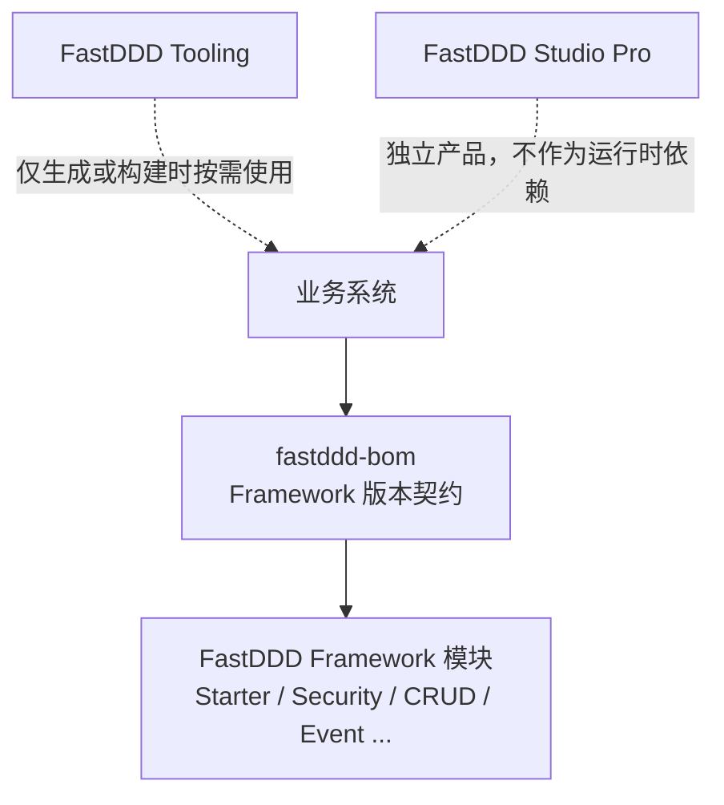

# FastDDD 1.0 业务系统升级与试点实施方案

> 版本：1.0
>
> 制定日期：2026-08-12
>
> Framework 候选基线：`1.0.0-jdk21-SNAPSHOT`，发布候选使用 `1.0.0-jdk21-rc1`
>
> 首个试点：DataChat（`D:\usr\workspace_2026\datachat_claude\datachat`）
>
> 关联文档：[Framework 1.0 整改方案](FASTDDD_1_0_FRAMEWORK_REMEDIATION_PLAN.md)、[ID 类型迁移清单](ID_TYPE_MIGRATION_CHECKLIST.md)、[升级指南](../UPGRADE_GUIDE.md)

## 1. 目标与发布结论

本方案定义现有业务系统从 FastDDD 开发快照迁移至 FastDDD 1.0 私有发布线的统一方法，并以 DataChat 验证该方法。它的目标不是让业务系统“换一个 Maven 版本后能编译”，而是在不改变业务语义和对外接口的前提下，完成可验证、可灰度、可回滚的升级。

结论如下：

1. 业务系统**只消费 Framework 发布的 `fastddd-bom` 与所需 `fast-ddd-*` 模块**；不依赖 Tooling 或 Studio Pro 的源码、聚合 POM 或内部实现。
2. `fastddd-bom` 是 Framework 仓库中的发布模块，而非第四个产品仓库；目标状态是只管理 Framework 运行时模块及经验证的第三方版本。当前 BOM 仍残留部分 Tooling 制品管理项，必须在首个 RC 前移除或拆分，不能把这一历史残留带入业务系统契约。
3. 拆分后的 Tooling 与 Studio Pro 独立发版、独立测试；除明确的生成/Studio 产品场景外，不进入业务系统运行时依赖图。
4. `1.0.0-jdk21-rc1` 是私有 Maven 仓库中的业务联调候选；至少一个复杂业务系统完成 UAT 与灰度稳定观察后，才可发布私有 `1.0.0`。开源公开发布不属于本方案的前置条件。

目标依赖关系：



## 2. 适用范围与非目标

### 2.1 适用范围

- 使用 `com.gallop.fastddd` 模块的 Java 业务系统。
- JDK 21、Spring Boot 3.5.x 的升级与运行验证。
- `BasePO<ID>`、`IService<T, ID>`、`BaseServiceImpl<M, T, ID>`、`BaseController<S, T, ID>`、`IdCodec`、Security SPI、事件和缓存等 Framework 公共契约的适配。
- 业务系统自身的数据库、接口、消息、第三方服务和发布回滚验证。

### 2.2 非目标

- 不把 Tooling 或 Studio Pro 合并回 Framework，也不将其加入 Framework BOM。
- 不为迁移方便在 Framework 1.0 新公共 API 中恢复原始泛型、弱类型 ID 或反射式 CRUD 兼容层。
- 第一轮升级不夹带领域重构、表结构大改、接口重设计或不可逆数据修复。
- 不因 Framework 公开开源延期而延后私有业务系统升级与私有 1.0 发布。

## 3. 统一升级原则

| 原则 | 要求 |
|---|---|
| 制品唯一来源 | 业务系统从私有 Maven 仓库获取与 Git 提交对应的候选制品；不得直接依赖 Framework 工作目录或本机残留 SNAPSHOT。 |
| BOM 优先 | `dependencyManagement` import `fastddd-bom`；所有 `fast-ddd-*` 依赖不写版本。 |
| 单一版本责任 | Framework 管理其模块和已验证的第三方版本。业务侧保留额外依赖时，必须明确其版本所有者，禁止无依据覆盖 Spring、Jackson、MyBatis 等平台版本。 |
| 业务侧适配 | Framework 的强类型 API 是 1.0 目标契约；业务系统补齐类型参数、替换废弃调用，不以降低 Framework 契约换取短期编译通过。 |
| 对外兼容 | 首轮原则上保持 REST 路径、请求/响应、错误码、JWT 声明、缓存键和消息载荷不变；确需变化必须版本化并经调用方确认。 |
| 数据可回退 | 未验证前不执行破坏性 DDL/DML。发布回滚以应用制品和 Framework 版本回退为主，数据库变更必须前向兼容。 |
| 真实依赖验证 | 不能以 H2 或 MySQL 代替生产使用的 PostgreSQL/pgvector；消息、缓存和外部服务可使用受控替身，但要注明覆盖边界。 |
| 密钥隔离 | 任何测试、文档、日志、提交和制品中不得包含真实密码、令牌、私钥或第三方 API 密钥。发现历史明文配置时须单列整改并轮换。 |

### 3.1 安全处置硬门禁（P0）

已发现 DataChat 的受 Git 跟踪开发配置含有非空外部服务凭据默认值。该问题不是“后续配置优化”，而是升级工作开始前必须关闭的安全事件。除只读盘点外，未满足下列全部条件时，禁止继续推送包含该配置的分支、发布 RC、连接 UAT 外部服务或灰度部署：

- [ ] 由凭据所有者立即吊销并轮换所有受影响凭据；不得在任务、评审记录或提交信息中记录凭据原文。
- [ ] 从受跟踪配置、示例、测试资源、构建参数和部署描述中移除可用默认值，改为运行时密钥注入；本地开发提供无敏感值的 `.example` 结构。
- [ ] 对当前分支、Git 历史、CI/CD 变量输出、制品和可访问日志进行密钥扫描，并登记发现范围、处置人和关闭证据。
- [ ] 在 CI 增加阻断式密钥扫描；确认构建日志不会回显环境变量或连接串中的敏感部分。
- [ ] 由安全/业务负责人书面确认轮换已生效；若无法确认历史访问范围，按安全事件流程扩大处置而不是以“开发环境”豁免。

### 3.2 Framework BOM 收敛前置项

物理拆仓后，Framework BOM 的边界必须与仓库边界一致。当前 `fastddd-bom` 源码中仍列有 Tooling 相关制品，这只说明拆分迁移尚有尾项，**不表示业务系统可以或应该消费这些制品**。在发布第一个业务 RC 前，Framework 团队必须完成：

- [ ] BOM 仅保留 `fastddd-framework` 仓库实际发布的 Framework 模块与受管第三方依赖。
- [ ] 移除 Tooling、FastDoc、代码生成和 Maven Plugin 等独立产品制品的 `dependencyManagement` 项。
- [ ] 在 `fastddd-tooling` 中建立独立的构建期依赖管理/兼容矩阵；业务系统仅在显式使用插件时按插件文档接入。
- [ ] 对**发布后的 BOM POM**做 Framework 坐标 allowlist 断言：每个 `com.gallop.fastddd` 制品均属于 Framework 仓库的发布清单；不能只依赖消费者 `dependency:tree`，因为 `dependencyManagement` 本身不会引入依赖。
- [ ] 用全新 Maven 本地仓库构建最小业务消费者，验证 import BOM 后 Framework 运行时依赖树中不存在 Tooling 或 Studio 制品。

在该收敛项完成前，DataChat 可继续使用当前 BOM 进行源码适配，但不得将其作为私有 RC/GA 的最终消费契约。

### 3.3 首个试点的可复用经验（DataChat，2026-08-13）

DataChat 已完成源码适配、默认单元测试、制品打包及本地启动健康检查。这些结果不能替代 RC 私服复现、PostgreSQL/pgvector UAT 与灰度，但已验证以下经验应成为后续消费者的标准门禁：

| 经验 | 标准做法 | 禁止做法 |
|---|---|---|
| 运行配置必须外置且可启动 | 受跟踪配置只保留 `${ENV_VAR}`；提交 `.env.example`，实际 `.env` 必须被忽略并由应用显式加载。 | 将可用密码、JWT、API Key 或私钥写回 `application-*.yml`，或以“开发测试”作为例外。 |
| 历史 YAML 不能直接复制成 `.env` | 对旧值形如 `${LLM_API_KEY:...}` 的配置，先识别嵌套占位符；`.env` 只放最终字面值或新轮换值。 | 把 `${变量:默认值}` 原样放入同名环境变量，导致循环占位符解析。 |
| JWT 是升级后的运行门禁 | 使用 HS512 时，启动前校验 `JWT_SECRET` 至少为 64 个 UTF-8 字节；本地可生成独立开发密钥。 | 复用长度不足的旧 JWT，或在失败后降低 Framework 的 HS512 校验。 |
| 启动命令与 Maven Reactor 必须匹配 | 先用 Reactor `install` 同步所有业务模块；再从包含主类的启动模块运行 `spring-boot:run`。 | 在无主类的聚合根执行 `spring-boot:run`，或单独启动模块却依赖过期的本地业务 JAR。 |
| 测试分层必须显式 | 默认 `clean test` 仅运行无共享环境依赖的测试；真实数据库测试使用 Failsafe profile，并显式注入测试环境变量。 | 将远端数据库凭据提交到 `application-test.yml`，或把集成测试静默当成单元测试通过。 |
| JDK 21 工具链也需治理 | 固定 Surefire/Failsafe 版本；Mockito inline 使用显式 `-javaagent`，并保留测试断言。 | 依赖动态 agent 挂载警告，或为使构建通过永久排除失败测试。 |
| 启动成功与可服务要分开证明 | 依次验证端口监听、`/actuator/health` 返回 `UP`、数据库健康项与关键 API；健康检查超时先诊断连接池/数据库，而非仅看 Tomcat 日志。 | 看到端口绑定或 `Started` 日志就宣称联调完成。 |

本地 `.env` 的加载路径与进程工作目录有关。业务项目必须在本地文档中明确“从根目录启动”或“从启动模块启动”的配置文件位置；若两种启动方式都支持，分别提供对应的可选加载路径并自动化验证。

## 4. 业务系统标准流程

每个业务系统创建独立升级分支和本系统的“升级登记表”，并按以下阶段推进。阶段间不得以“本地能启动”替代前一阶段的完成定义。

| 阶段 | 产出 | 完成定义 |
|---|---|---|
| P0：安全处置、登记与冻结 | 安全关闭证据、系统登记、负责人、环境矩阵、升级分支、升级前 tag/镜像 | §3.1 全部安全门禁关闭；已确认当前线上状态、回滚对象、数据库与外部依赖。 |
| P1：候选制品 | 私有 `rc` BOM、发布来源证明与依赖锁定记录 | Framework 提交/tag、BOM 版本、制品 SHA-256、私服仓库 ID 一一对应；RC 不可覆盖，业务构建不依赖未受控本地缓存。 |
| P2：编译适配 | 可审查的源码适配提交 | `clean compile` 通过；仅作 API/泛型/配置机械迁移，业务逻辑改动单独说明。 |
| P3：自动验证 | 单测、上下文、集成测试报告 | `clean verify` 通过；失败测试不得跳过或降断言绕过。 |
| P4：UAT | 验收用例、结果、缺陷清单 | 在与生产同类的数据库/关键中间件组合上完成核心业务验收。 |
| P5：灰度与回滚演练 | 发布单、指标面板、回滚记录 | 已成功演练回滚；灰度指标达到门槛后才扩大流量。 |
| P6：复盘与准入 | 迁移报告、共性问题清单 | 共性问题回写本方案/Framework 文档；作为 Framework 私有 GA 准入证据。 |

### 4.1 P0：登记与冻结

升级负责人必须在开始编码前确认：

- 该系统的生产状态（`DEVELOPMENT`、`TEST_UAT`、`PRODUCTION` 等）、业务负责人和发布窗口。
- 当前应用版本、当前 FastDDD 坐标、目标 RC 坐标、JDK、Spring Boot、数据库、Redis、消息和外部服务版本。
- 升级前可回退的 Git tag、应用镜像和数据库备份/恢复责任人。
- 对外 REST、异步消息、前端和其他服务调用的关键契约清单。
- §3.1 的安全事件关闭证据。仅有“轮换计划”不满足 P0；必须完成吊销、移除、扫描和负责人确认。

### 4.2 P1：候选制品与 Maven 接入

候选版必须先从 `fastddd-framework` 的受控提交构建、测试并发布至私有 Maven 仓库；业务系统随后只按坐标解析该制品。发布 runbook 至少记录唯一私服 repository/mirror ID、不可覆盖的 RC 规则、Framework 提交与 tag、构建环境、BOM/模块 SHA-256、制品保留期和发布后重新下载校验结果。建议业务项目保留如下最小接入形态：

```xml
<dependencyManagement>
  <dependencies>
    <dependency>
      <groupId>com.gallop.fastddd</groupId>
      <artifactId>fastddd-bom</artifactId>
      <version>1.0.0-jdk21-rc1</version>
      <type>pom</type>
      <scope>import</scope>
    </dependency>
  </dependencies>
</dependencyManagement>

<dependencies>
  <dependency>
    <groupId>com.gallop.fastddd</groupId>
    <artifactId>fast-ddd-starter</artifactId>
  </dependency>
</dependencies>
```

规则：

1. 只声明实际使用的 Framework 模块，例如 Security、Event、Cache；不因 BOM 存在而引入全部 starter。
2. 业务项目可以使用 Spring Boot parent，也可以自行管理 parent；但不得在不说明原因的情况下与 Framework BOM 竞争管理相同平台依赖。
3. `SNAPSHOT` 仅允许在 Framework 开发联调期间使用。进入 UAT 后必须切换固定且不可覆盖的 `rc` 字面量；由全新 Maven 本地仓库从私服重新解析并构建一次，不能以工作目录或原有 `.m2` 缓存证明可复现性。
4. Tooling 的 Maven Plugin 属构建时工具，需要时在 `pluginManagement` 中显式引入；它不等于业务应用运行时依赖。

### 4.3 P2：源码与配置适配

下列改动属于 Framework 1.0 强类型迁移的正常业务侧工作：

| 旧形态 | 目标形态 | 处理要求 |
|---|---|---|
| `extends BasePO` | `extends BasePO<Long>`、`BasePO<String>` 或 `BasePO<UUID>` | 根据真实数据库主键类型确定；禁止使用原始类型掩盖编译错误。 |
| `IService<T>` | `IService<T, ID>` | 服务接口、实现、调用点完整传播同一 `ID`。 |
| `BaseServiceImpl<M, T>` | `BaseServiceImpl<M, T, ID>` | Mapper、实体和 ID 类型一致；不使用 unchecked cast。 |
| `BaseController<S, T>` | `BaseController<S, T, ID>` | URL ID 解析使用目标 `ID`；Hashid/值对象使用明确 `IdCodec`。 |
| `listByField("field", value)` | Lambda/Wrapper 查询或语义化仓储方法 | 优先属性引用，避免字符串字段名在重构后静默失效。 |
| 旧 Security/事件扩展 | 当前 SPI 与明确配置 | 回归认证、授权、审计、事务提交后事件和失败路径。 |

不自动执行数据库主键类型迁移。若业务表原本为 `BIGINT`/`Long`，大多数改动只是 Java 泛型和接口契约收紧；若真实 ID 是 UUID、字符串业务键或值对象，必须在登记表中说明转换策略和接口表示。

### 4.4 P3：验证门禁

每个系统至少执行以下门禁，并保留命令、版本和结果：

1. `mvn -B clean compile`：消除旧 target 与本地缓存掩盖的编译问题。
2. `mvn -B clean verify`：单元测试、模块测试和质量门禁。
3. Spring 上下文启动测试：验证自动配置、Mapper 扫描、Security SPI 和配置绑定。
4. 数据库集成测试：使用同类数据库与关键扩展；验证 CRUD、事务、乐观锁、逻辑删除和 ID 往返。
5. API 契约回归：覆盖认证、权限、关键查询/写入、异常响应和 WebSocket（如使用）。
6. 事件与缓存验证：覆盖提交后事件、幂等/失败处理、缓存读写与失效；跨进程外部副作用必须有可恢复的持久投递/任务记录，不接受仅记录日志后吞掉异常。
7. 依赖树审查：确认不存在两套 Framework 版本或未经批准的平台版本覆盖。
8. 本地启动验证：从文档规定的工作目录加载实际忽略配置，依次验证端口、`/actuator/health=UP`、数据库健康项；不得只凭应用未退出判断成功。

若 JDK 21 下出现 Mockito/Byte Buddy 等测试工具链失败，须定位为测试基础设施问题并修复；不得将失败测试永久排除，或把“跳过测试的打包成功”作为升级完成证据。

### 4.5 P4/P5：UAT、灰度和回滚

UAT 环境必须使用脱敏或隔离数据，且与生产保持同类的数据库与关键扩展。进入灰度前应完成一次回滚演练，并在发布单中预先填写数值门槛，而非上线时临时判断：

- 回滚应用镜像/制品至升级前版本，并确认上一版 FastDDD 制品可解析。
- 验证已处理请求、异步任务和缓存不会因版本回退损坏。
- 首轮不引入不可逆 schema/data migration；如不可避免，先交付前向兼容数据库方案和单独恢复演练。
- 预设观察项：启动失败、认证失败率、5xx、核心接口延迟、数据库连接池、事件积压/失败、缓存错误和业务关键指标。
- 预设灰度梯度（建议 `1% → 10% → 50% → 100%`）、每阶段最短观察时长、扩容准入阈值和自动中止/回退阈值；具体数值由业务负责人基于当前基线填写。
- 明确 RTO、RPO、WebSocket 连接排空策略、LLM 在途请求的超时/取消策略，以及提交后异步任务在回滚后的补偿和对账责任。

灰度扩大由业务负责人和技术负责人共同确认，不以“没有报错日志”作为唯一条件。

## 5. DataChat 首个试点方案（UPG-DC-001）

### 5.1 当前核实基线

| 项 | 当前状态 |
|---|---|
| 仓库/分支 | `D:\usr\workspace_2026\datachat_claude\datachat`，`upgrade/jdk21-boot3.5.16` |
| 应用基线 | Java 21、Spring Boot 3.5.16、11 个后端 Maven 模块 |
| Framework 接入 | 根 POM 已 import `fastddd-bom`，当前指向 `1.0.0-jdk21-SNAPSHOT` |
| 主要 Framework 能力 | Starter、CRUD、Security、Application、Event、Cache，以及统一响应封装 |
| 数据与外部依赖 | PostgreSQL/pgvector、Redis、动态数据源、LLM/知识处理、WebSocket；部分场景还涉及多种业务数据源 |
| 已发现风险 | 主代码仍有旧 CRUD 泛型和旧查询调用；测试存在 JDK 21 下的 Mockito 类改写失败；已发现受跟踪配置凭据风险与提交后知识同步的可靠性风险 |

DataChat 已覆盖 Framework 的 CRUD、安全、事件、缓存和 AI 周边能力，适合作为首个“复杂消费者”试点；但它不是只改 POM 的低风险示例，必须按本方案完整验证。

### 5.2 DataChat 适配工作包

| 工作包 | 范围 | 验收 |
|---|---|---|
| DC-00：凭据安全处置 | 完成 §3.1 的吊销、轮换、外置、扫描和 CI 阻断；建立无敏感默认值的本地开发配置 | 安全负责人确认关闭；任何后续分支、制品、日志扫描均无有效凭据。 |
| DC-01：BOM 与候选制品锁定 | 完成 Framework BOM 收敛后，将联调分支从浮动 SNAPSHOT 切至固定、不可覆盖的 `1.0.0-jdk21-rc1`，记录私服来源证明 | 全新 Maven 本地仓库从私服重复解析和构建；发布 BOM allowlist 与运行时依赖树均无 Tooling/Studio 制品。 |
| DC-02：ID/CRUD 影响清单与编译适配 | 先生成可复核的逐文件清单：`BasePO` raw type、`IService<T>`、`BaseServiceImpl<M,T>`、`BaseController<S,T>`、Service `listByField`、Mapper `selectListByField` 和 `(Long) getId()`；再完成 `Long` 泛型和查询适配 | 每个计数归零，或逐项记录保留依据与复核人；`clean compile` 通过，零 raw type/unchecked 临时绕过。 |
| DC-03：接口兼容 | 核对项目、数据源、数据集、指标、知识库、图表、聊天、仪表盘、地图与管理 API 的路径、ID 表示、错误码 | 关键前端/API 回归用例通过；数值主键若对外按字符串传输，保持原协议。 |
| DC-04：安全与实时链路 | `SecurityIdentityService`、`SecurityPermissionService`、JWT、CORS、未授权、项目成员权限、WebSocket 鉴权 | 正常/拒绝/过期令牌路径均有自动或 UAT 用例。 |
| DC-05：可靠事件与知识链路 | 将指标变更后的知识同步从“事务后直接调用”改为可恢复的持久投递/任务：稳定幂等键、有限重试、死信、告警、人工处置与定期对账补偿 | 验证成功、事务回滚、提交后进程退出、外部服务超时/失败、重复投递和服务恢复后的补偿；数据库与向量库可恢复一致。 |
| DC-06：缓存真实状态与测试基础设施 | 登记实际 `CacheManager`、缓存名、TTL、失效源、部署副本数和 Redis 启用状态；修复 Mockito/JDK 21 兼容问题，配置与真实密钥解耦 | `clean verify` 通过；分别验证 Caffeine/Redis（按实际启用项）、双版本节点并存、节点间失效和回滚后的旧值读取。 |
| DC-07：PostgreSQL UAT | PostgreSQL + pgvector、实际缓存形态、受控 LLM/替身环境执行核心场景 | 形成 UAT 报告和缺陷闭环；包含可靠事件的宕机/恢复与数据对账用例。 |
| DC-08：量化发布演练 | 预生产灰度、指标、应用回退、连接排空、缓存与事件补偿检查 | 固化并演练流量梯度、观察时长、SLO、自动中止阈值、RTO/RPO 和回滚后的异步对账。 |

### 5.3 DataChat 的明确技术决策

1. **不以本地 MySQL 替代 PostgreSQL/pgvector 验收。**MySQL 可用于 Framework 通用能力验证；DataChat 的上线准入须在 PostgreSQL 和 pgvector 上完成。
2. **先确认缓存事实，再决定 Redis 验收。**必须登记实际启用的 Caffeine/Redis 缓存、缓存名、TTL、失效机制和节点数量；若 Redis 未启用，不能把本地 Redis smoke 当作业务缓存验收。若多实例使用 Caffeine，必须验证滚动发布与节点间旧值风险。
3. **RocketMQ 当前不阻断 DataChat 首轮。**若 DataChat 本次仅使用进程内 Spring 事务事件，可标记 RocketMQ 链路为“不适用”；若切换为分布式事件模式，则新增独立消息 UAT 后才能上线。
4. **LLM 必须使用受控配置。**单元/集成测试使用 stub/mock 或专门测试模型；UAT 使用可追踪的测试账号，避免真实业务数据外泄。
5. **先适配业务代码，不反向放宽 Framework。**DataChat 的 `Long` 主键模型应显式传播至 PO、Service 和 Controller；不要恢复 Framework 的原始泛型签名。
6. **先关闭安全事件。**必须满足 §3.1，包含立即吊销、轮换、移除、历史/制品/日志扫描和 CI 阻断；“只在开发环境使用”不能作为例外。

### 5.4 DataChat 验收场景

| 类别 | 最小必测场景 |
|---|---|
| 构建 | 全模块 `clean compile`、`clean verify`、依赖树只有一个目标 Framework 版本。 |
| 身份与权限 | 登录、刷新/失效令牌、未授权访问、跨项目访问拒绝、角色/成员权限变化。 |
| CRUD/ID | 创建、查询、更新、删除/逻辑删除、分页、乐观锁冲突；前后端 Long ID 表示保持兼容。 |
| 数据分析 | 数据源连接/失败、数据集、指标、仪表盘与图表核心读写。 |
| 知识与聊天 | 指标变更提交后知识同步、向量检索、聊天请求、LLM 超时/错误降级。 |
| 缓存和事件 | 按真实启用的 Caffeine/Redis 验证缓存命中/失效、双版本节点和回滚旧值；验证事务提交、回滚、提交后宕机、外部失败、重试/死信和对账补偿。 |
| 运行 | 应用启动、健康检查、关键日志无配置绑定/自动装配错误。 |
| 回滚 | 升级后回退到上一应用制品，核心读写、登录和缓存恢复正常。 |

### 5.5 DataChat 到 Framework 1.0 的准入关系

DataChat 通过 P3 仅说明“候选制品可以编译和自动验证”；通过 P4 才能作为内部 RC 的有效消费者证据；完成 P5 的稳定观察后，才可计入私有 Framework `1.0.0` 的业务准入。任何阶段发现公共 API 缺陷时，应先在 Framework RC 分支修复、重发新的 RC，并由 DataChat 重新验证；不得将未验证修复直接带入 GA。

## 6. 版本、仓库与发布协作

| 产品仓库 | 业务系统关系 | 版本策略 |
|---|---|---|
| `fastddd-framework` | 唯一运行时框架来源；包含 `fastddd-bom` | Framework RC/GA 的 BOM 与模块版本一致。 |
| `fastddd-tooling` | 可选构建/生成工具，不是业务运行依赖 | 独立版本；仅在业务项目显式使用插件时建立构建期兼容约束。 |
| `fastddd-studio-pro` | 独立产品应用，可作为 Framework 消费者 | 独立版本，不进入业务系统依赖树。 |

发布顺序：

1. Framework 在私有仓库发布固定 RC（含 BOM）。
2. DataChat 等试点业务系统从私服解析 RC，完成 P2～P5。
3. 复盘公共契约问题；如有变更，发布新的 RC 并重复受影响系统验证。
4. 所有已登记的目标业务系统满足准入后，发布私有 Framework `1.0.0`。
5. Tooling 与 Studio Pro 依其自身兼容矩阵另行发布；Framework 公开开源准备另行推进。

## 7. Framework 私有 1.0 的业务准入门槛

私有 `1.0.0` 发布前，必须同时满足：

- [ ] `fastddd-framework` 的 Framework 内部门禁、独立消费者测试和候选制品验证通过。
- [ ] DataChat 已完成本方案 DC-00 至 DC-08，且保留结果链接/报告。
- [ ] 所有已知业务消费者已登记真实生产状态；`PRODUCTION` 或 `UNKNOWN` 消费者不能只用推断代替决策。
- [ ] 每个生产消费者已有升级计划、负责人、发布窗口和回滚方案；暂不升级者明确继续使用的版本和支持边界。
- [ ] Framework RC 没有未关闭的 P0/P1 公共契约、安全或数据完整性缺陷。
- [ ] 已满足 §3.1：业务系统使用的密钥、密码和私钥已从源码/文档/构建日志中隔离；对已暴露项完成吊销、轮换、范围扫描与关闭确认。
- [ ] 每个 RC 都具备私服来源证明、不可覆盖策略、SHA-256 清单，并在全新 Maven 本地仓库完成消费者复现。
- [ ] DataChat 的知识同步具备持久化恢复、幂等、死信和对账补偿，且已完成宕机/恢复验证。
- [ ] 发布单已填写并演练灰度梯度、观察期、SLO、中止阈值、RTO/RPO、连接排空与异步补偿。

## 8. 每个业务系统的升级登记模板

复制下表至业务仓库 `docs/architecture/fastddd-1.0-upgrade.md`，并在每个阶段完成后填写实际证据。

| 项 | 内容 |
|---|---|
| 系统/负责人/生产状态 |  |
| 升级分支/升级前 tag 或镜像 |  |
| 当前与目标 Framework 坐标 |  |
| Framework 提交与私服制品校验信息 |  |
| JDK/Boot/数据库/中间件/外部服务 |  |
| 使用的 Framework 模块与 SPI |  |
| API/消息/数据迁移影响 |  |
| P2 编译适配提交与 `clean compile` 结果 |  |
| P3 `clean verify` 与集成测试结果 |  |
| P4 UAT 环境、用例与结论 |  |
| P5 灰度指标、观察期与回滚演练 |  |
| 遗留风险、豁免项与到期日 |  |
| 是否计入 Framework 1.0 准入 |  |

## 9. 未决项与下一步

DataChat 必须严格按 DC-00 → DC-08 执行：先关闭安全事件（DC-00），再完成 BOM/不可变 RC（DC-01），之后才开始影响清单与源码适配（DC-02）。进入 DataChat UAT 前，需由业务方确认以下事实并写入登记表：

1. DataChat 当前是否已有生产部署，以及允许的灰度窗口和回滚负责人。
2. PostgreSQL/pgvector 的测试或预生产环境、数据脱敏方式和备份恢复责任人。
3. DataChat 实际事件模式是否需要 RocketMQ；如不需要，应明确其为本轮不适用项。
4. LLM、WebSocket 和外部数据源的测试账号/替身策略。
5. 发现的敏感配置的轮换完成时间和密钥托管位置。

确认后，按 DC-00 开始实施；每个工作包单独提交、验证、review，并将实际问题回写到本方案和业务系统登记表。
