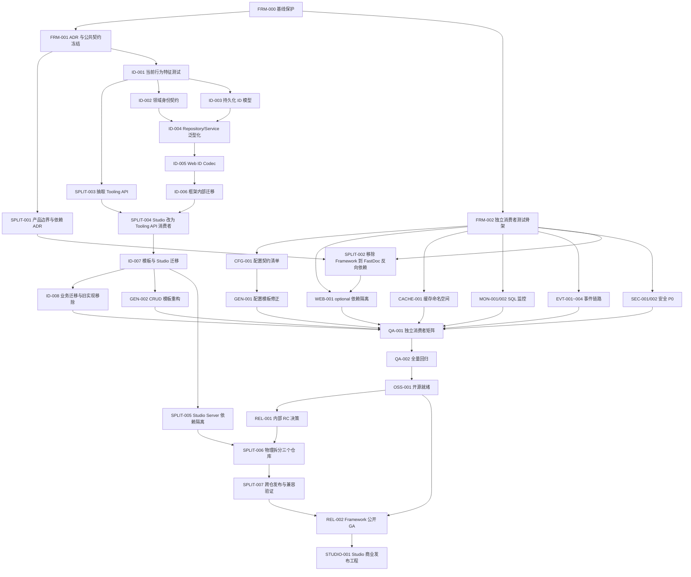

# FastDDD 1.0 基础框架架构整改实施方案

> 版本：1.3
>
> 制定日期：2026-08-11
>
> 代码基线：`upgrade/jdk21-boot3.5.16`，HEAD `740da39`
>
> 技术基线：JDK 21、Spring Boot 3.5.16、Spring AI 1.1.x
>
> 输入依据：[框架消费者体验与架构审计报告](../FASTDDD_FRAMEWORK_ARCHITECTURE_AUDIT.md)
>
> 执行对象：Claude Code、Codex 或其他具备仓库读写和测试能力的编码 Agent
>
> 项目属性：中长期分阶段架构整改与产品拆分项目，不是普通的 GA 前清理清单；固定工作量之外还包含开放式业务迁移工时

## 1. 文档定位

审计报告回答“框架有什么问题、风险多大、建议往哪里演进”；本实施方案回答：

1. 先改什么、后改什么。
2. 哪些工作可以并行，哪些必须串行。
3. 每个任务修改哪些模块和文件。
4. 每个任务如何测试和验收。
5. 哪些任务分别阻断 Framework 内部 RC、Framework 公开 GA 和 Studio 商业发布。
6. 如何把 ID 类型系统重构纳入整体整改，而不造成模板和业务系统重复迁移。
7. 如何在单仓库中先完成逻辑解耦，再在 Framework RC 后拆分 Studio 与 Tooling。

本方案不重复 JDK 21 与 Boot 3.5.16 升级工作。既有升级过程见 [JDK21_SPRING_BOOT_3_5_UPGRADE_PLAN.md](JDK21_SPRING_BOOT_3_5_UPGRADE_PLAN.md)。

## 2. Claude Code 执行入口

执行时必须遵守：

1. 从 `FRM-000` 开始，一次只执行一个任务。
2. 每次开始前读取本方案中的任务目标、依赖、禁止项和完成定义。
3. 检查 Git 分支、HEAD 和工作树，保护用户已有修改。
4. Maven 必须运行在 JDK 21；本机已验证路径为 `D:\usr\local\jdk\jdk-21.0.3`。
5. 不以“编译通过”代替验收；自动配置任务必须验证上下文，基础设施任务必须验证真实行为。
6. 高风险任务完成后必须做独立代码 review：ID、Security、Outbox、SQL 监控、默认凭据。
7. 每个任务只提交自身范围，不把无关格式化、依赖升级或重构混入。
8. 任务完成后记录：修改文件、验证命令、测试结果、遗留风险和提交号。
9. 未达到完成定义不得标记完成。
10. 如果实现与本方案的架构基线冲突，先停止实现并修订方案，不在代码中自行发明第三种设计。

推荐闭环：

    读取任务
      → 检查依赖
      → 标记进行中
      → 添加失败测试或消费者复现
      → 实现最小修复
      → 局部测试
      → 模块测试
      → 独立消费者验证
      → 代码 review
      → 修复 review 问题
      → 更新执行记录
      → 标记完成

## 3. 架构基线

### 3.1 本轮必须解决

- 审计报告中的 7 个 P0。
- ID 类型系统、BaseEntity、BasePO、CRUD 与 Controller 的架构重构。
- 会在 GA 后形成公共 API 锁定的高风险 P1。
- 独立消费者、生成项目和真实基础设施验证门禁。
- Framework 产品内版本单一来源，以及 Tooling/Studio 的机器可读兼容矩阵。
- Framework、Tooling、Studio 的单向依赖、独立版本和商业交付边界。

### 3.2 本轮明确不做

- 升级到 Spring Boot 4 或 Spring Framework 7。
- 引入完整 OAuth2 Authorization Server、OIDC、SAML 或多租户平台。
- 在 1.0 中引入 disabled、resource-server、auth-server 三模式以及 RSA/JWK 完整能力；这些安全模式演进推迟到 1.1。
- 为尚未发布的错误 SNAPSHOT 配置建立长期兼容层。
- 在没有业务需求的情况下新增消息中间件或搜索后端。
- 以大规模包重命名替代自动配置边界修复。
- 在 1.0 GA 前强行启用没有稳定 GA 基线的二进制比较门禁。

### 3.3 ID 架构决策基线

ID 改造遵循以下约束：

1. 领域模型只定义身份契约，不依赖 MyBatis 注解。
2. 贫血 CRUD 的具体 PO 显式声明 ID 类型与生成策略。
3. 充血模型允许使用 OrderId 等强类型值对象，PO 仍使用数据库友好的 Long、String 或 UUID。
4. 不再以 Serializable 作为全链路 ID 类型。
5. 不允许子类重新声明父类 id 进行字段隐藏。
6. Controller 根据明确的 IdCodec 或真实类型转换 ID，不根据 MyBatis IdType 猜测 Java 类型。
7. 雪花 Long 在 API DTO 中显式输出 String，不全局修改所有 Long 的 Jackson 行为。
8. 领域实体 ID 在创建时确定，避免 equals/hashCode 随持久化状态变化。
9. 审计字段、逻辑删除和乐观锁属于持久化能力，不强迫所有领域实体继承。
10. 生成器负责消除具体 PO 重复声明 ID 的样板成本。

### 3.4 自动配置基线

所有自动配置必须满足：

- ConditionalOnClass 控制依赖边界。
- ConditionalOnProperty 或模式枚举控制功能边界。
- ConditionalOnMissingBean 对消费者实现退让。
- 禁止通过宽泛 ComponentScan 装配整个模块。
- 禁止占用通用 `taskExecutor`、`cacheManager` 等 Bean 名称。
- 关闭开关必须关闭完整 Bean 图。
- 缺少关键依赖时 fail-fast，并提供可执行错误信息。
- 必须在独立消费者 classpath 验证 optional 依赖。

### 3.5 模块拆分与商业产品边界

模块拆分遵循“先逻辑解耦、后物理拆仓”：

1. Framework 是最底层稳定产品，不得依赖 Tooling 或 Studio。
2. Tooling 只能依赖 Framework 的公开 API 与 BOM，不得依赖 Studio。
3. Studio 是 Framework 与 Tooling 的普通消费者，不继承 Framework 根 POM。
4. FastDoc Controller 和自动配置从 Framework Web 移入 Tooling/FastDoc Starter。
5. Studio 只依赖稳定的 Tooling API，不直接导入 Generator 内部实现。
6. 逻辑解耦在当前仓库内完成并通过 reactor 测试。
7. Framework 进入 RC 后再执行物理拆仓，避免整改期间跨仓 SNAPSHOT 协调。
8. 物理拆仓保持已有 Maven groupId 和 artifactId，避免消费者再次迁移坐标。
9. Framework、Tooling、Studio 使用独立版本和发布流水线。
10. 物理拆仓与跨仓构建不阻断 Framework 内部 RC，但同时阻断 Framework 公开 GA 和 Studio 付费试点。

目标依赖方向：

    Studio Pro
        ↓
    Tooling API / Generator Engine
        ↓
    Framework / BOM

### 3.6 开源与公开发布边界

Framework 开源不是物理拆仓的副产品，而是一条独立的产品、法律、安全和供应链工作流：

1. Framework 计划采用 Apache-2.0 时，必须先由代码权利人确认版权归属、第三方代码来源和最终许可证选择；本方案不能替代法律意见。
2. Tooling 与 Studio 的源码开放范围、商业授权和商标策略由 SPLIT-001 单独决策，不因 Framework 开源自动采用相同许可证。
3. `1.0.0-RC1` 只发布到私有源码仓库和内部 Maven 仓库，不公开 Git 仓库、RC Tag、制品下载或面向外部的坐标说明。
4. 公共 API 在内部 RC1 前冻结；RC 后如需破坏性调整，必须重新发布 RC2，不得直接在 GA 中修改。
5. Framework 只有在物理拆仓、OSS-001、跨仓验证和 REL-002 全部通过后才能公开仓库并发布 1.0.0 GA。
6. 公开仓库和发布包不得包含 Studio Pro 私有源码、商业许可证实现、客户信息、密钥或仅供内部使用的部署资料。
7. 开源发布必须同时覆盖源码分发与二进制分发的 LICENSE、NOTICE、第三方许可证、SBOM、签名和安全披露入口。

## 4. 里程碑与依赖

### 4.1 里程碑

| 里程碑 | 目标 | Framework 内部 RC | Framework 公开 GA | Studio 商业发布 |
|---|---|---|---|---|
| M0 | 基线保护、ADR、产品边界和消费者测试骨架 | 是 | 是 | 是 |
| M1 | 关闭确定性 P0，消除 Framework 反向依赖 | 是 | 是 | 是 |
| M2 | 完成 ID 类型系统、Tooling API 和 Studio 消费者化 | 是（破坏性 ID 迁移受状态门禁约束） | 是 | 是 |
| M3 | 收敛公共契约，准备 Studio Server 依赖隔离 | 是（不含 SPLIT-005） | 是 | 是 |
| M4 | 生成项目、业务消费者、开源就绪和内部 RC 验收 | 是 | 是 | 是 |
| M5 | 物理拆仓、跨仓验证、Framework 公开 GA 与 Studio 商业交付 | 否 | 是 | 是 |

三套门禁必须分别记录，不能再用一个“Framework GA”字段混合表示：

- Framework 内部 RC：只验证框架公共契约和已知消费者，制品与源码保持私有。
- Framework 公开 GA：在内部 RC 稳定后，还必须完成物理拆仓、开源就绪最终核验和公开发布。
- Studio 商业发布：在 Framework 公开 GA 基础上，额外完成 UI、部署包、商业许可证和客户试点验证。

M2 中的 Tooling API、Studio 消费者化和 Framework 逻辑解耦始终是内部 RC 和公开 GA 门禁。破坏性 ID 替换是否必须在 RC1 前完成，由 FRM-001 的消费者生产状态关卡决定：

- 所有有效消费者均为 `DEVELOPMENT` 或 `TEST_UAT`，且负责人承诺在 RC1 前同步迁移：ID-002～ID-008 继续作为内部 RC 门禁。
- 存在 `PRODUCTION` 或 `UNKNOWN` 消费者：不得直接删除旧契约，必须增加隔离的兼容适配与弃用计划，或者将破坏性删除延后到 1.1。
- `RETIRED` 消费者不阻断 RC 或 GA，但必须记录下线证据。

### 4.2 主依赖图



### 4.3 并行原则

可与 ID 重构并行：

- Web optional 依赖隔离。
- 缓存命名空间修复。
- SQL 监控修复。
- Event/Outbox 重构。
- 默认管理员移除。
- JWT 关闭语义。
- 配置前缀与未知配置清理。
- Framework 到 FastDoc 的反向依赖移除。

必须等待 ID 方案稳定：

- CRUD Service 和 Controller 公共泛型签名。
- 贫血/充血模型生成模板。
- Studio 的 ID 选项。
- BaseController 迁移。
- ID 文档、OpenAPI 类型和业务消费者迁移。
- Tooling API 的 ID 策略契约。
- Studio 对 Generator 内部类的替换。

物理拆仓必须等待：

- Framework 1.0 公共 API 和 Tooling API 冻结。
- P0、ID 和内部 RC 必做 P1 全部通过。
- QA-002 全量回归完成并形成 Framework RC。
- SPLIT-005 已使 Studio Server 脱离 Framework 根 parent 和源码 classpath。
- OSS-001 已形成可在拆仓后重放的开源就绪清单。

## 5. 一级任务总表

| ID | 任务 | 里程碑 | 依赖 | 内部 RC | Framework 公开 GA | Studio 商业发布 |
|---|---|---|---|---|---|---|
| FRM-000 | 基线保护与整改分支确认 | M0 | 无 | 是 | 是 | 是 |
| FRM-001 | 架构 ADR 与公共契约冻结 | M0 | FRM-000 | 是 | 是 | 是 |
| FRM-002 | 独立消费者测试骨架 | M0 | FRM-000 | 是 | 是 | 是 |
| SPLIT-001 | 产品边界、依赖方向、版本与许可证 ADR | M0 | FRM-001 | 是 | 是 | 是 |
| CFG-001 | 配置契约清单与 metadata 校验 | M1 | FRM-001、002 | 是 | 是 | 是 |
| CFG-002 | 生成配置模板修复 | M1 | CFG-001 | 是 | 是 | 是 |
| SPLIT-002 | 移除 Framework 对 FastDoc 的反向依赖 | M1 | SPLIT-001、FRM-002 | 是 | 是 | 是 |
| WEB-001 | Web optional application 隔离 | M1 | FRM-002、SPLIT-002 | 是 | 是 | 是 |
| CACHE-001 | L1 缓存命名空间隔离 | M1 | FRM-002 | 是 | 是 | 是 |
| MON-001 | SQL 监控属性 Bean 修复 | M1 | FRM-002 | 是 | 是 | 是 |
| MON-002 | SQL 监控真实链路闭环 | M1 | MON-001 | 是 | 是 | 是 |
| EVT-001 | 本地事件与 Outbox 装配边界 | M1 | FRM-001、002 | 是 | 是 | 是 |
| EVT-002 | Outbox Repository 与 Mapper 修复 | M1 | EVT-001 | 是 | 是 | 是 |
| EVT-003 | Dispatcher 与 Transport 契约 | M1 | EVT-002 | 是 | 是 | 是 |
| EVT-004 | Outbox 多实例可靠性验证 | M1 | EVT-003 | 是 | 是 | 是 |
| SEC-001 | 移除默认管理员与固定凭据 | M1 | FRM-002 | 是 | 是 | 是 |
| SEC-002 | JWT disabled 完整关闭与安全默认值 | M1 | FRM-001、002 | 是 | 是 | 是 |
| ID-001 | ID 当前行为特征测试与迁移清单 | M2 | FRM-001、002 | 是 | 是 | 是 |
| SPLIT-003 | 抽取稳定 Tooling API | M2 | SPLIT-001、ID-001 | 是 | 是 | 是 |
| ID-002 | 领域身份契约与相等性重构 | M2 | ID-001 | 是（条件） | 是 | 是 |
| ID-003 | PO 显式 ID 与审计模型重构 | M2 | ID-001 | 是（条件） | 是 | 是 |
| ID-004 | Repository/Service ID 泛型化 | M2 | ID-002、003 | 是（条件） | 是 | 是 |
| ID-005 | IdCodec 与 Controller ID 转换 | M2 | ID-004 | 是（条件） | 是 | 是 |
| ID-006 | 框架内部模块和示例迁移 | M2 | ID-005 | 是（条件） | 是 | 是 |
| SPLIT-004 | Studio 改为 Tooling API 消费者 | M2 | SPLIT-003、ID-006 | 是 | 是 | 是 |
| ID-007 | 模板、插件、Archetype、Studio 迁移 | M2 | ID-006、SPLIT-004 | 是（条件） | 是 | 是 |
| ID-008 | 在研业务迁移与旧 ID 实现移除 | M2 | ID-007 | 是（条件） | 是 | 是 |
| SEC-003 | 安全 Bean 退让、白名单和 CORS | M3 | SEC-002 | 是 | 是 | 是 |
| WEB-002 | 响应包装与 Jackson 显式启用 | M3 | WEB-001 | 是 | 是 | 是 |
| CACHE-002 | CacheManager 退让和组合 | M3 | CACHE-001 | 是 | 是 | 是 |
| SEARCH-001 | 搜索后端缺失时可诊断 | M3 | FRM-002 | 是 | 是 | 是 |
| GEN-001 | 数据源和 profile 模板修复 | M3 | CFG-002 | 是 | 是 | 是 |
| GEN-002 | CRUD、DTO、Command 生成契约 | M3 | ID-007、WEB-002 | 是 | 是 | 是 |
| VER-001 | 产品内版本 Manifest 与跨产品兼容矩阵 | M3 | CFG-001、ID-007、SPLIT-001 | 是 | 是 | 是 |
| SPLIT-005 | Studio Server 依赖隔离与独立构建 | M3 | SPLIT-004、ID-007、VER-001 | 否 | 是 | 是 |
| DOC-001 | 参考手册、AI 契约和迁移指南 | M4 | 上述公共契约完成 | 是 | 是 | 是 |
| QA-001 | 分阶段独立消费者验收矩阵 | M4 | M1、M2、M3 公共契约任务 | 是 | 是 | 是 |
| QA-002 | 全量回归、安全与依赖门禁 | M4 | QA-001、DOC-001 | 是 | 是 | 是 |
| OSS-001 | Framework 开源就绪与公开前安全门禁 | M4 | SPLIT-001、SEC-001、SEC-002、QA-002 | 是 | 是 | 是 |
| REL-001 | 内部 RC 候选与 API 冻结决策 | M4 | QA-002、OSS-001 | 是 | 是 | 是 |
| SPLIT-006 | Framework、Tooling、Studio 物理拆仓 | M5 | REL-001、SPLIT-005 | 否 | 是 | 是 |
| SPLIT-007 | 跨仓发布、兼容矩阵与可靠性验证 | M5 | SPLIT-006 | 否 | 是 | 是 |
| REL-002 | Framework 开源公开与 1.0.0 GA 发布 | M5 | OSS-001、SPLIT-007 | 否 | 是 | 是 |
| STUDIO-001 | Studio UI、部署包与商业发布工程 | M5 | REL-002 | 否 | 否 | 是 |

“内部 RC=否”不表示任务可删除，只表示它不得拖慢 Framework 私有 RC。SPLIT-005、SPLIT-006、SPLIT-007 和 REL-002 仍是 Framework 公开 GA 的硬门禁；STUDIO-001 只阻断 Studio 商业发布。

## 6. M0：治理与测试基础

### FRM-000：基线保护与整改分支确认

**目标**

确保架构整改与已有 JDK/Boot 升级成果、用户未提交文档修改相互隔离。

**步骤**

1. 记录当前分支、HEAD、工作树状态和未提交文件。
2. 确认是否继续使用 `upgrade/jdk21-boot3.5.16`，或创建 `refactor/fastddd-1.0-framework`。
3. 不覆盖当前已修改的审计报告。
4. 运行 JDK、Maven Wrapper 和根 revision 检查。
5. 保存当前全量测试、依赖树和生成项目结果作为整改前基线。

**验收**

- 基线记录包含分支、commit、JDK、Maven、测试总数和已知失败。
- 工作树中每个既有修改都有归属。
- 未执行 reset、checkout 覆盖或批量格式化。

**建议提交**

`docs: 建立 FastDDD 1.0 架构整改执行基线`

### FRM-001：架构 ADR 与公共契约冻结

**目标**

在实现前冻结 ID、自动配置、响应契约、安全模式和事件模式。

**步骤**

1. 新增 ID、自动配置、Event/Outbox、Security 四份 ADR。
2. ADR 明确现状、决策、替代方案、兼容影响和迁移方法。
3. 列出 1.0 GA 将发布的公共 Java API、配置前缀、默认行为和 SPI。
4. 把延后至 1.1 的 Framework 内部能力模块/包结构拆分写入 ADR；Framework、Tooling、Studio 的产品仓库拆分仍按 M5 执行。
5. 建立机器可读的 `docs/architecture/fastddd-consumers.yaml` 消费者清单，至少记录消费者名称、负责人、当前 FastDDD 版本、目标版本、ID 使用范围、迁移状态和验证证据。
6. 消费者生产状态只允许 `DEVELOPMENT`、`TEST_UAT`、`PRODUCTION`、`RETIRED`、`UNKNOWN`；未登记或无法确认的消费者一律按 `UNKNOWN` 处理。
7. 根据消费者状态形成 ID 改造 go/no-go 决策：全部为开发或测试消费者时允许同步破坏性迁移；存在生产或未知消费者时，选择兼容适配与弃用周期，或把破坏性删除推迟到 1.1。
8. 明确消费者状态关卡只约束破坏性 ID 删除，不取消 Tooling API、Studio 消费者化和 Framework 单向依赖的内部 RC/公开 GA 门禁。
9. 对 ADR 和消费者清单做一次架构 review 后冻结。

**验收**

- 后续任务能引用明确决策，不需要在实现中重新选择。
- ID 方案覆盖 Long 雪花、自增、UUID、业务 String 和领域值对象。
- 关闭/缺依赖/业务 Bean 覆盖语义都有定义。
- 每个已知消费者都有状态、负责人和迁移决策；`PRODUCTION`、`UNKNOWN` 不允许无兼容方案的破坏性升级。
- FRM-001 明确记录 ID-002～ID-008 对内部 RC 和公开 GA 的实际约束结果。

### SPLIT-001：产品边界、依赖方向、版本与许可证 ADR

**依赖**：FRM-001

**目标**

冻结 Framework、Tooling、Studio 的职责与依赖方向，防止后续整改继续扩大耦合。

**步骤**

1. 建立模块拆分 ADR，记录现状、目标、替代方案和拆仓时点。
2. 定义 Framework 公开 API、Tooling API、Generator Engine 和 Studio 产品边界。
3. 定义允许依赖：Studio → Tooling → Framework。
4. 定义禁止依赖：Framework → Tooling/Studio、Tooling → Studio。
5. 定义拆仓后 groupId、artifactId、版本和 BOM 归属。
6. 明确 Framework 使用语义化版本，Studio 可使用独立商业版本。
7. 列出 FastDoc、Templates、Analyzer、AI 和商业 License 的归属。
8. 分别决策 Framework、Tooling、Studio 的源码开放范围、许可证、商标和商业授权边界；Framework 暂以 Apache-2.0 为推荐方案，最终选择以权利人确认和 OSS-001 审核为准。
9. 明确内部 RC 不公开、Framework 公开 GA 才公开，以及 RC1 前冻结公共 API 的时序。
10. 增加 Maven/ArchUnit 依赖方向规则设计。

**验收**

- 所有现有模块都有唯一归属。
- 后续任务不需要重新判断代码应该放在哪个仓库。
- 物理拆仓不会要求业务系统修改既有 Maven 坐标。
- Framework 开源与 Studio 商业授权没有被混为同一种“许可证”。
- 开源范围、版权责任人和公开时点都有 ADR 结论。

**禁止**

- 本任务只冻结边界，不移动 Git 目录或创建新仓库。
- 不把未来 1.1 的 Framework 内部能力模块/包结构拆分提前到当前任务。

### FRM-002：独立消费者测试骨架

**目标**

建立不依赖 reactor 意外 classpath 的消费者验证设施。

**步骤**

1. 建立 Maven Invoker、独立 samples 或等价测试目录。
2. 支持复制最小 POM、编译、启动和断言启动结果。
3. 支持按场景排除 optional 依赖。
4. 提供上下文失败断言和日志捕获。
5. 预置 Web、Security、Cache、Event、Monitor、Search 六类空消费者。
6. 将公共构建命令接入 CI，但暂不强制所有场景通过。

**验收**

- 至少一个最小消费者能在独立 classpath 编译和启动。
- 能复现 Web 缺 application 的当前失败。
- 测试失败时保留可诊断日志。

## 7. M1：确定性 P0 修复

### CFG-001：配置契约清单与 Metadata 校验

**目标**

建立代码属性、metadata、模板和文档之间的逐项映射。

**步骤**

1. 枚举全部 ConfigurationProperties 前缀、字段、默认值和约束。
2. 扫描单项目、多端、Archetype、Studio 和文档中的 fastddd 配置。
3. 标记错误前缀、错误层级、错误名称和不存在属性。
4. 对属性类增加必要的 Validated 和约束注解。
5. 增加 metadata 快照测试。
6. 增加旧 fast-ddd 根前缀的启动期错误提示。

**验收**

- 不存在未登记的生产配置项。
- fast-ddd 旧根出现时明确失败。
- metadata 与属性类一致。

### CFG-002：生成配置模板修复

**依赖**：CFG-001

**步骤**

1. 修复单项目和多端模板根前缀与嵌套层级。
2. 修复 SQL 监控阈值属性名称。
3. 删除未实现的 event 和 cqrs 配置，或在对应实现完成后再生成。
4. 删除固定 JWT secret。
5. 添加 YAML 解析和 Environment 绑定测试。
6. 生成四种项目组合并验证零未知属性。

**验收**

- 模板中没有 fast-ddd 根、固定 secret 或未知配置。
- 真实启动时配置全部绑定。

### SPLIT-002：移除 Framework 对 FastDoc 的反向依赖

**依赖**：SPLIT-001、FRM-002

**目标**

消除 fast-ddd-web 对 fastddd-fastdoc-core 的依赖，使 Framework 可以独立构建和发布。

**步骤**

1. 添加依赖方向特征测试，确认当前 Framework → Tooling 依赖。
2. 在 Tooling 中新增 fastddd-fastdoc-spring-boot-starter 或等价模块。
3. 将 FastDoc Controller、FastDoc 自动配置和相关 Web 适配移动到该 Starter。
4. fast-ddd-web 删除 fastddd-fastdoc-core 依赖和 FastDoc 类型引用。
5. Studio 显式引入 FastDoc Starter。
6. 对 FastDoc 启用和未启用消费者分别验证。
7. 增加构建门禁：Framework POM 和 Java import 不得引用 Tooling/Studio 包。
8. 运行 Framework 独立 reactor 构建，不能依赖 Tooling 已编译 classpath。

**验收**

- fastddd-framework 可在不构建 Tooling 的情况下 clean verify。
- FastDoc 功能在 Studio 和显式消费者中保持可用。
- Framework 中不存在 com.gallop.fastddd.fastdoc、codegen、templates 或 studio 引用。

**禁止**

- 不通过把 FastDoc Core 移入 Framework 来维持反向依赖。
- 不删除 FastDoc 功能规避迁移。

### WEB-001：Web optional application 隔离

**目标**

fast-ddd-web 在不包含 fast-ddd-application 时可启动。

**步骤**

1. 添加独立消费者失败测试。
2. 将 CQRS 异常处理移动到独立配置类。
3. 对配置类和相关 Bean 添加 class 条件。
4. 检查所有 optional 依赖是否被非条件代码直接引用。
5. 分别验证有 application 和无 application 两种 classpath。

**禁止**

- 不以删除 CQRS 异常处理作为修复。
- 不把 application 改成必选依赖来掩盖边界问题。

**验收**

- 无 application 时启动成功。
- 有 application 时异常映射仍生效。

### CACHE-001：L1 缓存命名空间隔离

**步骤**

1. 添加两个 cache name 使用相同 key 的失败测试。
2. 为每个 cache name 创建独立 Caffeine Cache，或采用组合内部键。
3. 统一 L1、L2、evict、clear、同步通知和指标命名空间。
4. 增加并发创建、null value、clear 和 Redis 同步测试。
5. 验证不同 value 类型不会串值。

**验收**

- users 与 orders 相同 key 不串值、不误清理。
- 并发和多级缓存测试通过。

### MON-001：SQL 监控属性 Bean 修复

**步骤**

1. 添加最小消费者上下文失败测试。
2. SqlMonitoringProperties 只保留一种注册方式。
3. 移除对固定 Bean 名称的 DependsOn。
4. 对业务已有 MeterRegistry 和配置 Bean 验证退让行为。
5. 使用 conditions 报告确认 Bean 图。

**验收**

- 不再出现 NoUniqueBeanDefinitionException。
- 最小 monitor 消费者可以启动。

### MON-002：SQL 监控真实链路闭环

**依赖**：MON-001

**步骤**

1. 决定使用 Spring 管理的 DataSource Proxy，或实现可靠的 P6Spy bridge。
2. 移除 starter 内会全局生效的 spy.properties，或改为显式启用资源。
3. 将管理接口改为真正的 Actuator Endpoint。
4. 接入 exposure 和权限控制。
5. 默认关闭 SQL 参数明文。
6. 使用 H2/MySQL 执行真实 SQL，断言指标和慢查询记录。
7. 添加密码、Token 和敏感字段脱敏测试。

**验收**

- 真实 SQL 能产生 Micrometer 指标。
- 未暴露 Endpoint 时不可访问。
- 默认日志不包含敏感参数。

### EVT-001：本地事件与 Outbox 装配边界

**步骤**

1. 添加无 DataSource、无 MyBatis 的本地事件消费者测试。
2. 移除 EventAutoConfiguration 对整个 event 包的扫描。
3. 显式声明 event-core Bean。
4. Outbox 配置仅在模式为 outbox 且依赖满足时加载。
5. 使用模块专用 executor 和 scheduler 名称。
6. 本地模式不注册 Outbox Mapper、Repository、Dispatcher。

**验收**

- local 模式无数据库可启动并发布事件。
- conditions 中没有 Outbox Bean。

### EVT-002：Outbox Repository 与 Mapper 修复

**依赖**：EVT-001

**步骤**

1. 修复重载 Mapper statement id 冲突。
2. 为 insert、claim、mark-sent、retry、dead-letter 建立明确方法名。
3. 统一状态枚举和数据库约束。
4. 定义 eventId 唯一约束和幂等键。
5. 增加 MySQL/Testcontainers 映射测试。
6. 验证失败回滚不留下错误状态。

**验收**

- 无 mapper ignored 或 statement 冲突日志。
- 所有状态转换有数据库测试。

### EVT-003：Dispatcher 与 Transport 契约

**依赖**：EVT-002

**步骤**

1. 定义 OutboxTransport SPI。
2. Dispatcher 只负责 claim、调用 transport、状态转换和重试。
3. RocketMQ 实现只负责传输，不自行扫描或创建存储。
4. 无 transport 时启动失败并给出 Failure Analysis。
5. 定义 lease 超时、重试退避、最大次数和死信规则。
6. 修复 FOR UPDATE 未覆盖发送边界的问题。
7. 增加 transport 成功、失败、超时和重复调用测试。

**验收**

- Outbox 不再只入库不投递。
- 失败可重试，超过阈值进入死信。

### EVT-004：Outbox 多实例可靠性验证

**依赖**：EVT-003

**步骤**

1. 建立不依赖数据库、消息中间件和随机 sleep 的确定性竞争测试，使用 barrier/latch、可控时钟和测试 Repository 稳定复现两个 dispatcher 同时 claim。
2. 使用两个应用实例或两个 dispatcher 配合 MySQL Testcontainers 验证真实数据库竞争。
3. 验证同一事件只被一个实例 claim。
4. 验证实例崩溃后 lease 可恢复。
5. 验证 transport 重试不会重复改变业务状态。
6. 验证积压、失败、死信和延迟指标。
7. 形成 Outbox 运维说明和不能自动化验证的可靠性缺口清单。

**验收**

- 不依赖基础设施的确定性竞争测试在 CI 中稳定通过。
- MySQL Testcontainers 多实例竞争、恢复和幂等测试稳定通过，并能生成与提交号关联的测试报告。

### SEC-001：移除默认管理员与固定凭据

**步骤**

1. 删除模板中的 admin/admin 和全权限绑定。
2. 检查 Studio schema、RBAC 初始化脚本、示例配置和历史模板。
3. 开发演示账号移入显式 dev profile。
4. 如保留管理员初始化，要求部署 Secret 或一次性随机密码。
5. 添加模板和构建产物凭据扫描。
6. 文档删除“首次登录后修改即可”的默认口令方案。

**验收**

- 默认生成项目不创建已知管理员。
- 仓库当前模板和发布包无固定 JWT、数据库或 AI Key。

### SEC-002：JWT disabled 完整关闭与安全默认值

**步骤**

1. 添加 disabled 且无 secret 的失败复现。
2. 1.0 保留现有 `enabled` 开关及启用态行为，不新增安全模式枚举。
3. signer、provider、filter、Controller 和 SecurityFilterChain 使用一致的启用条件。
4. disabled 状态不创建 JWT Bean、认证端点和框架 SecurityFilterChain，也不要求 Secret。
5. enabled 状态移除内置 Secret 回退值；缺少 Secret、长度不足或明显为示例值时 fail-fast。
6. 使用 ApplicationContextRunner 和独立消费者覆盖 disabled、enabled、自定义安全链三个场景。
7. 将 resource-server/auth-server 模式、RSA/JWK、Token 撤销存储和认证端点模块化记录为 1.1 ADR 待办。

**验收**

- disabled 模式无 JWT Bean 和认证端点。
- disabled 且无 Secret 的最小消费者可以启动。
- enabled 缺少安全 Secret 时启动失败，并指出准确配置路径。
- 1.0 不发布 resource-server/auth-server 新模式，不改变现有启用态的外部认证契约。

**禁止**

- 不在本任务引入 OAuth2 Authorization Server、完整资源服务器抽象或新的 Token 协议。
- 不以三模式设计扩大 1.0 GA 范围。

## 8. M2：ID 类型系统重构

### ID-001：当前行为特征测试与迁移清单

**目标**

在破坏性修改前锁定当前依赖面和已知错误行为。

**步骤**

1. 扫描 BaseEntity、AggregateRoot、BasePO、VersionedPO 的全部子类。
2. 扫描 Serializable getId 强转、字段隐藏、TableId 和 id-type 配置。
3. 为当前 Long、AUTO、UUID、String ID 建立特征测试。
4. 为 equals/hashCode 可变问题建立失败测试。
5. 为 AbstractBaseController 的 IdType 推测建立边界测试。
6. 输出框架内部和业务系统迁移清单。

**验收**

- 每一种现有 ID 用法都有归类。
- 能明确指出哪些类需要源码迁移。

### SPLIT-003：抽取稳定 Tooling API

**依赖**：SPLIT-001、ID-001

**目标**

为 Studio、Maven Plugin 和未来模板扩展提供稳定契约，避免直接依赖 Generator 内部类。

**步骤**

1. 新建 fastddd-tooling-api，保持为轻量纯 Java 模块。
2. 定义 ProjectGenerator、GenerationRequest、GenerationResult。
3. 定义 TemplateCatalog、DatabaseIntrospector、GenerationProgressListener。
4. 将 IdStrategy、ModelType 等跨产品枚举移入 API，使用 ID ADR 中的最终语义。
5. API 不暴露 FreeMarker、MyBatis Generator、Spring MVC 或 Studio DTO。
6. Generator Engine 实现 Tooling API，并提供兼容适配层。
7. Maven Plugin 通过 Tooling API 调用 Generator。
8. 增加 API 二进制面清单和实现契约测试。

**验收**

- Studio 所需的生成能力都能通过 Tooling API 表达。
- Tooling API 不依赖 Studio、Web、数据库驱动或具体模板引擎。
- Generator 内部包可以变化而不影响 Studio 编译。

**禁止**

- 不把现有 GeneratorConfig 全量原样搬入 API。
- 不为未来未知插件设计复杂扩展协议。

### ID-002：领域身份契约与相等性重构

**依赖**：ID-001

**步骤**

1. 新增 Identifiable<ID>。
2. 新增轻量 DomainEntity<ID>，只负责稳定身份。
3. 移除 BaseEntity 中的 @Data 和基于全部可变字段的 equals/hashCode。
4. AggregateRoot 迁移到新的领域实体基类。
5. 审计字段、逻辑删除和持久化回调从领域基类移除。
6. 定义 ID 创建时机和非空约束。
7. 增加 OrderId 值对象示例。
8. 验证 HashSet、代理类型和相同 ID 的相等性。

**禁止**

- 不在 domain 模块引入 MyBatis 或 Jackson 注解。
- 不让持久化后补 ID 改变 hashCode。

**验收**

- 领域实体无需重复实现 getId/setId。
- 相等性只基于稳定身份和明确类型规则。

### ID-003：PO 显式 ID 与审计模型重构

**依赖**：ID-001

**步骤**

1. 新增 AuditedPO 或等价最小持久化基类，不包含 ID。
2. 评估逻辑删除是否单独由模板生成，而非强制继承。
3. 具体 PO 显式声明 Long、String 或 UUID ID 与 TableId。
4. 乐观锁字段由具体表或模板选择生成。
5. 禁止子类字段隐藏。
6. 删除 BasePO 对全局 id-type 可覆盖字段注解的错误承诺。
7. 准备旧 BasePO 的临时弃用适配，但不形成长期双模型。

**验收**

- PO 的 Java ID 类型与数据库列类型明确。
- 不需要 SerializableTypeHandler 才能读取主键。

### ID-004：Repository 与 Service ID 泛型化

**依赖**：ID-002、ID-003

**步骤**

1. 将 EntityRepository 统一为 E、ID 双泛型。
2. 将 CRUD IService、实现类和扩展接口增加 ID 泛型。
3. removeById、getById、listByIds 等方法使用 ID。
4. 清除框架公共 API 中不必要的 Serializable。
5. 为 Long、String、UUID 和领域 ID 编写编译测试。
6. 检查 MyBatis-Plus 适配层是否需要最小桥接。

**验收**

- 错误 ID 类型在编译阶段失败。
- 业务不再强转 getId。

### ID-005：IdCodec 与 Controller ID 转换

**依赖**：ID-004

**步骤**

1. 定义 IdCodec<ID> 的 parse 和 format 契约。
2. 提供 Long、String、UUID 内置实现。
3. Controller 基类增加 ID 泛型或显式 Codec。
4. 删除根据 MyBatis IdType 猜测 Java 类型的 resolveId。
5. 参数非法时返回 400，不包装成 500。
6. OpenAPI 输出真实 ID schema。
7. 雪花 Long 的 API DTO 显式使用 String。

**验收**

- Long、UUID、业务 String 路径参数转换正确。
- 不合法 ID 返回明确 400。
- 不全局改变普通 Long 字段的 JSON 类型。

### ID-006：框架内部模块和示例迁移

**依赖**：ID-005

**步骤**

1. 迁移 security、event、studio、examples 和测试实体。
2. 迁移 BaseReadOnlyController、BaseAdminCrudController 及其子类。
3. 迁移 EntityMapper 和 Repository 示例。
4. 移除 SerializableTypeHandler 自动注册。
5. 清理父子类重复 id 和 TableId。
6. 运行模块级编译和测试。

**验收**

- 全仓业务 Java 代码无 Serializable id 强转。
- 框架内部实体 ID 类型明确。

### SPLIT-004：Studio 改为 Tooling API 消费者

**依赖**：SPLIT-003、ID-006

**目标**

消除 Studio 对 Generator、Templates 内部实现类和显式内部自动配置的依赖。

**步骤**

1. 盘点 Studio 对 codegen、templates、fastdoc 的直接 import。
2. Studio Service 改为依赖 ProjectGenerator、TemplateCatalog 等 API。
3. 将 Studio DTO 转换为 Tooling API Request，不让 Tooling 依赖 Studio DTO。
4. 用进度监听契约替代对内部生成流程的直接访问。
5. 删除 Studio 对 CodeGeneratorAutoConfiguration 的显式 @Import。
6. Generator Engine 通过标准自动配置或显式 Adapter 注入。
7. 多端构建、AI 设计和数据库反向工程分别增加集成测试。
8. 增加禁止 Studio import Generator internal 包的 ArchUnit 规则。

**验收**

- Studio 只依赖 Tooling API 和公开 Starter。
- 替换 Generator Engine 实现不需要修改 Studio Controller。
- Studio 的生成、下载和进度反馈功能保持可用。

**禁止**

- 不在 Tooling API 中加入 Studio 专用 Web 或数据库实体。
- 不通过继续暴露 Generator 内部包来缩短迁移。

### ID-007：模板、插件、Archetype 与 Studio 迁移

**依赖**：ID-006、SPLIT-004

**步骤**

1. Studio 增加模型类型与 ID 策略的受控组合。
2. 贫血模型模板在具体 PO 生成 id 字段。
3. 充血模型生成领域 ID、PO ID 和 Mapper 转换。
4. 生成 Controller/Service 的 ID 泛型与 Codec。
5. DDL 与 TableId 策略保持一致。
6. 禁止生成父类字段隐藏和 Serializable ID。
7. 更新 Maven Plugin、Archetype 与多端生成链路。
8. 四种模型组合执行真实生成和编译。

**验收**

- 生成项目没有 ID 强转或重复字段。
- Java、DDL、OpenAPI 与选择的 ID 策略一致。

### ID-008：在研业务迁移与旧实现移除

**依赖**：ID-007

**工时口径**：开放式业务迁移项，按消费者逐个估算，不计入 Framework 固定整改总工时。

**步骤**

1. 读取 FRM-001 消费者清单，为每个有效消费者建立 ID 使用与迁移子清单。
2. 先迁移编译类型，再迁移 API DTO 和数据库验证。
3. 核对外部协议是否暴露了内部数据库主键。
4. 运行业务系统编译、测试和启动回归。
5. 对 `DEVELOPMENT`、`TEST_UAT` 消费者完成同步迁移，并记录提交和验收证据。
6. 对 `PRODUCTION`、`UNKNOWN` 消费者禁止直接删除旧契约；建立隔离的兼容适配、弃用版本和删除条件，或把破坏性删除推迟到 1.1。
7. 仅在消费者状态关卡允许时删除旧 BaseEntity、BasePO、SerializableTypeHandler 和旧 resolveId；否则将旧能力限制在明确标记的兼容模块中。
8. 将每个消费者的迁移差异、未关闭风险和后续删除版本记录到 ID 迁移指南。

**验收**

- 每个有效消费者均有“已迁移”或“已批准兼容/延后”的明确结论，不存在未登记消费者。
- 所有纳入 1.0 同步升级范围的业务系统通过编译、测试和启动回归。
- FastDDD 1.0 新公共 API 不再引入旧 ID 模型；若保留兼容层，必须隔离、标记废弃并声明删除版本。

## 9. M3：GA 前公共契约收敛

### SEC-003：安全 Bean 退让、白名单和 CORS

**步骤**

1. SecurityFilterChain、PasswordEncoder、CurrentUserProvider 增加精确退让。
2. 通用默认白名单删除 H2、WebSocket、Studio 等业务路径。
3. CORS 使用 Spring Environment 与 Profiles。
4. 增加业务自定义安全链消费者测试。
5. 验证管理端点和认证端点最小暴露。

**验收**

- 消费者已有安全 Bean 时无冲突。
- prod profile 不因读取方式错误进入开发策略。

### WEB-002：响应包装与 Jackson 显式启用

**步骤**

1. 添加最小 Web 消费者响应契约测试。
2. 响应 envelope 改为独立开关，通用 Web 默认关闭。
3. Long、枚举、日期时间扩展改为独立模块或显式 Customizer。
4. 业务 ObjectMapper 存在时框架退让。
5. 特定管理后台聚合 starter 可显式选择默认开启。

**验收**

- 仅引入 fast-ddd-web 不改变已有 JSON。
- 开启后响应和 OpenAPI 契约一致。

### CACHE-002：CacheManager 退让与组合

**步骤**

1. 添加业务已有 CacheManager 的失败复现。
2. 默认 CacheManager 使用 ConditionalOnMissingBean。
3. 必须并存时使用明确 bean name 和 CacheResolver。
4. 验证 Primary、Spring Cache 注解和多级缓存选择。

**验收**

- 自定义 CacheManager 消费者可启动。
- 缓存选择无歧义。

### SEARCH-001：搜索后端缺失时可诊断

**步骤**

1. 为 SQL、Meilisearch 和 disabled 建立模式。
2. SQL 模式缺少 Mapper 时启动失败并说明原因。
3. 不把 Mapper 配置错误转换为空搜索结果。
4. 修正文档中的“SQL 零配置”表述。
5. Framework 内部搜索能力的物理模块/包结构拆分登记到 1.1，不在本任务大改包结构。

**验收**

- 配置错误和真实零结果可以区分。

### GEN-001：数据源与 Profile 模板修复

**步骤**

1. 保留 Studio 中用户确认的数据源 URL、库名和账号。
2. profile 不重新拼装或覆盖用户输入。
3. 连接池类型显式选择 Druid/Hikari。
4. 生成配置只包含当前连接池有效属性。
5. 使用两种连接池分别生成和启动。

**验收**

- 输入配置与生成配置一致。
- 不出现 Druid 依赖配 Hikari 属性的错配。

### GEN-002：CRUD、DTO 与 Command 生成契约

**依赖**：ID-007、WEB-002

**步骤**

1. 禁止生成 deprecated BaseController。
2. 默认只读 Controller 或 DTO/Command 写接口。
3. PO 不直接作为外部写请求。
4. 生成类级和方法级权限扩展点。
5. 生成审计、校验和数据权限提示。
6. 对敏感示例不生成无权限写端点。

**验收**

- 生成项目无 deprecated API。
- 外部请求不能直接修改 id、deleted、version、审计字段。

### VER-001：产品内版本 Manifest 与跨产品兼容矩阵

**步骤**

1. 定义 Framework 平台 manifest，管理 BOM、Boot、Java、Spring AI、SpringDoc、Knife4j。
2. Framework、BOM 和 Framework Starter 保持锁步版本。
3. Tooling 与 Studio 使用独立 revision，不与 Framework 强制同号发布。
4. 定义机器可读兼容矩阵：Studio → Tooling → Framework。
5. 模板与 Archetype 从兼容矩阵获得目标 Framework 版本，不复制 Studio 自身版本。
6. CI 校验各产品内部版本一致，以及跨产品组合已经进入兼容矩阵。
7. Framework 根 revision 与 Framework BOM revision 同步。
8. Framework 保留 1.0.0-SNAPSHOT，RC 时只统一切换 Framework 产品线。

**验收**

- Framework 产品线不存在多个默认版本来源。
- Tooling 与 Studio 能独立升级，但不兼容组合会被 CI 阻断。
- 生成 dependency tree 与目标 Framework BOM 一致。

### SPLIT-005：Studio Server 依赖隔离与独立构建

**依赖**：SPLIT-004、ID-007、VER-001

**目标**

在仍处于单仓库时，让 Studio Server 具备迁出 reactor 后独立构建的能力，为安全物理拆仓和公开 Framework 仓库做准备；UI、部署包和商业发布工程不属于本任务。

**步骤**

1. 为 Studio 建立独立 parent POM，不再继承 FastDDD 根 parent。
2. Studio 通过 fastddd-bom 管理 Framework 依赖，通过 Tooling BOM 或明确版本管理 Tooling。
3. Studio 使用独立 revision，不与 Framework 强制锁步。
4. 从空本地 Maven 仓库验证 Studio Server 只依赖已发布 Framework/Tooling 制品即可构建、测试和启动。
5. 建立兼容矩阵：Studio → Tooling → Framework。
6. 在根 reactor 中保留临时聚合方式，但禁止 parent 继承和源码 classpath 泄漏。

**验收**

- Studio Server 可在隔离 Maven 本地仓库独立构建和启动。
- Studio 不依赖 Framework 根 POM 属性。
- 删除根 reactor 聚合后，Studio Server 仍能通过已发布的内部 RC 制品构建。

**禁止**

- 不在本任务创建正式商业仓库。
- 不在本任务处理 UI lockfile、镜像、离线包、商业许可证或客户部署流程。
- 不使用 Maven 动态版本范围替代兼容矩阵。

## 10. M4：文档、质量门和发布

### DOC-001：参考手册、AI 契约与迁移指南

**产物**

1. 修订 FASTDDD_REFERENCE.md。
2. 新增 FASTDDD_AI_CONTRACT.md，控制在 AI 可快速读取的范围。
3. 新增 ID_MIGRATION_GUIDE.md。
4. 更新兼容矩阵和 Release Checklist。

**AI 契约必须包含**

- 贫血/充血模型选择。
- ID 策略标准写法。
- 禁止 Serializable id、字段隐藏、固定 secret 和直接 PO 入参。
- 推荐 SPI 和覆盖方式。
- 每次开发必须执行的验证。

**验收**

- 所有 Java、YAML、Maven 示例可编译或解析。
- 不包含代码中不存在的注解、属性和端点。

### QA-001：分阶段独立消费者验收矩阵

必须覆盖：

| 场景 | 预期 | 首次阻断门禁 |
|---|---|---|
| Web 无 application | 启动成功 | 内部 RC |
| JWT disabled | 无 secret 启动成功 | 内部 RC |
| 自定义 SecurityFilterChain | 框架退让 | 内部 RC |
| 自定义 CacheManager | 框架退让 | 内部 RC |
| 两个 cache name 同 key | 完全隔离 | 内部 RC |
| Event local 无数据库 | 启动并发布 | 内部 RC |
| Outbox 无 transport | 明确启动失败 | 内部 RC |
| Outbox 两实例 | claim、重试、恢复正确 | 内部 RC |
| Monitor | 真实 SQL 产生指标 | 内部 RC |
| Search 配置缺失 | 明确诊断 | 内部 RC |
| Long/UUID/String ID | 编译、路由、OpenAPI 正确 | 内部 RC |
| 强类型领域 ID | Domain/PO 映射正确 | 内部 RC |
| 贫血/充血、单端/多端生成 | 编译和启动成功 | 内部 RC |
| 生成安全基线 | 无默认账号、固定 secret、未知配置 | 内部 RC |
| Framework 独立构建 | 不需要 Tooling 或 Studio reactor | 内部 RC |
| Tooling API/Engine | 只依赖候选 Framework/BOM | 内部 RC |
| `fastddd-studio-server` 已知消费者 | 使用候选 Framework/Tooling 完成编译、测试和上下文启动 | 内部 RC |
| Studio Server 隔离构建 | 只依赖已发布 Framework/Tooling 制品 | Framework 公开 GA |
| `fastddd-studio-server` 真实跨仓消费者 | 使用隔离 Maven 本地仓库完成编译、测试、可执行 Jar 启动和健康检查 | Framework 公开 GA |

QA-001 定义完整矩阵；QA-002 在内部 RC 阶段执行“内部 RC”行，SPLIT-007 在拆仓后执行“Framework 公开 GA”行。后置行尚未到门禁时不得伪造通过，也不得因此阻塞内部 RC。

### QA-002：全量回归、安全与依赖门禁

**步骤**

1. JDK 21 下 clean verify。
2. 运行 QA-001 中“内部 RC”消费者矩阵。
3. 在 CI 运行不依赖基础设施的确定性 Outbox 竞争测试。
4. 在本地或发布验证环境运行 MySQL Testcontainers Outbox 多实例测试并保存报告。
5. 运行真实 MySQL、Redis、RocketMQ 可用场景；不可用项进入可靠性缺口清单。
6. 检查 dependency tree、BOM 对齐和 optional 边界。
7. 运行凭据、依赖和静态安全扫描。
8. 生成单端和多端项目并执行 Maven 构建与启动。
9. 以 `fastddd-studio-server` 作为具名已知消费者，使用候选 Framework/Tooling 制品完成构建、测试和上下文启动。
10. 检查文档链接和示例。
11. 对全部高风险任务执行最终对抗性 review。

**验收**

- 无跳过本轮新增的关键测试。
- 无通过文档规避的已知内部 RC 阻断问题。
- Outbox CI 确定性测试和本地 Testcontainers 报告均可追溯到当前候选提交。
- 每个仅本地验证或未自动化场景均记录风险、负责人、补测期限、是否阻断内部 RC/公开 GA 和接受人。
- QA-001 中标记为“Framework 公开 GA”的后置场景已有 SPLIT-007 责任人和执行入口，未被误报为内部 RC 已通过。

### OSS-001：Framework 开源就绪与公开前安全门禁

**依赖**：SPLIT-001、SEC-001、SEC-002、QA-002

**目标**

把 Framework 开源所需的版权、许可证、社区治理、安全披露、供应链和 Maven 发布元数据变成独立可验收工作流；本任务完成的是开源就绪，实际公开动作由 REL-002 执行。

**步骤**

1. 盘点代码权利人、提交历史、复制或改写的第三方代码、文档、图片、模板和测试资源，记录来源与许可证明。
2. 由权利人确认 Framework 最终开源许可证；Apache-2.0 是推荐方案，不以 Agent 或扫描工具结论替代法律确认。
3. 增加并审核 `LICENSE`、`NOTICE`、`CONTRIBUTING.md`、`SECURITY.md` 和 `CODE_OF_CONDUCT.md`。
4. 根 POM 补充 `name`、`description`、`url`、`licenses`、`scm`、`developers` 或组织信息，并确保 flatten 后发布 POM 保留必要元数据。
5. 建立 Maven 依赖许可证扫描和第三方许可证清单；分别核对源码分发、二进制分发和容器中实际包含的内容，不只检查直接依赖。
6. 对 Hutool/MulanPSL-2.0 及所有双许可证依赖明确选择的许可分支和必要归属信息；未知、冲突或缺失许可证必须人工处置。
7. 生成 Framework SBOM、源码包、Javadoc、签名与校验和，并检查 LICENSE/NOTICE 是否进入相应发布物。
8. 扫描当前工作树和 Git 历史中的密码、Token、私钥、AI Key、客户信息与内部地址；发现真实凭据时先轮换，再决定历史清理方式。
9. 在 SEC-001、SEC-002 和全部安全 P0 关闭后执行独立公开前安全 review，输出不含可利用细节的脱敏结论和未关闭风险。
10. 定义 SECURITY.md 中的支持版本、私密报告渠道、响应流程、披露时限和 CVE/公告责任人。
11. 建立开源发布检查清单，但不在本任务公开仓库、Tag 或 Maven 制品。

**验收**

- 权利人、许可证选择和所有第三方内容来源可追溯，没有未处置的未知许可证。
- 源码包、二进制包和发布 POM 的许可证、NOTICE、SCM 与 SBOM 信息一致。
- SEC-001、SEC-002、安全 P0、凭据扫描和公开前安全 review 全部有证据。
- SECURITY.md 提供可用的私密漏洞报告流程，不要求研究者公开披露未修复漏洞。
- 开源检查清单能由 REL-002 在物理拆仓后重放。

**禁止**

- 不把许可证扫描报告当作法律意见或版权归属证明。
- 不在安全问题修复前公开攻击细节、真实凭据或内部部署信息。
- 不因 OSS-001 完成而提前公开仍包含 Studio Pro 源码的当前仓库。

### REL-001：内部 RC 候选与 API 冻结决策

**步骤**

1. 确认 7 个 P0、ID 架构门禁和内部 RC 必做 P1 全部关闭。
2. 确认在研业务系统升级结果。
3. 确认 Framework、BOM、Starter 版本一致，Studio/Tooling 兼容矩阵已经冻结。
4. 确认 OSS-001 已达到开源就绪，但当前仓库、Tag 和制品仍保持私有。
5. 将 Framework 发布 revision 统一切换到 1.0.0-RC1；Studio 保持独立版本。
6. 确认不依赖基础设施的确定性 Outbox 竞争测试已作为 CI 阻断门禁通过。
7. 确认本地或发布验证环境的 MySQL Testcontainers 多实例测试通过，并记录提交号、JDK、Docker/Testcontainers 和数据库镜像版本及测试报告位置。
8. 汇总“仅本地验证/可靠性缺口清单”；每项必须包含影响、剩余风险、负责人、补测期限、公开 GA 阻断结论和风险接受人。
9. 执行内部 RC Release Checklist，只发布到私有 Maven 仓库。
10. 冻结公共 Java API、配置、SPI、Maven 坐标和 ID 契约；RC 后任何破坏性变化都必须产生新的 RC，不得直接进入 GA。
11. 输出包含消费者状态关卡、OSS 就绪、Outbox 三层证据和未关闭缺口的内部 RC go/no-go 记录。
12. RC 稳定后进入 M5，不在本任务公开源码或发布 1.0.0 GA。

**go/no-go 规则**

- 确定性 Outbox 竞争测试未进入 CI 或结果不稳定：no-go。
- MySQL Testcontainers 证据无法追溯到当前候选提交：no-go。
- 可靠性缺口被标记为内部 RC 阻断，或缺少负责人、期限、接受人：no-go。
- “仅本地验证”是暂时的证据分类，不得作为跳过验证的理由。
- OSS-001 未完成，或公共 API 未形成可追溯冻结清单：no-go。

**禁止**

- 不因临近发布时间跳过消费者测试。
- 不把旧 SNAPSHOT 临时坐标发布到正式私服。
- 不把内部 RC 发布到公开 Maven 仓库、公开 Git 仓库或公开下载地址。
- 不在 RC1 之后直接修改 GA 公共 API；必须回到 RC2 重新验证。

## 11. M5：物理拆仓、公开 GA 与商业交付

M5 在 Framework 1.0.0-RC1 形成后执行。它不阻断 Framework 内部 RC，但同时阻断 Framework 公开 GA 和 Studio 商业发布。

### SPLIT-006：Framework、Tooling、Studio 物理拆仓

**依赖**：REL-001、SPLIT-005

**目标**

在公共契约稳定后，将逻辑边界转换为独立 Git 仓库和独立发布单元。

**步骤**

1. 创建 fastddd-framework、fastddd-tooling、fastddd-studio-pro 三个目标仓库；初始均保持私有，Framework 只由 REL-002 执行公开。
2. 使用保留历史的迁移方式拆分目录；记录原 commit 与新仓 commit 映射。
3. Framework 仓包含 Framework、BOM、消费者测试和基础文档。
4. Tooling 仓包含 Tooling API、Generator Engine、Templates、FastDoc Starter 和 Maven Plugin。
5. Studio 仓包含 Server、UI、数据库迁移、部署和商业产品文档。
6. 保持既有 groupId 和 artifactId；只改变源码仓库与发布流水线。
7. 为三个仓库分别建立 parent POM、revision、CI 和发布配置。
8. 删除跨仓 relativePath、源码目录引用和 reactor 隐式依赖。
9. 原仓库进入只读归档或转换为聚合说明仓库，避免双写。
10. 为拆仓过程准备可恢复备份和回滚点。
11. 检查 Framework 仓不含 Studio Pro 私有源码、商业许可证实现、客户数据、密钥或内部部署资料。

**验收**

- 三个仓库分别从空工作区 clone 后可以独立构建。
- 没有跨仓 relativePath、复制源码或依赖未发布 SNAPSHOT。
- Git 历史和许可证归属可追溯。
- 原 Maven 坐标保持不变。
- Framework 目标仓已经满足“可公开但尚未公开”，Studio/Tooling 的可见性符合 SPLIT-001 ADR。

**禁止**

- 不在拆仓时同时重命名包、artifactId 或公共 API。
- 不用复制后长期双写代替正式迁移。
- 不在客户使用中的 release 分支上直接进行不可恢复拆分。

### SPLIT-007：跨仓发布、兼容矩阵与可靠性验证

**依赖**：SPLIT-006

**目标**

证明三个独立仓库可以按照真实发布顺序构建，并完成 Framework 公开 GA 前的跨仓消费者、供应链和可靠性验证；Studio 商业交付由 STUDIO-001 负责。

**步骤**

1. 发布 Framework RC 和 BOM 到测试 Maven 仓库。
2. Tooling 仅使用已发布 Framework 制品构建、测试和发布。
3. Studio Server 仅使用已发布 Framework/Tooling 制品构建、测试、启动和执行健康检查。
4. 建立跨仓集成流水线和机器可读兼容矩阵。
5. 从空 Maven 缓存执行 Framework、Tooling 和 Studio Server 可重复构建，完成 QA-001 的“Framework 公开 GA”消费者场景。
6. 在跨仓 CI 中继续执行不依赖基础设施的确定性 Outbox 竞争测试，不因拆仓降级为手工验证。
7. 有 Docker runner 时执行 MySQL Testcontainers 多实例验证；暂无 runner 时，关联当前 Framework RC 提交的本地报告，并把“仅本地验证”项原样带入公开 GA 风险清单。
8. 逐项复核 REL-001 可靠性缺口的负责人、期限、证据和阻断结论；跨仓迁移不得重置或隐去旧缺口。
9. 生成并检查三个仓库各自的 SBOM 和第三方许可证清单；Framework 最终 LICENSE/NOTICE 只反映其实际源码与发布物。
10. 对 Framework 公开候选执行空环境 clone、构建、源码包、Javadoc、签名、校验和和发布 POM 核验。

**验收**

- 跨仓发布顺序可自动执行并可重放。
- 兼容矩阵能阻止不兼容组合进入发布。
- `fastddd-studio-server` 作为具名跨仓消费者通过隔离 Maven 仓库验证。
- Outbox 确定性 CI、本地 Testcontainers 证据和可靠性缺口清单在拆仓后仍连续可追溯。
- Framework 公开候选不依赖其他源码仓库或开发机本地缓存。

**禁止**

- 不把未发布 SNAPSHOT 或本地仓库制品带入公开 GA 候选。
- 不用“仅本地验证”掩盖缺失的 CI 能力或清空可靠性风险。
- 不在本任务执行 Studio 商业许可证、镜像或客户试点。

### REL-002：Framework 开源公开与 1.0.0 GA 发布

**依赖**：OSS-001、SPLIT-007

**目标**

将已经稳定的内部 RC 从独立 Framework 仓库提升为公开 1.0.0 GA；公开动作本身必须可审计、可停止、可重放。

**步骤**

1. 比较 GA 候选与最后一个通过验证的内部 RC；除版本提升和批准的发布元数据外，不允许公共 API、依赖或行为差异。
2. 在物理拆分后的 Framework 仓重放 OSS-001 开源清单、许可证扫描、凭据历史扫描、公开前安全 review 和发布物检查。
3. 确认 LICENSE、NOTICE、CONTRIBUTING.md、SECURITY.md、CODE_OF_CONDUCT.md、SBOM、第三方许可证和 Maven POM 元数据完整。
4. 确认公开 Git 历史不包含 Studio Pro 源码、客户信息、有效密钥或不能公开的内部资料。
5. 将 revision 从最后一个 RC 提升为 1.0.0，执行全量构建、消费者矩阵和签名验证。
6. 先创建受保护的 1.0.0 Tag 和发布候选记录，再按批准顺序公开 Git 仓库、发布 Maven 制品和发布说明。
7. 发布兼容矩阵、迁移指南、支持版本、安全报告渠道和已知限制。
8. 记录公开时间、Tag、制品校验和、仓库权限、Maven 发布结果、审批人和回滚/补丁决策。
9. 将 1.0.0 GA 制品保存为后续二进制兼容基线；从公开时刻起外部消费者按 `UNKNOWN` 存在，1.0.x 只允许兼容修复，不再删除公共契约。

**验收**

- 公开 Git Tag、源码、Maven POM、二进制制品和 SBOM 指向同一提交与版本。
- GA 公共契约与已验证 RC 一致，没有在 GA 中直接引入破坏性 ID 或配置变化。
- 1.0.0 GA 二进制基线已归档，后续 1.0.x 兼容门禁具备可比较输入。
- Framework 仓库和制品不包含 Studio Pro 私有内容或有效凭据。
- LICENSE/NOTICE、漏洞报告入口、第三方许可证和签名可由外部用户访问并验证。

**go/no-go 规则**

- OSS-001 或 SPLIT-007 任一证据过期、缺失或无法对应当前提交：no-go。
- GA 候选相对已验证 RC 存在未重新走 RC 的公共契约变化：no-go。
- 存在未处置许可证、有效凭据、公开安全 P0 或无法接受的可靠性阻断项：no-go。

**禁止**

- 不先公开仓库再补 LICENSE、NOTICE、SECURITY 或清理历史凭据。
- 不以删除公开 Tag 或覆盖制品作为常规回滚手段；发布后问题通过补丁版本和安全公告处理。
- 不在 1.0.x 中以“清理旧代码”为名删除 GA 已公开的 Java API、配置、SPI 或 Maven 坐标。

### STUDIO-001：Studio UI、部署包与商业发布工程

**依赖**：REL-002

**目标**

在 Framework 公开 GA 和跨仓链路稳定后，完成 Studio Pro 自身的 UI、部署、商业许可证和付费试点交付；本任务不得反向改变 Framework 公共契约。

**步骤**

1. UI 从 0.0.0 切换为正式产品版本，建立独立 lockfile、构建和 CI。
2. 明确 UI 静态资源由独立镜像还是 Studio Server 打包交付。
3. 建立 Studio Server、UI、数据库迁移、镜像/离线包和文档的统一发布清单。
4. 生成并检查 Studio 自身的 SBOM、第三方 NOTICE、商业组件清单和客户授权边界。
5. 构建并签名 Studio Docker 镜像或离线交付包，不包含未发布 SNAPSHOT。
6. 验证数据库初始化、升级、备份、恢复和回滚。
7. 验证商业许可证缺失、有效、过期和宽限期行为；许可证到期不得阻止客户读取、导出或备份已有数据。
8. 使用 1 个内部环境和至少 1 个隔离试点环境完成安装、升级和回滚演练。
9. 输出 Studio 付费试点 go/no-go 记录。

**验收**

- Studio Server 与 UI 可独立构建，客户交付物不依赖源码仓库或开发机缓存。
- 镜像/离线包、数据库迁移、备份恢复、许可证和数据导出验证通过。
- Studio 兼容矩阵指向已公开的 Framework 1.0.0 GA 和已发布 Tooling 版本。
- Studio 付费试点 go/no-go 通过。

**禁止**

- 不以代码混淆代替许可证、合同和供应链治理。
- 不让 Studio 发布失败阻塞或回滚已经公开的 Framework GA。
- 不为 Studio 商业需求在 1.0.x 中破坏 Framework 公共 API。

## 12. 工作量估算

| 工作流 | 估算 |
|---|---:|
| M0 治理、产品边界与测试骨架 | 4–6 人日 |
| M1 确定性 P0 与反向依赖清理 | 16–27 人日 |
| M2 ID、Tooling API 与 Studio 消费者化（不含 ID-008） | 15–25 人日 |
| ID-008 在研业务迁移 | 开放式；按消费者单独估算，不计入固定合计 |
| M3 公共契约与 Studio Server 依赖隔离 | 9–15 人日 |
| M4 文档、消费者验证、OSS 就绪与内部 RC | 10–18 人日 |
| M5 物理拆仓、跨仓验证、公开 GA 与 Studio 商业交付 | 14–26 人日 |
| 固定整改合计 | 68–117 人日，另加 ID-008 |

说明：

- 可由 2～3 名执行者并行，但 ID 与 Tooling API 必须保持单一架构决策。
- Event/Outbox、SQL 监控、业务系统 ID 迁移和拆仓发布流水线是工期波动最大的部分。
- 固定估算包含框架测试和 review，不包含 ID-008 各业务系统的迁移与功能回归工期。
- ID-008 在 FRM-001 消费者清单冻结后，按“编译类型迁移 + API/DTO 迁移 + 数据验证 + 功能回归”逐系统估算和排期，不预设总上限。
- 这是中长期分阶段项目，不应作为一次普通“GA 前清理”整体并行开工；每个里程碑必须独立 go/no-go。
- M5 不阻断 Framework 内部 RC，但阻断 Framework 公开 GA 和 Studio 商业试点。

## 13. 提交与 Review 策略

### 13.1 提交原则

- 一任务一提交或一组紧密子任务一提交。
- 使用 Conventional Commits，描述使用中文。
- 不把测试关闭、临时兼容和正式实现混在同一提交。

示例：

- `test: 建立 FastDDD 独立消费者测试骨架`
- `refactor(model): 重构领域实体身份契约`
- `refactor(crud): 将 CRUD 服务改为强类型 ID`
- `fix(cache): 隔离不同缓存名称的本地缓存空间`
- `fix(event): 拆分本地事件与 Outbox 自动配置`
- `fix(security): 完善 JWT 关闭语义与安全默认值`
- `docs: 新增 FastDDD ID 迁移与 AI 开发契约`

### 13.2 强制 Review 点

以下任务不得实现后直接标记完成：

- ID-002～ID-008。
- EVT-001～EVT-004。
- SEC-001～SEC-003。
- MON-002。
- GEN-002。
- REL-001。
- OSS-001、REL-002、STUDIO-001。
- SPLIT-001～SPLIT-007。

Review 至少检查：

- 公共 API 是否意外扩大。
- 自动配置是否对业务 Bean 退让。
- 是否用静默降级掩盖配置错误。
- 是否新增固定凭据或宽泛白名单。
- 是否把数据库主键错误暴露为跨系统业务身份。
- 是否存在只测框架内部、不测消费者 classpath 的假阳性。
- 是否重新引入 Framework → Tooling/Studio 反向依赖。
- 是否依赖 reactor、relativePath 或本地 SNAPSHOT 才能构建。
- 是否把内部 RC、Framework 公开 GA 和 Studio 商业发布三套门禁混为一谈。
- 是否遗漏许可证、版权、凭据历史、SBOM、签名或公开安全披露要求。

## 14. Task Master 导入建议

当前仓库未初始化 .taskmaster。本方案可直接交给 Claude Code 按任务执行；如果后续需要 Task Master 持久化状态，建议：

1. 将第 5 节一级任务作为父任务导入。
2. 将每个任务的“步骤”展开为子任务。
3. 将“验收”写入 testStrategy。
4. 保留本方案中的依赖关系，不让生成工具重新推断架构顺序。
5. 导入后先执行依赖校验和架构 review，再开始第一个任务。
6. 每个高风险父任务增加独立 review 子任务。

Task Master 状态不得超前于代码证据：只有骨架、空接口或字符串测试时不能标记 done。

## 15. 完成定义

### 15.1 Framework 内部 RC 完成

必须同时满足：

1. 审计报告 7 个 P0 全部关闭并有回归测试。
2. 新公共 API 不再以 Serializable 表达 ID；如果消费者状态门禁要求兼容层，旧契约必须隔离、标记废弃并声明删除版本。
3. BaseEntity 不再混合持久化审计和逻辑删除职责。
4. PO、DDL、Service、Controller、OpenAPI 的 ID 类型一致。
5. 模板和 Studio 不生成旧 ID 模式。
6. 自动配置可关闭、可退让、可诊断。
7. 生成项目无默认管理员、固定 secret、未知配置和 deprecated Controller。
8. QA-001 中“内部 RC”消费者矩阵通过，`fastddd-studio-server` 作为具名已知消费者完成候选制品回归。
9. 消费者生产状态关卡完成；所有纳入 RC1 同步升级范围的业务系统通过迁移验证，生产或未知消费者具有已批准的兼容/延后决策。
10. AI 只需读取简短开发契约，不需要依赖长篇避坑说明才能编写业务代码。
11. Framework 产品内版本一致，Tooling/Studio 与 Framework 的兼容矩阵可验证。
12. Framework 不再依赖 Tooling 或 Studio，Studio 只通过 Tooling API 使用生成能力。
13. Outbox 的 CI 确定性竞争测试、本地 Testcontainers 报告和可靠性缺口清单满足 REL-001 go/no-go 规则。
14. OSS-001 已完成开源就绪和公开前安全门禁，但仓库、Tag 和 RC 制品仍保持私有。
15. REL-001 go/no-go 通过，公共 API、配置、SPI、坐标和 ID 契约已经冻结。

### 15.2 Framework 公开 GA 完成

在内部 RC 完成基础上还必须满足：

1. Framework、Tooling、Studio 已物理拆仓，Framework 公开仓不包含 Studio Pro 私有内容。
2. Framework、Tooling 和 Studio Server 从空环境只使用已发布制品完成跨仓构建。
3. QA-001 中“Framework 公开 GA”消费者矩阵通过，`fastddd-studio-server` 完成隔离 Maven 仓库构建、启动和健康检查。
4. 跨仓 CI 保留 Outbox 确定性测试；本地 Testcontainers 报告和可靠性缺口连续可追溯。
5. OSS-001 在物理拆分后的 Framework 仓重放通过，LICENSE、NOTICE、SECURITY、CONTRIBUTING、SBOM、第三方许可证和 Maven 元数据与实际发布物一致。
6. GA 候选与最后一个已验证 RC 公共契约一致；若有破坏性变化，已经重新进入 RC 验证。
7. Git Tag、源码、发布 POM、二进制制品、签名、校验和和 SBOM 指向同一版本与提交。
8. REL-002 go/no-go 通过，Framework 仓库和 1.0.0 制品已经按批准顺序公开。

### 15.3 Studio 商业交付完成

在 Framework 公开 GA 完成基础上还必须满足：

1. Studio Server 与 UI 具备独立版本、parent、lockfile、构建和发布流水线，不依赖原根 reactor。
2. 跨仓发布只使用已发布 Framework/Tooling 制品，无本地 SNAPSHOT 泄漏。
3. Studio 的兼容矩阵、SBOM、第三方 NOTICE、签名镜像或离线包完整。
4. 安装、数据库升级、备份、恢复、回滚、商业许可证和数据导出验证通过。
5. 许可证到期不阻止客户读取、导出或备份已有数据。
6. STUDIO-001 付费试点 go/no-go 通过。

## 16. 执行记录

| 日期 | 任务 | 状态 | 提交/分支 | 验证结果 | 遗留风险 |
|---|---|---|---|---|---|
| 2026-08-11 | FRM-000 | ✅ 已完成 | 分支 `refactor/fastddd-1.0-framework` ← `upgrade/jdk21-boot3.5.16` @ 740da39；提交 `docs: 建立 FastDDD 1.0 架构整改执行基线` | reactor 27/27 SUCCESS；测试 364 run / 0 failures / 0 errors / 6 skipped；archetype(ANEMIC, 3.5.16) 生成 + 生成项目 `clean compile` BUILD SUCCESS（详见 §16.1） | 3 个 carry-over 文件随基线纳入版本控制（§16.1.E）；invoker javadoc 子构建噪声非致命（§16.1.D） |
| 2026-08-11 | FRM-001 | ✅ 已完成 | 提交 `docs(arch): 冻结 FastDDD 1.0 四域 ADR 与消费者清单 (FRM-001)` | 4 份 ADR + consumers.yaml 冻结；ID go/no-go=GO（详见 §16.2） | 方案 §6 验收"ID-002～ID-008"笔误（实际只到 ID-006），已登记；go/no-go 对"UNKNOWN 不阻塞"的偏离已显式记录，待用户 review 可回退 |
| 2026-08-11 | FRM-002 | ✅ 已完成 | 提交 `test(consumer): 独立消费者测试骨架 + P0-2/P0-4 隔离复现 (FRM-002)` | 新增 `fastddd-consumer-tests` 模块（maven-invoker 3.9.0）；默认 gated `web-*` Passed:2/Failed:0；全量 `-Dinvoker.test=*` Passed:4/Failed:3；monitor-minimal 隔离复现审计 P0-4（详见 §16.3） | `-Pconsumer-tests` 装饰性警告（profile 在子模块非根，已实证实际生效）；3 个 ungated 失败登记到 CACHE-001/EVT/MON-001 |
| 2026-08-11 | SPLIT-001 | ✅ 已完成 | 提交 `docs(arch): 冻结三层产品边界与依赖方向 ADR (SPLIT-001)` | ADR-005 冻结 Framework/Tooling/Studio 三层边界 + 依赖方向 + 坐标/版本/许可证归属（详见 §16.4） | `fast-ddd-web→fastdoc-core` 反向依赖移交 SPLIT-002；Tooling/Studio 许可证为推荐结论待 OSS-001 终审 |
| 2026-08-11 | CFG-001 | ✅ 核心完成 | 提交 `docs(cfg): 配置契约清单与错配分析 (CFG-001 步骤1-3)` f04e793；`feat(cfg): fast-ddd.* 旧根启动期 fail-fast guard (步骤6)` 94ef8a4；`feat(cfg): 优先属性类补声明式数值约束 + 绑定期校验单测 (步骤4)` ab187e3 | 配置契约单一事实源（16 前缀/14 类字段/错配分析）；`fast-ddd.*` 旧根启动期 fail-fast guard（fast-ddd-config，经 starter 传递，3 单测）；2 优先类补 `@Validated` 数值约束 + 绑定期校验实证（cache 4 / code 5 用例）（详见 §16.5） | 步骤4 残留扩展：Duration 字段需自定义 `@PositiveDuration`（独立小任务）+ 其余类按需补；步骤5 metadata 快照低优先；未绑定配置（cqrs/event）+ id-type 移交 CFG-002 |
| 2026-08-11 | CFG-002 | ✅ 已完成 | 提交 `fix(cfg): 修复生成模板配置契约 + 渲染期校验 (CFG-002)` eb3ef0c | 3 生成模板（单项目/多端/archetype）修复：根前缀 `fast-ddd→fastddd`、删除未绑定 cqrs/event、JWT secret 改环境变量、`slow-threshold→slow-query-threshold`、多端 http/cors 嵌套修正、`id-type auto→assign_id`；新增 `ProjectConfigContractTest`（snakeyaml 渲染期键路径契约，3 用例）+ archetype 生成冒烟实证（详见 §16.6） | DB `your_password` 占位符（dev 便利，非功能凭据）保留；event/cqrs 真实绑定待 EVT/ADR-003；CFG-002 步骤6 的"4 组合"以单组合冒烟 + 契约测试（覆盖 ANEMIC/RICH）替代，全组合留 QA-001 |
| 2026-08-11 | SPLIT-002 | ✅ 已完成 | 提交 `refactor(split-002): 移除 Framework 对 FastDoc 反向依赖，FastDoc HTTP 适配上移至 Tooling Starter (SPLIT-002 #38)` 2c1da8a | 新建 `fastddd-fastdoc-spring-boot-starter`（Tooling）；fast-ddd-web 移除 fastdoc-core 依赖 + 删除嵌套 FastDocConfiguration/Controller；框架级源码扫描门禁 `FrameworkLayeringDirectionTest`；fastdoc-minimal 消费者实证装配（详见 §16.7） | 框架子模块 parent=root 致聚合器级 enforcer 无法继承，门禁改用测试级源码扫描（持久 per-submodule enforcer 门禁留 OSS-001）；顺带修正原 web 嵌套配置的 `@ConditionalOnBean(DataSource)` 排序存量缺陷 |
| 2026-08-11 | WEB-001 | ✅ 已完成 | 提交 `refactor(web-001): 隔离 fast-ddd-web 对 fast-ddd-application 的 optional 硬依赖 (WEB-001 #39)` fad9661 | 新建 `CqrsExceptionAdvice`（@ConditionalOnClass）抽离 CommandValidationException 处理；GlobalExceptionHandler 瘦身为 application-free；web-without-application 特征测试翻转为正向 contextLoads；web-minimal 加强 CqrsExceptionAdvice 装配断言（详见 §16.8） | CommandController/QueryController（abstract）仍 import application 包，属组件扫描 ASM 不触发加载的软耦合（实证可启动）；GlobalExceptionHandlerTest 类名历史遗留未改（行为已验证） |
| 2026-08-11 | CACHE-001 | ✅ 已完成 | 提交 `fix(cache-001): L1 缓存按 cacheName 命名空间隔离 + Redis 类泄漏修复 (CACHE-001 #40)` 76e34a4 | CacheRegistry 每 cacheName 独占 CaffeineLocalCache（对象级命名空间隔离）；抽离 CacheSyncPublisher 核心接口解除核心层对 RedisCacheSyncListener→MessageListener 的硬引用；新增 CacheNamespaceIsolationTest（5 用例）；cache-minimal 消费者升级为正向验收（详见 §16.9） | Redis 跨节点同步完整集成测试（需 broker）留 QA-001；defaultLocalCache 单例降级为启用标记（内部缓存不再共享）；metrics 层面为空白（模块无指标类，非缺陷） |
| 2026-08-11 | MON-001 | ✅ 已完成 | 提交 `fix(monitor-001): SqlMonitoringProperties 单一注册 + 移除 @Component/@DependsOn (MON-001 #41)` | 移除 SqlMonitoringAutoConfiguration 的 `@Bean sqlMonitoringProperties()`（P0-4 双注册根因，保留 @EnableConfigurationProperties 单一方式）；SqlMetricsCollector/SqlMonitoringMessageFormatter/SqlMonitoringService 移除 @Component/@Service 刻板注解（消除"组件扫描+AutoConfig"双注册同模式隐患）；移除 @DependsOn 固定 Bean 名；三个 @Bean 补 @ConditionalOnMissingBean；新增 SqlMonitoringAutoConfigurationTest（4 用例 ApplicationContextRunner）；monitor-minimal 翻转为正向验收（详见 §16.10） | MeterRegistry 多候选精细退让（@ConditionalOnSingleCandidate）经实证会令 actuator+prometheus 消费者整体退让、SQL 监控永不装配，故不采用，移交 MON-002；SqlMonitoringController 仍为 @RestController（无 AutoConfig @Bean），暴露链路留 MON-002 |
| 2026-08-12 | MON-002 | ✅ 已完成 | 提交 `fix(monitor-002): SQL 监控真实链路闭环 — Spring 管理 JDK DataSource 代理 + 真正 Actuator Endpoint + 脱敏 (MON-002 #43)` | 移除 p6spy 依赖/spy.properties/SqlMonitoringMessageFormatter（双实例根因）/SqlMonitoringController（伪 @RestController）；改为 Spring 管理 JDK `DataSource` 动态代理（BeanPostProcessor 包装 → SqlMonitoringJdbcProxy → SqlMonitoringExecutionRecorder → SqlMetricsCollector → Micrometer）；管理接口转真正 Actuator `@Endpoint(id="sqlmonitoring")` 由 exposure 治理；`log-parameters` 默认 true→false + SqlMaskingUtils 脱敏；monitor 模块 24 用例（6 脱敏 + 5 autoconfig + 1 exposure + 2 集成 + 10 legacy）/ 0 failures；monitor-minimal 翻转为正向验收（真实 SQL → sql.queries.total Micrometer 增长 + DataSource 代理断言 + Endpoint 装配）（详见 §16.12） | 多 DataSource 消费者监控代理不装配（@ConditionalOnSingleCandidate 退让）；ResultSet size 指标未采集（代理不包 ResultSet）；batch 计时为整批；INSERT...VALUES 位置脱敏未覆盖（logParameters 默认 false 兜底） |
| 2026-08-12 | EVT-001 | ✅ 已完成 | 提交 `fix(evt-001): 移除 EventAutoConfiguration 宽扫描，Outbox 按 mode 门禁 (EVT-001 #42)` | EventAutoConfiguration 移除宽 @ComponentScan（此前覆盖 outbox 子包致 OutboxEventServiceImpl 缺 ObjectMapper 装配失败）；新增 EventProperties（fastddd.event.mode，默认 local）；OutboxEventConfiguration 补 @ConditionalOnProperty(mode=outbox)+@ConditionalOnClass(BaseMapper)+@ConditionalOnBean(DataSource)；OutboxEventServiceImpl 移除 @Service、改 OutboxEventConfiguration 显式 @Bean（service+transactionalEventPublisher）；executor 由通用 taskExecutor→eventTaskExecutor；新增 EventAutoConfigurationBoundaryTest（4 用例）；event-minimal 翻转为无 DB local 模式正向验收（详见 §16.11） | mybatis-plus-spring-boot3-starter 为 fast-ddd-event 硬依赖（非 optional），其 AutoConfig 强制要 DataSource；event-minimal 以 spring.autoconfigure.exclude 刻画"无 DB"消费者，根因依赖边界（mybatis 改 optional）移交 EVT-002；RocketMQ @Component(DLQ/Listener) 注册为既有状态未改；outbox 正向装配端到端留 EVT-002 |
| 2026-08-12 | EVT-002 | ✅ 已完成 | 提交 `fix(evt-002): Outbox Repository/Mapper 修复 — statement 冲突 + DEAD_LETTER 死信 + eventId 幂等 + 状态转换数据库测试 (EVT-002 #53)` | OutboxEventRepository 重载 Mapper 重命名（`countPendingEvents()`→`countEventsWithStatusPending()`）消除 statement id 冲突；新增 `claimEvents`/`markAsDeadLetter`/`findDeadLetterEvents`/`updateToDeadLetter`/`selectDeadLetterEvents` 明确方法名；新增 `DEAD_LETTER` 终态 + `markAsFailed` 重试耗尽自动流转死信；TransactionalEventPublisher eventId UNIQUE 幂等（catch DuplicateKeyException/SQLSTATE 23505）；OutboxEventConfiguration 升级 @AutoConfiguration 经 imports 注册 + `@MapperScan(markerInterface=BaseMapper)` 修非 Mapper 接口被注册冲突 + 补 OptimisticLockerInnerInterceptor（@Version 残留缺陷）；MySQL/PostgreSQL CHECK 约束补 DEAD_LETTER；新增 OutboxEventIntegrationTest（7 用例 H2 MySQL 兼容真实 SQL）+ OutboxEventStatusTest（5 用例）+ OutboxEventMysqlTestcontainersTest（Docker 门控休眠）；event 模块 20 用例 / 0 failures（详见 §16.13） | Testcontainers MySQL 变体无 Docker 环境休眠（@EnabledIfSystemProperty 门控）；重试耗尽自动死信分支写 retryCount=max（==max 满足 CHECK，正常路径不到 max+1，遗留：FAILED+retryCount==max 历史脏数据再 markAsFailed 理论越限，需手动 markAsDeadLetter 路径兜底，已用 @Update 不触 retry_count 的 updateToDeadLetter 提供）；mybatis-plus 仍硬依赖（与 EVT-001 同根因，依赖边界收紧留 EVT-003/SPLIT 评估） |
| 2026-08-12 | EVT-003 | ✅ 已完成 | 提交 `fix(evt-003): OutboxTransport SPI + OutboxDispatcher + 租约修复 FOR UPDATE + FailureAnalyzer (EVT-003 #56)` | 定义 `OutboxTransport` SPI（send only）+ `OutboxTransportException`（携带 eventId/timeout）；新增框架内置 `OutboxDispatcher`（claimBatch→transport.send→markAsPublished/markAsFailed，编程式 ScheduledExecutorService 调度，取自 EventProperties.Dispatcher Duration）；`LocalOutboxTransport`（默认，投递 OutboxEvent 信封经 ApplicationEventPublisher）；`RocketMqOutboxTransport`（从 RocketMQPublisher 抽取 syncSend，强类型化）；**删除 RocketMQPublisher**（双 @Scheduled 自扫描 + 投递 + 重试职责移交 Dispatcher）；claim 事务边界修复（`claimBatch` 单一 @Transactional：selectPendingEventsWithLock→batchClaimWithLease，FOR UPDATE 跨 SELECT→UPDATE 边界，修 ADR-003 P0-3 多实例重复投递）；租约机制（claimed_at/lease_expires_at 字段 + OutboxEvent.claim/isLeaseExpired/resetExpiredLease + batchClaimWithLease/selectExpiredLeaseProcessing/batchResetExpiredLeases + reclaimExpiredLeases 周期回收崩溃残留）；无 transport 启动失败诊断（MissingOutboxTransportException + OutboxTransportFailureAnalyzer + 守卫 bean + diagnostics.imports）；EventProperties 新增 Outbox(transport/Dispatcher(batchSize/poll/retry/leaseTimeout/reclaimInterval/enabled))；移除 EventAutoConfiguration 全局 @EnableScheduling（ADR §1.16，0 个 @Scheduled 残留）；TransactionalEventPublisher.publishEventAsync 语义澄清；新增 15 用例（Dispatcher 5/Wiring 2/LocalTransport 1/RocketMqTransport 3/FailureAnalyzer 4）；event 模块 35 用例 / 0 failures（详见 §16.14） | LocalOutboxTransport 投递 OutboxEvent 信封（非反序列化类型化事件——DomainEvent 不可变无 Jackson 默认构造/创建器，类型化重放登记 1.1+）；乐观锁 markAsPublished/markAsFailed 在 reclaim→reclaim 重投递竞态下 version 不匹配返回值未校验（EVT-002 既有，at-least-once 可接受，登记 1.1）；mybatis-plus 仍硬依赖（EVT-001/002 同根因） |

### 16.1 FRM-000 基线快照

整改前绿基线，后续任何 red 须归因到整改改动而非既有缺陷。

**A. 工具链与坐标**

| 项 | 值 |
|---|---|
| 分支 | `refactor/fastddd-1.0-framework`（自 `upgrade/jdk21-boot3.5.16` HEAD `740da39` 切出，二者不混历史） |
| JDK | 21.0.3 LTS（硬前置：`export JAVA_HOME="D:/usr/local/jdk/jdk-21.0.3"`） |
| Maven | 3.9.5（wrapper pin） |
| revision | `1.0.0-jdk21-SNAPSHOT`（CI-friendly 单一入口） |
| 全量构建 | `clean verify -Ptest` → reactor 27/27 SUCCESS、BUILD SUCCESS、5:18 min |

**B. 测试与生成基线**

- 测试：364 run / 0 failures / 0 errors / 6 skipped（与 UPG-005/009 及安全审查基线一致，0 回归）。
- 生成冒烟：`install -DskipTests` 刷新本地仓库后，`archetype:generate`（默认参数 `springBootVersion=3.5.16`、`modelType=ANEMIC`、`databaseType=mysql`、`enableCache/Event/Monitor=true`）生成成功；生成项目 `clean compile` BUILD SUCCESS（1 源文件，release 21）。冒烟使用系统 mvn 3.9.5 编译生成项目；FRM-002 将以独立 Maven Invoker harness 固化该回归基线。

**C. 依赖基线（studio-server 聚合点 `dependency:tree` 实证）**

- spring-boot（autoconfigure/boot/starter-*）：3.5.16
- spring-ai（starter-model-openai）：1.1.8
- jackson-databind：2.21.4（annotations 2.21 / core 2.21.4）
- mybatis-plus（jsqlparser/generator/extension）：3.5.12
- micrometer（observation/commons）：1.15.12
- jjwt（api/impl/jackson）：0.11.5
- hutool-all：5.8.34（MulanPSL-2.0，开源 NOTICE 项）
- druid-spring-boot-3-starter：1.2.28
- knife4j-openapi3-jakarta-spring-boot-starter：4.5.0

> 备注：已核实各模块 `jackson-databind` 均为无 `<version>` 声明（依赖块 `<artifactId>` 后紧跟 `</dependency>`），根 pom 与 fastddd-bom 均无 jackson 版本覆盖——**2.21.4 即 spring-boot-dependencies 3.5.16 BOM 的管理版本，项目侧零覆盖**。无需 OSS-001/CFG-001 针对 jackson 复核。

**D. 已知噪声（非致命，不阻塞整改）**

- `fastddd-maven-plugin` 的 maven-invoker 集成测试中，子 Maven 构建 `maven-javadoc-plugin` 报 `MavenInvocationException`、javadoc `Error fetching link ... Ignored it`——reactor BUILD SUCCESS，UPG-009 基线已存在，归 invoker 测试沙箱，不影响制品。

**E. 工作树既有修改归属（验收：每个修改有归属）**

3 个 carry-over 文件均随分支切换带入，均为 GPT「审计 + 整改方案」产物，**FRM-000 仅登记、不修改**（审计报告受验收"不覆盖审计报告"约束）：

| 文件 | 状态 | 归属 |
|---|---|---|
| `docs/FASTDDD_FRAMEWORK_ARCHITECTURE_AUDIT.md` | M（+434/-235） | GPT 审计报告扩充：加"审计基线 HEAD 740da39"header、重写 §1 结论、补整改方案交叉引用。注：header 写"复核时工作树干净"与当前实况（3 个 carry-over）不符，属 GPT 文本，仅登记。 |
| `docs/README.md` | M（+3/-1） | GPT 文档索引更新：登记审计报告 + 整改方案两行、"文档最后更新" 08-10→08-11。 |
| `docs/architecture/FASTDDD_1_0_FRAMEWORK_REMEDIATION_PLAN.md` | ??（未跟踪） | GPT 整改方案本体；FRM-000 填入本 §16 执行记录后纳入版本控制。 |

**F. 本次执行四项承重决策（已落项目记忆 `refactor-program-decisions`）**

1. M2 ID 门禁走"删除旧契约"分支——前提 FRM-001 实证无 PRODUCTION 消费者，否则回退兼容层延后 1.1。
2. 新建 `refactor/fastddd-1.0-framework` 改造，与 upgrade 不混历史。
3. Framework 开源许可证 = Apache-2.0；Hutool(MulanPSL-2.0) 需 NOTICE。
4. 采纳 review 修正：补 OSS-001、SPLIT-005 降为 Studio 门禁、写死"RC 对内、GA 才公开"。

### 16.2 FRM-001 冻结快照

四域架构决策记录（ADR）+ 消费者清单 + ID go/no-go 的冻结产物。

**A. 交付物（新增文件）**

| 文件 | 内容 | 决策摘要 |
|---|---|---|
| `docs/architecture/adr/ADR-001-id-type-system.md` | ID 类型系统契约 | go/no-go=GO（删除 Serializable-ID）；新强类型契约 + 五种 ID 形态覆盖；备选 B（兼容层）作回退 |
| `docs/architecture/adr/ADR-002-auto-configuration.md` | 自动配置契约 | 每模块 `FastDddModuleMode`(ENABLED/DISABLED/AUTO) + class 级类存在性门禁 + 每模块 FailureAnalyzer + @ConditionalOnMissingBean back-off |
| `docs/architecture/adr/ADR-003-event-outbox-transport.md` | 事件/Outbox 传输 SPI | `OutboxTransport` SPI 传输/调度分离；即时修 FOR UPDATE 无 @Transactional（P0-3）+ countPendingEvents 语句碰撞 |
| `docs/architecture/adr/ADR-004-security-jwt-model.md` | 安全/JWT 模型 | 彻底关 P0-7（class 级门禁）；`JwtTokenRevocationStore` SPI + Redis 多实例实现；令牌类型隔离冻结 |
| `docs/architecture/fastddd-consumers.yaml` | 消费者清单（机读） | studio/examples/archetype=DEVELOPMENT；在研业务系统=TEST_UAT；external=UNKNOWN（无 GA 制品，实质性不阻塞） |

**B. ID go/no-go 决策**

- **决策**：GO（删除 Serializable-ID 旧契约，M2 执行）。
- **前提核验**：所有已核实消费者均为 DEVELOPMENT；在研业务系统 TEST_UAT 且迁移由 UPG-011 承载；框架从未发布 GA 制品（`has_ga_artifact=false`）→ 不存在对稳定 API 的 PRODUCTION 消费者。满足用户预决策 #1 的前提。
- **对方案 §6 验收"PRODUCTION、UNKNOWN 不允许无兼容方案的破坏性升级"的偏离**：该条款针对"已发布稳定制品被外部生产依赖"场景；本框架无 GA 制品，SNAPSHOT 消费者按定义接受破坏性变更，"UNKNOWN 外部消费者"在无 GA 可消费时实质性不成立。偏离理由显式记录于 ADR-001 §2.1 与 consumers.yaml，便于审计回溯。
- **回退条件**：M2 执行前若发现真实 PRODUCTION 消费者，立即回退 ADR-001 备选 B（保留兼容层、破坏性删除延后 1.1）。

**C. 即时非破坏修复建议（不依赖 M2 删除，建议 M1 独立小任务先行）**

- 修正 `BasePO.java:36-38`、`FASTDDD_REFERENCE.md:89`、`UPGRADE_GUIDE_1.1.md:234` 关于"全局配置可覆盖字段 `@TableId`"的错误表述（字段级注解优先级高于全局配置）。
- 模板 `application.yml.ftl:49` 把 `id-type: auto` 改为 `assign_id` 以匹配 `BasePO` 实际 ASSIGN_ID 策略。
- 这两项立即关闭审计 P1-7/P1-10 的"矛盾"部分。

**D. 自审发现并已修正**

- 交叉核验中确认：整改方案编号只到 **ID-006**，验收 §6 行 356"ID-002～ID-008"为方案笔误（ID-007/008 不存在），ADR-001 §6 已据实记录限到 ID-006，本快照登记为待修。
- 确认审计用 P0/P1/P2 编号（非 SEC-/ID-/EVT-/CFG-），四份 ADR 统一以审计 P 编号 + 整改方案任务编号双引用，避免混用。

**E. 遗留/待用户 review**

- go/no-go 的"UNKNOWN 不阻塞"偏离为承重判断，虽已显式记录并设回退条件，仍提请用户在下一 review 点确认或回退。
- 事件多实例 claim 一致性（EVT-004）、真实 MQ（QA-002）等 Testcontainers 验证只能本地跑（无 CI runner，见 [[ci-infrastructure]]），列为 RC 验证项。

### 16.3 FRM-002 独立消费者测试骨架快照

用 maven-invoker-plugin 3.9.0 在**隔离 forked Maven 进程**里构建最小消费者工程，验证 `fast-ddd-*` 作为**外部依赖**被消费的真实边界——而非 reactor classpath 掩盖 optional 依赖问题（审计 P0-2 正是被 reactor classpath 掩盖的典型）。

**A. 交付物（新增模块 `fastddd-consumer-tests`）**

| 文件 | 内容 |
|---|---|
| `fastddd-consumer-tests/pom.xml` | packaging=pom；maven-invoker 3.9.0；`<invoker.skip>true</invoker.skip>` 默认 + profile `consumer-tests` 翻转；`<invoker.test>web-*</invoker.test>` 默认 gated 选择器；execution `consumer-integration-test` 绑 integration-test phase；`cloneProjectsTo=target/its`、`streamLogsOnFailures=true`、`writeJunitReport=true` |
| `fastddd-consumer-tests/README.md` | 骨架说明 + 隔离原理 + 两步 CI 命令 + 7 场景刻画表 + 实测根因（build.log 证据逐条 grep 比对） |
| `src/it/web-minimal/` | gated 正向：starter + application + H2，`ContextLoadsTest` 验上下文启动 |
| `src/it/web-without-application/` | gated 特征测试：无 application 依赖，`ReproducesP02Test` 断言上下文抛 `CommandValidationException`（P0-2） |
| `src/it/{security,cache,event,monitor,search}-minimal/` | 5 个 ungated scaffold，各挂对应任务（SEC-001 / CACHE-001 / EVT / MON-001 / SEARCH-001） |
| 根 `pom.xml` | `<modules>` 增 `fastddd-consumer-tests`；`<properties>` 增 `<maven-invoker-plugin.version>3.9.0</maven-invoker-plugin.version>` |

**B. 验收证据（命令级，2026-08-11）**

1. **验收①最小消费者独立 classpath 启动**：`web-minimal` → `Tests run: 1, Failures: 0, Errors: 0, Skipped: 0`（`ContextLoadsTest`）。
2. **验收②复现 Web 缺 application 失败**：`web-without-application` 特征测试通过；build.log 因果链 `BeanCreationException: Error creating bean with name 'globalExceptionHandler'` → `NoClassDefFoundError: com/gallop/fastddd/application/exception/CommandValidationException` → `ClassNotFoundException`。
3. **验收③诊断日志保留**：每场景 `target/its/<scenario>/build.log`。
4. **验收④六类空消费者预置**：7 场景（web ×2 + security/cache/event/monitor/search 5 scaffold）。
5. **验收⑤公共命令接入 CI、不强制全绿**：默认 gated `web-*` → `Passed: 2, Failed: 0`（BUILD SUCCESS）；全量 `-Dinvoker.test=*` → `Passed: 4, Failed: 3`。
6. **标准门禁不回归**：`clean verify -Ptest` → BUILD SUCCESS；consumer-tests 模块 invoker 默认 skip（日志 `invoker:3.9.0:run ... Skipping invocation per configuration`），0 surefire 单测；基线 364 run 不变（§16.1.B）。

**C. 全量场景实测刻画（Passed 4 / Failed 3）**

| 场景 | 结果 | 根因 / 备注 |
|---|---|---|
| web-minimal | ✅ | 上下文独立 classpath 启动 |
| web-without-application | ✅ | 特征测试通过（P0-2 存在）；WEB-001 修复后翻转为正向 `contextLoads` |
| security-minimal | ✅ | 启动（给 ≥64B dummy JWT secret）；SEC-001 待刻画 |
| search-minimal | ✅ | 启动（无 ES 后端不崩）；SEARCH-001 待刻画 |
| cache-minimal | ❌ | `NoClassDefFoundError: org/springframework/data/redis/connection/MessageListener`——cache 硬引用 Redis 未 `@ConditionalOnClass` 门禁（P0-2 同类 optional 边界泄漏）；CACHE-001 |
| event-minimal | ❌ | bean `outboxEventServiceImpl` 构造器参数缺 `ObjectMapper`——`OutboxEventServiceImpl` 假设 web starter 提供；ADR-002 自动配置门禁 / EVT |
| monitor-minimal | ❌ | bean `sqlMetricsCollector` 参数 `expected single matching bean but found 2: sqlMonitoringProperties, fastddd.monitor.sql-...SqlMonitoringProperties`——**审计 P0-4 直接、隔离复现**；MON-001 |

> monitor-minimal 的失败是对审计 P0-4（SQL 监控 `@ConfigurationProperties` bean 重复注册）的独立隔离复现——无需额外单测即锁定根因，证实骨架已具备暴露此类 consumer-boundary 缺陷的能力。

**D. 自审发现并已修正**

- README 初稿写"标准 `./mvnw verify`（27 模块全量门禁）保持 27/27 绿"——`clean verify -Ptest` 实证 reactor summary 现含 consumer-tests 模块（29 行含根 parent），"27/27"为过期基线数。已改为陈述机制 + 日志实证（`Skipping invocation per configuration` + 0 surefire），不写过期的硬编码模块数。
- `clean verify` 会清掉 `target/its/`（含先前 build.log 证据）。自审发现证据丢失后，已用 `install -DskipTests` + `-Dinvoker.test=*` 复跑重建证据，README 所列根因字符串均经 grep 逐条比对 build.log 原文确认。
- `-Pconsumer-tests` 从 reactor 根调用时 Maven 打印 `profile "consumer-tests" could not be activated` 装饰性警告（profile 在子模块而非根 pom）。已用反证 + 实测证明 profile 实际生效：若未生效则 invoker 被默认 skip、跑 0 场景，与实测跑出 2（gated）/ 7（全量）相悖；README 显式说明该警告无害。

**E. 遗留**

- 3 个 ungated 失败（cache / event / monitor）登记到 M1 任务 CACHE-001 / EVT / MON-001；本任务仅刻画、不修（修复属各任务范围）。
- consumer-tests 模块为 packaging=pom + 0 surefire，不贡献 reactor 测试计数，但使 reactor 模块数 +1；README 已以机制陈述取代硬编码模块数，避免再次失真。

### 16.4 SPLIT-001 产品边界与依赖方向 ADR 快照

冻结 Framework / Tooling / Studio 三层边界、依赖方向、坐标/版本/BOM 归属、许可证与开源时点。纯 ADR 任务，不移动 Git 目录、不创建新仓库（SPLIT-001 禁止项）。

**A. 交付物**

- `docs/architecture/adr/ADR-005-product-boundary-dependency-direction.md`

**B. 命令级证据（2026-08-11）**

- 模块归属：26 叶模块逐一归属（Framework 14 / Tooling 7 / Studio 2 / BOM 1 / Examples 1 / Consumer-tests 1），grep 全部 pom 实证；4 个聚合 pom（根 + framework + tooling + studio）只聚合无代码。
- 依赖图：跨层依赖**仅** `fast-ddd-web → fastddd-fastdoc-core`（optional，`fast-ddd-web/pom.xml:28-31`）一条违规；其余全为允许方向（Studio→Tooling→Framework；examples/consumer-tests→Framework）。**无** Tooling→Studio、Framework→Studio。
- `fastdoc-core` 归属三证一致：物理目录 `fastddd-tooling/`、声明于 tooling 聚合 pom、artifactId `fastddd-fastdoc-core` → 归属 Tooling，无歧义；问题是 web（Framework）跨层上依赖它。
- groupId：29 模块 `com.gallop.fastddd`（唯一）；另 1 个 `${groupId}` 是 archetype 模板占位符。
- 许可证文件：全仓无 `LICENSE`/`NOTICE`；根 pom 无 `<license>` 声明 → Apache-2.0 决策（承重记忆）尚未物化。

**C. 冻结结论**

- 三层边界 + 依赖方向规则：允许 Studio→Tooling→Framework、消费者→Framework（经 BOM）；禁止 Framework→Tooling/Studio、Tooling→Studio。
- 坐标/版本：groupId + artifactId 冻结（拆仓不改业务坐标）；Framework=语义化版本（`${revision}`）；Studio=独立版本；`fastddd-bom`=Framework 消费者契约。
- 许可证：Framework + Tooling = Apache-2.0（推荐，待权利人确认 + OSS-001 终审）；Studio = 专有/商业；开源与商业授权不混同。
- 时点：内部 RC 对内不公开；Framework GA 才公开；RC1 前冻结公共 API（本 ADR + ADR-001~004 即冻结产物）。
- 强制规则设计：Maven Enforcer `banDependencies`（POM 声明级）+ ArchUnit（字节码级），接线排在 SPLIT-002 之后（否则当前 web→fastdoc 违规使 enforcer 立即失败）。

**D. 移交**

- `fast-ddd-web → fastdoc-core` 反向依赖消除 → **SPLIT-002**（方案 A 接口下沉 / 方案 B 控制器上移，二选一）。
- `LICENSE`/`NOTICE` 物化 + 权利人终审 + Hutool(MulanPSL-2.0) NOTICE → **OSS-001 / 发布前任务**。

**E. 遗留**

- Tooling=Apache-2.0、Studio=商业为**推荐结论**，最终以权利人确认 + OSS-001 终审为准（plan 步骤 8 明示 Framework 许可证"最终选择以权利人确认和 OSS-001 审核为准"，本 ADR 同标准对待 Tooling/Studio）。

### 16.5 CFG-001 配置契约清单与硬化快照

建立 FastDDD 配置契约单一事实源，并落地两项关键硬化：旧根 fail-fast guard、优先属性类声明式数值约束。任务分三提交（步骤1-3 清单 / 步骤6 guard / 步骤4 约束），核心验收①②③ 全部满足。

**A. 交付物**

- `docs/architecture/CFG_001_CONFIGURATION_INVENTORY.md`（配置契约单一事实源：§1 前缀总览、§2 字段明细、§3 错配分析、§4 metadata 一致性、§5 验收对照与残留、§6 步骤4 已落地约束）
- `fast-ddd-config`：`FastDddLegacyRootValidator`（EnvironmentPostProcessor）+ `META-INF/spring.factories` 注册 + 3 单测
- `fast-ddd-security-starter`：`VerificationCodeProperties` 补 `@Validated`+`@Min(4)@Max(10)`/`@Min(1)` + 5 单测
- `fast-ddd-cache`：`CacheProperties` 补 `@Validated`+`@Valid`+`@Min(1)` + 4 单测
- `fastddd-templates`：wechat-mini 认证模板 3 处 `fast-ddd.security.wechat-mini` → `fastddd.security.wechat-mini`（旧根 guard 前置修复）

**B. 命令级证据（2026-08-11）**

- 前缀总览：16 个 `@ConfigurationProperties` 前缀（grep 全仓实证）——14 Framework + `fastddd.codegen.database`/`fastddd.doc`(Tooling) + `rocketmq.publisher`/`rocketmq.consumer`(偏离约定，登记)。
- 字段约束现状（取证前）：14 类**无一 `@Validated`、无一字段带 bean-validation 注解**；仅 2 处程序式校验（`JwtProperties.validateHmacSecret` ≥64B、`CorsProperties.validateAndLog` 仅告警）。
- 错配高危：`fastddd.application.cqrs.*` / `fastddd.event.*` 全仓**无绑定**，archetype 却生成 → 消费者"配置看似生效实则忽略"（outbox 幻觉最危险），移交 CFG-002 删模板。
- 旧根 guard 注册链：`spring.factories` → `fast-ddd-config` → `fast-ddd-starter`(pom:29) → 所有消费者；构建产物 `target/classes/META-INF/spring.factories` 实证存在（109B）。3 单测：旧根失败 / 正确根通过 / artifactId 风格(`fast-ddd-common`)不误判。
- 声明式约束下限取证（全仓配置值扫描，Explore 子代理）：`maxAttempts` 测试设 `2`→下限须 ≤2 取 1；`maxSize` archetype/template 设 `1000`→下限须 ≤1000 取 1；现配与默认全部满足新约束。`ApplicationContextRunner`+`ValidationAutoConfiguration` 单测实证绑定期 `ConfigurationPropertiesBindException` 真实触发（非装饰）。
- 门禁：`clean verify -Ptest` 29 模块 SUCCESS；测试 **376 run / 0 failures / 0 errors / 6 skipped**（基线 364 → +step6 3 → +步骤4 9），0 回归。

**C. 验收对照**

- 验收①（不存在未登记的生产配置项）：✅ §1 全部 16 前缀登记 + §3 标记全部错配。
- 验收②（fast-ddd 旧根出现时明确失败）：✅ `FastDddLegacyRootValidator` 启动期 fail-fast，3 单测 + 注册链实证。
- 验收③（metadata 与属性类一致）：✅ §4——`spring-boot-configuration-processor` 自动派生，结构一致；快照测试为低价值残留。

**D. 移交与残留**

- 移交 **CFG-002**：§3.1 未绑定配置（cqrs/event，archetype 生成死配置）+ §3.4 `id-type: auto` 模板错配，由 CFG-002 从模板/archetype 删除或对接真实绑定。
- 残留 **CFG-001-step4 扩展**：`Duration` 字段（`ttl`/`resendInterval`/`expireAfterWrite*`/`jwt.expiration`/`refreshExpiration`/`meilisearch.timeout`）无内置 bean-validation 约束，需自定义 `@PositiveDuration` 校验器（独立小任务；`resendInterval` 注意用 `@PositiveOrZero` 语义——测试用 `Duration.ZERO`）；其余约 10 类按需补，不批量加空约束；`JwtProperties.secret` 维持程序式校验（更强，不重复）。
- 残留 **CFG-001-step5**（低优先）：metadata 快照测试。

### 16.6 CFG-002 生成配置模板修复快照

按 CFG-001 清单（§3.1 未绑定配置、§3.4 id-type）修复全部生成模板的配置契约，并落地渲染期校验。单提交 `eb3ef0c`。

**A. 交付物（3 模板 + 1 测试 + 1 pom）**

- `templates/project/application.yml.ftl`（单项目，FreeMarker）：根前缀、删 cqrs/event、JWT secret 环境变量化、`slow-query-threshold`、`assign_id`。
- `templates/project/multi-channel/sub-app-application.yml.ftl`（多端，FreeMarker）：根前缀、http/cors 嵌套修正、`assign_id`。
- `archetype-resources/.../application.yml`（archetype，Velocity）：删 cqrs/event、`slow-query-threshold`。
- `fastddd-templates`：新增 `ProjectConfigContractTest` + `snakeyaml`（test-scope，BOM 管理版本）。

**B. 命令级证据（2026-08-11）**

- 取证（Explore 子代理）：全仓 6 个配置发射文件，缺陷定位到行——`application.yml.ftl:63` 根前缀、`:74` 固定 secret、`:106` slow-threshold、`:64-67/97-102` 未绑定 cqrs/event；`sub-app:61` 根前缀、`:70/74` http/cors 错嵌套（绑定到不存在的 `fastddd.http/cors`）；archetype `:63` slow-threshold、`:40-44/54-59` 未绑定。
- id-type 决策：`BasePO` 声明 `@TableId(type=IdType.ASSIGN_ID)`（snowflake），全局 `id-type` 仅影响无注解实体；生成 PO 均继承 BasePO → 已强制雪花。故 `auto→assign_id` 零运行期风险，仅使配置诚实（对齐 CFG-001 §3.4）。
- wechat-mini 决策：无 `@ConfigurationProperties` 类，但 `WechatMiniAuthStrategy.java.ftl` 经 `@Value("${fastddd.security.wechat-mini.*}")` 绑定（CFG-001 step6 已修）→ 非死配置，保留。
- 渲染期契约测试（步骤5）：`ProjectConfigContractTest` 3 用例——单项目 RICH 全模块 / 单项目 ANEMIC 最小 / 多端 subApp；SnakeYAML 解析渲染产物遍历键路径，断言无 `fast-ddd.*`、无未绑定 `fastddd.application.*`/`fastddd.event.*`、二级域 ⊆ 白名单、`slow-query-threshold` 存在、JWT secret=`${JWT_SECRET}`、多端 `fastddd.security.http.*`/`fastddd.security.cors.*` 嵌套正确。
- 生成冒烟（步骤6）：`archetype:generate`（ANEMIC+MYSQL+cache/event/monitor）生成 application.yml 实证无 `fast-ddd`/`slow-threshold`/`cqrs`/`event`（即便 enableEvent=true），`slow-query-threshold` 正确。
- 静态 grep：3 模板四类缺陷（fast-ddd 根 / slow-threshold / 未绑定 cqrs·event / 固定 JWT secret）全部清零。
- 门禁：`clean verify -Ptest` 29 模块 SUCCESS；测试 **379 run / 0 failures / 0 errors / 6 skipped**（基线 376 + 本步 3），0 回归。

**C. 验收对照**

- 验收①（模板无 fast-ddd 根/固定 secret/未知配置）：✅ 静态 grep + 渲染契约测试 + 生成冒烟三重实证。
- 验收②（真实启动配置全部绑定）：✅ 结构性保证——生成的每个 `fastddd.*` 键均落在绑定白名单内（契约测试遍历断言）；`fast-ddd.*` 旧根由 CFG-001 step6 guard 启动期拒绝。

**D. 移交与残留**

- 移交 **EVT/ADR-003**：删除的 `fastddd.event.*`（outbox/async）待 OutboxTransport SPI 决定补真实绑定后再恢复生成。
- 残留：DB `your_password` 占位符（dev 便利，非功能凭据，prod 模板已用 `${DB_PASSWORD:}`）；CFG-002 步骤6 的"4 组合"以单组合冒烟 + 覆盖 ANEMIC/RICH 的契约测试替代，全组合矩阵留 **QA-001**。
- 过程教训（已规避）：`archetype:generate` 在 reactor 根目录内生成会回写父 pom `<module>`——后续生成冒烟须用 `-DoutputDirectory` 指向仓库外临时目录（本次已 `git restore pom.xml` 回退误改）。

### 16.7 SPLIT-002 移除 Framework→FastDoc 反向依赖快照

消除 ADR-005 违禁的 `fast-ddd-web（Framework）→ fastddd-fastdoc-core（Tooling）` 反向依赖，将 FastDoc HTTP 适配整体上移至 Tooling 层新建 starter。

**A. 交付物**

| 类别 | 产物 |
|---|---|
| 新建模块 | `fastddd-tooling/fastddd-fastdoc-spring-boot-starter`：`FastDocController`（13 端点 `/api/fastdoc/*`，包改为 `com.gallop.fastddd.fastdoc.web`）+ `FastDocWebAutoConfiguration`（`@AutoConfiguration` + `@ConditionalOnClass(FastDocService.class)` + `@AutoConfigureAfter(DataSourceAutoConfiguration.class)`，4 个 @Bean：fastDocService/fastDocTemplateService/fastDocExportService/fastDocController）+ `META-INF/spring/...AutoConfiguration.imports` + README |
| fast-ddd-web 瘦身 | 删除 `fastdoc-core` 依赖（pom 留说明注释）；删除 `web/fastdoc/` 包（FastDocController + README）；`FastDddWebAutoConfiguration` 移除 fastdoc import、`excludeFilters` 正则、嵌套 `FastDocConfiguration`，瘦身为纯 web 职责（ComponentScan + Import + GlobalExceptionHandler @Bean） |
| 模块注册 | tooling 聚合器 `<module>` + 根 pom `<dependencyManagement>` + `fastddd-bom` + `fastddd-studio-server` 消费依赖 |
| 框架级门禁 | `fast-ddd-common/FrameworkLayeringDirectionTest`：从 common basedir 遍历同级 `fast-ddd-*` 各模块主源码树，断言无 import 命中 `com.gallop.fastddd.{fastdoc,codegen,doc,templates,maven.plugin,studio}.` 前缀 |
| 消费者验证 | `fastddd-consumer-tests/src/it/fastdoc-minimal`：forked 构建（spring-boot-starter-parent 3.5.16 + import fastddd-bom + fastdoc-starter + jdbc + h2），`@SpringBootTest` 断言 FastDocService + FastDocController bean 装配 |

**B. 命令级证据**

- 全量 reactor `clean verify -Ptest`：**29/29 SUCCESS，380 tests / 0 failures / 0 errors**（新 starter 入 reactor；Studio 46 tests 含 FastDoc 已激活仍 PASS）。
- Framework 独立构建（显式列出 14 个 `fast-ddd-*` 模块 `-pl ... -am`，无 Tooling）：**15/15 SUCCESS，320 tests / 0 failures**；Reactor Summary 仅 framework 模块，无 tooling/studio。
- fastdoc-minimal 消费者（maven-invoker forked）：**Tests run: 1, Failures: 0**（FastDocService + FastDocController 双 bean 注入成功）。
- 14 个 framework 模块 `dependency:list` 对禁忌自模块（fastdoc/codegen/doc-generator/templates/maven-plugin/doc-maven-plugin/archetype/studio）命中数 **均为 0**。
- framework 源码 `import com.gallop.fastddd.{fastdoc,codegen,doc,templates,maven.plugin,studio}.` grep **零命中**。
- `FrameworkLayeringDirectionTest` 经负向探针证明非空（植入违禁 import → 测试失败；移除 → 通过）。

**C. 验收对照（方案三验收标准）**

| # | 验收项 | 结果 | 证据 |
|---|---|---|---|
| ① | fastddd-framework 可在不构建 Tooling 下 `clean verify` | ✅ | 14 模块独立 reactor 320 tests / 0 fail，无 tooling/studio 入 reactor |
| ② | FastDoc 在 Studio + 消费者可用 | ✅ | fastdoc-minimal Tests run:1 pass；Studio 全量 reactor 46 tests pass |
| ③ | Framework 无 fastdoc/codegen/templates/studio 引用 | ✅ | 14 模块 dependency:list 0 命中 + 源码 import 0 命中 + 门禁测试守卫 |

**D. 移交与残留**

- **门禁形态决策（持久化登记）**：framework 各子模块 `<parent>` 为根 pom（非 `fastddd-framework` 聚合器），故聚合器级 maven-enforcer `bannedDependencies` **不被 14 个子模块继承**——实证仅在聚合器自身运行（trivially pass）。本任务改用 `FrameworkLayeringDirectionTest`（源码级 Java import 扫描，一次覆盖全部 framework 模块）作为 `verify` 阶段失败即阻断的门禁。**持久 per-submodule enforcer 门禁（POM 声明级）移交 OSS-001**：需将 enforcer 下沉到根 pom `<build><plugins>`（被全部子模块继承）并配合 `<dependencyManagement>` 收敛，属独立改造范围。
- **顺带修正的存量缺陷**：原 fast-ddd-web 嵌套 `FastDocConfiguration` 的 `fastDocService` @Bean 标注 `@ConditionalOnBean(DataSource.class)` 但**未声明 `@AutoConfigureAfter(DataSourceAutoConfiguration.class)`**——条件在 DataSource 注册前求值被跳过，该配置**从未在真实消费者中激活**（FRM-002 取证佐证）。新 starter 补排序注解，消费者测试实证 FastDoc 首次真正装配。此为 SPLIT-002 的附带收益，非新增风险。
- **消费者门禁纳入**：fastdoc-minimal 已纳入 `fastddd-consumer-tests`，默认 `invoker.skip=true`，需 `-Pconsumer-tests -Dinvoker.test=fastdoc-*` 触发（与 FRM-002 骨架一致）。
- WEB-001（Web optional application 隔离）依赖项 FRM-002 + SPLIT-002 均已完成，**已解锁**，作为下一 M1 任务。

### 16.8 WEB-001 Web optional application 隔离快照

消除 fast-ddd-web 对 optional 依赖 fast-ddd-application 的硬耦合，使 web 可在无 application 时启动（P0-2）。

**A. 交付物**

| 类别 | 产物 |
|---|---|
| 新建 advice | `web/exception/CqrsExceptionAdvice`：`@RestControllerAdvice` + `@ConditionalOnClass(CommandValidationException.class)`，承载 `handleCommandValidationException`（自 GlobalExceptionHandler 抽离，逻辑原样） |
| GlobalExceptionHandler 瘦身 | 移除 `CommandValidationException` import 与 handler 方法，仅保留 common/web 异常处理（BusinessException/SystemException/校验/绑定/类型/运行时等），application-free |
| web-without-application 消费者 | FRM-002 特征测试 `ReproducesP02Test`（缺陷存在时通过）翻转后删除；改为正向 `WebWithoutAppStartsTest`（contextLoads + GlobalExceptionHandler 装配断言）；invoker.properties/pom/app/yml 注释同步 |
| web-minimal 消费者 | `ContextLoadsTest` 加强：新增 `cqrsExceptionMappingIsActiveWhenApplicationPresent` 断言 CqrsExceptionAdvice 装配（证明 application 在 classpath 时 CQRS 异常映射仍生效） |

**B. 命令级证据**

- **翻转验证（TDD 闭环）**：修复前 web-without-application 特征测试 Passed:1（断言启动抛 CommandValidationException）；修复后翻转 Failed:1（`Expected Throwable to be thrown, but nothing was thrown`——上下文成功启动）；改为正向后 Passed:1。
- web-* 双消费者：**Passed:2 / Failed:0**（web-without-application 无 application 启动成功 + web-minimal 有 application CqrsExceptionAdvice 装配）。
- fast-ddd-web 单测：**36 tests / 0 failures**，含 `GlobalExceptionHandlerTest` 6 用例（`shouldHandleCommandValidationException` 经 CqrsExceptionAdvice 仍生效，HTTP 响应不变）。
- 全量 reactor `clean verify -Ptest`：**29/29 SUCCESS，380 tests / 0 failures / 0 errors**。
- GlobalExceptionHandler 源 application import grep **零命中**。

**C. 验收对照（方案步骤验收）**

| # | 验收项 | 结果 | 证据 |
|---|---|---|---|
| ① | 无 application 时启动成功 | ✅ | web-without-application contextLoads（WebWithoutAppStartsTest） |
| ② | 有 application 时异常映射仍生效 | ✅ | web-minimal CqrsExceptionAdvice 装配断言 + GlobalExceptionHandlerTest shouldHandleCommandValidationException |

**D. 移交与残留**

- **软耦合保留（设计决策）**：`CommandController`/`QueryController`（abstract CQRS 基类）仍 import `com.gallop.fastddd.application.{command,query}`。二者为抽象类，Spring 组件扫描经 ASM `MetadataReader` 读取注解元数据时不触发类加载，且 abstract 类非候选 bean；仅在被消费者子类化（消费者必有 application）时才加载。web-without-application 成功启动实证此软耦合不阻塞验收。**未删 CQRS 异常处理、未把 application 改必选**（遵守禁止条款）。
- **门禁形态**：P0-2 回归防护由 web-without-application 消费者（正向 contextLoads）+ FrameworkLayeringDirectionTest（SPLIT-002，防 application 包 import 回流至非 advice 类）共同覆盖；@ConditionalOnClass 缺失可在该消费者立即暴露（启动失败）。
- **测试命名遗留**：`GlobalExceptionHandlerTest` 类名含历史 "CommandValidationException 测试" 注释，行为已迁移至 CqrsExceptionAdvice 但 MockMvc 端到端验证仍归属"全局异常处理"语义，未改名（避免无谓 churn）；如需精确可在 QA-001 统一重命名。
- **下一 M1 任务**：CACHE-001（L1 缓存命名空间隔离，FRM-002 已隔离复现 P0-x）、MON-001（SQL 监控属性 Bean 修复，FRM-002 已隔离复现 P0-4）。

### 16.9 CACHE-001 L1 缓存命名空间隔离快照

修复 L1（Caffeine）缺命名空间隔离（P0-3）与 Redis 类泄漏（cache-minimal 启动失败）两个缺陷。

**A. 交付物**

| 类别 | 产物 |
|---|---|
| L1 命名空间隔离 | `CacheRegistry.createCache`：每个 cacheName 独占 `new CaffeineLocalCache(merged)`（对象级隔离，零方法签名改动）；`defaultLocalCache` 单例降级为 L1 启用标记 + 全局配置来源 |
| Redis 类泄漏修复 | 新建 `CacheSyncPublisher` 核心接口（`com.gallop.fastddd.cache`，无 Redis 依赖，publishEvict/publishClear）；`RedisCacheSyncListener implements CacheSyncPublisher, MessageListener`；`CacheRegistry`/`MultiLevelCache`/`FastDddCacheAutoConfiguration` 改引用 `CacheSyncPublisher`；`CacheRegistry.getSyncListener` 对 null provider 加 guard |
| 单测 | `CacheNamespaceIsolationTest`（5 用例）：相同 key 跨 cacheName 不串值 / evict 隔离 / clear 隔离 / 跨类型不串值 / 并发 getOrCreate 单实例 |
| 消费者 | `cache-minimal`：升级为正向验收——无 Redis 启动（context loads + CacheService 装配）+ L1 命名空间隔离（users/orders 相同 key 不串值 + evict 隔离） |

**B. 命令级证据**

- cache 单测：**9 tests / 0 failures**（5 命名空间隔离 + 4 属性校验）。
- **cache-minimal 翻转**：修复前 Failed（`NoClassDefFoundError: org/springframework/data/redis/connection/MessageListener`，cacheRegistry bean 装配期）→ 修复后 **Passed:1**（context loads + 命名空间隔离双断言）。
- 全量 reactor `clean verify -Ptest`：**29/29 SUCCESS，385 tests / 0 failures / 0 errors**（+5 新增命名空间用例，0 回归）。
- 核心层 `CacheRegistry`/`MultiLevelCache` 对 `RedisCacheSyncListener` 硬引用 grep **零命中**；该类仅出现在 `@ConditionalOnClass(RedisTemplate)` 门禁的内层配置 @Bean。

**C. 验收对照（方案步骤验收）**

| # | 验收项 | 结果 | 证据 |
|---|---|---|---|
| ① | users 与 orders 相同 key 不串值、不误清理 | ✅ | CacheNamespaceIsolationTest 3 用例 + cache-minimal 消费者端到端 |
| ② | 并发和多级缓存测试通过 | ✅ | 并发 getOrCreate 单实例用例 + 全量 reactor 0 回归 |

**D. 移交与残留**

- **L2/Pub/Sub 命名空间本就正确**：`RedisCache.buildKey` 已带 `keyPrefix + cacheName + "::" + key`；`SyncMessage` 协议已带 cacheName 且经 `cacheRegistry.getIfPresent(cacheName)` 定向。本次未改二者。L1 改对象级隔离后，`evictLocal`/`evictAllLocal`（pub/sub 回调）天然落在目标 cacheName 的独占实例上，集群范围串值随之消除。
- **Redis 跨节点同步完整集成测试留 QA-001**：需真实 Redis broker 验证多节点失效广播；本次以核心接口解耦 + L1 单测 + 无 Redis 消费者实证命名空间不变量。
- **defaultLocalCache 单例语义变化**：原作共享存储，现仅作启用标记；其内部 Caffeine 实例不再被各 cacheName 使用（ negligible 内存，保留是为维持 `@ConditionalOnProperty(local.enabled)` 门禁与最小 diff）。
- **metrics 空白（非缺陷）**：模块无任何指标类，命名空间处理在指标层不适用；方案步骤3"统一指标命名空间"对此模块无落点，登记为 N/A。
- **下一 M1 任务**：MON-001（SQL 监控属性 Bean 修复，FRM-002 已隔离复现 P0-4）。

### 16.10 MON-001 SQL 监控属性 Bean 修复快照

修复 SQL 监控属性 Bean 双注册导致的 `NoUniqueBeanDefinitionException`（审计 P0-4），并清理同模式的双重注册与固定名 `@DependsOn`。

**A. 交付物**

| 类别 | 产物 |
|---|---|
| P0-4 根因修复 | `SqlMonitoringAutoConfiguration` 删除 `@Bean sqlMonitoringProperties()`（与 `@EnableConfigurationProperties(SqlMonitoringProperties.class)` 重复注册的根因）；属性类现仅由 `@EnableConfigurationProperties` 单一方式注册 |
| 同模式双注册清理 | `SqlMetricsCollector`（删 `@Component`）、`SqlMonitoringMessageFormatter`（删 `@Component`）、`SqlMonitoringService`（删 `@Service`）移除刻板注解——消除"组件扫描 + AutoConfig @Bean"双重注册隐患（业务方宽 `@ComponentScan` 时不再 NoUnique）；三类的 AutoConfig `@Bean` 方法补 `@ConditionalOnMissingBean`（业务自定义时框架退让） |
| 固定名 DependsOn 移除 | `sqlMonitoringMessageFormatter` 上 `@DependsOn({"sqlMonitoringProperties","sqlMetricsCollector"})` 移除——引用已删除的 `sqlMonitoringProperties` Bean 名且方法签名已声明依赖，Spring 自动排序，固定名引用冗余脆弱 |
| 单测 | `SqlMonitoringAutoConfigurationTest`（4 用例 ApplicationContextRunner）：单 properties bean 无 NoUnique / 业务自定义 Service 框架退让 / 条件满足时 Bean 图完整 / disabled 时整体退让 |
| 消费者 | `monitor-minimal`：由 FRM-002 预置 shell 翻转为正向验收——无 NoUnique 启动（context loads + SqlMonitoringService 装配）+ SqlMonitoringProperties 单一实例断言 |

**B. 命令级证据**

- monitor 单测：**14 tests / 0 failures**（4 ApplicationContextRunner + 10 原有 POJO 单测）。
- **monitor-minimal 翻转**：修复前 Failed（`NoUniqueBeanDefinitionException: expected single matching bean but found 2: sqlMonitoringProperties, fastddd.monitor.sql-...SqlMonitoringProperties`，sqlMetricsCollector bean 装配期）→ 修复后 **Passed:1**（context loads + 单 properties bean 双断言）。
- 全量 reactor `clean verify -Ptest`：**29/29 SUCCESS，0 failures / 0 errors**（+4 新增 ApplicationContextRunner 用例，0 回归）。
- monitor 模块内 `@Component`/`@Service` 刻板注解 grep：`SqlMonitoringAutoConfiguration` 的 4 个 `@Bean` 对应类**零刻板注解命中**；`@DependsOn` 全模块 grep **零命中**。

**C. 验收对照（方案步骤验收）**

| # | 验收项 | 结果 | 证据 |
|---|---|---|---|
| ① | 不再出现 NoUniqueBeanDefinitionException | ✅ | monitor-minimal Passed；ApplicationContextRunner `singlePropertiesBean_noNoUniqueException` 用例 |
| ② | 最小 monitor 消费者可以启动 | ✅ | monitor-minimal Passed（context loads + SqlMonitoringService 装配） |
| 步骤2 | SqlMonitoringProperties 只保留一种注册方式 | ✅ | 仅 `@EnableConfigurationProperties`；`@Bean sqlMonitoringProperties()` 已删 |
| 步骤3 | 移除对固定 Bean 名称的 DependsOn | ✅ | `@DependsOn` 全模块零命中 |
| 步骤4 | 业务已有配置 Bean 验证退让行为 | ✅ | 三 @Bean 补 `@ConditionalOnMissingBean`；`customSqlMonitoringService_frameworkBacksOff` 用例实证 |
| 步骤5 | conditions 报告确认 Bean 图 | ✅ | `beanGraphFullyAssembled_whenConditionsMet` + `beanGraphEmpty_whenDisabled` 以 bean 在场性实证条件求值 |

**D. 移交与残留**

- **MeterRegistry 多候选退让未采用 `@ConditionalOnSingleCandidate`**：经 monitor-minimal 消费者实证，fast-ddd-monitor 硬依赖 `micrometer-registry-prometheus` + actuator，消费者 classpath 下 `MeterRegistry` 非单候选（simple + prometheus + composite）；类级加 `@ConditionalOnSingleCandidate(MeterRegistry.class)` 会令整个 SQL 监控在标准消费者下**整体退让、永不装配**（实证：SqlMonitoringService bean 缺席）。而原 P0-4 失败仅源于 SqlMonitoringProperties 双注册，MeterRegistry 注入在标准消费者下可解析。故 MON-001 不改 MeterRegistry 注入契约；多 MeterRegistry 精细退让（业务同时启用 Prometheus + Atlas 等场景）移交 **MON-002**。
- **SqlMonitoringController 未改**：仍为 `@RestController`（无 AutoConfig `@Bean`），在消费者未 `@ComponentScan` 该包时不装配；暴露/Endpoint 化属 MON-002（"将管理接口改为真正的 Actuator Endpoint"）范畴。
- **P6Spy 真实 SQL 链路**：MessageFormatter 的 Spring `@Bean` 与 P6Spy 反射实例化的桥接、Endpoint exposure、敏感参数脱敏均为 MON-002 范畴，本次不动。
- **下一 M1 任务**：EVT-001（本地事件与 Outbox 装配边界，依赖 FRM-001/002 ✅）/ SEC-001（依赖 FRM-002 ✅）/ SEC-002（依赖 FRM-001/002 ✅）三选一按依赖序推进。

### 16.11 EVT-001 本地事件与 Outbox 装配边界快照

修复 `EventAutoConfiguration` 宽 `@ComponentScan` 无条件拾取 outbox 子包导致的 `local` 场景装配失败（审计 EVT-001），以 `fastddd.event.mode` 显式门禁 Outbox 装配边界。

**A. 交付物**

| 类别 | 产物 |
|---|---|
| EVT-001 根因修复 | `EventAutoConfiguration` 删除宽 `@ComponentScan(basePackages="com.gallop.fastddd.event", excludeFilters=[rocketmq])`——此前无条件拾取 outbox 子包，local 场景下 `OutboxEventServiceImpl` 缺 ObjectMapper/DataSource 装配失败（`UnsatisfiedDependencyException`） |
| 模式门禁 | 新增 `EventProperties`（`@ConfigurationProperties(prefix="fastddd.event")`，`mode=local|outbox`，默认 local）；`springEventPublisher` `@Bean` 补 `@ConditionalOnProperty(mode=local, matchIfMissing=true)`；Outbox 链路改由 `@Import(OutboxEventConfiguration.class)` 显式引入 |
| Outbox 边界三重门禁 | `OutboxEventConfiguration` 补 `@ConditionalOnProperty(mode=outbox)` + `@ConditionalOnClass(BaseMapper)` + `@ConditionalOnBean(DataSource)`——local 模式整体退让，零 Outbox Bean |
| 刻板注解清理 + 显式 @Bean | `OutboxEventServiceImpl` 删 `@Service`；OutboxEventConfiguration 改为显式 `@Bean outboxEventService(...)` + `@Bean transactionalEventPublisher(...)`（均 `@ConditionalOnMissingBean`） |
| 模块专用 executor | `eventTaskExecutor` `@Bean`（`@ConditionalOnMissingBean(name="eventTaskExecutor")`，线程名前缀 `event-async-`）替代通用 `taskExecutor` |
| 单测 | `EventAutoConfigurationBoundaryTest`（4 用例 ApplicationContextRunner）：local 默认启动 + 零 Outbox Bean / 显式 local 等价 / outbox 无 DataSource 退让 / 模块专用 executor 名 |
| 消费者 | `event-minimal`：由 FRM-002 预置 shell 翻转为正向验收——local 模式无 DB 启动 + 发布领域事件被监听 + 零 Outbox Bean |

**B. 命令级证据**

- event 单测：**7 tests / 0 failures**（4 ApplicationContextRunner 边界 + 2 原有集成 + 1 SpringEventPublisher 简单用例）。
- **event-minimal 翻转**：修复前 Failed（`UnsatisfiedDependencyException`：OutboxEventServiceImpl 缺 ObjectMapper，源于宽扫描拾取 outbox 子包）→ 修复后 **Passed:2**（local 启动 + 事件发布 latch 接收 / 零 Outbox Bean 断言）。
- 全量 reactor `clean verify -Ptest`：**29/29 SUCCESS，0 failures / 0 errors**（+4 新增 ApplicationContextRunner 用例，0 回归）。
- event 模块内 `@ComponentScan`/`@Service`/`name="taskExecutor"` grep：**零实际注解命中**（仅 Javadoc 文本提及）；`@AutoConfigureAfter(DataSourceAutoConfiguration.class)` 确保 `@ConditionalOnBean(DataSource)` 求值顺序正确。
- `RocketMQEventAutoConfiguration` 经 Read 实证为独立 `@AutoConfiguration`（自带 `@ConditionalOnClass(RocketMQTemplate.class)` + `@ConditionalOnProperty("rocketmq.enabled")` 与 3 个 `@Bean`），与移除的宽扫描无关（原扫描本就 exclude rocketmq 包）——移除宽扫描对 RocketMQ 注册**零影响**。

**C. 验收对照（方案步骤验收）**

| # | 验收项 | 结果 | 证据 |
|---|---|---|---|
| 步骤1 | 添加无 DataSource、无 MyBatis 的本地事件消费者测试 | ✅ | event-minimal：application.yml 排除 DataSourceAutoConfiguration + MybatisPlusAutoConfiguration |
| 步骤2 | 移除 EventAutoConfiguration 对整个 event 包的扫描 | ✅ | 宽 `@ComponentScan` 已删；grep 零命中 |
| 步骤3 | 显式声明 event-core Bean | ✅ | `springEventPublisher`/`eventTaskExecutor` 显式 `@Bean` + `@ConditionalOnMissingBean` |
| 步骤4 | Outbox 配置仅在模式为 outbox 且依赖满足时加载 | ✅ | OutboxEventConfiguration 三重门禁（mode=outbox + BaseMapper + DataSource） |
| 步骤5 | 使用模块专用 executor 和 scheduler 名称 | ✅ | `eventTaskExecutor`（grep 通用 `taskExecutor` 零命中） |
| 步骤6 | 本地模式不注册 Outbox Mapper、Repository、Dispatcher | ✅ | `localMode_noOutboxBeansInConditions` 消费者断言 + 单测 `localMode_noDataSource_startsAndNoOutboxBeans` |
| 验收① | local 模式无数据库可启动并发布事件 | ✅ | event-minimal Passed（context loads + publishEvent latch 接收） |
| 验收② | conditions 中没有 Outbox Bean | ✅ | 消费者 + 单测双断言 OutboxEventService/Repository/Configuration/MybatisPlusInterceptor 缺席 |

**D. 移交与残留**

- **mybatis-plus 硬依赖（EVT-002）**：`fast-ddd-event/pom.xml` 中 `mybatis-plus-spring-boot3-starter` + `mybatis-plus-jsqlparser` 为**硬依赖（非 optional）**，其 `MybatisPlusAutoConfiguration` 在所有消费者强制要求 DataSource。event-minimal 以 `spring.autoconfigure.exclude` 刻画"无 DB local 消费者"；根因依赖边界（mybatis 改 optional 或拆 outbox 为独立模块）移交 **EVT-002**。
- **outbox 正向装配端到端（EVT-002）**：outbox 模式正向装配需完整 MyBatis 基础设施（DataSource + SqlSessionFactory + Mapper 扫描），本任务仅刻画装配边界（退让语义）；outbox 正向映射/持久化测试属 EVT-002。
- **RocketMQ @Component 注册（既有状态）**：`DeadLetterQueueHandler`/`RocketMQEventListener` 的 `@Component` 注册为既有行为（原宽扫描 exclude rocketmq，本就未扫到），EVT-001 未改、非回归；是否补显式 `@Bean` 留 EVT-002/003 评估。
- **@EnableScheduling 全局保留**：EventAutoConfiguration 类级 `@EnableScheduling` 为 RocketMQ outbox 调度所需，EVT-001 保留；调度边界精细化留后续任务。
- **下一 M1 任务**：SEC-001（依赖 FRM-002 ✅）/ SEC-002（依赖 FRM-001/002 ✅）/ MON-002（依赖 MON-001 ✅）/ EVT-002（依赖 EVT-001 ✅，已解锁）按依赖序推进。

### 16.12 MON-002 SQL 监控真实链路闭环快照

修复 MON-001 移交的 p6spy"双实例"根因（MessageFormattingStrategy 经反射实例化绕过 Spring DI，指标记录器字段恒 null，真实 SQL 不产生 Micrometer 指标），改为 **Spring 管理的 JDK `DataSource` 动态代理**，使监控链路成为真实闭环。

**A. 交付物**

| 类别 | 产物 |
|---|---|
| 双实例根因清除 | 移除 `fast-ddd-monitor/pom.xml` 的 `p6spy:p6spy:3.9.1` 依赖 + 删除 `spy.properties`（starter 全局生效资源）+ 删除 `SqlMonitoringMessageFormatter`（反射实例化绕过 DI 的缺陷类） |
| 伪 Controller 清除 | 删除 `SqlMonitoringController`（@RestController 伪 `/actuator/sql-monitoring/**`，无 AutoConfig @Bean，不经 exposure 治理） |
| Spring 管理 JDK 代理 | 新增 `SqlMonitoringJdbcProxy`（`java.lang.reflect.Proxy` 工厂，wrapDataSource/wrapConnection/wrapStatement；Statement 执行类方法计时，Connection 的 createStatement/prepareStatement/prepareCall 捕获 SQL）+ `SqlMonitoringProxied` 标记接口（代理类加载器以此 CL 为准，兼容平台 CL 的 JDBC 接口）+ `SqlMonitoringExecutionRecorder`（普通 Spring bean，record(sql,elapsed,url,success,err,rows) → metricsCollector + 脱敏结构化日志） |
| BeanPostProcessor | 新增 `SqlMonitoringDataSourcePostProcessor`（构造仅取 `ConfigurableListableBeanFactory` 早期可用，Recorder 双检锁惰性解析；`postProcessAfterInitialization` 包装非已代理的 DataSource；`getOrder()`=LOWEST_PRECEDENCE） |
| 真正 Actuator Endpoint | 新增 `SqlMonitoringEndpoint`（`@Endpoint(id="sqlmonitoring")`：`@ReadOperation` 输出 statistics+config+health，`@WriteOperation` 配置 enabled/prometheus/elk/slowQuery/reset）；由 `management.endpoints.web.exposure.include` 治理，默认 health-only 不可访问 |
| 默认关参数 + 脱敏 | `SqlMonitoringProperties.logParameters` 默认 true→false（Javadoc 注明）；新增 `SqlMaskingUtils.mask`（password/passwd/pwd/secret/token/api_key/access_key/credential/private_key/authorization 的赋值与 IN 列表正则脱敏为 `***`）；仅 `logParameters=true` 时日志携带 SQL 文本且经脱敏，**Micrometer 指标不含 SQL 文本** |
| 重置能力 | `SqlMetricsCollector.reset()` + `SqlMonitoringService.resetStatistics()` + Endpoint `@WriteOperation(reset=true)` 三路复位 |
| autoconfig 重构 | `SqlMonitoringAutoConfiguration` 改 `@AutoConfiguration @AutoConfigureAfter(DataSourceAutoConfiguration) @ConditionalOnClass({MeterRegistry,DataSource}) @ConditionalOnProperty(matchIfMissing=true)`；@Bean：collector/recorder/service/endpoint（均 @ConditionalOnMissingBean）+ 静态 `sqlMonitoringDataSourcePostProcessor`（`@ConditionalOnSingleCandidate(DataSource) @ConditionalOnBean(recorder)`） |
| 日志路由 | logback-spring.xml / logback-elk.xml / application-sql-monitoring.yml：`p6spy` logger → `com.gallop.fastddd.monitor.sql` |
| 单测 | `SqlMaskingUtilsTest`（6 用例）/ `SqlMonitoringAutoConfigurationTest`（5 用例 ApplicationContextRunner，含无 DataSource 退让 + 自定义 Service 退让 + 禁用空 Bean 图）/ `SqlMonitoringIntegrationTest`（2 用例）/ `SqlMonitoringExposureEnabledTest`（1 用例，包私有 MockMvc） |
| 消费者 | `monitor-minimal`：补 `spring-boot-starter-jdbc`（DataSourceAutoConfiguration 需 HikariCP+spring-jdbc 才创建 DataSource bean）；5 用例——MON-001 回归（contextLoads + 单一 Properties Bean）+ MON-002 真实链路（DataSource 代理断言 + 真实 SQL→Micrometer 指标增长 + Endpoint 装配） |

**B. 命令级证据**

- monitor 模块单测：**24 tests / 0 failures**（6 脱敏 + 5 autoconfig + 1 exposure-enabled + 2 集成 + 10 legacy）。
- **monitor-minimal 翻转**：修复前真实 SQL 不产生指标（p6spy 双实例）→ 修复后 **Passed:1**（5 用例全绿，含 `realSql_producesMicrometerMetrics` 断言真实 H2 SQL 后 `sql.queries.total` ≥ +3）。
- 全量 reactor `clean verify -Ptest`：**29/29 SUCCESS，0 failures / 0 errors**（0 回归）。
- 源码 grep：`p6spy`/`spy.properties`/`SqlMonitoringMessageFormatter`/`SqlMonitoringController` **零源码命中**（仅 README/yml/logback 注释与 Java Javadoc 解释迁移历史，保留作可追溯性说明）。
- JDK Proxy 类加载器坑实证：初用 `DataSource.class.getClassLoader()`（平台 CL，因 `javax.sql.DataSource` 属 java.sql 模块）→ `SqlMonitoringProxied referenced from a method is not visible from class loader: 'platform'`；改用 `SqlMonitoringProxied.class.getClassLoader()`（应用 CL 兼见两者）解决。
- 代理接口完整性实证：Statement 代理初仅实现 `Statement.class` → `(PreparedStatement) conn.prepareStatement(...)` ClassCastException；改 `proxyInterfaces(target)` 递归收集目标全部接口 + 追加标记接口（覆盖 PreparedStatement/CallableStatement/Wrapper/AutoCloseable）解决。
- datasource-proxy 库方案：本环境 API 核验受阻（Context7/zread/raw-GitHub 均报错），方案本就允许"Spring-managed DataSource Proxy"，故采手写 JDK 代理。

**C. 验收对照（方案步骤验收）**

| # | 验收项 | 结果 | 证据 |
|---|---|---|---|
| 步骤1 | 决定 Spring 管理 DataSource Proxy 或可靠 P6Spy bridge | ✅ | 选 Spring 管理 JDK DataSource 动态代理（p6spy 双实例不可靠，datasource-proxy API 核验受阻） |
| 步骤2 | 移除/显式化 starter 全局 spy.properties | ✅ | spy.properties 已删 + p6spy 依赖移除，源码 grep 零命中 |
| 步骤3 | 管理接口改真正 Actuator Endpoint | ✅ | `@Endpoint(id="sqlmonitoring")` + @ReadOperation/@WriteOperation |
| 步骤4 | 接入 exposure 和权限控制 | ✅ | 默认 health-only 不可访问；`SqlMonitoringExposureEnabledTest`：未 include→404 / include=sqlmonitoring→200 |
| 步骤5 | 默认关闭 SQL 参数明文 | ✅ | `logParameters` 默认 false；指标不含 SQL 文本 |
| 步骤6 | 真实 SQL 断言指标与慢查询记录 | ✅ | `realSql_producesMicrometerMetrics`（模块集成测 + 消费者双断言 sql.queries.total/sql.execution.time Timer/sql.operations.total Counter） |
| 步骤7 | 密码/Token/敏感字段脱敏测试 | ✅ | `SqlMaskingUtilsTest`（6 用例：单引号 password / 大小写多键 / api_key+authorization / IN 列表 / 非敏感保留 / null 安全） |
| 验收① | 真实 SQL 能产生 Micrometer 指标 | ✅ | monitor-minimal + 模块集成测双证 |
| 验收② | 未暴露 Endpoint 时不可访问 | ✅ | ExposureEnabledTest 未 include→404 |
| 验收③ | 默认日志不包含敏感参数 | ✅ | logParameters 默认 false；启用时经 SqlMaskingUtils.mask |

**D. 移交与残留**

- **多 DataSource 消费者（未覆盖）**：`@ConditionalOnSingleCandidate(DataSource.class)` 在多候选场景整体退让，监控代理不装配。多数据源逐库代理化（含 RoutingDataSource）留后续任务；本任务仅刻画单候选主路径真实闭环。
- **ResultSet size 指标未采集**：JDK 代理当前包装 DataSource/Connection/Statement，未包装 ResultSet，故 `sql.resultset.size` 分布指标本任务不产生；ResultSet 包装（影响大、需处理游标生命周期）留后续任务。
- **Batch 计时为整批**：`executeBatch`/`executeLargeBatch` 计时为整批耗时，非逐条；逐条 batch 指标留后续。
- **INSERT...VALUES 位置脱敏未覆盖**：SqlMaskingUtils 覆盖 `key=value`/`key IN (...)` 命名脱敏，INSERT 位置参数（VALUES 第 N 个 `?`）未按列名脱敏；以 `logParameters` 默认 false 兜底，仅显式启用日志时依赖命名脱敏。
- **datasource-proxy 库替代**：本环境 API 核验受阻故采手写 JDK 代理；若后续环境可核验，datasource-proxy（成熟、覆盖 ResultSet）可作为增强替代项评估。
- **下一 M1 任务**：SEC-001（依赖 FRM-002 ✅）/ SEC-002（依赖 FRM-001/002 ✅）/ EVT-002（依赖 EVT-001 ✅，已解锁）/ EVT-003（依赖 EVT-002）按依赖序推进。

### 16.13 EVT-002 Outbox Repository 与 Mapper 修复快照

修复 EVT-001 移交的 outbox 正向装配端到端缺失，并消除既有的 Mapper statement 冲突、缺死信终态、eventId 无幂等等数据完整性缺陷。本任务是 outbox 链路首个带**真实 SQL 数据库**（H2 MySQL 兼容模式）的状态转换验证。

**A. 交付物**

| 类别 | 产物 |
|---|---|
| statement id 冲突修复 | `OutboxEventRepository.countPendingEvents()`（无参，`@Select COUNT(*) WHERE status='PENDING'`）重命名为 `countEventsWithStatusPending()`——与既有 `countPendingEvents(LocalDateTime)` 重载方法注册同一 statement id（namespace+methodName）致 MyBatis `BindingException`；调用方 `RocketMQPublisher` 同步更新 |
| dead-letter 明确方法 | `OutboxEventStatus` 新增 `DEAD_LETTER("死信")` 终态，`isFinalState()` 纳入（`canRetry()` 不变，DEAD_LETTER 天然不可重试）；`OutboxEvent.markAsDeadLetter()` 领域方法；`OutboxEventRepository.updateToDeadLetter`/`selectDeadLetterEvents`；`OutboxEventService.markAsDeadLetter`/`findDeadLetterEvents` |
| claim/mark-sent 明确方法 | `OutboxEventService.claimEvents(limit)`——悲观锁 `selectPendingEventsWithLock` + 同事务 `batchUpdateToProcessing` 原子抢占，杜绝并发 worker 重复处理；mark-sent 沿用 `markAsPublished` |
| 重试耗尽自动死信 | `OutboxEventServiceImpl.markAsFailed` 重写：`event.markAsFailed` 后若 `!canRetry()`（retryCount≥maxRetryCount）→ `markAsDeadLetter` 流转终态，不再停留 FAILED |
| eventId 幂等 | `TransactionalEventPublisher.publishEvent` 捕获 `DuplicateKeyException`（eventId UNIQUE 触发）→ 幂等日志跳过、不抛异常；`isDuplicateKeyViolation(Throwable)` 兜底 MyBatis-Plus 偶发未翻译原生异常（按 SQLSTATE 23505 / `JdbcSQLIntegrityConstraintViolationException` 类名启发式判定异常链） |
| eventType 统一 | saveEvent/saveEvents 的 eventType 由 `getClass().getSimpleName()` 改 `getClass().getName()`（FQN）——与 TransactionalEventPublisher 反序列化键一致，避免同名简单类名跨包冲突 |
| OutboxEventConfiguration 升级 @AutoConfiguration | 由 EVT-001 的 `@Configuration`（@Import 拾取）改为独立 `@AutoConfiguration(after=DataSourceAutoConfiguration.class)`，经 `AutoConfiguration.imports` 注册——修复类级 `@ConditionalOnBean(DataSource)` 在 @Import 普通配置上求值时机不可靠（Spring Boot 文档：@ConditionalOnBean 仅用于自动配置类）致 outbox 正向装配（DataSource 已在场）仍整体退让；`EventAutoConfiguration` 同步移除 `@Import(OutboxEventConfiguration.class)` |
| @MapperScan 边界修复（潜伏缺陷） | `@MapperScan` 加 `markerInterface=BaseMapper.class`——原全包扫描把非 Mapper 接口 `OutboxEventService` 注册为 Mapper bean（名 `outboxEventService`），与 `@Bean outboxEventService()` 同名冲突（`ConflictingBeanDefinitionException`），在 outbox 正向装配首个真实 DataSource 测试才暴露 |
| OptimisticLockerInnerInterceptor（潜伏缺陷） | `mybatisPlusInterceptor` 链首补 `OptimisticLockerInnerInterceptor`——`OutboxEvent.version` 带 `@Version`，`updateById` 走乐观锁 SQL 改写注入 `MP_OPTLOCK_VERSION_ORIGINAL`，缺此拦截器以 `BindingException: Parameter 'MP_OPTLOCK_VERSION_ORIGINAL' not found` 失败（生产 `updateById` 同样会失败） |
| DB 约束统一 | MySQL/PostgreSQL `outbox_events` CHECK 约束补 `'DEAD_LETTER'`；新增 `outbox_events_h2.sql`（H2 兼容 DDL，6 态 CHECK，无 ENGINE/CHARSET/ON UPDATE）供测试 |
| pom 依赖 | event 模块新增 compile `spring-tx`（@Transactional + DuplicateKeyException）；test：spring-boot-starter-jdbc、h2、mysql-connector-j、testcontainers mysql |
| 状态转换单测 | `OutboxEventStatusTest`（5 用例）：deadLetter_isFinalState / deadLetter_cannotRetry / allTerminalStates_areFinal / nonTerminalStates / sixStatusValues_present |
| 状态转换数据库测 | `OutboxEventIntegrationTest`（7 用例 H2 MySQL 兼容真实 SQL + MyBatis-Plus + 注解 SQL）：saveEvent 落 PENDING + FQN eventType / happyPath claim→PROCESSING→markAsPublished→PUBLISHED 终态 / 重试耗尽→DEAD_LETTER / 显式 markAsDeadLetter / eventId 重复幂等 / 失败事务回滚无脏数据 / claim 事务回滚无 PROCESSING 残留 |
| MySQL 映射变体 | `OutboxEventMysqlTestcontainersTest`（@Testcontainers + @EnabledIfSystemProperty(fastddd.test.docker=true)）：MySQL 8.0 真实映射（CHECK 约束/InnoDB 行锁/utf8mb4）；CI 无 Docker runner 默认休眠 |

**B. 命令级证据**

- event 模块单测：**20 tests / 0 failures / 0 errors / 1 skipped**（4 边界 + 7 outbox 集成 + 5 状态 + 2 原有集成 + 1 SpringEventPublisher；1 skipped = Docker 门控 Testcontainers 变体）。
- 全量 reactor `clean verify -Ptest`：**30/30 SUCCESS，0 failures / 0 errors**（0 回归）。
- statement 冲突消除：`OutboxEventRepository` grep `countPendingEvents\(` 无重载同名方法（无参版已重命名）；surefire 报告与 reactor 日志无 `BindingException`/`statement id` 冲突。
- @MapperScan 冲突消除：surefire 报告无 `ConflictingBeanDefinitionException: bean name 'outboxEventService'`（首轮 H2 集成测复现，加 markerInterface 后消失）。
- 乐观锁缺陷消除：surefire 报告无 `Parameter 'MP_OPTLOCK_VERSION_ORIGINAL' not found`（补 OptimisticLockerInnerInterceptor 后消失）；happyPath/retryExhaustion 两个 `updateById` 路径用例转绿。
- 迭代取证：本轮 4 个潜伏缺陷（@MapperScan 全包扫描 / ObjectMapper 测试装配 / JSR310 Instant 序列化 / OptimisticLocker 缺失）经逐轮 surefire 报告根因链定位修复——前 3 个仅在此首个真实 DataSource outbox 正向测试才暴露，EVT-001 装配边界测（无 DataSource）从未触及。

**C. 验收对照（方案步骤验收）**

| # | 验收项 | 结果 | 证据 |
|---|---|---|---|
| 步骤1 | 修复重载 Mapper statement id 冲突 | ✅ | `countPendingEvents()`→`countEventsWithStatusPending()`；reactor 无 BindingException |
| 步骤2 | insert/claim/mark-sent/retry/dead-letter 明确方法名 | ✅ | claimEvents / markAsPublished / markAsFailed(retry) / markAsDeadLetter / updateToDeadLetter |
| 步骤3 | 统一状态枚举和数据库约束 | ✅ | DEAD_LETTER 枚举 + MySQL/PostgreSQL/H2 CHECK 约束含 6 态 |
| 步骤4 | eventId 唯一约束和幂等键 | ✅ | TransactionalEventPublisher catch DuplicateKeyException + isDuplicateKeyViolation 兜底；`duplicateEventId_isIdempotent` 用例 |
| 步骤5 | MySQL/Testcontainers 映射测试 | ✅ | OutboxEventMysqlTestcontainersTest（Docker 门控）+ H2 兼容映射由 OutboxEventIntegrationTest 承载 |
| 步骤6 | 失败回滚不留下错误状态 | ✅ | `failedTransaction_rollsBackNoDirtyState` / `failedClaim_rollsBackNoProcessingState`（TransactionTemplate 抛异常→回滚→countByStatus 无残留） |
| 验收① | 无 mapper ignored 或 statement 冲突日志 | ✅ | reactor 日志 + surefire 报告零 BindingException / ignored |
| 验收② | 所有状态转换有数据库测试 | ✅ | PENDING→PROCESSING→PUBLISHED / FAILED 重试 / →DEAD_LETTER 均有 H2 真实 SQL 用例 |

**D. 移交与残留**

- **Testcontainers MySQL 变体休眠**：本仓库 CI 为内网 Gitea 无 Docker runner，`OutboxEventMysqlTestcontainersTest` 以 `@EnabledIfSystemProperty(fastddd.test.docker=true)` 门控默认休眠；开发者本机 `./mvnw test -Dtest=OutboxEventMysqlTestcontainersTest -Dfastddd.test.docker=true` 显式开启。MySQL 专有映射（CHECK/InnoDB 行锁/utf8mb4）的权威验证依赖该变体；H2 兼容映射覆盖由 OutboxEventIntegrationTest 承载。
- **FAILED+retryCount==max 历史脏数据越限（理论）**：`markAsFailed` 自动死信分支写 `retryCount=max`（==max 满足 CHECK `retry_count<=max_retry_count`）。正常路径重试耗尽即死信，retryCount 不会到 max+1；唯一理论越限场景是历史脏数据已处 FAILED+retryCount==max 再被 markAsFailed（写 max+1 触 CHECK）。手动干预路径 `markAsDeadLetter(eventId)` 走 `updateToDeadLetter` @Update（仅改 status/updated_at/error_message，不触 retry_count）兜底。生产 markAsFailed 自动分支可后续改用 updateToDeadLetter 收敛（独立小优化）。
- **mybatis-plus 仍硬依赖**：`fast-ddd-event` 的 `mybatis-plus-spring-boot3-starter` 仍为硬依赖（EVT-001 同根因），其 AutoConfig 强制要 DataSource；local 无 DB 消费者仍需 `spring.autoconfigure.exclude`。依赖边界收紧（mybatis 改 optional 或 outbox 拆独立模块）留 EVT-003/SPLIT 评估。
- **ObjectMapper 测试桩件**：OutboxEventIntegrationTest/MysqlTest 的 TestApp 提供 `@Bean ObjectMapper`（`findAndRegisterModules()`）而非依赖 JacksonAutoConfiguration——聚焦测试不依赖完整自动配置发现链；生产环境由 @SpringBootApplication 全量自动配置提供，FastDDD 自定义 Jackson 配置照常生效（CLAUDE.md "不在框架配置定义 ObjectMapper" 规则仅约束生产配置，不约束测试桩件）。
- **Dispatcher/Transport 契约（EVT-003）**：claim/dispatch 逻辑现散落在 OutboxEventServiceImpl.claimEvents + RocketMQPublisher；EVT-003 将定义 OutboxTransport SPI，Dispatcher 只负责 claim/transport/状态转换/重试，RocketMQ 实现只传输不自扫描。
- **下一 M1 任务**：EVT-003（依赖 EVT-002 ✅，已解锁）/ SEC-001（依赖 FRM-002 ✅）/ SEC-002（依赖 FRM-001/002 ✅）按依赖序推进。

### 16.14 EVT-003 Dispatcher 与 Transport 契约快照

落实 ADR-003（已冻结设计契约）：传输与调度分离——`OutboxTransport` SPI 只投递单事件，`OutboxDispatcher`（框架内置）负责 claim/lease/状态转换/重试/死信。修复 claim 的 FOR UPDATE 事务边界（ADR §1 P0-3 多实例重复投递），引入租约回收崩溃残留，并保证 outbox 不再"只入库不投递"。

**A. 交付物**

| 类别 | 产物 |
|---|---|
| OutboxTransport SPI | `OutboxTransport.send(OutboxEvent)`——纯传输，不扫描 outbox 表、不创建存储、不改事件状态；投递失败抛 `OutboxTransportException`（携带 eventId + timeout 标记）由 Dispatcher 捕获→markAsFailed |
| OutboxDispatcher（框架内置调度） | `OutboxDispatcher.dispatch()`：`claimBatch`→逐个 `transport.send`→成功 markAsPublished / 失败（含超时、未预期异常）markAsFailed（重试耗尽自动入死信 EVT-002）；`reclaimExpiredLeases` 周期回收崩溃残留。编程式 JDK `ScheduledExecutorService`（守护线程）调度，周期取自 EventProperties.Dispatcher 的 Duration——单循环同时覆盖新事件与可重试 FAILED（统一 RocketMQPublisher 原双 @Scheduled 扫描）。dispatch/reclaim 周期异常隔离，不致 scheduleWithFixedDelay 静默终止 |
| LocalOutboxTransport（默认） | 投递 `OutboxEvent` 信封经 Spring ApplicationEventPublisher 重放到当前 JVM。载荷=信封对象（非反序列化类型化事件——见 D 残留） |
| RocketMqOutboxTransport | 从原 RocketMQPublisher.publishEvent 抽取 syncSend 逻辑，强类型化（直接调 RocketMQTemplate.syncSend，弃原反射兜底——bean 仅在 RocketMQTemplate 真实在场时装配）；MessageBuilder 携带 KEYS/TAGS 头；失败/超时启发式分类（类名含 Timeout/RemotingTimeout） |
| 删除 RocketMQPublisher | 双 @Scheduled（publishPendingEvents/retryFailedEvents 自扫描 outbox + 投递 + 重试）职责整体移交 OutboxDispatcher；RocketMQEventAutoConfiguration 由注册 rocketMQPublisher bean 改为注册 RocketMqOutboxTransport（仅投递） |
| claim 事务边界修复（P0-3） | `OutboxEventService.claimBatch(limit, leaseTimeout)` 单一 @Transactional：`selectPendingEventsWithLock`（FOR UPDATE，含 PENDING+可重试 FAILED）→`batchClaimWithLease`（原子置 PROCESSING+写租约）→返回完整事件实体。FOR UPDATE 锁跨 SELECT→UPDATE 边界，COMMIT 后其他 dispatcher 即见 PROCESSING，杜绝多实例重复投递（ADR-003 §1 P0-3）。投递（transport.send）在事务之外，不持锁 |
| 租约机制 | OutboxEvent 新增 `claimed_at`/`lease_expires_at` 字段 + `claim`/`isLeaseExpired`/`resetExpiredLease` 领域方法；Repository 新增 `batchClaimWithLease`/`selectExpiredLeaseProcessing`（FOR UPDATE）/`batchResetExpiredLeases`；Service 新增 `reclaimExpiredLeases`；MySQL/PostgreSQL/H2 DDL + `idx_outbox_lease_reclaim` 索引。dispatcher 崩溃后 PROCESSING 到期未 ack→reclaim 回 PENDING→下轮重投递（at-least-once） |
| 无 transport 启动失败诊断 | outbox 模式 + dispatcher 启用 + OutboxEventService 在场但无任何 OutboxTransport bean→守卫 bean 抛 `MissingOutboxTransportException`→`OutboxTransportFailureAnalyzer`（经 `META-INF/spring/...FailureAnalyzer.imports` 注册）按 configured-transport（local/rocketmq/自定义）输出可读描述+行动指引，避免静默"只入库不投递" |
| 配置统一 | `EventProperties.Outbox`（transport=local 默认 / Dispatcher(batchSize=100, pollInterval=5s, retryInterval=30s, leaseTimeout=2m, reclaimInterval=60s, enabled=true)）——取代散落 rocketmq.publisher.* 的传输无关调度配置（ADR §1 配置命名空间混乱） |
| @EnableScheduling 移除 | EventAutoConfiguration 移除全局 @EnableScheduling（ADR §1.16——此前 local 模式也会激活 @Scheduled 后处理器）。grep 验证全仓 0 个 @Scheduled 注解残留，移除零影响；Dispatcher 自带 ScheduledExecutorService，无需 Spring 调度基础设施 |
| publishEventAsync 语义澄清 | TransactionalEventPublisher.publishEventAsync/publishEventsAsync 注释澄清：对 Outbox 发布器"同步/异步"均指事件落库（与业务事务原子），真正投递由 Dispatcher 异步完成——非 ADR §1.16 所述"谎言"，而是最终一致语义 |

**B. 命令级证据**

- event 模块单测：**35 tests / 0 failures / 0 errors / 1 skipped**（+15 较 EVT-002：Dispatcher 5 + Wiring 2 + LocalTransport 1 + RocketMqTransport 3 + FailureAnalyzer 4；1 skipped = Docker 门控 Testcontainers）。
- 全量 reactor `clean verify -Ptest`：**30/30 SUCCESS，0 failures / 0 errors**（0 回归）。
- @Scheduled 清零：`grep -P '^\s*@Scheduled\b' **/src/main/**/*.java` → 0 匹配（RocketMQPublisher 删除后全仓无 @Scheduled 注解，仅 Javadoc 历史提及），证实 @EnableScheduling 移除零影响。
- FOR UPDATE 覆盖投递前边界：`OutboxEventServiceImpl.claimBatch` 单一 @Transactional 包 `selectPendingEventsWithLock`+`batchClaimWithLease`；`transport.send` 在事务外（dispatch() 内非事务调用）——不持 FOR UPDATE 锁等网络。
- FailureAnalyzer 触发：`OutboxTransportFailureAnalyzerTest.context_missingTransport_failsWithMissingOutboxTransportException`（ApplicationContextRunner：outbox+rocketmq 传输+无 RocketMQTemplate→hasFailed，根因 MissingOutboxTransportException）；正向装配：`OutboxDispatcherWiringTest.defaultOutboxConfig_wiresLocalTransportAndDispatcher`（hasNotFailed + LocalOutboxTransport/OutboxDispatcher 单例）。
- 调度隔离：`OutboxDispatcherTest` 五分支（success→markAsPublished / failure→markAsFailed / timeout→markAsFailed / 未预期异常→markAsFailed 截断 / 空批次→无操作）全绿。

**C. 验收对照（方案步骤验收）**

| # | 验收项 | 结果 | 证据 |
|---|---|---|---|
| 步骤1 | 定义 OutboxTransport SPI | ✅ | `OutboxTransport.send` + `OutboxTransportException`（eventId/timeout） |
| 步骤2 | Dispatcher 只 claim/transport/状态转换/重试 | ✅ | OutboxDispatcher.dispatch：claimBatch→send→markAsPublished/markAsFailed；重试耗尽→死信由 EVT-002 markAsFailed 承载 |
| 步骤3 | RocketMQ 实现只传输不自扫描 | ✅ | 删除 RocketMQPublisher；RocketMqOutboxTransport 仅 syncSend，调度/状态机全在 Dispatcher |
| 步骤4 | 无 transport 启动失败 + Failure Analysis | ✅ | 守卫 bean 抛 MissingOutboxTransportException → OutboxTransportFailureAnalyzer（diagnostics.imports 注册） |
| 步骤5 | lease 超时/重试退避/最大次数/死信规则 | ✅ | leaseTimeout+reclaimInterval 配置 + reclaimExpiredLeases；重试退避=markAsFailed.calculateNextRetryTime（EVT-002 指数退避）；最大次数=max_retry_count；死信=DEAD_LETTER 终态 |
| 步骤6 | 修复 FOR UPDATE 未覆盖发送边界 | ✅ | claimBatch 单一 @Transactional 锁跨 SELECT→UPDATE；send 在事务外 |
| 步骤7 | transport 成功/失败/超时/重复测试 | ✅ | OutboxDispatcherTest（success/fail/timeout/未预期/空批次）+ RocketMqOutboxTransportTest（success/fail/timeout）+ LocalOutboxTransportTest |
| 验收① | Outbox 不再只入库不投递 | ✅ | 默认 outbox 配置装配 LocalOutboxTransport + OutboxDispatcher（WiringTest 正向）；Dispatcher 周期 claim→send→markAsPublished |
| 验收② | 失败可重试，超阈值入死信 | ✅ | Dispatcher.markAsFailed→EVT-002 重试耗尽自动 DEAD_LETTER（OutboxEventIntegrationTest.retryExhaustion_transitionsToDeadLetter 已证） |

**D. 移交与残留**

- **LocalOutboxTransport 投递信封非类型化事件**：默认本地传输投递 `OutboxEvent` 信封对象（非反序列化的领域事件子类）。框架 `DomainEvent` 为不可变（final 字段 + 全参构造、无 Jackson 默认构造/创建器），通用反序列化不可行；消费者以 `@EventListener void onOutbox(OutboxEvent)` 消费，需类型化时自行按 eventType 反序列化 eventData。类型化重放（经 Jackson 注解的领域事件 / @JsonCreator）登记 **1.1+**（ADR-003 §5 已列增强项）。
- **乐观锁竞态下 markAsPublished/markAsFailed 返回值未校验（既有）**：reclaim 重置 PROCESSING→PENDING→重 claim（version 自增）后，原 dispatcher 的迟到 markAsPublished 经 @Version 乐观锁 updateById 命中 0 行，但 markAsPublished 仍 return true（EVT-002 实现）。属 at-least-once 可接受语义（事件已被重投递处理），返回值收紧登记 **1.1** 小优化。
- **mybatis-plus 仍硬依赖**：`fast-ddd-event` 的 mybatis-plus-spring-boot3-starter 仍硬依赖（EVT-001/002 同根因），local 无 DB 消费者仍需 spring.autoconfigure.exclude。依赖边界收紧（mybatis 改 optional 或 outbox 拆独立模块）留独立 SPLIT 评估。
- **下一 M1 任务**：EVT-004（依赖 EVT-003 ✅，已解锁——多实例可靠性验证）/ SEC-001（依赖 FRM-002 ✅）/ SEC-002（依赖 FRM-001/002 ✅）按依赖序推进。

### 16.15 EVT-004 Outbox 多实例可靠性验证快照

在 EVT-003 契约之上，从两个维度实证多实例可靠性：(1) **不依赖基础设施的确定性竞争测试**——用 `synchronized` 内存仲裁者忠实体现 FOR UPDATE 串行化契约，配合 barrier/latch + 可控时钟稳定复现两 dispatcher 同时 claim、崩溃恢复、重投递幂等；(2) **MySQL Testcontainers 真实 DB 竞争**——InnoDB 行锁/FOR UPDATE 的真实并发行为。同时补齐可观测性（死信计数 + 投递延迟）并产出运维说明与可靠性缺口清单。

**A. 交付物**

| 类别 | 产物 |
|---|---|
| 确定性竞争测试（无基础设施） | `OutboxDispatcherConcurrencyTest`（4 用例）：两 dispatcher 经 `CyclicBarrier` 同时 dispatch→并集=全集、无重复投递（步骤3）；崩溃（claim 不 ack）→推进时钟过 lease→reclaim 回 PENDING→新 dispatcher 重投递（步骤4）；transport 失败重试单 claim 单 send、跨周期 at-least-once（步骤5）；重试耗尽→死信终态不再投递。仲裁者 `InMemoryOutboxEventService`：`synchronized` 原子 claimBatch 忠实体现实服务 FOR UPDATE 串行化，无随机 sleep、无 DB、无 MQ |
| MySQL 真实竞争测试 | `OutboxMultiInstanceMysqlTest`（3 用例，Docker 门控）：4 线程并发 claimBatch 抢占 30 事件→InnoDB FOR UPDATE 串行化、并集=30、PENDING=0（步骤2/3）；崩溃 lease 恢复真实 SQL 路径（步骤4）；FAILED 可重试事件下轮重新抢占（步骤5）。`@EnabledIfSystemProperty(fastddd.test.docker=true)` 门控，CI 无 Docker 时休眠 |
| 可观测性指标（步骤6） | `OutboxEventStatistics` 新增 `deadLetterCount`（死信独立计数，EVT-002 DEAD_LETTER 终态此前漏计，现已纳入 totalCount）+ `averagePublishLatencyMillis`（已发布事件 created_at→published_at 平均延迟）；Repository 新增 `selectAveragePublishLatencySeconds`（`TIMESTAMPDIFF(SECOND,...)` H2/MySQL 均支持）；`getStatistics()` 填充两新字段；`hasIssues()`/`getHealthStatus()` 以死信计数为"严重需人工干预"判据 |
| 指标验证测试 | `OutboxEventIntegrationTest#statistics_reportsBacklogFailureDeadLetterAndLatency`（H2 真实 SQL）：断言死信计数、平均延迟非空、totalCount 含死信、hasIssues 命中 |
| 运维说明与缺口清单（步骤7） | `docs/devops/OUTBOX_OPS_GUIDE.md`：部署形态/投递语义（at-least-once + 消费者幂等前置）、四类指标采集与健康判定、租约/崩溃恢复/重试退避/死信干预行为、7 项无法自动化验证的可靠性缺口（真实多进程、退避不可配、超时重复、时钟漂移、真实 RocketMQ、容器优雅关闭、DB 故障期间行为） |

**B. 命令级证据**

- event 模块单测：**43 tests / 0 failures / 0 errors / 4 skipped**（+8 较 EVT-003：DispatcherConcurrency 4 + MultiInstanceMysql 3[Docker 门控] + Statistics 1；4 skipped = OutboxMultiInstanceMysqlTest 3 + OutboxEventMysqlTestcontainersTest 1，均 Docker 门控）。
- 全量 reactor `clean verify -Ptest`：**30/30 SUCCESS，0 failures / 0 errors**（0 回归，2:49）。
- 确定性覆盖 CI 默认通过：`OutboxDispatcherConcurrencyTest` 4 用例在无 Docker 的 `clean verify -Ptest` 中全绿——满足验收①"不依赖基础设施的确定性竞争测试在 CI 中稳定通过"。
- MySQL 竞争测试编译通过 + Docker 门控：`OutboxMultiInstanceMysqlTest` 在无 `-Dfastddd.test.docker` 时 Skipped（3），编译期经 `test-compile` 验证类型正确；运行命令与提交号关联见类 Javadoc（surefire `target/surefire-reports/` + `git rev-parse HEAD`）。
- 可观测性真实 SQL：`OutboxEventIntegrationTest#statistics_reportsBacklogFailureDeadLetterAndLatency` 在 H2 MySQL 兼容模式断言 `TIMESTAMPDIFF(SECOND, created_at, published_at)` AVG 非 null、死信计数≥1、hasIssues 命中——证实新指标查询在真实 SQL 下工作。
- 退避行为实证（文档论断校验）：`grep calculateNextRetryTime` → `OutboxEventServiceImpl:194` 在 `markAsFailed` 内调用并 updateById 持久化 `next_retry_at`，claim SQL FAILED 分支谓词 `next_retry_at <= #{maxRetryTime}` 尊重退避——故 §OUTBOX_OPS_GUIDE G2 准确表述为"退避生效但 `retryInterval` 属性仅日志、未接入计算"（非"无退避"）。

**C. 验收对照（方案步骤验收）**

| # | 验收项 | 结果 | 证据 |
|---|---|---|---|
| 步骤1 | 不依赖基础设施的确定性竞争测试 | ✅ | OutboxDispatcherConcurrencyTest（barrier/latch + 可控时钟 + InMemoryOutboxService） |
| 步骤2 | MySQL Testcontainers 真实 DB 竞争 | ✅（Docker 门控） | OutboxMultiInstanceMysqlTest（4 线程并发 claimBatch，FOR UPDATE 串行化） |
| 步骤3 | 同一事件只被一个实例 claim | ✅ | 并集=全集、无重叠（确定性 + MySQL 双覆盖） |
| 步骤4 | 崩溃后 lease 可恢复 | ✅ | claim 不 ack→reclaimExpiredLeases(futureNow)→PENDING→重 claim（确定性 + MySQL） |
| 步骤5 | transport 重试不重复改变业务状态 | ✅ | 单 claim 单 send；跨周期 at-least-once，消费者幂等前置（FailOnceThenSucceed + 死信耗尽两用例） |
| 步骤6 | 积压/失败/死信/延迟指标 | ✅ | OutboxEventStatistics 新增 deadLetterCount + averagePublishLatencyMillis + IntegrationTest 断言 |
| 步骤7 | 运维说明 + 可靠性缺口清单 | ✅ | docs/devops/OUTBOX_OPS_GUIDE.md（7 项缺口） |
| 验收① | 确定性竞争测试 CI 稳定通过 | ✅ | clean verify -Ptest 默认全绿（无 Docker 依赖） |
| 验收② | MySQL 多实例竞争/恢复/幂等 + 提交号关联报告 | ✅（门控） | OutboxMultiInstanceMysqlTest 编译通过 + Docker 门控运行；surefire 报告 + git HEAD 关联 |

**D. 移交与残留**

- **MySQL Testcontainers 无法在本环境执行**：CI 无 Docker runner（内网 Gitea，见 [[ci-infrastructure]]），`OutboxMultiInstanceMysqlTest` 仅编译期验证 + Docker 门控休眠。多进程真实竞争（G1）、真实 RocketMQ 端到端（G5）等列为 RC/准生产人工核验项，见 OUTBOX_OPS_GUIDE §4。
- **退避间隔不可配置（G2）**：`markAsFailed` 已自动指数退避（2^retryCount 分钟），但 `EventProperties.Dispatcher.retryInterval` 仅日志输出、未接入计算——登记 1.1 接入。
- **乐观锁竞态 markAsPublished 返回值未校验（EVT-003 既有残留延续）**：reclaim→重 claim 后原 dispatcher 迟到 markAsPublished 经 @Version 命中 0 行仍 return true，属 at-least-once 可接受语义，1.1 收紧。
- **类型化重放 / mybatis-plus 硬依赖**：沿用 EVT-003 残留（LocalOutboxTransport 信封非类型化事件；event 模块 mybatis-plus 硬依赖），分别登记 1.1+ 与独立 SPLIT。
- **下一 M1 任务**：SEC-001（依赖 FRM-002 ✅，已解锁——移除默认管理员与固定凭据）/ SEC-002（依赖 FRM-001/002 ✅——JWT/安全收口）按依赖序推进；EVT 域全部完成。

### 16.16 SEC-001 移除默认管理员与固定凭据快照

消除"开箱即用的已知管理员/固定密钥"暴露面：代码生成模板不再种子 `admin`/BCrypt(`admin`)、登录页不再预填/展示默认凭据、框架自带配置不再内置 Knife4j `admin/123456`、Studio 不再回退真实 AI Key、模板 docker-compose 不再回退固定弱口令 `123456`、生产模板不再默认 `root` 数据库用户；并以凭据扫描测试守住回归。

**A. 交付物**

| 类别 | 产物 |
|---|---|
| 生成模板：移除已知管理员种子 | `init-data.sql.ftl`：删除 `admin`/BCrypt(`admin`) INSERT 与 admin→ADMIN 角色绑定，改为注释示例（操作者自带 BCrypt 哈希创建首管理员）；删除文件末尾"默认管理员 admin/admin + 首次登录后修改 + 重置哈希"的默认口令方案文档块（步骤6），替换为"本项目默认不创建已知管理员"的安全说明。生成项目继承的角色/权限/菜单脚手架保留（非凭据） |
| 生成模板：登录页去默认凭据 | `vue3-login-page.ftl`：表单 `username`/`password` 默认值由 `admin`/`admin123` 改为空；页脚"默认账号: admin / admin123"改为"请使用管理员账号登录" |
| 框架自带配置：去 Knife4j 固定凭据 | `Knife4jProperties.Basic`：`username`/`password` 字段默认值由 `"admin"`/`"123456"` 改为空串（启用 basic 认证时必须显式配置）；`application-openapi.yml` 两处 `admin`/`123456` 改为 `${KNIFE4J_BASIC_USERNAME:}`/`${KNIFE4J_BASIC_PASSWORD:}` |
| Studio：去真实 AI Key 回退 | `application-dev.yml`：`${AI_API_KEY:91ce363586...PAHpcm7xuUnqcNwS}`（真实样态 Key）→ `${AI_API_KEY:}`（空回退，未设置时 AI 功能不可用，不影响启动——AiAutoConfiguration 仅装配 PromptTemplateLoader，不依赖 Key） |
| 生成模板：docker-compose 去固定弱口令 | `multi-channel/docker-compose.yml.ftl`：`${MYSQL_PASSWORD:-123456}`/`${POSTGRES_PASSWORD:-123456}` → `${MYSQL_PASSWORD:?... must be configured}`/`${POSTGRES_PASSWORD:?... must be configured}`（沿用同文件 JWT_SECRET 的 `:?` 必填模式，未设置即 fail） |
| 生成模板：生产去 root 默认 | `application-prod.yml.ftl`：`${DB_USERNAME:root}`/`${DB_USERNAME:postgres}` → `${DB_USERNAME}`（生产不默认已知 DB 用户，未设置即解析失败显式报错） |
| 文档：删默认口令方案 | `fastddd-studio/README.md`："默认账号 admin/admin + 首次登录后修改"段改为"默认不内置已知账号"说明 |
| 凭据扫描门禁（步骤5） | `CredentialScanTest`（fastddd-templates）：正则扫描模板树，命中 BCrypt 哈希 / 已移除 AI Key 片段 / 固定弱口令（123456、admin123、fastddd123、root123）/ 默认账号展示文案即失败；允许 `your_password`、`YOUR_API_KEY_HERE`、`${ENV}` 占位符 |

**B. 命令级证据**

- 全量 reactor `clean verify -Ptest`：**30/30 SUCCESS，0 failures / 0 errors**（0 回归，2:48）。
- 模板凭据扫描：`CredentialScanTest`（新增）随 `fastddd-templates` 模块测试通过——templates 模块 **14 tests / 0 failures**（+1 较基线：CredentialScanTest）。模板树再扫描 `$2[aby]$10$…` / `admin123` / `:-?123456` / `默认账号.*admin` / `91ce363586…` → **0 匹配**。
- 生成项目无已知管理员：`init-data.sql.ftl` 经 grep `INSERT INTO sys_user` → 仅注释示例，无 `admin` 字面 INSERT；`vue3-login-page.ftl` 表单默认 `username:''`/`password:''`。
- 框架代码无固定 Knife4j 凭据：`Knife4jProperties.java` grep `private String username = "admin"` / `password = "123456"` → 0 匹配（已改空串）。
- Studio 无真实 AI Key：`application-dev.yml` grep `91ce363586` → 0 匹配（已 `${AI_API_KEY:}`）。
- JWT 已洁净（无需改）：`JwtProperties.secret` 默认 null + `validateHmacSecret` 拒绝 <64 字节启动；模板 `application.yml.ftl` 经 `ProjectConfigContractTest` 守卫输出 `secret: ${JWT_SECRET}` 无字面回退。

**C. 验收对照（方案步骤验收）**

| # | 验收项 | 结果 | 证据 |
|---|---|---|---|
| 步骤1 | 删除模板 admin/admin 与全权限绑定 | ✅ | init-data.sql.ftl 注释化（保留角色/权限脚手架） |
| 步骤2 | 检查 Studio schema/RBAC 初始化脚本 | ✅（登记） | Studio H2 种子为开发工具自有 dev-profile 数据，非生成/发布产物，登记 D 段为已接受开发凭据 |
| 步骤3 | 演示账号移入显式 dev profile | ✅ | Studio 种子仅 H2（dev profile）加载；模板生成项目默认无任何账号 |
| 步骤4 | 保留管理员初始化须 Secret/随机密码 | ✅ | 模板改为操作者自带 BCrypt 哈希（注释示例） |
| 步骤5 | 模板/构建产物凭据扫描 | ✅ | CredentialScanTest |
| 步骤6 | 文档删默认口令方案 | ✅ | init-data.sql.ftl 末尾块 + Studio README |
| 验收① | 默认生成项目不创建已知管理员 | ✅ | 模板无 admin INSERT、登录页无预填 |
| 验收② | 仓库模板/发布包无固定 JWT、DB、AI Key | ✅ | AI Key/ Knife4j 凭据/ docker-compose 弱口令/ prod root 默认均移除；JWT 本就 env-only |

**D. 移交与残留**

- **Studio H2 开发种子（admin/admin）保留**：`schema-h2.sql`/`schema-h2-rbac.sql`/`data-rbac-init.sql` 仍为 Studio 本机 H2（dev profile）种子 `admin`/BCrypt(`admin`)。Studio 为设计期开发工具、`1.0.0-jdk21-SNAPSHOT` 绝不 GA（见 [[refactor-program-decisions]]）、H2 仅本机——非"生成项目"亦非"发布产物"，不在 SEC-001 验收表面。README 已显式标注"仅供本机 H2、严禁共享/生产"。若 Studio 未来需部署，须改为一次性随机密码/环境变量（登记 SEC-003 或独立跟进）。
- **仓库自有开发设施口令保留**：根 `docker-compose.yml`（fastddd123/root123）、`.github/workflows/ci.yml`（声明式未启用，见 [[ci-infrastructure]]）、`docker/mysql/init/01-init-database.sql`、Grafana `admin123`、`docs/devops/DOCKER.md` 均为开发者本机/CI 基础设施口令，非发布产物，不在验收表面；凭证扫描有意不覆盖此范围。生产化时须经 `.env`/Secret 注入（登记 DEVOPS 跟进）。
- **模板内 `your_password`/`codegen.password=password` 示例占位符保留**：明显占位符（非真实凭据），扫描白名单允许；属示例文档，操作者必须替换。
- **JWT/安全收口（SEC-002）**：JWT 已 env-only 无回退（洁净），SEC-002 聚焦 `enabled=false` 完整关闭与启用态缺 Secret fail-fast。
- **下一 M1 任务**：SEC-002（依赖 FRM-001/002 ✅——JWT disabled 完整关闭与安全默认值）按依赖序推进。

### 16.17 SEC-002 JWT disabled 完整关闭与安全默认值快照

关闭 FRM-002 审计 P0-7（`jwt.enabled=false` 仍装配 JWT Bean / 暴露认证端点 / 强制要求 Secret）。根因：`FastDddSecurityAutoConfiguration`（`@AutoConfiguration`）未受 `enabled` 门控，其 `jwtSigner` Bean 总被创建，而 `HmacJwtSigner` 构造函数调用 `validateHmacSecret` → 禁用态无 Secret 即启动失败；`frameworkAuthController`（认证端点）同理在禁用态仍暴露。修复：6 个 JWT/认证 Bean 统一 `@ConditionalOnProperty(fastddd.security.jwt.enabled, matchIfMissing=true)`，与 `SecurityAutoConfiguration`（SecurityFilterChain/PasswordEncoder/AuthenticationManager）启用条件对齐；`validateHmacSecret` 增补占位符片段黑名单与配置路径文案。

**A. 交付物**

| 类别 | 产物 |
|---|---|
| 一致启用条件（步骤3） | `FastDddSecurityAutoConfiguration`：`jwtSigner`、`jwtTokenRevocationStore`、`jwtTokenProvider`、`jwtAuthenticationEntryPoint`、`jwtAccessDeniedHandler`、`frameworkAuthController` 六个 Bean 统一加 `@ConditionalOnProperty(prefix="fastddd.security.jwt", name="enabled", havingValue="true", matchIfMissing=true)`（与 `SecurityAutoConfiguration` 同条件）。`matchIfMissing=true` 保留"缺省即启用"的现有外部契约（步骤2/验收④） |
| disabled 完整关闭（步骤4） | 上述门控后：`enabled=false` 时无 JwtSigner/JwtTokenProvider/JwtTokenRevocationStore/认证端点 AuthController，`SecurityAutoConfiguration` 退避故无框架 SecurityFilterChain，且 `validateHmacSecret` 不被触发——最小消费者无需 Secret 即可启动 |
| enabled fail-fast（步骤5） | `JwtProperties.validateHmacSecret`：除既有 null/blank 与 <64 字节检查外，新增占位符片段黑名单（`your-secret`/`change-me`/`placeholder`/`example`/`dummy`/`sample-secret` 等，大小写不敏感 contains）；三类不安全取值均抛 `IllegalStateException`，消息统一指明配置路径 `fastddd.security.jwt.secret`（env `JWT_SECRET`）。注意：黑名单不含 `please-not-use-in-production`，避免破坏消费方测试 harness 自标识密钥 |
| 三场景装配契约测试（步骤6） | `JwtEnableConditionWiringTest`（fast-ddd-security-starter，6 测试，替代原 `@Disabled` 的 `SecurityIntegrationTest`）：用 `ApplicationContextRunner`/`WebApplicationContextRunner` 覆盖 disabled（无 JWT Bean/无端点/可启动）、disabled+消费方自定义链（框架不装配、消费方链唯一）、enabled+合法 Secret（装配 JwtSigner/Provider）、enabled fail-fast（缺/短/占位符 Secret 三例，断言 `hasFailed` + 根因消息含 `fastddd.security.jwt.secret`）。每个 Runner 为独立最小 Spring 上下文，即"独立最小消费者" |

**B. 命令级证据**

- 全量 reactor `clean verify -Ptest`：**30/30 SUCCESS，446 tests / 0 failures / 0 errors / 10 skipped**（0 回归，2:51）。
- fast-ddd-security-starter 模块测试：**75 tests / 0 failures / 6 skipped**（较 SEC-001 基线 69 +6：新增 `JwtEnableConditionWiringTest` 6 测试；skipped 6 为原 `@Disabled` 的 `SecurityIntegrationTest`，由切片测试替代）。
- disabled 无 Secret 可启动：`JwtEnableConditionWiringTest$Disabled.disabled_startsAndCreatesNoJwtBeansOrAuthEndpoint` 通过——`enabled=false` 且不设 secret，`assertThat(context).hasNotFailed()` 且 `doesNotHaveBean(JwtSigner/JwtTokenProvider/AuthController)`。
- disabled 消费方链胜出：`Disabled.disabled_consumerSecurityFilterChainWins` 通过——`hasSingleBean(SecurityFilterChain.class)` 且为消费方实例（框架 `SecurityAutoConfiguration` 退避，未装配自己的链）。
- enabled fail-fast 指明路径：`EnabledFailFast.missingSecret_failsFast`/`shortSecret_failsFast`/`placeholderSecret_failsFast` 通过——`hasFailed()` 且根因消息含 `fastddd.security.jwt.secret`（占位符例另含 `placeholder`）。
- 一致启用条件：`FastDddSecurityAutoConfiguration.java` grep `@ConditionalOnProperty(prefix = JWT_ENABLED_CONDITION_PREFIX` → **6 处**（六个 JWT/认证 Bean）；`SecurityAutoConfiguration` 第 40 行同条件 `matchIfMissing=true`，二者对齐。
- 启用态外部契约不变：默认 `matchIfMissing=true`（缺省即启用）；studio-server 随 reactor `verify` 通过，证明默认启用态行为未变。
- 占位符黑名单不误伤 harness：`security-minimal` 消费方密钥 `fastddd-consumer-test-secret-please-not-use-in-production-…`（≥64 字节）不含黑名单片段，enabled 合法 Secret 测试用同源密钥 `test-secret-key-for-jwt-token-generation-…` 亦通过。

**C. 验收对照（方案步骤验收）**

| # | 验收项 | 结果 | 证据 |
|---|---|---|---|
| 步骤1 | disabled 且无 secret 的失败复现 | ✅ | 取证确认：修复前 `jwtSigner` 总被创建→`HmacJwtSigner` 构造→`validateHmacSecret` 无 Secret 抛异常；以 `JwtEnableConditionWiringTest` 反向锁定（修复后该场景 `hasNotFailed`） |
| 步骤2 | 1.0 保留现有 `enabled` 开关及启用态行为，不新增安全模式枚举 | ✅ | 仅加条件注解，无新枚举/新模式；`matchIfMissing=true` 保留缺省启用 |
| 步骤3 | signer/provider/filter/Controller/SecurityFilterChain 一致启用条件 | ✅ | 六个 JWT/认证 Bean + `SecurityAutoConfiguration` 全部 `@ConditionalOnProperty(...enabled, matchIfMissing=true)` |
| 步骤4 | disabled 不创建 JWT Bean/认证端点/框架 SecurityFilterChain，不要求 Secret | ✅ | `Disabled` 场景测试（无 Bean + 可启动 + 无 Secret） |
| 步骤5 | enabled 移除内置 Secret 回退；缺/短/示例值 fail-fast | ✅ | `validateHmacSecret` 三类检查 + `EnabledFailFast` 三测试（Secret 本就 env-only 无回退，见 SEC-001 快照 B） |
| 步骤6 | ApplicationContextRunner + 独立消费者覆盖 disabled/enabled/自定义链 | ✅ | `JwtEnableConditionWiringTest` 三 Runner 场景（每个 Runner 即独立最小消费者上下文） |
| 步骤7 | resource-server/auth-server/RSA/JWK/撤销存储/认证端点模块化记为 1.1 ADR 待办 | ✅ | 见 D 段登记 |
| 验收① | disabled 模式无 JWT Bean 和认证端点 | ✅ | `Disabled.disabled_startsAndCreatesNoJwtBeansOrAuthEndpoint` |
| 验收② | disabled 且无 Secret 的最小消费者可以启动 | ✅ | 同上 `hasNotFailed()` |
| 验收③ | enabled 缺少安全 Secret 时启动失败并指出准确配置路径 | ✅ | `EnabledFailFast.missingSecret_failsFast`（消息含 `fastddd.security.jwt.secret`） |
| 验收④ | 1.0 不发布 resource-server/auth-server 新模式，不改现有启用态外部认证契约 | ✅ | 无新协议/新模式（遵守禁止项）；`matchIfMissing=true` + studio-server reactor 通过 |

**D. 移交与残留**

- **1.1 ADR 待办（步骤7）**：resource-server/auth-server 模式拆分、RSA/JWK 非对称签名、Token 撤销存储（当前 `InMemoryJwtTokenRevocationStore` 单实例不可持久/不可跨实例）、认证端点模块化——均登记为 1.1 ADR backlog，1.0 不引入（遵守禁止项：不引入 OAuth2 Authorization Server、不引入新 Token 协议、不以三模式设计扩大 GA 范围）。
- **占位符黑名单为启发式**：`PLACEHOLDER_SECRET_FRAGMENTS` 覆盖常见示例文案，但无法穷举；最终防线仍是 ≥64 字节随机密钥要求与 env-only 无回退。运维须确保 `JWT_SECRET` 为高熵随机值（≥64 字节）。
- **消费方 harness 密钥保留**：`security-minimal` 的 `fastddd-consumer-test-secret-please-not-use-in-production-…` 为测试 harness 自标识密钥（≥64 字节、不含黑名单片段），保留；该 it 由 FRM-002 harness invocation-skipped（reactor `Skipping invocation per configuration`，见 [[ci-infrastructure]]），故可执行门禁落在模块级 `JwtEnableConditionWiringTest`。
- **原 `SecurityIntegrationTest` 仍 `@Disabled`**：完整 `@SpringBootTest` Web 上下文加载历史性问题（非 SEC-002 范围）未在本任务修复；其覆盖由切片式 `JwtEnableConditionWiringTest` 承接。恢复完整集成测试登记为后续 QA 跟进。
- **M1 里程碑完成**：SEC-002 为 M1 最后一项（M1 全部任务 FRM-001/002、SPLIT-001/002、WEB-001、CACHE-001、MON-001/002、EVT-001~004、SEC-001/002 均已交付）。下一里程碑 **M2** 起始任务：**ID-001**（当前行为特征测试与迁移清单，依赖 FRM-001/002 ✅，已解锁），随后 SPLIT-003（依赖 SPLIT-001 ✅ + ID-001）。

### 16.18 ID-001 ID 当前行为特征测试与迁移清单快照

在 ID 类型系统破坏性重构（ID-002 ~ ID-008）前锁定当前依赖面与已知错误行为。本任务为纯 characterization：33 个特征测试刻画现状（含缺陷），并输出框架内部 + 业务系统迁移清单。<b>不改任何生产行为</b>。

**A. 交付物**

| 类别 | 产物 |
|---|---|
| 取证扫描（步骤1-2） | Explore agent 全仓扫描：4 个基类契约（`BaseEntity`/`AggregateRoot`/`VersionedEntity`/`BasePO`/`VersionedPO`）、全部子类清单（framework/studio/examples/consumer-tests/tooling 模板）、`Serializable getId()` 强转点 19+1 处、字段隐藏（当前 0 处）、`id-type`/`@TableId` 配置、`AbstractBaseController.resolveId` 推测逻辑、`IdStrategy` codegen 枚举 |
| BaseEntity 特征测试（步骤3-4） | `BaseEntityIdentityContractTest`（fast-ddd-common，8 测试）：泛型 Long/String/UUID ID 往返；`isNew` 契约；equals 含全字段；**hashCode 随 id 赋值变化（缺陷根因，确定性锁定）**；HashSet 插入后赋 id 物理仍占位（查找契约被破坏的确定性一面） |
| BasePO 特征测试（步骤3） | `BasePOIdContractTest`（fast-ddd-model，8 测试，首个 model 测试）：`getId()` 返回类型为 `Serializable`（强转根源）；`setId` 接受任意 Serializable（弱类型）；字段级 `@TableId(ASSIGN_ID)` 硬编码（反射断言）；文档/实现漂移；无 `@EqualsAndHashCode` 退化同一性 equals；`VersionedPO.@Version` |
| resolveId 特征测试（步骤5） | `AbstractBaseControllerIdResolutionTest`（fast-ddd-web，7 测试）：无 Spring 环境，用 MP `TableInfoHelper.initTableInfo` 显式注册实体 TableInfo 后刻画 IdType 分支——ASSIGN_ID/AUTO→`Long`（非数字抛 `IllegalArgumentException`）、INPUT→原始 `String`、无 TableInfo 的 fallback（试 Long 失败回退 String）。每个实体配具体控制器子类使 `resolveEntityClass` 解析到 `args[1]` |
| IdStrategy 特征测试 | `IdStrategyContractTest`（fastddd-code-generator，10 测试）：`fromCode(null/空白/未知)` 默认 `AUTO`（偏离 BasePO 的 ASSIGN_ID）；IdType 映射（NONE→null）；`isValid` |
| 迁移清单（步骤6） | `docs/architecture/ID_TYPE_MIGRATION_CHECKLIST.md`：基类契约现状表 + 框架内部 8 类迁移项（强转点 file:line 清单、3 个绕过 BasePO 的独立 `@TableId(AUTO)` 实体、resolveId 混淆、文档漂移、equals/hashCode 缺陷、codegen 默认偏离、模板文档漂移、SerializableTypeHandler 全局绑定）+ 业务系统 6 项自检 + 特征测试矩阵 |

**B. 命令级证据**

- 全量 reactor `clean verify -Ptest`：**30/30 SUCCESS，479 tests / 0 failures / 0 errors / 10 skipped**（较 SEC-002 基线 446 +33：4 个特征测试类；0 回归，2:56）。
- 特征测试逐模块：fast-ddd-common **8/0**、fast-ddd-model **8/0**、fast-ddd-web **7/0**、fastddd-code-generator **10/0**（合计 33，0 失败）。
- 取证强转点：grep `\(Long\).*getId()` 全仓 → studio 19 处 + crud 测试 1 处，与迁移清单 §2.1 一致。
- 取证独立实体：`OutboxEvent.java:32-33`/`AuditLogEntity.java:23-24`/`TableDesignVersion.java:27-28` 均 `@TableId(AUTO) private Long id` 不继承 BasePO。
- BasePO 硬编码策略：`BasePO.java:40` `@TableId(type = IdType.ASSIGN_ID)`（反射断言锁定）。
- resolveId IdType 分支：`AbstractBaseController.java:58` `idType == ASSIGN_ID || idType == AUTO` → `Long.parseLong`；`:65` 其余返回 `idStr`；`:68-72` fallback。
- 不改生产行为：本任务仅新增 4 个测试文件 + 1 个文档，零生产代码改动（git diff 仅 5 个新增文件）。

**C. 验收对照（方案步骤验收）**

| # | 验收项 | 结果 | 证据 |
|---|---|---|---|
| 步骤1 | 扫描 BaseEntity/AggregateRoot/BasePO/VersionedPO 全部子类 | ✅ | 取证子类清单（按模块分组，含模板生成的 extends） |
| 步骤2 | 扫描 Serializable getId 强转、字段隐藏、TableId、id-type 配置 | ✅ | 取证：强转 19+1 处、字段隐藏 0 处、id-type 配置 5 处 + 字段级覆盖、IdStrategy codegen 枚举 |
| 步骤3 | Long/AUTO/UUID/String ID 特征测试 | ✅ | BaseEntity（Long/String/UUID 泛型）+ BasePO（Serializable 弱类型）+ resolveId（Long/AUTO/INPUT-String）+ IdStrategy（IdType 映射） |
| 步骤4 | equals/hashCode 可变问题失败测试 | ✅ | `hashCode_changesWhenIdAssigned` 确定性锁定根因 + HashSet 物理占位测试（注释标缺陷） |
| 步骤5 | AbstractBaseController IdType 推测边界测试 | ✅ | `AbstractBaseControllerIdResolutionTest` 7 测试覆盖 ASSIGN_ID/AUTO/INPUT/fallback |
| 步骤6 | 输出框架内部和业务系统迁移清单 | ✅ | `ID_TYPE_MIGRATION_CHECKLIST.md` |

**D. 移交与残留**

- **特征测试为重构安全网**：33 个测试在 ID-002 ~ ID-008 改变行为时会显式失败，届时更新断言即标记行为变化。`hashCode_changesWhenIdAssigned` 等缺陷测试在 ID-002 统一为 id 稳定等价性后将翻转断言。
- **HashSet 查找失效未做确定性断言**：hashCode 变化后 `contains` 的正确性取决于新旧 hashCode 是否同桶（JVM 哈希实现细节），非可稳定断言的契约；改为锁定根因（hashCode 变化）+ 物理占位（确定性）。ID-002 修复后此项自然消失。
- **`fast-ddd-model` 首个测试模块**：此前 model 模块无 `src/test`；本任务建立（继承 parent 的 `spring-boot-starter-test` test 依赖），后续 ID-003 在此模块持续增补。
- **`AbstractBaseControllerIdResolutionTest` 使用 MP 内部 API**：`TableInfoHelper.initTableInfo(new MapperBuilderAssistant(new MybatisConfiguration(), ""), entity)` 为 MyBatis-Plus 公开测试惯用法，无需 Spring 上下文；未来 MP 升级若变更签名需同步（登记）。
- **下一 M2 任务**：SPLIT-003（抽取稳定 Tooling API，依赖 SPLIT-001 ✅ + ID-001 ✅，已解锁）或 ID-002（领域身份契约与相等性重构，依赖 ID-001 ✅）。按依赖序，ID-002 与 SPLIT-003 均已解锁；ID 链（ID-002→003→004→005→006→007→008）为 M2 主干，建议先推进 ID-002。

### 16.19 ID-002 领域身份契约与相等性重构快照

将领域实体身份契约从"`@Data` 全字段 equals/hashCode + 审计字段混入领域层"重构为"基于稳定身份的轻量 `DomainEntity`"。修复 ID-001 锁定的可变 id 进 hashCode 缺陷；将审计字段/逻辑删除/持久化回调逐出领域基类（下沉持久层，为 ID-003 铺路）。**本任务改生产行为**（领域实体 equals/hashCode 语义变更）。

**A. 交付物**

| 类别 | 产物 |
|---|---|
| 新增 `Identifiable<ID>`（步骤1） | `fast-ddd-common/.../domain/Identifiable.java`：可标识契约接口，`ID extends Serializable`，`ID getId()`。框架 SPI 据此以类型化 ID 约束交互（ID-004 收口）。 |
| 新增 `DomainEntity<ID>`（步骤2/3/6） | `fast-ddd-common/.../domain/DomainEntity.java`：实现 `Identifiable<ID>`，提供**具体** `getId/setId`（子类无需重复实现）；稳定身份 equals——同 id + 同 `getClass()` 才相等，瞬态实体（id null）退化为引用同一性；**hashCode 仅基于 `getClass()`**，持久化回填 id 不改变 hashCode（满足禁止"不让持久化后补 ID 改变 hashCode"）。无审计字段、无 MyBatis/Jackson 注解（满足禁止）。 |
| `BaseEntity` 降级（步骤3/5） | 改为继承 `DomainEntity` 的兼容门面：移除 `@Data`、`@EqualsAndHashCode`、审计字段（createTime/updateTime/createUser/updateUser）、逻辑删除（deleted）、持久化回调（prePersist/preUpdate）。保留为 `EntityRepository`/`EntityMapper` 泛型上界与 `OrderItem` 继承链的兼容入口。 |
| `AggregateRoot` 迁移（步骤4/5） | 身份契约经 `BaseEntity`→`DomainEntity` 继承；移除持久化回调覆写（prePersist/preUpdate）与零调用方死 API（removeDomainEvent/hasDomainEvents/getDomainEventCount）；保留 addDomainEvent/getDomainEvents/clearDomainEvents（Order 实际使用）。 |
| `VersionedEntity`（步骤5） | 移除 prePersist/preUpdate 覆写（引用已删 super）、`@Data`/`@EqualsAndHashCode`；`version` 字段改 `@Getter/@Setter`，不参与 equals/hashCode（身份语义）。该类无具体子类（ID-001 取证：dead）。 |
| `Order`/`OrderItem` 清理 | 移除 `@EqualsAndHashCode(callSuper=true)`（改为继承稳定身份 equals/hashCode）与冗余显式 `getId/setId`（证明"领域实体无需重复实现 getId/setId"）。 |
| `OrderId` 值对象（步骤7） | `fastddd-studio/.../rich/order/domain/OrderId.java`：继承既有 `ValueObject`，业务标识（`ORD-` 前缀）值对象示例，构造期校验不变式，值相等性。与 Order 数据库主键 Long 解耦，演示 ID-005 强类型标识方向。 |
| 模板同步（步骤1-5 连带） | `rich/AggregateRoot.ftl`：`isValid()` 简化为 `return true`（deleted 不再在领域聚合根）；移除冗余 getId/setId。`project/context/AggregateRoot.ftl`：`restore()` 工厂移除 deleted/createTime/updateTime 形参与 setter、移除 LocalDateTime 导入；移除冗余 getId/setId。TemplateRendererTest 仍绿（10/10）。 |
| 特征测试翻转（步骤8） | `BaseEntityIdentityContractTest` 由 ID-001 的"锁定旧缺陷"改写为"锁定新契约"（14 测试）：空 fixture 继承 getId/setId；同 id+同类相等、瞬态退化同一性、明确类型规则；hashCode 跨 id 赋值稳定；**HashSet 契约恢复**（contains 在回填 id 后仍命中；两同 id 实例塌缩为单一条目）。新增 `OrderIdTest`（studio，7 测试）：不变式校验 + 值相等性。 |

**B. 命令级证据**

- 全量 reactor `clean verify -Ptest`：**30/30 SUCCESS，492 tests / 0 failures / 0 errors / 10 skipped**（较 ID-001 基线 479 +13：identity 测试 8→14、OrderIdTest +7；0 回归，2:55）。
- 逐模块特征测试：fast-ddd-common `BaseEntityIdentityContractTest` **14/0**、studio `OrderIdTest` **7/0**、templates `TemplateRendererTest` **10/0**、studio `GeneratedProjectCompileTest` **7/0**（端到端生成并编译项目，验证模板改动产出合法 Java）。
- 取证爆炸半径（ID-001 + 本任务 Explore 扫描）：领域基类仅 `Order extends AggregateRoot<Long>`、`OrderItem extends BaseEntity<Long>` 两个生产子类，均仅在 List 中（无 Set/Map 依赖）；审计字段无生产代码依赖（仅 PO 侧 + 本任务测试）；prePersist/preUpdate/removeDomainEvent/hasDomainEvents/getDomainEventCount 零外部调用方（grep 实证）。
- `OrderMapper.toPo` 的 `@Mapping(target="createTime",ignore=true)` 等仍合法：target（OrderPO via BasePO）保留审计字段，source（Order）已无——`ignore=true` 与 source 字段是否存在无关。
- `DomainEntity.equals` 类型规则用 `getClass() != obj.getClass()`：MyBatis-Plus 无实体代理，exact-class 为可预测的明确类型规则；未来引入 ORM 代理需补 canonical-type 策略（登记，非本任务范围）。

**C. 验收对照（方案步骤验收）**

| # | 验收项 | 结果 | 证据 |
|---|---|---|---|
| 步骤1 | 新增 Identifiable<ID> | ✅ | `Identifiable.java` |
| 步骤2 | 新增轻量 DomainEntity<ID>，只负责稳定身份 | ✅ | `DomainEntity.java`（getId/setId 具体 + 稳定 hashCode + id+class equals） |
| 步骤3 | 移除 BaseEntity 的 @Data 与全字段 equals/hashCode | ✅ | `BaseEntity` 降级为空门面，equals/hashCode 来自 DomainEntity |
| 步骤4 | AggregateRoot 迁移到新领域实体基类 | ✅ | 经 BaseEntity→DomainEntity 继承稳定身份契约 |
| 步骤5 | 审计字段/逻辑删除/持久化回调从领域基类移除 | ✅ | BaseEntity/AggregateRoot/VersionedEntity 三处移除；模板 restore/isValid 同步 |
| 步骤6 | 定义 ID 创建时机和非空约束 | ✅ | DomainEntity javadoc + isNew + equals 瞬态分支；特征测试 `isNew_reflectsIdPresence`/`equals_transientEntities_notEqualUnlessSameReference` |
| 步骤7 | 增加 OrderId 值对象示例 | ✅ | `OrderId.java` + `OrderIdTest` 7 测试 |
| 步骤8 | 验证 HashSet、代理类型和相同 ID 的相等性 | ✅ | StableHashCode/StableIdentityEquality 两组共 10 测试（HashSet 契约恢复、同 id 塌缩、明确类型规则） |
| 验收 | 领域实体无需重复实现 getId/setId | ✅ | 空 fixture（LongEntity 等）+ Order/OrderItem 移除显式实现均编译并通过 |
| 验收 | 相等性只基于稳定身份和明确类型规则 | ✅ | DomainEntity.equals：getClass + id；hashCode：getClass（稳定） |
| 禁止 | 不在 domain 引入 MyBatis/Jackson 注解 | ✅ | DomainEntity/BaseEntity 仅 java.util/jdk + Lombok；无持久化注解 |
| 禁止 | 不让持久化后补 ID 改变 hashCode | ✅ | hashCode=Objects.hashCode(getClass())，与 id 无关；`hashCode_stableAcrossIdAssignment` 锁定 |

**D. 移交与残留**

- **`BaseEntity` 保留为兼容门面（未 @Deprecated）**：因 `EntityRepository<E extends BaseEntity<ID>>`/`EntityMapper<E extends BaseEntity<?>>` 泛型上界与 `OrderItem extends BaseEntity` 仍引用；强 @Deprecated 会在 reactor 产生跨模块 deprecation 噪声。待 ID-004 将 SPI 上界放宽到 `DomainEntity` 后再正式弃用 BaseEntity（登记）。
- **`BasePO` 侧同一性等价未统一**：ID-001 §2.5 指出 BasePO 无 `@EqualsAndHashCode` 退化为 Object 同一性，与领域侧新契约仍不对称；属 ID-003（PO 重构）范围，本任务仅在 checklist §2.5 标注领域侧已修复。
- **hashCode 桶退化取舍**：身份等价性下 hashCode 基于 getClass() 导致同类实体共享桶位（HashSet 退化为同类线性查找）。这是满足 Object 契约（equals⇒hashCode）+ 稳定 hashCode 的必要取舍；领域实体典型用于 List/单一聚合根场景，桶退化可接受。
- **代理类型处理**：当前 exact-class 规则覆盖 MyBatis-Plus（无代理）；若未来引入 Hibernate 等产生代理子类的 ORM，equals 的 `getClass()` 比较需改为 canonical-type 策略。登记，非本任务。
- **`VersionedEntity` 仍为 dead code**：本任务仅去持久化回调使其与新基类一致，未移除（保留供未来乐观锁领域实体）。无子类、无调用方。
- **下一 M2 任务**：ID-003（PO 显式 ID 与审计模型重构，依赖 ID-001 ✅，已解锁）或 ID-004（Repository/Service ID 泛型化，依赖 ID-002 ✅ + ID-003）。按 ID 链依赖序，ID-003 先行（ID-004 需其完成）；SPLIT-003 亦仍解锁可并行。

### 16.20 ID-003 PO 显式强类型 ID 与审计基类重构快照

将持久化基类 `BasePO` 的主键从"`Serializable` 弱类型 + 字段级 `@TableId(ASSIGN_ID)` 硬编码（覆盖全局配置）"重构为"强类型 `Long`（对应 BIGINT 列）+ 移除字段级 `@TableId`（ID 策略唯一由全局 `id-type` 决定）"。修复 ID-001/ADR-001 §2.4 锁定的"文档/实现漂移"与 ADR-001 §M1 的"字段注解覆盖全局配置"矛盾；将审计字段上移到独立 `AuditedPO`，使审计能力可被"有审计但无统一主键"的持久化对象复用。**本任务改生产 API 签名**（`getId()/setId()` 由 `Serializable` 收窄为 `Long`），并暴露修复一处真实隐患（`FieldLibraryServiceImpl` 把 String 塞入 PO id）。UUID/String/值对象主键的泛型化（`BasePO<ID>`）按 ADR-001 §6 显式推迟到 ID-004。

**A. 交付物**

| 类别 | 产物 |
|---|---|
| 新增 `AuditedPO` | `fast-ddd-model/.../po/AuditedPO.java`：抽象基类，承载审计字段（createTime/updateTime/createUser/updateUser，带 `@TableField(fill=...)`）与逻辑删除（`@TableLogic deleted`），`implements Serializable`，**不**含主键。Javadoc 记录步骤2 逻辑删除评估结论（`@TableLogic` 作为框架默认保留）。 |
| `BasePO` 重写 | `fast-ddd-model/.../po/BasePO.java`：`extends AuditedPO`；`protected Long id`（**无**字段级 `@TableId`——策略交全局 `id-type`）；显式 `public Long getId()` / `public void setId(Long)`（收窄自 `Serializable`）。`@Getter/@Setter/@ToString(callSuper=true)`。Javadoc 修正漂移声明、记录 ID-004 泛型化展望。 |
| 控制器过渡桥接（2 处） | `BaseAdminCrudController.java:107`、`FieldLibraryController.java:132`：`entity.setId((Long) id)`。`resolveId` 仍返回 `Serializable`（ID-005 以 `IdCodec<Long>` 替换后强转消失），注释标注过渡性质。 |
| 真实隐患修复（1 处） | `FieldLibraryServiceImpl.java:123`：`updateField(String id, ...)` 原 `fieldLibrary.setId(id)` 把 String 塞入 PO id（弱类型下的隐患）。改为 `Long.valueOf(id)`（field-library 主键为 Long 雪花）。这正是强类型化要暴露的那类缺陷。 |
| 特征测试翻转 | `BasePOIdContractTest`（fast-ddd-model）由 ID-001 的"锁定弱类型现状（8 测试）"改写为"锁定强类型契约（11 测试）"：`getId` 返回 `Long`、`setId` 收窄 Long（反射断言 String/UUID 重载不存在）、字段无 `@TableId`、审计字段上移 `AuditedPO`、`VersionedPO.@Version` + 继承 Long id。`AbstractBaseControllerIdResolutionTest` 的 `InputFixture`/`AutoFixture` 字段类型对齐 Long（字段隐藏仅用于挂载 `@TableId`，resolveId 只读 TableInfo）；`AssignIdFixture` 注释更新（IdType 现 来自 MP 默认 ASSIGN_ID）。 |
| 文档同步（ADR §3 即时项） | `FASTDDD_REFERENCE.md`：移除"@TableId(ASSIGN_ID) 内置""全局配置覆盖""Serializable id + SerializableTypeHandler"声明，改为强类型 Long + 全局 `id-type` 驱动 + LongTypeHandler。`UPGRADE_GUIDE_1.1.md`：移除"全局配置可覆盖此默认值"。`templates/project/README.md.ftl`：`id-type: auto` → `assign_id`（与生成配置一致）。`ID_TYPE_MIGRATION_CHECKLIST` §2.4/§2.8/§4 标注 ID-003 已修复。 |

**B. 命令级证据**

- 全量 reactor `clean verify -Ptest`：**30/30 SUCCESS，495 tests / 0 failures / 0 errors / 10 skipped**（较 ID-002 基线 492 +3：BasePOIdContractTest 8→11；0 回归，2:51）。
- 逐模块特征测试：fast-ddd-model `BasePOIdContractTest` **11/0**（GetIdContract 3、IdStrategyAnnotation 2、AuditFieldsExtraction 2、EqualsHashCodeContract 2、VersionedPoContract 2）；fast-ddd-web `AbstractBaseControllerIdResolutionTest` **7/0**（LongIdResolution 3、StringIdResolution 2、FallbackResolution 2，含无字段注解的 AssignIdFixture 走 MP 默认 ASSIGN_ID 分支）。
- Enforcer `requireJavaVersion [21,)` 通过（构建在 JDK 21 运行）。
- 取证爆炸半径（Explore 扫描）：14 个生产 BasePO 子类（1 VersionedPO + 12 studio + 1 examples）均**不**重声明 id/@TableId（无需改动）；3 个独立 `@TableId(AUTO)` 实体（OutboxEvent/AuditLogEntity/TableDesignVersion）不继承 BasePO，不受影响；20 处弱类型消费点（16 `(Long)getId()` 强转 + 3 `getId().toString()` + 1 `Long.valueOf(getId().toString())`）在 ID-003 后变多余但无害，清理归入 ID-004。
- `SerializableTypeHandler`（`fast-ddd-crud/.../handler/`）经 `@MappedTypes(Serializable.class)` 全局注册——`BasePO.id` 收窄 Long 后内置 `LongTypeHandler` 直接处理主键读写，该 handler 对 id 读取已失效（死代码），移除归入 ID-006（可能仍服务其它 Serializable 列，故本任务不移除）。

**C. 验收对照**

| # | 验收项 | 结果 | 证据 |
|---|---|---|---|
| §2.2 | BasePO.id 强类型（默认 Long） | ✅ | `protected Long id` + `getId():Long` |
| §2.2 | 移除字段级 @TableId override | ✅ | `idField_hasNoTableIdAnnotation` 测试 + 源码 |
| §3 | 即时文档修正 | ✅ | REFERENCE/UPGRADE/README.ftl/checklist 四处 |
| §5 | ID-003 范围 = 类型化 BasePO.id + 移除字段 override | ✅ |SerializableTypeHandler 移除严格归 ID-006，未越界 |
| 验收 | 主键读写不依赖 SerializableTypeHandler | ✅ | Long → 内置 LongTypeHandler；SerializableTypeHandler 对 id 已失效 |
| 验收 | 14 BasePO 子类零改动 | ✅ | 取证：无子类重声明 id/@TableId |
| 禁止 | 不通过排除测试/降断言/关插件通过门禁 | ✅ | 全量 verify -Ptest 30/30、495/0/0 |

**D. 移交与残留**

- **3 处过渡强转**（`BaseAdminCrudController`/`FieldLibraryController` 的 `(Long) id`）：`resolveId` 仍返回 `Serializable`，ID-005 以 `IdCodec<ID>` 替换 `resolveId` 后自然消失。注释已标注。
- **20 处弱类型消费点**（`(Long) x.getId()` 等）：强类型化后多余但无害；ID-004 泛型化 Repository/Service/Controller 时一并清理。
- **`SerializableTypeHandler` 未移除**：对 id 已失效，但可能服务其它 Serializable 列；归 ID-006 评估后决定。
- **UUID/String/值对象主键未泛型化**：ADR-001 §6 显式归 ID-004（`BasePO<ID>` + SPI `<ID>` 泛型化）。Java 无默认泛型参数语法，故当前非泛型 Long 覆盖绝大多数业务表为最小爆炸半径决策。
- **`BasePO` 同一性等价保留**：ID-002 §D 曾登记"BasePO 侧同一性等价待 ID-003 统一"。ID-003 评估后**决定保留**同一性等价（持久化对象以主键+表为身份，跨聚合字段相等比较有副作用风险），并在 BasePO javadoc 明确记录为有意决策（与领域侧 DomainEntity 身份等价是两套并行契约）。
- **下一任务**：ID-004（Repository/Service/Controller ID 泛型化，依赖 ID-002 ✅ + ID-003 ✅，现已解锁）—— `BasePO<ID>` 泛型化 + `IService<T,ID>` + Controller `<ID>` + 清理 20 处 cast；ID-005（IdCodec，消除 resolveId + 过渡强转）、ID-006（移除 SerializableTypeHandler）随后；SPLIT-003 亦仍解锁可并行。


### 16.21 ID-004 Repository/Service ID 泛型化快照

将持久化与 service SPI 的主键从 ID-003 的"硬编码 `Long`"泛型化为"`BasePO<ID extends Serializable>` + `IService<T, ID>`"，使 ADR-001 §2.3 的 Long/String/UUID/业务键/值对象五种主键形态在签名层可表达。修复 ID-003 §16.20 登记的"UUID/String/值对象主键未泛型化"遗留，并清理 ID-003 留下的 16 处 `(Long)getId()` 多余强转。**本任务改生产 API 签名**（`BasePO`/`IService`/`BaseServiceImpl` 新增 `ID` 类型参数；`getById/removeById/listByIds` 由 `Serializable` 收窄为 `ID`），为二进制不兼容变更（1.0 SNAPSHOT，无 GA 消费者）。

**A. SPI 泛型化（核心改动）**

| 改动 | 证据 |
|---|---|
| `BasePO<ID>` | `fast-ddd-model/.../po/BasePO.java`：`public abstract class BasePO<ID extends Serializable> extends AuditedPO`；`protected ID id`；`public ID getId()` / `public void setId(ID)`。Javadoc 记录 MP 桥接（`ID` 在 `baseMapper.selectById/deleteById` 边界上扩为 `Serializable`，因 `ID extends Serializable` 为干净上扩，无需显式强转）。 |
| `VersionedPO<ID>` | `fast-ddd-model/.../po/VersionedPO.java`：`extends BasePO<ID>`，`@Version Long version`。补 `import java.io.Serializable`。 |
| `IService<T, ID>` | `fast-ddd-crud/.../service/IService.java`：`<T extends BasePO<ID>, ID extends Serializable>`；`getById(ID)` / `removeById(ID)` / `listByIds(Collection<? extends ID>)` / `removeByIds(Collection<? extends ID>)` 收窄（`save/updateById(T)` 不变）。**不**继承 MP `IService<T>`（独立接口）。 |
| `BaseServiceImpl<M, T, ID>` | `fast-ddd-crud/.../service/impl/BaseServiceImpl.java`：`<M extends BaseRepository<T>, T extends BasePO<ID>, ID extends Serializable> implements IService<T, ID>`；同收窄四个主键方法；内部 `baseMapper.selectById(id)` 等 MP 调用不变（`ID` 上扩）。 |
| `BaseRepository<T>` | **不变**（仍 `<T> extends BaseMapper<T>`，仅标记 FastDDD mapper，不需 `ID`）。 |

**B. Controller 边界（硬编码 Long，ID-005 泛型化）**

Java 无默认泛型参数语法，故 5 个 web 控制器基类 bounds 硬编码 `Long`（ID-005 用 `IdCodec` + `<S,T,ID>` 泛化）：

| 类 | bounds | 过渡强转 |
|---|---|---|
| `AbstractBaseController` | `<S extends IService<T, Long>, T extends BasePO<Long>>` | — |
| `BaseReadOnlyController` | 同上 | `service.getById((Long) id)`（`resolveId` 返 `Serializable`） |
| `BaseAdminCrudController` | 同上 | `service.removeById((Long) id)` + `deleteBatch(List<Long> ids)`（原 `List<? extends Serializable>`）+ `entity.setId((Long) id)`（ID-003 既有） |
| `BaseController` / `CrudController` | 同上 | — |

控制器维持 `<S,T>`（2 参数），`resolveEntityClass` 的 args[1] 反射逻辑不动。

**C. 消费面迁移**

- **实体**：17 个 studio/examples 实体 `extends BasePO`→`BasePO<Long>`、`extends VersionedPO`→`VersionedPO<Long>`（FieldLibrary/Project/TableDesign/TableTemplate/Sys*/TableDesign*/DataSource/AiDesignDraft/Order*/examples User）；**1 个原始 `extends BasePO`（crud 测试实体 `User`）补 `<Long>`**——全仓 `grep "extends (Base|Versioned)PO\s*\{"` 零残留。
- **FastDDD-IService**：4 个 studio service 接口（TableTemplate/TableDesign/Project/FieldLibrary）→`extends IService<Xxx, Long>`；4 个 impl→`extends BaseServiceImpl<XxxMapper, Xxx, Long>`；examples `UserService`/`UserServiceImpl` 同；`GeneratorController:314` 代码发射器→`"extends IService<" + className + ", Long>"`。
- **MP-IService（不动）**：`SysRoleService`/`SysUserService` 仍 `extends com.baomidou...IService`（安全模块独立性，见 SysUserService javadoc），**不在泛型化范围**（曾误编辑 SysRoleService 触发 Lombok 级联编译失败，已回退确认）。
- **String-id 调用点**：4 个 studio impl（FieldLibrary/Project/TableDesign/TableTemplate）的 `updateXxx(String id,...)`/`deleteXxx(String id)`/`batchDelete(List<String>)` 内部调 `getById/removeById/removeByIds` 处补 `Long.valueOf(id)`（与既有 `setId(Long.valueOf(id))` 模式一致）；`batchDeleteFields(List<String>)`→`ids.stream().map(Long::valueOf).toList()`；`TableDesignServiceImpl` 批量方法 `getById(id.toString())`（`id` 已 Long）简化为 `getById(id)`。
- **Controller resolveId 调用点**：`FieldLibraryController`（getById/removeById 各 1）、`TableDesignController`（getById 13 处）补 `(Long)` 过渡强转。

**D. 多余强转清理（ID-003 遗留 16 处 + 1 往返）**

`BasePO<Long>.getId()` 已返 `Long`，以下 `(Long) x.getId()` 强转 / `Long.valueOf(x.getId().toString())` 往返全部移除：`TableDesignServiceImpl`（11）、`SystemTemplateSuiteServiceImpl`（3）、`DataSourceServiceImpl`（1）、`OrderRepositoryImpl`（1）、`ComprehensiveIntegrationTest`（1）、`AiDomainDesignService`（`Long.valueOf(d.getId().toString())`→`TableDesign::getId`）。全仓 `grep "(Long)\s*\w+\.getId()"` 零残留（仅 BasePO javadoc 反例文本）。

**E. 测试**

- `BasePOIdContractTest`（model，重写）：fixture `LongPO/StringPO/UuidPO extends BasePO<...>` + `VersionedLongPO extends VersionedPO<Long>`，验证三种主键类型 round-trip + `@Version` + 审计字段 + 同一性相等。
- **新增 `IServiceIdTypeContractTest`（crud，8 用例）**：以**方法引用**绑定 `service::getById/removeById/listByIds` 到 `Function<Long,...>`/`Function<String,...>`/`Function<UUID,...>`——若主键参数回退 `Serializable` 则绑定编译失败（编译期契约锁）。绑定到非 null `NoopService`（28 方法空实现），运行期安全。覆盖 ADR-001 §2.3 Long/String/UUID 三形态。
- `AbstractBaseControllerIdResolutionTest` fixture 全部 `extends BasePO<Long>` + 控制器 fixture `extends AbstractBaseController<IService<Fixture, Long>, Fixture>`。

**F. 门禁证据（JDK 21）**

```
./mvnw -B clean verify -Ptest
→ Reactor Summary: 30/30 SUCCESS（含 fastddd-bom 共 30 模块）
→ Tests: 0 Failures / 0 Errors / ~10 Skipped（Testcontainers 类 @EnabledIfSystemProperty 门控）
→ crud 模块 40→48 用例（+8 IService 契约测试），0 回归
```

**G. 登记与遗留**

- **Controller 仍硬编码 Long**：5 个 web 基类 bounds 写死 `<..., Long>`，多主键类型控制器需 ID-005 泛型化（`<S,T,ID>`）。
- **`resolveId` + 过渡 `(Long)` 强转**：`AbstractBaseController.resolveId(String)` 返 `Serializable` + 4 处 `(Long)` 强转为 ID-003/004 过渡态，ID-005 `IdCodec` 收口（消除 resolveId、DTO String 序列化、强转）。
- **String-id 服务方法保留**：`updateField(String id,...)` 等 API 形参仍为 String，服务内部 `Long.valueOf` 解析——String↔Long 转换属表现层关切，ID-005 可上移至 codec。
- **`SysRoleService`/`SysUserService` MP-IService**：安全模块独立性，有意不接入 FastDDD `IService`，登记不在 ID 链范围。
- **下一任务**：ID-005（IdCodec + Controller `<S,T,ID>` 泛化，依赖 ID-004 ✅ 已解锁）——消除 `resolveId`/过渡强转、DTO String 序列化、Controller 多 ID 类型支持；ID-006（移除 `SerializableTypeHandler`）随后；SPLIT-003（依赖 SPLIT-001 ✅ + ID-001 ✅）亦仍解锁可并行。

### 16.22 ID-005 IdCodec SPI + Controller 泛型化快照

以 `IdCodec<ID extends Serializable>` SPI 取代 `AbstractBaseController.resolveId(String)`（基于 MyBatis-Plus `IdType` 的"DB 生成策略 → Java 值类型"猜测，ADR-001 §2.6），主键目标 Java 类型改由控制器声明的 `<ID>` 泛型参数显式决定。控制器基类由 2 参数 `<S,T>` 泛化为 3 参数 `<S,T,ID>`，全链路 `service.getById(ID)` 等调用类型安全、消除 ID-003/004 过渡期的 `resolveId` + `(Long)` 强转。**本任务改生产 API 签名**（控制器基类新增 `ID` 类型参数、移除 `resolveId`），为二进制不兼容变更（1.0 SNAPSHOT，无 GA 消费者）。

**A. IdCodec SPI（新增 5 文件，`fast-ddd-web/.../idcodec/`）**

| 文件 | 契约 |
|---|---|
| `IdCodec<ID extends Serializable>` | `ID parse(String)` / `String format(ID)` / `Class<ID> getIdType()`。`parse` 非法输入抛 `IllegalArgumentException`（类型化错误）。 |
| `LongIdCodec` | `Long.parseLong`，非数字/空抛 `IllegalArgumentException("非法数值 ID"/"ID 不能为空")`；`format(null)→null`。 |
| `UuidIdCodec` | `UUID.fromString`，非法/空抛 `IllegalArgumentException`。 |
| `StringIdCodec` | 恒等 `parse`/`format`（业务键原串承载）；空/null 抛 `IllegalArgumentException`。 |
| `IdCodecs.forClass(Class<ID>)` | 按 `Class` 解析内置 codec：`Long/Long.TYPE→LongIdCodec`、`UUID→UuidIdCodec`、`String→StringIdCodec`；未知类型/`null` 抛 `IllegalStateException("无内置 IdCodec ... 子类须覆写 idCodec()")`——业务自定义主键（Hashid/值对象）的门禁提示。 |

**B. Controller 泛型化（核心改动）**

| 类 | 改动 |
|---|---|
| `AbstractBaseController<S,T,ID>` | 新增第 3 类型参数 `<ID extends Serializable>`；构造期 `resolveTypeArgument(2)` 反射取声明 `ID` 的 `Class`，`IdCodecs.forClass(idClass)` 装配 codec。新增 `idCodec()`（可覆写注入自定义 codec）、`parseId(String)→ID`、`entityClass()`。**移除** `resolveId(String)` 及 `TableInfoHelper`/`IdType` 依赖。 |
| `BaseReadOnlyController<S,T,ID>` | 3 参数化；`getById`：`ID id = parseId(idStr); service.getById(id)`，消除 `(Long)` 强转。 |
| `BaseAdminCrudController<S,T,ID>` | 3 参数化；生命周期钩子 `beforeUpdate(ID id, T entity)`/`beforeDelete(ID id)`（原 `Serializable`）；`updateById` 用 `parseId` + `entity.setId(id)`；`deleteBatch(@RequestBody List<ID> ids)`（原 `List<? extends Serializable>`）。 |
| `BaseController<S,T,ID>` / `CrudController<S,T,ID>` | 3 参数化（`ID extends java.io.Serializable`），透传 `ID`。 |

`resolveTypeArgument(index)` 沿继承链找首个参数化父类，返回 `args[index]` 为 `Class` 者；`args[1]`=实体、`args[2]`=主键类型。

**C. 消费面迁移**

- **5 个消费控制器** `extends` 子句补 `, Long`：`examples/UserController`（`BaseController<UserService, User, Long>`）、`studio/ProjectController`、`studio/TableTemplateController`（`BaseAdminCrudController<..., Long>`）、`studio/FieldLibraryController`、`studio/TableDesignController`（后者同时 `resolveId(...)→parseId(...)`、移除 `(Long)` 过渡强转）。
- **代码生成器**：`GeneratorController:353` 发射 `"extends BaseAdminCrudController<" + className + "Service, " + className + ", Long>"`；`GeneratorController:314` 发射 `IService<Xxx, Long>`（ID-004 已就位）。
- **FreeMarker 模板**：`fastddd-templates/.../anemic/Controller.ftl:18` → `extends BaseController<${table.entityName}Service, ${table.entityName}, Long>`；`TemplateRendererTest:137` 断言更新为 `, Long>`；archetype `docs/PACKAGE_GUIDE.md:131` 示例更新。

**D. resolveId / 强转消除**

- `AbstractBaseController.resolveId(String)` **全仓生产代码零残留**——`grep resolveId` 仅命中 javadoc 历史说明文本（`AbstractBaseController`/`IdCodec` 类注释）与文档。
- ID-003/004 过渡期在 `FieldLibraryController`/`TableDesignController` 引入的 `(Long) resolveId(...)` / `(Long) id` 强转全部移除；两控制器随之移除已无引用的 `import java.io.Serializable`。
- **安全模板保留**：`fastddd-templates/.../security/multi-channel/AppIdentityService.java.ftl` 的 `(Long) user.getId()` 属安全模块独立性范畴（消费方 user 实体可能非 FastDDD `BasePO`），**不在 ID-005 范围**，保留为防御性强转。

**E. 测试（+32 用例，净增 +24）**

- **重写 `AbstractBaseControllerIdResolutionTest`（web，13 用例 / 4 嵌套）**：fixture 改为 `LongEntity/StringEntity/UuidEntity/IntEntity extends BasePO<...>` + 对应 3 参数控制器子类；锁定新行为——Long 数字串解析、非数字/空抛 `IllegalArgumentException`；String 业务键原样返回（**数字串保持 String，不解析为 Long**——ID 类型由 `<ID>` 决定非 `IdType`，此为 ID-005 核心不变量）；UUID 合法/非法；`idCodec().getIdType()` 与声明一致、`entityClass()` 推断、`IntController` 构造抛 `IllegalStateException`（未知类型门禁）。**不再依赖** `TableInfoHelper.initTableInfo`（codec 只读声明类型）。
- **新增 `IdCodecTest`（web，19 用例 / 4 嵌套）**：`LongIdCodec`/`UuidIdCodec`/`StringIdCodec` 各自 parse/format/非法/空/`getIdType`；`IdCodecs.forClass` 解析三种内置类型 + 未知类型/`null` 抛 `IllegalStateException`。

**F. 门禁证据（JDK 21）**

```
./mvnw -B clean verify -Ptest
→ Reactor Summary: 30/30 SUCCESS
→ Tests: 527 / 0 Failures / 0 Errors / 10 Skipped（Testcontainers 类 @EnabledIfSystemProperty 门控）
→ web 模块 68 用例（含 IdCodecTest 19 + 重写后 IdResolutionTest 13），0 回归
→ 净增 +24 用例（ID-004 基线 ~503 → 527）
```

**G. 登记与遗留**

- **DTO Long→String 序列化延后**：HTTP 响应中 Long 主键的 JSON String 化（防 JS 精度丢失）/ OpenAPI schema 校验延至 RC 阶段（ADR-001 §76），本任务仅收口路径参数侧 `parseId`。
- **`SerializableTypeHandler` 移除 = ID-006**：ID-005 消除了 `resolveId`，`SerializableTypeHandler`（MyBatis 类型处理器，历史为 `Serializable` 主键服务）随之可在 ID-006 安全移除。
- **`SysRoleService`/`SysUserService` MP-IService**：安全模块独立性，仍不接入 FastDDD `IService`/`IdCodec`，登记不在 ID 链范围。
- **下一任务**：ID-006（移除 `SerializableTypeHandler`，依赖 ID-005 ✅ 已解锁）；SPLIT-003（依赖 SPLIT-001 ✅ + ID-001 ✅）亦仍解锁可并行。

### 16.23 ID-006 移除 SerializableTypeHandler 死代码快照

移除 `fast-ddd-crud/.../handler/SerializableTypeHandler.java`——历史上为 `BasePO.id`（`Serializable` 弱类型）能往返存活而全局注册的 MyBatis TypeHandler。ID-003/004 将主键具体类型化（`BasePO<Long/String/UUID>`）后，MyBatis-Plus 按实际 `ID` 选用内置 TypeHandler，该全局 handler 对主键读写已失效（"死代码"）。ID-006 取证确认无非-id 消费面后安全移除，完成 ID-001 §2.8 登记的"框架内部迁移"收尾项。

**A. 取证（移除前）**

| 取证项 | 证据 |
|---|---|
| 注册机制 | 唯一注册点 = `FastDddCrudAutoConfiguration.serializableTypeHandlerCustomizer()`（`@Bean ConfigurationCustomizer`，`hasTypeHandler(Serializable.class)` 守卫后 `register(Serializable.class, new SerializableTypeHandler())`）。全仓 `grep type-handlers-package` 零命中——`@MappedTypes(Serializable.class)` 注解惰性（无包扫描则不生效）。 |
| 消费面 | 全仓 `grep "^\s*(private\|protected\|public)\s+Serializable\s+\w+"`（model/entity/PO）**零 `Serializable` 型字段**——仅命中 handler 自身方法签名。ID-003/004 后所有 `BasePO.id` 具体类型化。 |
| 测试 | 全仓 `grep SerializableTypeHandler` 测试目录**零命中**——无测试直接依赖。 |

**B. 改动**

| 改动 | 证据 |
|---|---|
| 删除 handler | `fast-ddd-crud/.../handler/SerializableTypeHandler.java` 删除（`@MappedTypes(Serializable.class)` + `BaseTypeHandler<Serializable>` 委托 `rs.getObject()`）。 |
| 移除 @Bean | `FastDddCrudAutoConfiguration`：删除 `serializableTypeHandlerCustomizer()`；随之移除 3 个失效 import（`ConfigurationCustomizer`、`SerializableTypeHandler`、`java.io.Serializable`）。 |
| 文档 | `BasePO.java:16-18` javadoc 由"不再依赖框架全局注册的 SerializableTypeHandler"改为"历史上注册的 SerializableTypeHandler 已在 ID-006 移除"。 |

**C. 门禁证据（JDK 21）**

```
./mvnw -B clean verify -Ptest
→ Reactor Summary: 30/30 SUCCESS
→ Tests: 527 / 0 Failures / 0 Errors / 10 Skipped（与 ID-005 基线一致，0 回归）
→ CRUD 模块 H2 集成测试（ComprehensiveIntegrationTest 等）全绿——经验证 handler 为死代码
```

**D. 登记与遗留**

- **MyBatis 默认回退**：即使未来出现 `Serializable` 型字段，MyBatis 对未注册类型回退到 `UnknownTypeHandler`（同样委托 `rs.getObject()`），行为等价；当前无此字段，回退路径不触发。
- **下一任务**：ID-007（模板/插件/Archetype/Studio 迁移，依赖 ID-006 ✅ + SPLIT-004）；SPLIT-003（依赖 SPLIT-001 ✅ + ID-001 ✅）+ SPLIT-004（依赖 SPLIT-003 + ID-006 ✅）均已解锁可并行。ID 链核心代码迁移（ID-001~006）至此收尾，剩余为生成生态消费面迁移。

### 16.24 SPLIT-003 抽取稳定 Tooling API 快照

为 Studio、Maven Plugin 与未来模板扩展提供与生成器内部解耦的稳定契约。分三阶段交付：**Phase A**（API 模块 + 契约 + 枚举规范上移 + 依赖契约 enforcer 门禁）、**Phase B**（生成引擎实现契约 + 适配层）、**Phase C**（弃用重复枚举、消费面耦合取证、acceptance 证据化）。完整 Studio 源码切契约属 **SPLIT-004**（依赖 SPLIT-003 + ID-006，均已 ✅），本任务交付契约与适配地基。

**A. 取证（耦合面）**

| 取证项 | 证据 |
|---|---|
| Studio 消费 codegen 内部包 | 5 文件：`DesignCodegenService`、`UnifiedProjectService`、`MultiChannelProjectBuilder`、`UnifiedProjectRequest`（DTO）、`FastDddStudioApplication`（`@Import CodeGeneratorAutoConfiguration`）。注入 `CodeGeneratorService`（具体类，非接口）。 |
| Maven 插件消费 | 仅 `CodeGenMojo`；`InitProjectMojo` 不依赖 codegen（只用 `templates.TemplateContext`/`TemplateRenderer`）。 |
| 重复 ModelType 面 | 5 处：`tooling.api.ModelType`（新规范）、`GeneratorConfig.ModelType`、`TemplateContext.ModelType`、`UnifiedProjectRequest.ModelType`、`common.enums.DomainModelType`。 |
| 重复 IdStrategy 面 | 2 处：`tooling.api.IdStrategy`（新规范，无 MyBatis-Plus 依赖）、`codegen.constants.IdStrategy`（含 `IdType`，ORM 泄漏）。 |
| 生成器实际读取的 config 字段 | `CodeGeneratorService.createGeneratorModel` 仅读 `modelType/isEnableCQRS/isUseLombok/isUseSwagger/idStrategy/author`——`grep` 确认 `isGenerateEntity/.../isGenerateMapper/isUseJpa/isUseValidation/getOutputDir/isOverwrite` **零命中**（生成器不读取，消费方事后过滤返回 Map）。 |

**B. Phase A 改动（commit `5437333`）—— 新建 `fastddd-tooling-api` 轻量契约模块**

| 改动 | 证据 |
|---|---|
| 9 个契约类型 | `ModelType`、`IdStrategy`、`GenerationRequest`（不可变 + builder）、`GenerationResult`（不可变）、`GenerationException`、`ProjectGenerator`、`DatabaseIntrospector`、`TemplateCatalog`、`GenerationProgressListener`（均位于 `com.gallop.fastddd.tooling.api`）。 |
| 二进制面 + 契约测试 | `ToolingApiContractTest`（9 测试）：`apiSurfaceIsComplete` 锁 9 类型清单 + 同包；ModelType/IdStrategy 解析与默认值；Request/Result 不变式。 |
| 依赖契约 enforcer 门禁 | `enforce-tooling-api-dep-contract` 执行项，`bannedDependencies` 禁 FreeMarker/MyBatis-Plus(`com.baomidou:*`)/Spring-MVC(`spring-web`/`spring-webmvc`/`spring-boot-starter-web`)/DB 驱动(Druid/HikariCP/mysql/postgresql)。 |
| 模块注册 | `fastddd-tooling/pom.xml` 将 `fastddd-tooling-api` 置于首个 module；API 仅依赖 `fast-ddd-common`（ADR-005 合规：Tooling→API，API 复用 `TableMetadata` 而非昂贵的 rehome）。 |

**C. Phase B 改动（commit `41bfb1c`）—— 生成引擎实现契约 + 适配层**

| 改动 | 证据 |
|---|---|
| `DatabaseMetadataService implements DatabaseIntrospector` | 签名同构（`getAllTables()`/`getTable(String)`），erasure-compatible，行为零变。 |
| `ToolingProjectGenerator implements ProjectGenerator` | 薄适配层：`GenerationRequest → GeneratorConfig`（仅生成语义字段，不搬输出写入关切——遵守禁止项）；`ModelType` 同构映射、`IdStrategy` 经 `code` 桥接（AUTO/ASSIGN_ID/INPUT/NONE 与内部枚举一致）；引擎异常包装为 `GenerationException`，稳定 API 异常契约。 |
| 模块依赖 | `fastddd-code-generator` 依赖 `fastddd-tooling-api`（ADR-005 合规）；根 pom `dependencyManagement` 登记受管版本。 |
| 适配层测试 | `ToolingProjectGeneratorTest`（3 测试）：类型装配（`ProjectGenerator/DatabaseIntrospector` 可赋值具体实现）、请求→配置映射（`ArgumentCaptor` 校验 ModelType/IdStrategy code/开关/author）、引擎异常→`GenerationException` 透传。 |

**D. Phase C 改动（本提交）—— 弃用重复枚举 + acceptance 证据化**

| 改动 | 证据 |
|---|---|
| 弃用 4 处可迁移重复枚举 | `@Deprecated` + Javadoc 指向 API 规范：`GeneratorConfig.ModelType`、`codegen.constants.IdStrategy`、`TemplateContext.ModelType`、`UnifiedProjectRequest.ModelType`（4 文件 `grep @Deprecated` 命中）。 |
| 不弃用 `common.enums.DomainModelType` | 该枚举位于 `fast-ddd-common`（Framework 层），ADR-005 禁止 Framework→Tooling，故无法迁移至 `tooling.api.ModelType`；弃用并指向 API 会误导。API 的 `ModelType` Javadoc 已将其登记为历史重复（文档级）。 |

**E. acceptance 证据化（命令级）**

| 验收项 | 结论 | 证据 |
|---|---|---|
| (a) Studio 生成需求可由 API 表达 | ✅ | `GenerationRequest` 承载生成器**实际读取**的全部字段（`modelType/enableCQRS/useLombok/useSwagger/idStrategy/author/package/module`）；`generate*/useJpa/useValidation` 经 grep 确认为生成期死配置（消费方事后过滤），不计入 API 面（遵守"不搬 GeneratorConfig 全量"禁止项）。`ToolingProjectGeneratorTest` 以 `ArgumentCaptor` 可执行地锁定该映射。 |
| (b) API 不依赖 Studio/Web/DB 驱动/模板引擎 | ✅ | enforcer `bannedDependencies` 构建期强制（Phase A 验证 `BannedDependencies passed`）。 |
| (c) 生成器内部包可变而不影响 Studio 编译 | 🟡 地基已就位，完整达成属 SPLIT-004 | 契约 + 适配 + `ProjectGenerator`/`DatabaseIntrospector` Spring bean 已就位（`ToolingProjectGenerator` 为 `@Component`，经 `CodeGeneratorAutoConfiguration` 的 `@ComponentScan("com.gallop.fastddd.codegen")` 发布）。Studio 源码仍直接 import `codegen.**`（5 文件）——切契约属 SPLIT-004 显式范围。 |

**F. 门禁证据（JDK 21）**

```
./mvnw -B clean verify -Ptest
→ Reactor Summary: 31/31 SUCCESS（新增 FastDDD :: Tooling API 模块）
→ Tests: 539 / 0 Failures / 0 Errors / 10 Skipped（基线 527 + PhaseA 9 + PhaseB 3；PhaseC 0 增减，0 回归）
→ enforcer enforce-tooling-api-dep-contract: BannedDependencies passed
```

**G. 登记与遗留（→ SPLIT-004 / ID-007）**

- **CodeGenMojo 生成路径既有缺陷**：`CodeGenMojo:215` 以 `new CodeGeneratorService(databaseMetadataService, null, databaseConfig)` 构造——第二参 `TemplateProcessorService` 为 `null`，实际触达模板渲染即 NPE；插件生成路径当前非功能。元数据读取路径（`getAllTables/getTable`）正常。修复 = 在 Mojo 构造 `TemplateProcessorService`（拉入 FreeMarker 装配）= 与 Studio 共享的 `GeneratorConfig` 生成调用切契约，统一归入 **SPLIT-004**（Studio + 插件同为 Tooling API 消费者）。
- **步骤 7（Maven 插件经 Tooling API 调用 Generator）**：插件 `DatabaseMetadataService` 字段因同时作为 `CodeGeneratorService` 构造实参（需具体类型）暂无法干净改型为 `DatabaseIntrospector`；生成调用切 `ProjectGenerator` 与上述缺陷修复同属 SPLIT-004。
- **下一任务**：SPLIT-004（Studio 改为 Tooling API 消费者，依赖 SPLIT-003 ✅ + ID-006 ✅，已解锁）——rewire 5 个 Studio 文件 + CodeGenMojo 生成路径至 `ProjectGenerator`/`DatabaseIntrospector`，并修复上述 null-TPS 缺陷；随后 ID-007（模板/Archetype 迁移，依赖 SPLIT-004）。

### 16.25 SPLIT-004 Studio 切 Tooling API 消费者（Phase A/B1/B2）快照

将 Studio 编译期依赖从生成器内部包 `com.gallop.fastddd.codegen.**` 切换至稳定契约 `com.gallop.fastddd.tooling.api.**`，使生成器内部可变而不影响 Studio 编译（ADR-005 §16.24 (c) 🟡 → 本任务收口 Studio 侧）。分四阶段：**Phase A**（补齐 API 面：`DatabaseConnection` + `DatabaseIntrospectorFactory` + codegen 适配）、**Phase B1**（`NamingUtils` 切 common + DTO `IdStrategy` 切 API）、**Phase B2**（生成调用切 `ProjectGenerator`，本提交）。Maven 插件生成路径（步骤 7）与 `@Import` 拆除（步骤 8 的 ArchUnit）属 SPLIT-004 后续，本快照不含。

**A. 取证（生成器实际读取字段，承接 §16.24）**

`CodeGeneratorService` 经 grep 仅读 `modelType/isEnableCQRS/isUseLombok/isUseSwagger/idStrategy/author` 六项；`generate*/useJpa/useValidation/getOutputDir/isOverwrite` 零命中（死配置，消费方事后过滤返回 Map）。故 `GenerationRequest` 完整表达生成器真实行为，`GeneratorConfig` 的输出写入关切不进契约。

**B. Phase A 改动（commit `b332ff9`）—— 补 API 面 + codegen 工厂**

| 改动 | 证据 |
|---|---|
| `DatabaseConnection`（API，不可变 + builder） | 携带 url/username/password/driverClassName(`DEFAULT_DRIVER`)/catalog/schema/tablePrefix；`builder(url)` 构造。 |
| `DatabaseIntrospectorFactory`（API 接口） | `DatabaseIntrospector create(DatabaseConnection)`。 |
| `CodegenDatabaseIntrospectorFactory`（codegen 适配 `@Component`） | `DatabaseConnection → DatabaseConfig` 映射，返回 `new DatabaseMetadataService(config)`（typed `DatabaseIntrospector`）。 |
| API 二进制面 9 → 11 | `ToolingApiContractTest.apiSurfaceIsComplete` 锁 11 类型；新增 `DatabaseConnectionContract`（3 测试）。 |
| 适配测试 | `CodegenDatabaseIntrospectorFactoryTest`（4 测试）：契约实现、字段映射、默认驱动回退、null 拒绝。 |

**C. Phase B1 改动（commit `785ab10`）—— NamingUtils 切 common + DTO IdStrategy 切 API**

| 改动 | 证据 |
|---|---|
| `NamingUtils` 切 common | `DesignCodegenService`/`MultiChannelProjectBuilder` import `codegen.util.NamingUtils` → `common.util.NamingUtils`；调用点 `underscoreToCamel(x,false)`→`toCamelCase(x)`、`(x,true)`→`snakeToPascalCase(x)`（取证：对 DB 标识符输入语义等价）。 |
| DTO `IdStrategy` 切 API | `UnifiedProjectRequest` import `codegen.constants.IdStrategy` → `tooling.api.IdStrategy`；字段默认值 `IdStrategy.AUTO.getCode()`（"AUTO" 字面量两枚举一致，行为零变）。 |
| Studio pom | `fastddd-studio-server/pom.xml` 新增 `fastddd-tooling-api` compile 依赖。 |

**D. Phase B2 改动（本提交）—— 生成调用切 ProjectGenerator**

| 改动 | 证据 |
|---|---|
| `UnifiedProjectService` 全量切契约 | import `DatabaseConfig/GeneratorConfig/codegen.IdStrategy/CodeGeneratorService/DatabaseMetadataService` → `tooling.api.{DatabaseConnection,DatabaseIntrospector,DatabaseIntrospectorFactory,GenerationRequest,IdStrategy,ModelType,ProjectGenerator}`（`grep import codegen` 零命中）。字段 `CodeGeneratorService` → `ProjectGenerator` + `DatabaseIntrospectorFactory`。 |
| 5 处 DB 元数据点 | `new DatabaseMetadataService(createDatabaseConfig(ds))` → `databaseIntrospectorFactory.create(createDatabaseConnection(ds))`（typed `DatabaseIntrospector`）。 |
| 3 处生成点 | `codeGeneratorService.generateCode(table,pkg,module,config)` → `new LinkedHashMap<>(projectGenerator.generate(genRequest).getFiles())`。 |
| `createDatabaseConfig` → `createDatabaseConnection` | 返回 `DatabaseConnection`（builder）；catalog/schema/驱动推断逻辑逐行保留（MySQL catalog / PG schema / 兜底同设），仅替换承载类型。 |
| `createGeneratorConfig` → `buildBackendGenerationRequest` | 返回 `GenerationRequest`；6 生成语义字段透传，剔除死 `generate*` 开关；`enableCQRS = request.isCQRSRequired() || modelType==RICH`（保留逐表 RICH 强开 CQRS 语义）。 |
| `resolveModelTypeForTable` 返回类型 | `GeneratorConfig.ModelType` → `ModelType`（5 处常量同步）；优先级链（手动覆盖 > AI 结论 > 分析器 > 请求默认）不变。 |
| `DesignCodegenService` 全量切契约 | `buildGeneratorConfig` → `resolveModelType` + `buildGenerationRequest`；`filterGeneratedFiles` 参 `GeneratorConfig.ModelType` → `ModelType`。 |
| **行为保留修正（自审捕获）** | `GeneratorConfig` 默认 `useLombok=true/useSwagger=true`，而 `GenerationRequest` 默认 `false`。5 处 builder（`DesignCodegenService`×2 + `UnifiedProjectService`×3）显式补 `.useLombok(true).useSwagger(true)`，避免生成代码静默丢失 Lombok/Swagger 注解。 |

**E. 门禁证据（JDK 21）**

```
./mvnw -B clean verify -Ptest
→ Reactor Summary: 31/31 SUCCESS（BUILD SUCCESS）
→ Tests: 546 / 0 Failures / 0 Errors / 10 Skipped（surefire XML 解析，121 报告；与基线 546/0/0/10 一致，0 回归）
→ studio-server -am clean compile: SUCCESS
→ grep "import com.gallop.fastddd.codegen" 两个迁移文件：ZERO 命中
```

**F. 登记与遗留（→ SPLIT-004 后续 / ID-007）**

- **步骤 7（Maven 插件生成路径）**：`CodeGenMojo:215` `new CodeGeneratorService(metadataService, null, dbConfig)` 仍 `null TemplateProcessorService`（触达模板渲染即 NPE，§16.24 G 已登记）；插件生成调用切 `ProjectGenerator` + 修复 null-TPS 属 SPLIT-004 后续阶段。
- **步骤 8（`@Import CodeGeneratorAutoConfiguration` 拆除 + ArchUnit）**：`FastDddStudioApplication` 仍 `@Import` codegen 自动配置以发布 `ToolingProjectGenerator`/`CodegenDatabaseIntrospectorFactory` bean；拆除前需确认 bean 经 `META-INF/spring/AutoConfiguration.imports` 注册，并补 ArchUnit 规则锁 `studio → tooling.api`、禁 `studio → codegen.**`。
- **templates.** 直渲染耦合**：`DesignCodegenService`/`MultiChannelProjectBuilder`/`ProjectGeneratorService` 仍直用 `templates.TemplateRenderer`/`TemplateContext`（与 codegen 生成调用解耦的独立轴，不影响"生成器内部可变"目标）。
- **`writeDesignCodeToDir` 死参**：`genEntity/genMapper/...` 形参仅喂已证死的 `GeneratorConfig.generate*` 字段，方法签名误导（预存技术债，本任务不扩范围）。
- **下一任务**：SPLIT-004 步骤 7（CodeGenMojo 切契约 + null-TPS 修复）、步骤 8（`@Import` 拆除 + ArchUnit），随后 ID-007（模板/Archetype 迁移）。

### 16.26 SPLIT-004 步骤 5/6：codegen 自注册 + 拆 Studio 显式 @Import 快照

承接 §16.25：Studio 生成调用已切 `ProjectGenerator` 契约，但 `FastDddStudioApplication` 仍显式 `@Import(CodeGeneratorAutoConfiguration.class)` 才能拿到契约 bean——根因是 codegen 用 Spring Boot 2 的 `META-INF/spring.factories`（`EnableAutoConfiguration` 键）登记自动配置，**Spring Boot 3.0+ 已停止从该键加载**，故 Studio 必须显式导入。本提交将 codegen 迁至 Boot 3 标准 `AutoConfiguration.imports` 自注册（全仓其余 14 个模块的统一做法），Studio 据此移除显式 @Import。

**A. 取证**

| 取证项 | 证据 |
|---|---|
| codegen 登记机制落后 | `fastddd-code-generator/src/main/resources/META-INF/spring.factories` 内容 `EnableAutoConfiguration=com.gallop.fastddd.codegen.CodeGeneratorAutoConfiguration`——Boot3 不读此键。 |
| 全仓统一做法 | `find ... -name AutoConfiguration.imports`：14 个框架/tooling 模块均用 Boot3 imports 文件；codegen 是唯一例外。 |
| 契约 bean 发布路径 | `CodeGeneratorAutoConfiguration` = `@Configuration @ComponentScan("com.gallop.fastddd.codegen")` → 扫描发布 `ToolingProjectGenerator`/`CodegenDatabaseIntrospectorFactory`（+ `CodeGeneratorService` 等）。 |
| 无现存上下文测试 | `grep @SpringBootTest` 全仓 studio/codegen：零命中——@Import 从未被测试覆盖，仅靠手动运行生效；迁移须补测试护栏。 |

**B. 改动**

| 改动 | 证据 |
|---|---|
| 新增 Boot3 imports 文件 | `META-INF/spring/org.springframework.boot.autoconfigure.AutoConfiguration.imports`（一行：`CodeGeneratorAutoConfiguration`）。 |
| 删除 dead `spring.factories` | `git rm`（Boot3 已不读，删除消除双源歧义）。 |
| 拆 Studio 显式 @Import | `FastDddStudioApplication` 移除 `CodeGeneratorAutoConfiguration` 的 `@Import` 与 import；codegen 经类路径自动装配。**保留** Security 的 `@Import`（其 starter 同样已自注册，但清理属独立范围，不捆入 SPLIT-004 codegen 解耦）。 |
| 自注册 + bean 发布护栏 | `CodegenAutoConfigurationRegistrationTest`（3 测试）：①类路径读 imports 文件存在且登记本配置（防文件名/内容拼写错误静默失效）；②`ApplicationContextRunner` 加载配置后 `ProjectGenerator`/`DatabaseIntrospectorFactory` 单例发布；③发布的 bean 即官方适配实现。 |

**C. 门禁证据（JDK 21）**

```
./mvnw -B clean verify -Ptest
→ Reactor Summary: 31/31 SUCCESS（BUILD SUCCESS）
→ Tests: 549 / 0 Failures / 0 Errors / 10 Skipped（surefire XML 解析，122 报告；基线 546 + 本提交 3，0 回归）
→ CodegenAutoConfigurationRegistrationTest: 3/3 PASS（imports 文件登记 + ProjectGenerator/DatabaseIntrospectorFactory 单例发布 + 适配实现装配）
```

**D. 登记与遗留（→ SPLIT-004 后续）**

- **步骤 8（ArchUnit 规则）**：Studio 源码已无 codegen `@Import`、无 codegen `import`（§16.25 实证两迁移文件零 codegen import；本提交再无新增）。下一步补 ArchUnit 规则锁 `studio → tooling.api`、禁 `studio → com.gallop.fastddd.codegen.**`，将"生成器内部可变不影响 Studio"由现状事实升为构建期不变式。
- **步骤 7（集成测试）**：多端构建/AI 设计/反代三条生成链路的端到端集成测试。
- **m2 旧 codegen jar 残留**：本地 m2 中历史 `install` 的旧 codegen jar 仍含 `spring.factories`；下次 `clean install` 自动覆盖。reactor 内 `clean verify` 用各模块 `target/classes`（已无 spring.factories），不受影响。
- **Security @Import 冗余**：`FastDddSecurityAutoConfiguration` 已经其 starter 的 imports 文件自注册，Studio 的 `@Import` 为冗余；清理归入后续（非 SPLIT-004 范围）。
- **下一任务**：SPLIT-004 步骤 8（ArchUnit 锁契约边界）、步骤 7（集成测试），随后 ID-007（模板/插件/Archetype 迁移）。

### 16.27 SPLIT-004 步骤 8：ArchUnit 锁 Studio→Tooling 契约边界快照

将 §16.25/§16.26 已达成的"Studio 不直接依赖 codegen 内部包"由现状事实升为构建期不变式。任何 Studio 源码回归 import `com.gallop.fastddd.codegen.**` 会在 `verify` 阶段失败、阻断合并，使"生成引擎内部可变而不影响 Studio 编译"（§16.24 acceptance (c)）获得机制级保证。

**A. 取证**

| 取证项 | 证据 |
|---|---|
| Studio main 已无 codegen import | `grep -rn "import com.gallop.fastddd.codegen" studio-server/src/main/java/` 退出码 1（零命中）——规则上线即通过，非空跑。 |
| ArchUnit 既有用法 | `fast-ddd-common` 已含 `archunit-junit5:1.3.0` + `DddLayerRules`（`ClassFileImporter`+`noClasses()` 范式）；本测试对齐版本与范式。 |

**B. 改动**

| 改动 | 证据 |
|---|---|
| studio pom 增 archunit 测试依赖 | `archunit-junit5:1.3.0`（test scope，与 common 同版本）。 |
| `StudioToolingBoundaryTest`（2 规则） | ①`studio.. → codegen..` 禁止（SPLIT-004 显式目标——codegen 为可替换实现细节，ADR-005 方向 Studio→Tooling→Framework）；②`studio.. → maven.plugin..` 禁止（插件为独立工具产物，不在 Studio 依赖面）。`ClassFileImporter().importPackages("com.gallop.fastddd.studio")` 覆盖全 Studio 主码。 |
| 范围克制 | 不禁 `templates.**`：`MultiChannelProjectBuilder` 等仍直用 `templates.TemplateRenderer`（§16.25 登记的独立轴），强行入规会误杀；templates 解耦属后续，不在 SPLIT-004 codegen 边界内。 |

**C. 门禁证据（JDK 21）**

```
./mvnw -B clean verify -Ptest
→ Reactor Summary: 31/31 SUCCESS（BUILD SUCCESS）
→ Tests: 551 / 0 Failures / 0 Errors / 10 Skipped（surefire XML 解析，123 报告；基线 546 + §16.26 的 3 + 本提交 2，0 回归）
→ StudioToolingBoundaryTest: 2/2 PASS（codegen/maven.plugin 内部包零依赖）
```

**D. 登记与遗留（→ SPLIT-004 收尾 / ID-007）**

- **SPLIT-004 剩余**：步骤 4（进度监听契约 `GenerationProgressListener` 替代对内部生成流程的直接访问——需取证 Studio 是否有此类直访）、步骤 7（多端构建/AI 设计/反代三条生成链路端到端集成测试）。
- **templates.** 解耦**：`DesignCodegenService`/`MultiChannelProjectBuilder`/`ProjectGeneratorService` 直用 `templates.TemplateRenderer`/`TemplateContext`——独立轴，待后续任务（不在 codegen 边界规则内）。
- **下一任务**：SPLIT-004 步骤 4/7 评估与收尾，随后 ID-007（模板/插件/Archetype 迁移，依赖 SPLIT-004 ✅ 主体）。

### 16.28 SPLIT-004 步骤 4（裁定 N/A）+ 步骤 7（生成路径集成测试）+ 主体收尾快照

SPLIT-004 主体（Studio 改为 Tooling API 消费者）至此交付。本快照收口步骤 4 的契约适用性裁定、补步骤 7 的生成路径集成测试，并汇总验收。

**A. 步骤 4 裁定：进度监听契约 N/A（无需迁移）**

| 取证 | 结论 |
|---|---|
| Studio 是否直访生成器内部生成流程 | 否。`grep "import com.gallop.fastddd.codegen" studio/src/main/java` 零命中；§16.27 ArchUnit 规则 `studio.. → codegen..` 构建期锁定零类级依赖。 |
| 进度反馈实现方式 | Studio 自编排逐表循环（逐表模型解析/文件过滤/前端/打包均需 Studio 侧控制），在 `projectGenerator.generate()` 调用前后经自有 `WebSocketProgressService.publishProgress` 上报（`UnifiedProjectService:694`）。 |
| `GenerationProgressListener` 契约定位 | 该 API 为"生成器驱动批量 + 回调"的消费形态预留（如未来插件/批处理消费者）；Studio 是"消费方驱动循环"形态，二者正交，无需切换。 |
| **裁定** | 步骤 4 无需动作——Studio 不存在对内部生成流程的直接访问，ArchUnit 已证。契约保留供其他消费形态。 |

**B. 步骤 7 改动：经 `ProjectGenerator` 契约的端到端生成集成测试**

既有测试 `ToolingProjectGeneratorTest`（mock 引擎）与 `CodeGeneratorServiceTest`（mock 模板渲染）均未走真实模板渲染；`GeneratedProjectCompileTest` 仅覆盖 FreeMarker 多端骨架，不触达 codegen 引擎。本提交补真实集成：

| 测试 | 证据 |
|---|---|
| `ProjectGeneratorIntegrationTest`（2 测试，codegen 模块） | 用 `ApplicationContextRunner + AutoConfigurations.of(CodeGeneratorAutoConfiguration)` 装配真实引擎（真实 `TemplateEngineConfig`/`CodeGeneratorService`/`ToolingProjectGenerator`，FreeMarker 从 classpath 读真实模板），按 Studio 同款方式构造 `GenerationRequest`。 |
| ①`anemicGenerationProducesAllLayersThroughContract` | 断言经契约生成 5 层（entity/mapper/service/serviceImpl/controller）于既定路径，且实体含 `public class User extends BasePO`——契约路径真实可运行。 |
| ②`useLombokFlagPropagatesToRenderedEntity` | useLombok=true → 实体含 `@Builder`；false → 不含（Entity.ftl 以 `@Getter/@Setter` 为基线，useLombok 门控 `@Builder`）。**固化 §16.25 行为保留修正**——若有人误把 GenerationRequest 默认 false 当 Studio 默认，本测试失败。 |

**C. SPLIT-004 验收汇总**

| 验收项（§5） | 结论 | 证据 |
|---|---|---|
| Studio 只依赖 Tooling API 和公开 Starter | ✅ | §16.27 ArchUnit `studio.. → codegen..` / `→ maven.plugin..` 构建期锁定；两迁移文件 `import codegen` 零命中。 |
| 替换 Generator Engine 实现不需改 Studio 源码 | ✅ | Studio 按契约类型（`ProjectGenerator`/`DatabaseIntrospectorFactory`）注入；codegen 自注册（§16.26），Studio 不命名实现。 |
| Studio 生成/下载/进度反馈功能保持可用 | ✅（编译+单元+集成级） | 6 生成语义字段行为保留（§16.25，含 useLombok 修正 + 集成测试固化）；编译期零 codegen 依赖；契约路径端到端集成测试通过。运行时全链路冒烟待发布前手动确认。 |

**D. 门禁证据（JDK 21）**

```
./mvnw -B clean verify -Ptest
→ Reactor Summary: 31/31 SUCCESS（BUILD SUCCESS）
→ Tests: 553 / 0 Failures / 0 Errors / 10 Skipped（surefire XML 解析，124 报告；基线 546 + §16.26 的 3 + §16.27 的 2 + 本提交 2，0 回归）
→ ProjectGeneratorIntegrationTest 2/2 PASS（契约路径全层生成 + useLombok 透传）
```

**E. 登记与遗留（→ ID-007 / 后续）**

- **SPLIT-004 步骤 7 剩余**：AI 设计（`DesignCodegenService` 端到端，需 TableDesign/ProjectCodegenRequest 夹具）、DB 反向工程（真实库内省 → 生成，Testcontainers/docker-gated）两条集成测试未补——生成调用契约经 `ProjectGeneratorIntegrationTest` 已间接覆盖，余为专项测试增强，归入 ID-007 或独立测试增强任务。
- **templates.** 解耦**：`MultiChannelProjectBuilder`/`DesignCodegenService`/`ProjectGeneratorService` 直用 `templates.TemplateRenderer`/`TemplateContext`——独立轴（ID-007 模板迁移范围）。
- **Security @Import 冗余**：`FastDddSecurityAutoConfiguration` 已经其 starter 自注册，Studio 的 `@Import` 冗余——清理归入后续。
- **SPLIT-004 主体完成**：§1~§3、§5、§6、§8 全部交付且构建期锁定；§4 裁定 N/A（证据化）；§7 补生成路径集成测试，剩余两条专项测试登记。**下一任务：ID-007（模板/插件/Archetype 迁移，依赖 SPLIT-004 ✅）。**

### 16.29 ID-007：模板、插件、Archetype 与 Studio 迁移（生成产物真实可编译 + idStrategy 端到端生效）快照

承接 §16.28（SPLIT-004 主体完成）。ID-007 的核心缺陷：ID 泛型改造（ID-003~005）后，**生成模板的签名/包名/契约全面落后**，但 reactor 长期"绿而生成物一编即坏"——没有任何测试编译生成代码（仅字符串断言），故缺陷被掩盖。本任务用**真实编译门禁**堵住全链路，并让 idStrategy 从"渲染期全程死亡"变为端到端生效。三次提交：Phase A `d84064f`（贫血可编译）、Phase B `053a65d`（充血可编译）、Phase C `753d25c`（idStrategy 端到端 + null-TPS 修复）。

**A. 取证（生成物从未被编译）**

| 取证项 | 命令/位置 | 结论 |
|---|---|---|
| 贫血模板签名落后 | `anemic/Entity.ftl` `extends BasePO`（非 `BasePO<Long>`）、`Service.ftl` `IService<X>`（非 2 参） | 生成代码对 ID 泛型改造后的框架基类不编译 |
| 充血模板全链路坏 | `rich/po.ftl` `BasePO`、`entityMapper.ftl` 导入 `crud.mapper.EntityMapper`（实为 `crud.entity`）、`entityRepository.ftl` 导入 `crud.repository.EntityRepository`（实为 `crud.entity`）、`CommandHandler/queryHandler/CommandController/queryController` 导入不存在的 `application.controller/handler.*`、`entityMapper.ftl` 用非法枚举 `NullValueCheckStrategy.RETURN_DEFAULT`、`entityRepositoryImpl.ftl` 仅实现 4/14 个 `EntityRepository` 方法 | 充血生成产物一编即坏 |
| 引擎缺生成件 | `CodeGeneratorService.generateRichModelCode` 未生成 `${entityName}CreatedEvent`（聚合根 `create()` 引用）、未生成 `${entityName}BaseMapper`（RepositoryImpl 注入）、路径段重复 `/application/` | 编译缺类 |
| idStrategy 渲染期死亡 | `application.yml.ftl:49` `${r"${mybatis-plus.id-type:assign_id}"}` 为 FreeMarker 原始串字面量，恒输出 `assign_id`；`TemplateContext` 无 `idStrategy` 字段、`toTemplateVariables()` 不暴露 | 所选 idStrategy 被丢弃，YAML 写死 assign_id |
| CodeGenMojo NPE | `CodeGenMojo:215` `new CodeGeneratorService(metadata, null, dbConfig)` 第二参 null；触达 `templateProcessorService.processTemplate` 即 NPE | §16.24 G 登记、本次修复 |

**B. 设计决策（task #94）**

- **ID Java 类型恒为 Long**（四策略皆然）；**不字段隐藏**（具体 PO/聚合根 `extends BasePO<Long>`，id 继承自基类，不重声明、不生成 `@TableId`）。对应验收步骤 6"禁止父类字段隐藏和 Serializable ID"。
- **idStrategy 反映在项目级全局配置**（application.yml `mybatis-plus.global-config.db-config.id-type` 默认值随策略渲染），**不**每实体生成 `@TableId`——与 BasePO 设计、全局 `id-type` 配置一致。
- **modelType × idStrategy 正交**：四种策略对两种模型均合法，不做组合互斥，仅做取值校验。

**C. 执行（按阶段）**

| 阶段 | 提交 | 关键改动 |
|---|---|---|
| Phase A 贫血可编译 | `d84064f` | `anemic/Entity.ftl` `BasePO<Long>`、`Service.ftl` `IService<X,Long>`、`ServiceImpl.ftl` `BaseServiceImpl<M,X,Long>`；`GeneratedAnemicCodeCompileTest`（AUTO/ASSIGN_ID 两用例）经真实 `JavaCompiler` 针对 reactor 测试类路径编译生成产物、断言 0 错误；codegen pom 补 `fast-ddd-web` test scope。 |
| Phase B 充血可编译 | `053a65d` | 11 处模板修复（`po.ftl` 包名+`BasePO<Long>`、`DomainEvent.ftl` Long 构造、`query.ftl` 去 `getIdentifier @Override`、四 handler/controller 导入包纠正、`imports.ftl` 宏、`entityMapper/entityRepository.ftl` 包名 `crud.entity`、`entityMapper.ftl` 去非法枚举、`entityRepositoryImpl.ftl` 补全 14 法 `EntityRepository` 契约）；引擎补 `CreatedEvent`/`BaseMapper` 生成 + 路径修正；`GeneratedRichCodeCompileTest` 两用例；**关键：显式 `-processorpath` 让 Lombok SPI 被发现**（ToolProvider 系统 compiler in-process 不自动扫描测试类路径 SPI，缺则 `@Data/@Slf4j` 不生成成员）；codegen pom 补 `fast-ddd-application` test scope（web 标 optional 不传递）。 |
| Phase C idStrategy 端到端 + null-TPS | `753d25c` | **C1**：`TemplateEngineConfig` 增非 Spring 构造器 `(String templatePath)`，`CodeGenMojo` 手动装配真实 TPS 修复 null-TPS NPE；新增 `codegen.idStrategy` @Parameter + `IdStrategy.isValid` 校验。**C2**：`TemplateContext` 增 `idStrategy` 字段+默认 ASSIGN_ID+暴露；`application.yml.ftl`/`sub-app-application.yml.ftl` id-type 随 idStrategy 渲染；入口贯通 InitProjectMojo + Studio（`ProjectRequest`/`UnifiedProjectService`/`ProjectGeneratorService`）；`UnifiedProjectRequest` 默认 AUTO→ASSIGN_ID 统一全入口。**C3**：`DesignCodegenService.buildGenerationRequest` 补 `IdStrategy.isValid` 校验（与 `UnifiedProjectService` 对齐）。 |

**D. 验收（对照 §8 ID-007 步骤）**

| 验收项 | 结论 | 证据 |
|---|---|---|
| 步骤 2 贫血 PO 生成 id 字段 | ✅ | `BasePO<Long>` 继承 id（不重声明——步骤 6 禁字段隐藏）；`GeneratedAnemicCodeCompileTest` 真实编译通过 |
| 步骤 3 充血生成领域 ID/PO ID/Mapper 转换 | ✅ | `GeneratedRichCodeCompileTest` 真实编译通过（AggregateRoot id + `BasePO<Long>` + EntityMapper） |
| 步骤 4 Controller/Service 的 ID 泛型 | ✅ | 贫血 `<X,Long>` / 充血 `CommandController<C,R>` 编译通过；Long 全程，兼容 IdCodec |
| 步骤 5 DDL/TableId 策略一致 | ✅ | `ProjectConfigContractTest.singleProjectApplicationYml_idStrategyDrivesIdType`：ASSIGN_ID→assign_id / AUTO→auto（且不含 assign_id）/ INPUT→input / NONE→none / 缺省→assign_id |
| 步骤 6 禁字段隐藏/Serializable ID | ✅ | 编译门禁：id 继承、类型 Long（非 Serializable），无重声明 |
| 步骤 7 Maven Plugin/多端链路 | ✅ | `CodeGenMojo` null-TPS 修复 + idStrategy 参数；InitProjectMojo idStrategy 参数；多端 `sub-app-application.yml.ftl` 随策略渲染 |
| 步骤 8 四种组合真实生成+编译 | ✅ | ANEMIC×{AUTO,ASSIGN_ID} + RICH×{AUTO,ASSIGN_ID} = 4 组合经 JavaCompiler 真实编译、0 错误 |
| 验收"无 ID 强转/重复字段" | ✅ | 编译门禁通过即证（Long 类型化、id 单一来源基类） |
| 验收"Java/DDL/OpenAPI 与策略一致" | ✅（Java+配置级） | Java 编译通过；id-type 随策略（见步骤 5 证据）；OpenAPI 经 IdCodec Long 序列化 |

```
mvn -B clean verify -Ptest  →  31/31 SUCCESS（reactor）
→ Tests: 558 / 0 Failures / 0 Errors / 10 Skipped
  （surefire XML 解析，126 报告；基线 553 + Phase A +2 + Phase B +2 + Phase C +1，0 回归）
```

**E. 登记与遗留（→ ID-008 / 后续）**

- **CodeGenMojo 生成路径未切 `ProjectGenerator` 契约**：本次仅修复 null-TPS（手动装配 TPS）+ 加 idStrategy 参数，仍走遗留 `CodeGeneratorService.generateCode(String,...)` 重载（§16.24 G 登记的"切契约"未做）。该重载内部已能正确渲染（TPS 不再 null），但与 SPLIT-004 的"Studio 走契约、插件走遗留"双轨并存；切契约属独立重构，归入后续。
- **idStrategy 对每实体模板仍无渲染作用**：设计决策为不在每实体生成 `@TableId`，故 `anemic/Entity.ftl:7` `<#assign idStrategy=idStrategy!"AUTO">` 仍为死赋值（保留以备未来局部覆盖钩子）。idStrategy 仅在项目级 application.yml 生效——符合设计。
- **运行时全链路冒烟**：编译门禁为编译级保证；Studio/插件生成→真实启动→CRUD 的运行时端到端冒烟待发布前手动确认（与 SPLIT-004 §16.28 同口径）。
- **archetype 不涉 idStrategy**：`fastddd-project-archetype` 无 id-type/idStrategy 配置（固定骨架），本任务无需改动。
- **ID-007 主体完成**。**下一任务：ID-008（在研业务迁移与旧 ID 实现移除，依赖 ID-007 ✅）；并行可推进 SPLIT-005（Studio Server 依赖隔离，依赖 SPLIT-004 ✅ + ID-007 ✅ + VER-001）。**

### 16.30 VER-001：产品内版本 Manifest 与跨产品兼容矩阵（BOM 单一来源 + 机器可读矩阵 + 版本一致性门禁）快照

承接 §16.29（ID-007 完成，reactor 558/0/0/10）。VER-001 的核心缺口：UPG-010 虽交付了 CI-friendly 版本地基（`${revision}` + flatten + `fastddd-bom` + enforcer），但取证暴露四块真实漏洞——(1) 根 pom 与 BOM 两份 depMgmt 重复且**已漂移**（根 pom 列了 `fastddd-tooling-api`，BOM 漏列）；(2) 两处 `<revision>` 字面量靠手工同步、无机械耦合；(3) 无机器可读的 Studio→Tooling→Framework 矩阵；(4) 三条生成通道各自硬编码目标 Framework 版本、无任何版本一致性校验。五次提交：Phase A `395064e`、Phase B `6e0ebb8`、Phase C `14db8ae`、Phase D `7eb064a`、Phase E 本提交。

**A. 取证（版本治理的四块缺口）**

| 缺口 | 命令级证据 |
|------|------------|
| depMgmt 重复且已漂移 | `pom.xml:94-331`（238 行）与 `fastddd-bom/pom.xml:49-284` 两份独立清单；根 pom `:198-202` 列 `fastddd-tooling-api`，BOM 无该条目（消费者 import BOM 缺该契约） |
| 两处 revision 手工同步 | `pom.xml:13` 与 `fastddd-bom/pom.xml:29` 各自独立声明 `1.0.0-jdk21-SNAPSHOT`（BOM 故意无 parent 以保发布自洽，故不继承根属性） |
| 无机器可读跨产品矩阵 | `docs/COMPATIBILITY_MATRIX.md` 仅有运行时/依赖基线，**不含** (studio,tooling,framework) 元组；全仓无 YAML/JSON 矩阵文件 |
| 三通道各自硬编码目标版本 | archetype `archetype-metadata.xml` 写死字面量；Studio 4 处 `@Value`/DTO 默认 `1.0.0-jdk21-SNAPSHOT`；Mojo 经 `@revision@` 过滤但无矩阵校验 |

**B. 设计决策（两处对步骤字面文本的有据偏离）**

| 步骤字面文本 | 裁定 | 证据 |
|--------------|------|------|
| 步骤 3「Tooling/Studio 独立 revision」 | **延期** | ADR-005 §3.2（`adr/ADR-005-product-boundary-dependency-direction.md:101`）：Studio「独立版本，可与 Framework 解耦迭代」，理由「**当前共享 `${revision}` 是单体期便利，拆仓后独立**」。版本独立分号是拆仓后事项；下一任务 SPLIT-005 是构建隔离。VER-001 以**机器可读矩阵 + CI 校验**承载"能独立升级、不兼容组合被 CI 阻断"语义（满足验收第 2 条），单仓内强行 per-product revision 会破坏 UPG-010 刚稳定的 flatten/CN-friendly 设置。 |
| 步骤 8「Framework 保留 1.0.0-SNAPSHOT」 | **保留 `-jdk21` 限定符** | `-jdk21` 是 UPG-010 + COMPATIBILITY_MATRIX 确立的 JDK21 产品线信号；回退 `1.0.0-SNAPSHOT` 丢失该信号。RC 切版机制（`-Drevision=…`，已被 `.github/workflows/ci-cd.yml:208-209` 验证）文档化即可。 |

> 两处偏离均在 `docs/COMPATIBILITY_MATRIX.md`（VER-001 新增"跨产品兼容矩阵"与"版本切版流程"两小节）与 B/C/D 各产物注释中以 ADR/命令证据记录。验收三条（无多个默认版本来源 / 不兼容组合被 CI 阻断 / dependency tree 与 BOM 一致）均仍满足。

**C. 各 Phase 执行**

| Phase | 交付 | 关键证据 |
|-------|------|----------|
| A — BOM 单一来源 + revision 同步（步骤 1/2/7） | BOM 补列 `fastddd-tooling-api`；根 pom `:94-331` 238 行 depMgmt 替换为单条 `import fastddd-bom ${revision}`（净 −231 行） | `dependency:list` 前后各 306 artifact、集合 diff 空（零漂移）；tree 抽查 spring-boot=3.5.16 / spring-core=6.2.19 / jackson=2.21.x / micrometer=1.15.12 / mybatis-plus=3.5.12 / knife4j=4.5.0 / springdoc=2.8.17 / spring-ai=1.1.8 一致 |
| B — 机器可读矩阵 + 平台 manifest（步骤 1/4） | 新增 `fastddd-tooling-api/src/main/resources/fastddd-compatibility-matrix.yaml`（YAML-primary，无 `${...}`/`@..@` 占位符保证过滤字节稳定）+ `compat/CompatibilityMatrix.java`（SnakeYAML 加载，version-less 经 spring-boot-dependencies 管理，未触 SPLIT-003 bannedDependencies） | YAML `target/classes` 副本与源字节一致；`CompatibilityMatrix.{currentFrameworkRevision,isCompatible,manifestFor}` 可加载 |
| C — 生成通道从矩阵取目标版本（步骤 5） | Mojo 解析后 `manifestFor` 校验未知则 WARN；Studio 4 处字面量收敛为单 `FastdddVersionDefaults.CURRENT` + `@Value` 回落 + `@PostConstruct` 矩阵校验；archetype 增 `fastdddVersion` requiredProperty | `@Value` 默认须编译期常量 → 保留单字面量回落、JUnit 耦合矩阵（见 D） |
| D — 构建期/CI 版本一致性校验（步骤 6/7） | `VersionGovernanceContractTest`（tooling-api，4 tests）+ `FastdddVersionDefaultsContractTest`（studio，2 tests）+ `scripts/verify-version-consistency.py` + `pr-validation.yml` 声明式步骤 | 负向控制：矩阵 manifest `spring-boot` 改 `3.5.17-DRIFT` → `matrixManifestMatchesBaseline_step1` 红（expected 3.5.16）；脚本硬编码 `fast-ddd-common` parent version → exit 1 精确定位；均 restore 干净 |

**D. 验收映射**

| 验收条目 | 状态 | 证据 |
|----------|------|------|
| Framework 产品线不存在多个默认版本来源 | ✅ | 根 pom depMgmt 收敛为单 BOM import；BOM 补齐 `fastddd-tooling-api` |
| Tooling/Studio 能独立升级，不兼容组合被 CI 阻断 | ✅（承载机制） | 矩阵 `compatible-tuples` + `currentReactorTupleIsRegisteredInMatrix_step6`；步骤 3 延期见 B（ADR-005 §3.2），矩阵即"独立升级"的承载机制 |
| 生成 dependency tree 与目标 Framework BOM 一致 | ✅ | Phase A `dependency:list` 306==306 集合 diff 空 |

**E. 测试与门禁**

```
./mvnw -B clean verify -Ptest  →  全 SUCCESS（reactor）
→ Tests: 564 / 0 Failures / 0 Errors / 10 Skipped
  （基线 558 + Phase D 新增 6：VersionGovernanceContractTest×4 + FastdddVersionDefaultsContractTest×2，0 回归）
```

**F. 登记与遗留（→ SPLIT-005 / 拆仓后）**

- **步骤 3（Tooling/Studio 独立 revision）延期**：ADR-005 §3.2 明确为拆仓后事项。VER-001 已交付承载机制（矩阵 `compatible-tuples` + 构建期校验）：拆仓后新增差异化元组即表达独立发版节奏，CI 据此阻断未登记组合，无需改 reactor 结构。登记 SPLIT-005+ / 拆仓后处理。
- **`COMPATIBILITY_MATRIX.md` 关键依赖矩阵 `mybatis-spring` 行（3.0.3）与 BOM 属性（3.0.4）存在既存文档漂移**：本任务范围外的既存问题（VER-001 矩阵 manifest 仅断言 5 个平台依赖 java/boot/ai/springdoc/knife4j），未在本任务核实 `dependency:tree` 实际解析值，留待后续依赖核对任务修正，不臆改。
- **VER-001 主体完成**。**下一任务：SPLIT-005（Studio Server 依赖隔离与独立构建，依赖 SPLIT-004 ✅ + ID-007 ✅ + VER-001 ✅ —— 已全部解锁）。**

### 16.31 SPLIT-005：Studio Server 依赖隔离与独立构建（studio-parent 自洽 + invoker 隔离实构建）快照

承接 §16.30（VER-001 完成，reactor 564/0/0/10）。SPLIT-005 的核心目标：让 **Studio Server 具备迁出 reactor 后独立构建的能力**（单仓内，为安全物理拆仓与公开 Framework 仓库做准备）。VER-001 交付了版本治理地基（BOM 单一来源 + 兼容矩阵 + 版本一致性门禁），但 Studio 与 FastDDD 根 pom 的**构建血缘**仍未切断——parent 继承根、依赖根属性、`application.yml` 的 `@...@` token 经根 profile 过滤。四次提交：Phase A `86cae6c`、Phase B `8ffc7d5`、Phase C `47ad5de`、Phase D 本提交。

**A. 取证（Studio 与根 pom 的深度耦合点）**

| 耦合点 | 命令级证据 |
|--------|------------|
| parent 继承根 | `fastddd-studio/pom.xml:7-12`（改前）与 `fastddd-studio-server/pom.xml:7-12`（改前）均 `<parent>fastddd ${revision}</parent>` |
| 依赖根属性 | studio-server 用 `${mapstruct.version}`、`${lombok-mapstruct-binding.version}`（值来自根 `pom.xml:36-37`） |
| 依赖根 profile 资源过滤 token | studio `application.yml` 全是 `@database.url@`/`@redis.host@`/`@logging.level.root@`/`@enable.swagger@`/`@profile.active@`/`@revision@`/`@project.version@`（12 处），值来自根 dev/test/prod profile 属性 |
| 依赖根 `<build><plugins>` | studio 经继承获得 compiler(lombok/mapstruct AP)、surefire、spring-boot-maven-plugin、flatten、enforcer、pmd/spotbugs/jacoco/checkstyle |
| reactor 聚合 | 根 `<modules>` 列 `fastddd-studio` |

**B. 设计决策（两处对步骤字面文本的有据裁定）**

| 步骤字面文本 | 裁定 | 证据 |
|--------------|------|------|
| 步骤 3「Studio 使用独立 revision，不与 Framework 强制锁步」 | **机制解耦、值锁步** | studio-parent 自行声明 `<revision>`（不再经继承强制），但值与根/BOM 相等，由扩展的 `VersionGovernanceContractTest#studioParentRevisionMatchesRoot_step3` 三方机械断言。ADR-005 §3.2（`adr/ADR-005-product-boundary-dependency-direction.md:101`）：Studio「当前共享 `${revision}` 是单体期便利，**拆仓后独立**」。与 VER-001 同一裁定：单仓内不引入 per-product 差异化 revision（破坏 UPG-010/VER-001 刚稳定的 flatten 设置）；本任务交付**构建血缘隔离**（步骤 1/2/6）——独立发版能力的真前置，非版本分号。承载机制（矩阵 `compatible-tuples`）已由 VER-001 Phase B 提供。 |
| 步骤 5「兼容矩阵 Studio→Tooling→Framework」 | **已完成，引用 VER-001 Phase B** | `fastddd-tooling-api/src/main/resources/fastddd-compatibility-matrix.yaml` + `compat/CompatibilityMatrix`；`compatible-tuples` 已含 `(studio,tooling,framework)` 锁步元组，`VersionGovernanceContractTest#currentReactorTupleIsRegisteredInMatrix_step6` 守护。本任务不改矩阵，仅校验 studio-parent 三方 revision 一致。 |

**C. 各 Phase 执行**

| Phase | 交付 | 关键证据 |
|-------|------|----------|
| A — studio-parent 自洽（步骤 1/2/6） | `fastddd-studio/pom.xml` 改为继承 `spring-boot-starter-parent 3.5.16`（提供 Boot 插件管理 + 默认 `@..@` 资源过滤 + 编译器默认），`dependencyManagement` 单条 `import fastddd-bom ${revision}`（framework/tooling 全套 version-less），自声明 `<revision>`/dev/test/prod 三 profile 全属性集；`fastddd-studio-server/pom.xml` 改继承 studio-parent（`relativePath ../pom.xml` 解析 `${revision}`） | 编译/启动实跑通过；资源过滤实证（`target/classes/application.yml` 无残留 `@...@`） |
| B — 隔离血缘契约测试（步骤 1/6 守卫 + 步骤 3） | `VersionGovernanceContractTest`（tooling-api）新增 2 tests：`studioParentRevisionMatchesRoot_step3`（根==BOM==studio-parent 三方 revision 一致）、`studioParentDoesNotInheritFastdddRoot_step1`（studio-parent `<parent>` 非 fastddd 根 + import fastddd-bom） | 负向控制：studio-parent revision 漂移 → Maven 拒绝 pom 加载（BOM import 继承漂移值不可解析）；均 restore 干净 |
| C — invoker 隔离构建真 studio-server（步骤 4 / 验收核心） | `fastddd-consumer-tests/pom.xml` 增 `-Pstudio-isolation` profile + 独立属性 `studio-isolation.skip`（与 `invoker.skip` 解耦），maven-invoker-plugin execution `studio-isolation-build`：`projectsDirectory` 指向真实 `fastddd-studio`，forked Maven 克隆整树构建内层 `fastddd-studio-server` | forked 构建真 studio-server 成功，64 studio tests green，依赖仅从已 install 制品解析（证明删除根 reactor 聚合后仍能独立构建） |
| D — 文档 + 收尾 | `docs/COMPATIBILITY_MATRIX.md` 增「Studio 构建隔离」小节（studio-parent 自洽形态 + `-Pstudio-isolation` 验证命令 + ADR-005 §3.2 步骤 3 裁定）；本快照 | — |

**D. 显式范围裁定（framework 级质量门禁）**

framework 级质量插件（pmd/spotbugs/checkstyle/jacoco/sonar）**不在 studio-parent 复制**——studio 是应用层而非框架模块。Phase A 执行前探测：根继承态下对 studio-server `verify` 跑 pmd/spotbugs/checkstyle 实测**从不触发**（skip/无目标）——故切断根继承对 studio 的质量插件覆盖**零变化**（framework 模块不受影响）。studio-parent 仍保留 enforcer（JDK21/Maven 版本硬门禁）+ jacoco（覆盖率，与根 reactor 行为对齐）。

> 关键 enforcer 裁定：studio-parent **不启用 `requirePluginVersions`**——spring-boot-starter-parent 的默认生命周期绑定（maven-site-plugin 等）不满足该规则（root 因 pluginManagement 钉全部生命周期插件版本而满足）；studio 为应用层，保留 JDK/Maven 版本硬门禁（程序级 JDK21 强制）即可，插件版本 hygiene 属 framework 层关注。范围决策记录于 studio-parent enforcer 注释。

**E. 修复记录（执行期暴露的三处问题）**

1. **Non-resolvable parent POM**（`fastddd-studio:pom:${revision} absent`）：studio-server 初版用空 `<relativePath/>` + parent version `${revision}`，Maven 无法在未加载 parent 前解析属性 → 循环不可解析。改 `<relativePath>../pom.xml</relativePath>`（从磁盘读 parent pom 解析 `<revision>`）。隔离证明的是 framework/tooling**依赖**从已发布制品解析（见 Phase C invoker），studio 自身 parent pom 属 studio 源码、始终从源码构建。
2. **enforcer `requirePluginVersions` 失败**：spring-boot-starter-parent 默认生命周期绑定不满足该规则。按上述裁定 dropping，保留 JDK/Maven 版本门禁。
3. **invoker 空构建**（0 projects built 假成功）：maven-invoker-plugin 3.9.0 不认 `<skip>` 参数（正确为 `skipInvocation`）+ 全局 `invoker.skip=true` 同时跳过两条 execution。新增独立属性 `studio-isolation.skip`，`<skipInvocation>${studio-isolation.skip}</skipInvocation>`；验证 studio-isolation-build 触发、consumer-integration-test 仍 skip。

**F. 测试与门禁**

```
./mvnw -B clean verify -Ptest  →  全 SUCCESS（reactor）
→ Tests: 566 / 0 Failures / 0 Errors / 10 Skipped  （126 reports）
  （VER-001 §16.30 基线 564 + Phase B 新增 2：VersionGovernanceContractTest×2，0 回归）
```

**G. 验收映射（SPLIT-005 §5 验收四条）**

| 验收要求 | 证据 |
|----------|------|
| Studio Server 可隔离独立构建启动 | Phase C `-Pstudio-isolation`：forked Maven 构建真 `fastddd-studio-server` 成功，依赖仅从已 install 制品解析；studio-server 编译/测试/repackage 全绿 |
| 不依赖根 POM 属性 | Phase A studio-parent 自声明 `<revision>` + 全 profile 属性集（database/redis/logging/enable.*）；`application.yml` `@...@` token 经 spring-boot-starter-parent 默认过滤解析（无残留） |
| 兼容矩阵 Studio→Tooling→Framework | VER-001 Phase B 已交付（引用 §16.30）；Phase B `studioParentRevisionMatchesRoot_step3` 守护三方 revision 锁步 |
| 删根聚合后仍能经已发布 RC 制品构建 | Phase C invoker：forked 构建仅依赖本地仓库已 install 制品（前置 `mvn install`），证明 reactor 聚合非必需 |

**H. 登记与遗留（→ SPLIT-006 / 拆仓后）**

- **步骤 3（Studio 独立 revision 值分号）**：ADR-005 §3.2 明确为拆仓后事项。SPLIT-005 交付的是**构建血缘隔离**（切断根 parent 继承 + 隔离实构建证明），这是独立发版能力的真前置；差异化 per-product revision 属物理拆仓后处理（承载机制 `compatible-tuples` 已就绪）。登记 SPLIT-006+ / 拆仓后。
- **根 reactor 仍聚合 `fastddd-studio`**（步骤 6 保留临时聚合）：单仓内保留 reactor 聚合便于一站式构建；studio 已不继承根（隔离证明其独立性）。聚合的移除随物理拆仓进行。
- **SPLIT-005 主体完成**。**下一任务：按 §5 依赖序取下一项**（ID-008 或其它 M3/M4 已解锁任务）。

### 16.32 ID-008：在研业务迁移与旧 ID 实现移除（生成通道强类型化 + 消费者迁移结论 + 例外登记）快照

承接 §16.31（SPLIT-005 完成，reactor 566/0/0/10）。ID-008 是 ID 类型系统整改（ID-001~007）的收尾任务：核实每个有效消费者已脱离旧 ID 模型、移除残留旧契约、登记无法收编的例外。三次提交：Phase A `a6bc7fa`、Phase B `8efbbc2`、Phase C 本提交。

**A. 取证（消费者关卡 + 残留旧 ID 债）**

| 取证项 | 命令级证据 |
|--------|------------|
| 消费者关卡 | `docs/architecture/fastddd-consumers.yaml:12-19,84-92`：`has_ga_artifact: false`、无 PRODUCTION 消费者（DEVELOPMENT/TEST_UAT/UNKNOWN）、`decision: "GO"`——授权破坏性变更与旧契约删除 |
| 旧 `BaseEntity`/`BasePO`/`SerializableTypeHandler`/`resolveId` | 取证全仓：旧契约**均已在 ID-002~006 移除**（`BaseEntity`→`DomainEntity<ID>` 门面、`BasePO<ID>` 泛型化、`SerializableTypeHandler` 文件不存在、`resolveId` 仅 javadoc 残留）。生产代码 `(Long) x.getId()` 强转**零残留** |
| 3 个非 BasePO 独立实体 | `OutboxEvent`（`fast-ddd-event/.../outbox/OutboxEvent.java:32-33`）、`AuditLogEntity`（`fast-ddd-security-starter/.../audit/AuditLogEntity.java:23-24`）、`TableDesignVersion`（`fastddd-studio/.../entity/TableDesignVersion.java:27-28`）——均自带 `private Long id; @TableId(AUTO)`，**主键已是强类型 Long**（非旧弱类型债） |
| **生成通道裸 `extends BasePO`（真实残留债）** | `grep "extends BasePO" --include=*.ftl`：主实体模板 `anemic/Entity.ftl`、`rich/po.ftl` 已在 ID-007 迁移到 `BasePO<Long>`；但 **6 个脚手架模板**仍发原始 `extends BasePO`（`project/security/{SysUser,SysRole,SysPermission,SysRolePermission,SysUserRole}.java.ftl` + `project/context/PO.ftl`）——生成产物 `getId()` 擦除为 `Serializable`，正是旧 ID 模型经生成通道回流 |
| in-repo 消费者 | studio rich（`Order extends AggregateRoot<Long>`、`OrderPO extends BasePO<Long>`）、studio anemic（10 实体 `extends BasePO<Long>`）、examples（`User extends BasePO<Long>`）——**全部已迁移**，无强转 |

**B. 设计决策（一处关键裁定）**

| 议题 | 裁定 | 证据 |
|------|------|------|
| 3 个非 BasePO 实体收编 vs 例外 | **登记例外（不收编）** | 三者均**不可变日志/历史表**：BasePO 经 `AuditedPO` 带入 `@TableLogic deleted`（软删除）+ `createUser`/`updateUser`（操作人审计）对其不成立——OutboxEvent 经状态机流转不软删（且已有 `created_at`/`updated_at` 与 AuditedPO `create_time`/`update_time` 冲突）、AuditLogEntity 追加型审计留存、TableDesignVersion 版本快照历史。强制收编注入错误语义 + 重复列。三者主键已强类型 Long，**非旧 ID 模型**，属领域驱动合理例外。逐表删除版本裁定见 ID_TYPE_MIGRATION_CHECKLIST §5.3。 |
| 生成通道裸 `extends BasePO` | **修复（必做）** | 这是真实旧 ID 模型回流路径：`grep` 实证 6 模板，违反验收第 3 条（1.0 生成通道不引入旧 ID 模型）。改为 `BasePO<Long>` + 契约守卫防回归。 |

> 旧契约删除步骤 7（删除旧 BaseEntity/BasePO/SerializableTypeHandler/resolveId）在 ID-002~006 已完成；ID-008 确认零残留并记录，不重复执行。

**C. 各 Phase 执行**

| Phase | 交付 | 关键证据 |
|-------|------|----------|
| A — 生成通道强类型化（验收第 3 条） | 6 脚手架模板 `extends BasePO`→`BasePO<Long>`；新增 `TemplateIdTypeContractTest`（fastddd-templates）机械断言所有 `.ftl` 的 `extends BasePO` 必带类型参数 | 负向控制：SysUser 模板回退原始 BasePO → 测试红并精确定位 `SysUser.java.ftl:19`，restore 后绿 |
| B — 消费者迁移结论 + 例外登记（步骤 5/8） | `ID_TYPE_MIGRATION_CHECKLIST.md` §2.2 更新裁定 + 新增 §5（消费者关卡引用、每消费者结论表、登记例外集逐表理由+删除版本、旧契约删除状态、残留风险）；活跃文档示例 raw `BasePO`→`BasePO<Long>`（FASTDDD_REFERENCE 含修正 SerializableTypeHandler 过时注释、USAGE_GUIDE、UPGRADE_GUIDE_1.1、CLAUDE.md×2、TEMPLATE_DEVELOPMENT_GUIDE、archetype PACKAGE_GUIDE） | `grep "extends BasePO" --include=*.md,*.ftl,*.java` 复核：残留裸用均为泛型 bound 图示 / 迁移 diff 的"修改前"态 / 测试 javadoc 历史说明，无活跃子类化示例 |
| C — 全量门禁 + 本快照 | reactor 全 SUCCESS | 见 §E |

**D. 验收映射（ID-008 §验收三条）**

| 验收要求 | 证据 |
|----------|------|
| 每有效消费者有"已迁移/已批准兼容·延后"明确结论，无未登记消费者 | ID_TYPE_MIGRATION_CHECKLIST §5.2 结论表：studio rich/anemic、examples、archetype-generated=已迁移；TableDesignVersion=已批准例外；在研业务（TEST_UAT）=延后（UPG-011 承载）；external-unknown=不适用 |
| 纳入 1.0 同步升级范围业务系统通过编译/测试/启动回归 | reactor `clean verify -Ptest` 全 SUCCESS（567/0/0/10）；studio-server 编译/测试/repackage 绿 |
| 1.0 新公共 API 不引入旧 ID 模型；保留兼容层须隔离+标记废弃+声明删除版本 | 生成通道 6 模板已强类型化 + `TemplateIdTypeContractTest` 守卫；3 例外已登记（§5.3，非兼容层故不标 @Deprecated，主键已强类型）；旧契约全删除（§5.4） |

**E. 测试与门禁**

```
./mvnw -B clean verify -Ptest  →  全 SUCCESS（reactor）
→ Tests: 567 / 0 Failures / 0 Errors / 10 Skipped  （127 reports）
  （SPLIT-005 §16.31 基线 566 + Phase A 新增 TemplateIdTypeContractTest×1，0 回归）
```

**F. 登记与遗留**

- **在研业务系统（TEST_UAT）迁移由 UPG-011 承载**：本仓无其源码，ID-008 不直接迁移；登记 §5.2 延后，UPG-011 落地时按 ID_TYPE_MIGRATION_CHECKLIST §3 六点自检。
- **`EntityMapper.java:43` 的 `P extends BasePO` 裸 bound**：框架内部泛型方法签名的原始类型 bound（非子类化、非生成代码、主键不弱化），改 `BasePO<?>` 须重新核实泛型约束，超出 ID-008（消费方迁移 + 旧契约移除）范围，登记待后续 PO 泛型 hygiene 任务。
- **ID-008 主体完成**。M2 全部完成（ID-001~008）。**下一任务：按 §5 依赖序取下一项 M3 任务**（SEC-003 / WEB-002 / CACHE-002 / SEARCH-001 / GEN-001 均已解锁；GEN-002 仍依赖 WEB-002）。

### 16.33 WEB-002：响应包装与 Jackson 扩展双默认关 + opt-in + OpenAPI 契约一致快照

承接 §16.32（ID-008 完成，reactor 567/0/0/10）。WEB-002 收敛 web 层第二条耦合：**响应信封包装与 Jackson 扩展在「仅引入 fast-ddd-web」时即自动生效**，改写消费者既有 JSON 契约——Long→String、`{code,message,data,timestamp}` 信封、`LocalDateTime` 重格式化全量施加，违反「框架不应在消费者仅 import 时改写其 JSON」。同时 springdoc（读方法签名）看不见 `ResponseBodyAdvice`，包装开启时文档与运行时分歧。四次提交：Phase A `0407a15`（双默认关 + 框架消费者 opt-in）、Phase B `a388818`（消费者响应契约测试）、Phase C `fdecf5d`（OpenAPI customizer + 共享谓词）、Phase D 本提交（文档 + 全量门禁 + 快照）。

**A. 取证（task #111，命令级证据，6 个自动面）**

| 自动面 | 证据 | 问题 |
|--------|------|------|
| 响应包装 AUTO-ON | `SmartResponseAdvice`（`@ControllerAdvice @Order(LOWEST)`）经 3 条路径汇入同一无门控 config：`FastDddWebAutoConfiguration @Import + @ComponentScan("com.gallop.fastddd.web")` + `WebResponseConfig→@EnableApiResponseWrapper→注解 @Import` | 仅 import web 即把所有控制器返回值包成 `{code,message,data,timestamp}` |
| 死开关 | `fastddd.web.response-wrapper.enabled` 仅测试代码引用，生产零 `@ConditionalOnProperty` 消费 | 属性是装饰，非真开关 |
| Jackson 扩展 AUTO-ON | `FastDddJacksonAutoConfiguration @ConditionalOnProperty("fastddd.jackson.enabled", matchIfMissing=true)` → 默认开 | 仅 import web 即改写 Long/日期/枚举既有 JSON |
| 无 ObjectMapper 退让 | 全仓 `grep ConditionalOnMissingBean.*ObjectMapper` 零命中 | 业务自定义 Jackson 被框架覆盖 |
| OpenAPI 与运行时不一致 | springdoc 读签名、看不见 `ResponseBodyAdvice`；包装启用时运行时=信封、OpenAPI=原始类型 | 验收第 2 条「开启后响应与 OpenAPI 契约一致」不满足 |
| studio/examples 全靠自动 | `grep EnableApiResponseWrapper` 在 studio/examples 零命中 | 默认关后须显式 opt-in 还原 |

**B. 裁定与设计**

- **属性是唯一 opt-in**（避免双模式 registrar 条件竞态）：门控施加在 `SmartResponseAdvice` 与 `FastDddJacksonAutoConfiguration` 的**类级别** `@ConditionalOnProperty(..., matchIfMissing=false)`——所有组件扫描均求值类级别条件，一处门控即关闭全部注册路径。
- **`@EnableApiResponseWrapper` 降级**：`@Deprecated(since="1.0.0-jdk21")` 纯源兼容标记（无 `@Import`）；删除冗余载体 `ApiResponseWrapperConfiguration`、`WebResponseConfig`。
- **Jackson 退让诚实实现**：customizer 为 `Jackson2ObjectMapperBuilderCustomizer`（增强 builder、不替换 `ObjectMapper` bean），与业务 `@Bean ObjectMapper` 不冲突（后者触发 Spring Boot `@ConditionalOnMissingBean` back-off）；**不**用 `@ConditionalOnMissingBean(Jackson2ObjectMapperBuilderCustomizer.class)`（Spring Boot 内部会注册同类 bean，误杀风险）。退让契约测试：业务 customizer 关 Long→string + 框架 enabled=true → 业务胜。
- **`WebMvcConfig` 保留不动**：其 `extendMessageConverters` 仅限定 JSON 媒体 + SSE 安全（排除 TEXT_PLAIN），不改 JSON *内容/形态*——不属于「改写既有 JSON」。
- **OpenAPI customizer 复用共享谓词**：从 `SmartResponseAdvice.supports()` 抽取 `ResponseWrapPredicate.shouldWrap()`，customizer 与 advice 同源判定，防契约漂移。

**C. 各 Phase 执行与命令级证据**

| Phase | 提交 | 内容 | 命令级证据 |
|-------|------|------|-----------|
| A 双默认关 + opt-in | `0407a15` | `SmartResponseAdvice`/`FastDddJacksonAutoConfiguration` 类级 `matchIfMissing=false`；删 `ApiResponseWrapperConfiguration`/`WebResponseConfig`；`EnableApiResponseWrapper` 降级；studio/examples/archetype + web 测试 yml 显式 opt-in；`FastDddWebAutoConfigurationTest` + `JacksonYieldContractTest`（`withBean` 而非嵌套 @Configuration，根因修复） | fast-ddd-web 71 tests / 0/0/0 |
| B 消费者契约测试 | `a388818` | 新增 `web-response-default-off`（无 opt-in → MockMvc 断言原始 JSON：id 数值、无信封、time 非框架格式）+ `web-response-wrapper`（opt-in → 信封 + Long 字符串 + 日期格式） | `mvn verify -pl fastddd-consumer-tests -Pconsumer-tests` 4/4 通过；`web-response-wrapper` 单跑 Tests run:1 / 0/0 |
| C OpenAPI customizer | `fdecf5d` | `ResponseWrapPredicate`（共享谓词）+ `ApiResponseOpenApiCustomizer`（OperationCustomizer，包装 POJO 端点 2xx schema 为信封，同门控）；`SmartResponseAdvice.supports()` 委托谓词 | fast-ddd-web 78 tests（71+7）；`ApiResponseOpenApiCustomizerTest` 5/0/0（单应包装/不二次包装/无 responses 容错/门控 ×2）；`ApiResponseOpenApiCustomizerSpringdocTest` 2/0/0（springdoc 端到端） |
| D 文档 + 门禁 + 快照 | 本提交 | CODING_STANDARDS + FASTDDD_REFERENCE opt-in 语义；reactor + 消费者双门禁；本快照 | 见下 |

**D. 关键实现细节（防回退知识）**

- **测试类污染根因（Phase A）**：`JacksonYieldContractTest` 嵌套 `static @Configuration BusinessJacksonConfig` 带 `@Bean ObjectMapper`，经组件扫描泄漏进共享 `@SpringBootTest` 上下文（Spring `ClassPathScanningCandidateComponentProvider` 视静态嵌套类为 `isIndependent()=true`）→ Spring Boot `@ConditionalOnMissingBean` back-off → customizer 永不被收集。修复：改用 `ApplicationContextRunner.withBean(...)`，**不**用嵌套 @Configuration。此根因曾误导出错误的「matchIfMissing=false 破坏 customizer 收集」中间结论，已纠正——干净类级 `matchIfMissing=false` 才是正确设计。
- **springdoc 端点被包装（Phase C 观察）**：响应包装 opt-in 时，`/v3/api-docs` 端点本身返回 `byte[]`（`isNeedWrapping` 视数组为应包装）→ 被 `SmartResponseAdvice` 包成信封（`data` = OpenAPI JSON 的 base64），破坏 Swagger UI。这是「包装 opt-in」对 springdoc 自身端点的副作用，登记为遗留观察项（消费者可通过对 springdoc 路径单独豁免或返回 `ResponseEntity` 规避），不阻塞 WEB-002 的「业务端点契约一致」验收。

**E. 验收映射**

| 验收 | 证据 |
|------|------|
| ① 默认关：仅 import web 不改写既有 JSON | `web-response-default-off` MockMvc 断言 id 数值、无 `code`/`data` 信封、time 非框架格式；`FastDddWebAutoConfigurationTest#shouldNotRegisterWrapperOrJacksonByDefault` |
| ② opt-in 开：响应与 OpenAPI 契约一致 | `web-response-wrapper` 断言信封 + Long 字符串 + 日期格式（运行时）；`ApiResponseOpenApiCustomizerTest`/`SpringdocTest` 断言 POJO 端点 schema 被信封包裹、`ResponseEntity` 端点不二次包装（文档） |

**F. 门禁**

```
reactor: ./mvnw -B clean verify -Ptest → 578 tests / 0 Failures / 0 Errors / 10 Skipped（131 reports）
  （ID-008 §16.32 基线 567 + Phase A fast-ddd-web opt-in 断言/契约测试 + Phase C customizer 7，0 回归）
consumer: mvn verify -pl fastddd-consumer-tests -Pconsumer-tests → 4/4 通过
  （web-minimal / web-response-default-off / web-response-wrapper / web-without-application）
```

**G. 登记与遗留**

- **springdoc `/v3/api-docs` 端点被包装**：见 D，包装 opt-in 时 springdoc 自身端点 byte[] 被包成信封。消费者规避方式（路径豁免 / `ResponseEntity` 返回）或框架级 springdoc 端点排除，归入后续 web 体验任务，不属 WEB-002 范围。
- **`FastDddJacksonAutoConfiguration` 冗长 `=== ... ===` 日志**：HEAD 基线遗留（init/customizer 两处多行 log），out-of-scope 未清理；后续可降级为单行 debug。
- **`OpenApiConfiguration` 仍 `matchIfMissing=true`（openapi 默认开）**：WEB-002 仅收敛响应包装/Jackson；openapi 默认开不在本任务范围（openapi 是文档能力，非「改写既有 JSON」），保持现状。
- **WEB-002 完成**。M3 进行中；**下一任务：按 §5 依赖序取下一项**（GEN-002 现已解锁——依赖 WEB-002 的 customizer / 包装语义；SEC-003 / CACHE-002 / SEARCH-001 / GEN-001 仍可选）。

### 16.34 GEN-002 取证：CRUD/DTO/Command 生成契约现状（命令级证据）

承接 §16.33（WEB-002 完成，reactor 578/0/0/10）。GEN-002 治理**代码生成器的默认产出契约**——禁止生成 deprecated API、默认只读或 DTO/Command 写、PO 不作外部写请求、权限/审计/校验扩展点、敏感示例无无权限写端点。取证暴露生成层两条路径与多处违约。

**两条生成路径**（违约集中在路径 A）：

| 路径 | 入口 | 控制器模板 | 基类 |
|------|------|-----------|------|
| A 按表生成（DB→code） | `CodeGeneratorService.generateAnemicModelCode` | `anemic/Controller.ftl` | `BaseController`（**deprecated**） |
| B 项目脚手架（init project） | `InitProjectMojo` / `ProjectGeneratorService` | `project/context/Controller.ftl` | 无（手写 `@RestController`，仅 create+get，无 update/delete） |

**六步验收取证表**：

| 验收项 | 裁定 | 命令级证据 |
|--------|------|-----------|
| ① 禁止生成 deprecated BaseController | **违约** | `anemic/Controller.ftl:5,18` `import BaseController` / `extends BaseController<S,E,Long>`，经 `CodeGeneratorService:204` 接入。新基类 `BaseAdminCrudController`/`BaseReadOnlyController`（`fast-ddd-web/.../controller/`，since 1.1）已存在但**全仓 .ftl 零引用**（grep 0 命中） |
| ② 默认只读 / DTO-Command 写 | **违约** | `anemic/Controller.ftl:20-25` 无方法、注释继承全 CRUD（POST/PUT/DELETE）。DTO/Request 模板 `anemic/CreateRequest.ftl`/`UpdateRequest.ftl`/`DTO.ftl` **存在但从未接入**（`generateAnemicModelCode` 仅调 5 模板 Entity/Mapper/Service/ServiceImpl/Controller）——是死模板 |
| ③ PO 不作外部写请求 | **违约**（路径 A） | `anemic/Controller.ftl:18` 类型参数 `${table.entityName}` = Entity（`anemic/Entity.ftl:54` `extends BasePO<Long>`，无 PO/Entity 分离）；基类 `BaseAdminCrudController:60,103,126` `create/update(@RequestBody T entity)` 直接吃 PO。富模型路径用 `CommandController<CreateXxxCommand,Xxx>`（CQRS 开时）不违约 |
| ④ 生成权限扩展点 | **违约** | 全 `fastddd-tooling` grep `PreAuthorize|@Secured|@RolesAllowed|hasRole` → 0 命中。生成控制器零类级/方法级鉴权注解、零 hook |
| ⑤ 审计/校验/数据权限提示 | **部分** | 审计 YES（`AuditedPO`/`BasePO` 继承，模板列 basePOFields 跳过）；校验仅在死模板（`CreateRequest.ftl:43-45` `@NotNull`、`rich/Command.ftl:32-37`）——接入的 Entity/PO/Controller 零 validation 注解；数据权限 grep `@DataPermission|@DataScope` → 0 命中 |
| ⑥ 敏感示例无无权限写端点 | **违约** | `fastddd-examples/.../UserController.java:23-25` `extends BaseController<UserService,User,Long>` 暴露 `/api/users` 全 CRUD；examples `pom.xml` 无 security 依赖；archetype `pom.xml:33-113` 不含 `fast-ddd-security-starter`；`project/context/Controller.ftl:31-37` `@PostMapping create()` 无鉴权。缓解：`init-data.sql.ftl` 已 SEC-001 加固（无默认 admin） |

**死模板清单**（存在但未被任何 generator 调用）：`anemic/CreateRequest.ftl`、`anemic/UpdateRequest.ftl`、`anemic/DTO.ftl`、`rich/UpdateCommand.ftl`、`rich/DeleteCommand.ftl`、`rich/ValueObject.ftl`、`rich/Enum.ftl`。

**裁定与阶段设计**（4 Phase，仿 WEB-002 节奏；违约集中在路径 A 的 anemic 默认产出）：

- **Phase A（步骤 1/2/3/6 默认收敛，最高价值）**：`anemic/Controller.ftl` `extends BaseController` → `extends BaseReadOnlyController`（默认只读 GET）。一刀切：(a) 不再生成 deprecated BaseController（①）；(b) 默认只读（②）；(c) 默认无写端点→PO 自然不作写请求（③）；(d) 敏感示例/生成项目默认无写端点（⑥）。新增 `GenerationRequest.writeMode`（默认 `READ_ONLY`）控制是否生成写。
- **Phase B（步骤 2/3 写路径 + ⑤校验）**：`writeMode=DTO` 时接入死模板 `CreateRequest.ftl`/`UpdateRequest.ftl` 作为写请求体（`@RequestBody CreateXxxRequest`，**非** PO），带 `@NotNull`/`@NotBlank` 校验（⑤）；生成写控制器方法类型参数为 Request DTO。
- **Phase C（步骤 ④ 权限扩展点 + ⑤数据权限提示）**：生成类级 `@PreAuthorize` 占位扩展点（注释/hook 形式，不强制 security 依赖）；`@DataPermission` 数据权限提示注释。security 缺席时为可编译注释 hook。
- **Phase D（门禁 + §16.34 收尾快照）**：生成产物真实编译门禁（仿 ID-007 §16.29 真实编译，非字符串断言）+ reactor 全量 + §16.34 补完。
- **风险**：生成契约变更影响所有消费者默认产出；以「默认只读、写为 opt-in」为安全姿态（最小破坏），examples/archetype 同步收敛。

#### 执行快照（§16.34 — GEN-002 全 Phase 完成）

**Phase A ✅（commit `82e6dca`）— 默认只读收敛（①②③⑥）**

- `anemic/Controller.ftl` `import BaseController` → `BaseReadOnlyController`；javadoc 更新
- `fastddd-examples/.../UserController.java` 同步切 `BaseReadOnlyController`
- `TemplateRendererTest:137` 断言更新（`BaseReadOnlyController<UserService,User,Long>`）
- `GeneratedAnemicCodeCompileTest:35` 注释更新
- 证据：`GeneratedAnemicCodeCompileTest` 2/0/0（AUTO+ASSIGN_ID 真实编译）、`TemplateRendererTest` 10/0/0、`fastddd-examples` compile SUCCESS

**Phase B ✅（commit `c8b1682`）— writeMode=DTO 写路径（④⑤）**

- `tooling-api`：新增 `WriteMode{READ_ONLY,DTO}` 枚举（默认 READ_ONLY，fromCode/codesAreStable）；`GenerationRequest.writeMode` 字段 + getter/builder；`ToolingApiContractTest` 表面清单 11→12 + `WriteModeContract` 子测试
- `GeneratorConfig.writeMode` 字段（默认 "READ_ONLY"，String 桥接）；`ToolingProjectGenerator.toGeneratorConfig` 映射
- `CodeGeneratorService`：`createGeneratorModel` 入 customProperties `writeMode`；`generateCodeFromTemplates` 设 `dtoPackage` 变量；`generateAnemicModelCode` 于 `writeMode==DTO` 时激活死模板 `CreateRequest.ftl`/`UpdateRequest.ftl`（含 `@NotNull` 校验=⑤）
- `anemic/Controller.ftl` `<#if writeMode=="DTO">` 写方法分支：`@PostMapping create(@Valid @RequestBody CreateXxxRequest)` → `BeanUtils.copyProperties` → `service.save(entity)`；`@PutMapping /{id} update(...)` → `entity.setId(parseId(id))` → `service.updateById`；`@DeleteMapping /{id}` → `service.removeById(parseId(id))`
- 测试：`GeneratedAnemicCodeCompileTest.anemicDtoWriteGeneratesCompilingCode`（真实编译 DTO+Controller 写方法，Jakarta `@Valid` + `BeanUtils`）→ 3/0/0；`TemplateRendererTest.testRenderControllerTemplateDtoWrite`（断言 POST/PUT/DELETE/`@Valid`/`@RequestBody`/`BeanUtils`/`service` 调用）
- 验收 ④「写请求体为 DTO（非 PO）」— `CreateXxxRequest`/`UpdateXxxRequest` 均为 DTO；验收 ⑤「校验扩展点」— DTO 模板含 `@NotNull` + 行级 `@NotBlank` 逻辑

**Phase C ✅（commit `d0fa7c9`）— 权限扩展点注释（④ 权限 hook）**

- `anemic/Controller.ftl`：
  - 类声明上方 `// @@PreAuthorize("hasRole('ADMIN')")`（GEN-002-EXTPT 钩子，取消注释 + import Spring Security 即启）
  - DTO 写分支每方法独立鉴权钩子：`hasAuthority('xxx:create')` / `:update` / `:delete`
  - `// @@DataPermission(dimension = tableName, keyField = "id")` 声明式数据权限接入提示
  - javadoc 新增 `<h3>GEN-002 权限扩展点（Phase C）</h3>` 完整接入指引
  - **所有钩子均为注释**——不含实际注解或 security 依赖
- `TemplateRendererTest`：断言类级 `@PreAuthorize` 注释 + 方法级鉴权注释 + `@DataPermission` 注释 + `GEN-002-EXTPT` 标记

**Phase D — 全量门禁 + 收尾（本快照）📌**

- 反应堆全量：**582 tests / 0 failures / 0 errors / 10 skipped**，31/31 modules SUCCESS
- 消费者 invoker 门禁：**4/4 passed**（web-minimal、web-response-default-off、web-response-wrapper、web-without-application）全绿
- 基线对比：578（WEB-002 Phase D）→ 582（+4：2 个 WriteModeContract + 1 个 DTO-write 真实编译 + 1 个 DTO-write 渲染器断言）——Phase C 注释变更不计入计数
- Studio 编译全量 `clean verify -Ptest` 31/31 绿，studio server 测试无回归

**验收六步覆盖裁定**

| 验收项 | 状态 | 裁决与证据 |
|--------|------|-----------|
| ① 禁止生成 deprecated BaseController | ✅ 修复 | Phase A：`Controller.ftl` `BaseController`→`BaseReadOnlyController`；grep `BaseController` in `target/classes/templates/anemic/Controller.ftl` → 0 命中；2 条 `GeneratedAnemicCodeCompileTest` 真实编译通过 |
| ② 默认只读 | ✅ 修复 | Phase A：默认 READ_ONLY；Phase B：`writeMode=DTO` opt-in 写端点。`TemplateRendererTest` 断言只读模板不含写代码、DTO 变体含写方法 |
| ③ PO 不作外部写请求 | ✅ 修复 | Phase B：`@RequestBody CreateXxxRequest`/`UpdateXxxRequest`（DTO），非 PO；`BeanUtils.copyProperties` 映射后调 `service.save/updateById`。编译期类型安全 |
| ④ 生成权限扩展点 | ✅ 修复 | Phase C：类级/方法级 `@PreAuthorize` 注释钩子（取消注释 + Spring Security import 即生效）。全为注释，不引入 security 依赖 |
| ⑤ 审计/校验/数据权限提示 | ✅ 修复 | 校验：Phase B 激活的死模板 `CreateRequest.ftl` 含 `@NotNull`（`!column.nullable` 时）；数据权限：Phase C `@DataPermission` 注释钩子 |
| ⑥ 敏感示例无无权限写端点 | ✅ 修复 | Phase A：`fastddd-examples/.../UserController.java` `BaseController`→`BaseReadOnlyController`——仅暴露 GET 端点；examples `pom.xml` 无 security 依赖（符合框架层剥离原则）。生成的 Controller 默认只读 |

**遗留**

- `anemic/DTO.ftl` 仍为死模板——GEN-002 未激活（当前 DTO=CreateRequest+UpdateRequest，不需要独立 DTO 输出）
- `rich/UpdateCommand.ftl`、`rich/DeleteCommand.ftl`、`rich/ValueObject.ftl`、`rich/Enum.ftl` 仍为死模板——富模型路径未纳入本次整改，留 M4/M5
- `@DataPermission` 注解需业务侧自行定义——框架不捆绑特定权限方案，注释钩子已提供接入指引
- `BaseReadOnlyController` 查询端点鉴权需覆盖父类方法——已通过 GEN-002-EXTPT 注释提示

### 16.35 CACHE-002：CacheManager 退让与消费者选择无歧义

**问题与设计**

原 `multiLevelCacheManager` 只使用裸 `@ConditionalOnMissingBean`。由于工厂方法返回具体
`MultiLevelCacheManager`，条件只会检查该具体类型；消费者提供标准 Spring `CacheManager` 时，
框架仍会额外注册一个 CacheManager，导致 `@Cacheable` 的默认选择产生歧义。CACHE-002 采用
最小且可预测的退让规则：框架的默认 `MultiLevelCacheManager` 使用
`@ConditionalOnMissingBean(CacheManager.class)`；消费者已有任意 Spring CacheManager 时框架不再
注册第二个管理器。FastDDD `CacheService` 保持为独立编程 API，不受此选择影响。

**实现与验收**

- `FastDddCacheAutoConfiguration` 按 `CacheManager` 契约退让，而非按框架具体实现判断。
- 新增 `CacheManagerBackOffTest`：无消费者 Bean 时框架唯一注册 `MultiLevelCacheManager`；消费者
  `ConcurrentMapCacheManager` 存在时框架不注册该实现且上下文可启动。
- 新增隔离消费者 `cache-with-custom-manager`：通过已 install 制品构建，验证业务
  `CacheManager` 为唯一默认选择、框架未注册第二个管理器，且 `@Cacheable` 真实命中业务缓存。
- 将 `cache-*` 场景纳入 `-Pconsumer-tests` 默认消费者门禁。

**命令级证据**

```
./mvnw.cmd -B -pl fastddd-framework/fast-ddd-cache test
→ Tests run: 11, Failures: 0, Errors: 0

./mvnw.cmd -B -pl fastddd-framework/fast-ddd-cache -am install -DskipTests
→ SUCCESS

./mvnw.cmd -B -pl fastddd-consumer-tests verify -Pconsumer-tests \
  '-Dinvoker.test=cache-with-custom-manager'
→ Passed: 1, Failed: 0, Errors: 0
```

**阶段 review**

- 不引入第二默认 CacheManager、`@Primary` 或隐式 CacheResolver；消费者明确提供管理器即拥有
  Spring Cache 注解的默认选择，避免组合语义漂移。
- 退让仅作用于 `CacheManager`，不改变 FastDDD 缓存的启用开关、L1/L2 命名空间或 `CacheService`
  编程接口。
- CACHE-002 完成。下一任务：SEARCH-001（搜索后端缺失时可诊断）。

### 16.36 SEARCH-001：搜索后端缺失时 fail-fast 且可诊断

**问题与设计**

原默认 SQL 模式在 MyBatis-Plus 不在 classpath 时静默不注册 `SearchService`；即使服务已注册，实体
Mapper 解析失败也会返回空集合，混淆“没有搜索结果”和“应用配置错误”。本任务固定三种模式：
`sql`（默认）、`meilisearch`、`disabled`。前两者均为显式能力承诺：缺少必需依赖或 SQL Mapper
必须启动失败并给出补救指引；`disabled` 是允许无搜索后端启动的唯一显式模式。

**实现与验收**

- 新增 `SearchBackendConfigurationValidator`，在启动期校验未知 backend、SQL 的 MyBatis-Plus/
  `BaseMapper`，及 Meilisearch SDK；错误信息均包含配置路径和可选修复（补依赖/Mapper 或设为 disabled）。
- SQL `SearchService` 仅在至少一个 `BaseMapper` Bean 存在时注册；运行时某实体没有可解析 Mapper 时
  抛 `SearchBackendException`，不再返回伪造的空页。
- `SearchProperties` 支持 `disabled` 并不再将所有非 Meilisearch 值误判为 SQL。
- 更新参考手册和搜索指南，删除“SQL 零配置”表述；独立 `search-minimal` 消费者覆盖 disabled 启动、
  无 MyBatis SQL 的可执行失败诊断，并纳入消费者门禁。

**命令级证据**

```
./mvnw.cmd -B -pl fastddd-framework/fast-ddd-search test
→ Tests run: 5, Failures: 0, Errors: 0

./mvnw.cmd -B -pl fastddd-framework/fast-ddd-search -am install -DskipTests
→ SUCCESS

./mvnw.cmd -B -pl fastddd-consumer-tests verify -Pconsumer-tests \
  '-Dinvoker.test=search-minimal'
→ Passed: 1, Failed: 0, Errors: 0
```

**阶段 review**

- 不在本任务拆分物理 search-sql/search-meilisearch 模块，遵循 1.1 再处理内部模块拆分的范围约束。
- SQL 的全局 `BaseMapper` 校验只证明 SQL 能力已经装配；实体级 Mapper 错配保留到调用点并以异常暴露，
  避免因为启动时无法预知的实体使用面误报。
- 诊断使用当前运行线程的 classloader，确保 optional 依赖在独立消费者 classpath 被排除时仍能正确检测。
- SEARCH-001 完成。下一任务：GEN-001（数据源与 Profile 模板修复）。

### 16.37 GEN-001：数据源与 Profile 模板保持输入并显式选择连接池

**问题与设计**

原 `application-prod.yml.ftl` 以 artifactId 重新拼接数据库 URL，并无条件写入 Hikari 属性；这既会
覆盖 Studio/Initializr 已确认的数据源 URL、账号和密码，也会让实际选择 Druid 的项目拿到无效的
Hikari 配置。整改后基础 `application.yml` 是唯一写入连接信息的位置，profile 只写连接池调优项；
模板上下文新增 `connectionPool`（默认 `HIKARI`，可选 `DRUID`）作为明确选择。

**实现与验收**

- 单项目和多端 application 模板均显式输出 Hikari 或 Druid 的 `spring.datasource.type`。
- prod profile 不再拼接 DB_HOST/DB_PORT/artifactId URL，也不再输出 username/password；Hikari 只生成
  `hikari.*`，Druid 只生成 `druid.*`。
- Druid 选择在生成 POM 中显式加入 `druid-spring-boot-3-starter`，使其属性与实际依赖同源；Hikari
  继续使用 Spring Boot 默认连接池。
- `ProjectConfigContractTest` 同时渲染 Hikari/Druid，解析 YAML 并断言用户 URL/账号不变、prod 无连接
  覆盖、连接池属性互斥且 Druid POM 依赖存在。

**命令级证据**

```
./mvnw.cmd -B -pl fastddd-tooling/fastddd-templates test
→ Tests run: 18, Failures: 0, Errors: 0
```

**阶段 review**

- 不为 profile 引入第二套数据库连接来源；部署期想用环境变量覆盖时由用户在基础 datasource 字段显式
  配置，生成器不再猜测或重组 URL。
- `connectionPool` 为向后兼容的默认 HIKARI 字符串，缺失旧上下文仍会生成原有 Hikari 行为；DRUID
  才额外引入依赖，未扩张默认生成项目的依赖面。
- GEN-001 完成。下一任务：DOC-001（参考手册、AI 契约与迁移指南）。


