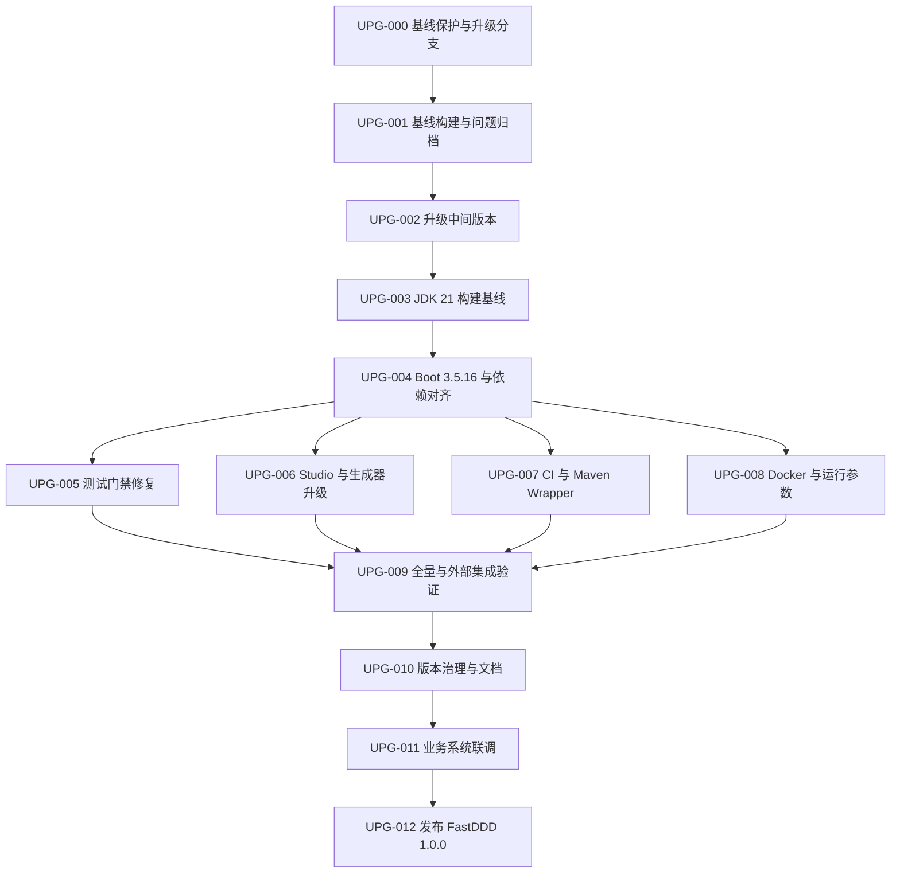

# FastDDD JDK 21 与 Spring Boot 3.5.16 升级改造计划

> **文档版本：** v1.3
>
> **编制日期：** 2026-08-09
>
> **最近修订：** 2026-08-09（v1.3：将 Spring AI / SpringDoc 固定为 1.1.8 / 2.8.17；修正 Lombok annotation processor、MySQL 9.7.0、Knife4j 传递依赖和自定义 Conditional 验证方案；Druid 目标版本固定为 1.2.28；更新 SpringDoc Boot 3 官方参考）
>
> **状态：** 待执行
>
> **执行工具：** Claude Code
>
> **升级目标：** JDK 21、Spring Boot 3.5.16、FastDDD 1.0.0
>
> **升级中间版本：** `1.0.0-jdk21-SNAPSHOT`

---

## Claude Code 执行入口

将下面的指令交给 Claude Code，后续让它按任务编号逐项执行：

```text
请先完整阅读 docs/architecture/JDK21_SPRING_BOOT_3_5_UPGRADE_PLAN.md，
从 UPG-000 开始，一次只执行一个任务。开始前检查工作区，保护用户已有修改；
完成当前任务的验收后，更新文档中的执行记录并向我汇报，不要自动进入下一任务。
未经我确认，不要 commit、tag、push、发布制品或删除分支。
不要引入 Spring Boot 4.x，也不要通过排除测试或降低断言来通过门禁。
```

---

## 一、执行结论

本次升级采用以下技术和版本策略：

1. 将 FastDDD 的编译、测试、运行和生成项目最低 Java 基线统一提升到 JDK 21。
2. 将 Spring Boot 从 3.4.5 升级到 3.5.16，不在本次改造中迁移 Spring Boot 4.x。
3. 升级期间使用 `1.0.0-jdk21-SNAPSHOT`，防止与旧的 `1.0.0-SNAPSHOT` 在本地仓库或 Maven 私服中互相覆盖。
4. 所有在研业务系统同步升级，不长期维护 Java 17 分支。
5. 升级前代码使用 Git tag 归档；升级工作使用短期分支，完成后合并回 `main`。
6. 全量验证通过后发布 FastDDD `1.0.0`，随后 `main` 进入 `1.1.0-SNAPSHOT` 开发周期。
7. Spring Boot 4.x、Spring Framework 7、Jackson 3 和 Jakarta EE 11 作为 FastDDD `2.0.0` 的独立改造，不与本次任务混合。

### 1.1 预估改造量

| 维度 | 预估 |
|------|------|
| 影响文件 | 30～45 个，不含机械更新的父版本声明 |
| 生产 Java 代码 | 预计 0～5 个文件需要兼容性修改 |
| 构建、CI、容器、生成器和文档 | 主要改动区域 |
| 改造工期 | 5～8 人日 |
| 外部中间件完整回归 | 另预留 1～2 人日 |
| 综合风险 | 中低；外部集成模块为主要不确定项。Spring AI 直接调用面仅 2 个源文件（analyzer、studio），且用的是稳定核心 API（ChatModel/ChatResponse/Prompt/OpenAiChatOptions），实际迁移工作量可控；**真正的工期不确定项是 Druid 坐标迁移后的上下文测试与 SpringDoc/Knife4j 联动验证** |

---

## 二、当前基线与已验证结论

### 2.1 当前代码基线

| 项目 | 当前状态 |
|------|----------|
| FastDDD 版本 | `1.0.0-SNAPSHOT` |
| Java | 17 |
| Spring Boot | 3.4.5 |
| Maven 模块 | 27 个 reactor 单元 |
| Java 文件 | 约 509 个，其中主代码约 447 个、测试约 62 个 |
| Git 分支 | `main` |
| 正式 tag | 无 |
| 工作区状态 | `docs/FASTDDD_REFERENCE.md` 存在用户未提交修改，执行时必须保留 |

### 2.2 升级探针结果

已使用命令行属性覆盖进行过以下验证，未修改项目源文件：

| 验证组合 | 结果 |
|----------|------|
| JDK 17 + Boot 3.4.5 | 全模块 `clean compile` 成功 |
| JDK 21 + Boot 3.4.5 + release 21 | 全模块编译成功 |
| JDK 21 + Boot 3.5.16 + release 21 | 全模块编译成功 |
| JDK 21 + Boot 3.5.16 回归测试 | 排除一个升级前已知失败用例后，55 个套件、352 个测试通过，6 个跳过 |
| JDK 21 + Boot 4.1.0 | POM 解析阶段失败，确认不属于本次小版本升级范围 |

源码扫描未发现以下 JDK 21 典型硬障碍：

- `sun.*` 或 `com.sun.*` 内部 API；
- `Unsafe`；
- `SecurityManager`；
- finalizer；
- 必须依赖 `--add-opens` 的生产代码；
- Java EE `javax.servlet`、`javax.persistence` 等遗留包。

当前 `javax.*` 使用均为 JDK 自带的 `javax.sql` 或 `javax.crypto`，不需要迁移到 Jakarta 包。

### 2.3 已知基线问题

#### B-01：性能测试的逻辑删除与唯一键冲突

`PerformanceIntegrationTest` 使用逻辑删除清理 `perf_test_*` 数据，然后以相同用户名再次插入。数据库唯一键仍包含已逻辑删除记录，因此全量测试会在升级前失败。

建议使用 `JdbcTemplate` 执行物理删除作为测试清理方式，不修改生产逻辑删除规则。

#### B-02：JDK 21 下 Mockito 动态加载 agent 警告

测试能够通过，但 Mockito/Byte Buddy 会提示未来 JDK 将默认禁止动态加载 agent。该问题不是本次发布阻塞项，但应在测试构建中显式配置 Mockito agent 或形成后续技术债任务。

#### B-03：Maven Wrapper 不完整

仓库存在 `.mvn/wrapper/maven-wrapper.properties`，Dockerfile 也复制 `mvnw` 和 `mvnw.cmd`，但仓库根目录当前没有这两个脚本。应选择并落实一种方案：

- 推荐：补全 Maven Wrapper，并在 CI 和本地统一使用；
- 备选：删除 Dockerfile 中无效的 wrapper 复制步骤，并明确使用 Maven 镜像内置版本。

#### B-04：部分模块缺少直接测试

以下包含生产 Java 代码的模块当前没有直接测试类：

- `fastddd-examples`
- `fast-ddd-application`
- `fast-ddd-cache`
- `fast-ddd-model`
- `fast-ddd-search`
- `fast-ddd-starter`
- `fastddd-doc-generator`
- `fastddd-doc-maven-plugin`
- `fastddd-fastdoc-core`
- `fastddd-maven-plugin`

升级完成不能只以 Maven 编译成功作为结论，必须补充生成项目和外部集成 smoke test。

---

## 三、目标架构与版本规则

### 3.1 目标技术基线

| 组件 | 目标 |
|------|------|
| 构建 JDK | JDK 21 |
| 编译字节码 | `--release 21` |
| 运行 JRE | JRE 21 |
| Spring Boot | 3.5.16 |
| Spring Framework | 由 Boot 3.5.16 BOM 管理 |
| Maven | 3.9.x，推荐 Wrapper 固定版本 |
| 开发阶段 FastDDD | `1.0.0-jdk21-SNAPSHOT` |
| 首个正式版 | `1.0.0` |

### 3.2 Maven 编译配置原则

根 POM 使用单一 Java 版本来源：

```xml
<properties>
    <java.version>21</java.version>
    <maven.compiler.release>${java.version}</maven.compiler.release>
    <spring-boot.version>3.5.16</spring-boot.version>
</properties>
```

删除根 POM 中重复的：

```xml
<maven.compiler.source>17</maven.compiler.source>
<maven.compiler.target>17</maven.compiler.target>
```

`maven-compiler-plugin` 改用：

```xml
<configuration>
    <release>${maven.compiler.release}</release>
    <encoding>${project.build.sourceEncoding}</encoding>
    <parameters>true</parameters>
    <!-- 保留现有 annotationProcessorPaths -->
</configuration>
```

所有普通子模块继承根 POM，不得再次声明 Java 版本。生成独立项目的模板 POM需要单独输出 `release 21`。

### 3.3 依赖版本管理原则

1. Spring Boot BOM 是 Spring Framework、Micrometer、Jackson、JUnit、Testcontainers 等受管依赖的首要版本来源。
2. 删除手工版本前必须通过 Boot 3.5.16 的 effective POM确认该依赖确实受管，禁止批量盲删。
3. MyBatis-Plus、Spring AI、SpringDoc、Knife4j、RocketMQ、JJWT 等非 Boot BOM完整管理的依赖继续由 FastDDD 根 POM集中维护。
4. 避免单个模块重新声明第三方版本。
5. 依赖升级必须同时检查编译期、测试期和运行期，不以 `dependency:tree` 无红字作为唯一结论。

优先检查以下当前手工锁定项：

| 依赖 | 当前版本 | 目标 / 处理原则 | 风险等级 |
|------|----------|-----------------|----------|
| **Spring AI BOM** | **1.0.3** | **确定性升级到 `1.1.8`**（Boot 3.5.x 对应的 1.1 维护线）；2.0.x 对应 Boot 4.x，不在本次范围。见 UPG-004 第 9～11 步 | 🔴 高 |
| **SpringDoc** | **2.2.0** | **确定性升级到 `2.8.17`**。官方矩阵为 Boot 3.1.x → SpringDoc 2.2.x、Boot 3.2.x → 2.3～2.5、Boot 3.5.x → 2.8.x | 🔴 高 |
| **Knife4j** | **4.5.0** | **与 SpringDoc 2.8.17 联动验证**。Knife4j 传递声明 SpringDoc 2.3.0，但根 dependencyManagement 会统一解析为 2.8.17；主要风险是二者的运行时兼容性，仅在依赖结构变化或无法统一版本时考虑 exclusion / 升级 Knife4j | 🟠 中高 |
| Druid | 1.2.20（**`druid-spring-boot-starter`，Boot 2 坐标**） | **确定性迁移到 `druid-spring-boot-3-starter:1.2.28`**。当前代码 4 处引用旧坐标（根 pom、examples、crud、code-generator），UPG-004 必须全部改掉并做完整上下文启动测试 | 🔴 高 |
| Micrometer | 1.12.0 | 删除手工版本，交由 Boot 3.5.16 BOM 管理，实际解析为 **1.15.12** | 🟢 低 |
| JUnit Jupiter | 5.10.1 | 删除手工版本，交由 Boot 3.5.16 BOM 管理，实际解析为 **5.12.2** | 🟢 低 |
| Testcontainers | 1.19.3 | 删除手工版本，交由 Boot 3.5.16 BOM 管理，实际解析为 **1.21.4** | 🟢 低 |
| Lombok | 1.18.30 | 删除 Lombok 手工版本，交由 Boot 3.5.16 BOM 管理为 **1.18.46**；同步删除 `annotationProcessorPaths` 中 **Lombok 自身**的 `<version>`。`lombok-mapstruct-binding:0.2.0` 不受 Boot BOM 管理，其属性和 processor path 版本必须保留 | 🟡 中 |
| MySQL Connector | `mysql:mysql-connector-java:8.0.33` | 迁移为 `com.mysql:mysql-connector-j` 并删除手工版本，交由 Boot 3.5.16 BOM 管理为 **9.7.0**；这是主版本跳升，必须执行真实 MySQL 连接、CRUD、事务与 Druid 连接池验证 | 🟠 中高 |
| MyBatis Spring | 3.0.3 | 检查与 MyBatis-Plus starter 的传递版本一致性；MyBatis-Plus 3.5.12 自带 mybatis-spring，覆盖到 3.0.3 可能冲突 | 🟡 中 |
| Elasticsearch Client | 8.11.0 | 检查与 Boot 3.5 的 Spring Data Elasticsearch 对齐后决定是否移除覆盖 | 🟡 中 |
| Freemarker | 2.3.33 | 检查 Boot BOM；生成器如有特定需求需记录原因 | 🟢 低 |
| RocketMQ | 2.2.3 | 执行实际 Spring 上下文和连接测试 | 🟡 中 |

> **验证纪律（适用于上表所有项）**：版本对齐以三层验证为准，不以"编译通过"或"`dependency:tree` 无红字"作为唯一结论：
> 1. 权威兼容性来源（Spring AI README、springdoc.org 兼容矩阵等）；
> 2. `mvn dependency:tree -Dverbose` 实证：`spring-core` 等核心 Spring artifact 的解析版本**必须由 Boot BOM 主导**，不能被 Spring AI / SpringDoc / Knife4j 的传递依赖覆盖成更低版本；
> 3. 运行时冒烟：真实 Spring 上下文启动 + 端点访问（AI starter 上下文装配、SpringDoc 的 `/v3/api-docs`、Knife4j 的 `/doc.html`）。

### 3.4 Git 与制品版本策略

```text
main（当前 Java 17 基线）
  │
  ├── tag: baseline/jdk17-boot3.4.5
  │
  └── branch: upgrade/jdk21-boot3.5.16
          │
          ├── version: 1.0.0-jdk21-SNAPSHOT
          ├── 所有在研业务系统联调
          └── 合并 main → 发布 v1.0.0
```

后续版本规则：

| FastDDD 版本 | 变更类型 |
|--------------|----------|
| `1.0.x` | 缺陷、安全和依赖补丁；不得破坏公共 API |
| `1.1.x` | 向后兼容的新功能和废弃标记 |
| `2.0.0` | Spring Boot 4.x、Spring Framework 7、Jackson 3 等破坏性迁移 |

> Git tag 和 push 属于外部共享状态变更。Claude Code 执行到相关任务时，必须先获得用户确认；不得自动推送或发布。

---

## 四、改造范围

### 4.1 P0：本次必须完成

- 根 POM 的 Java、Boot、编译插件和版本治理；
- 所有 reactor 模块版本同步；
- Boot BOM 重叠依赖梳理；
- Java 21 编译和测试；
- 基线性能测试修复；
- Studio、Maven 插件、模板和 archetype 默认版本升级；
- 7 个 GitHub Actions 工作流升级；
- Docker 构建与运行镜像升级；
- 生成项目编译验证；
- MySQL、Redis、RocketMQ、Elasticsearch 等启用模块的 smoke test；
- 升级指南、兼容矩阵和发布说明；
- FastDDD `1.0.0` 发布门禁。

### 4.2 P1：建议在 1.0.x 周期内完成

> **边界澄清（v1.2）**：以下 P1 项不再全部阻塞 1.0.0 发布。按收益与前置条件分为两组——
>
> - **A 组（纳入 UPG-010，作为 1.0.0 发布门禁）**：Maven CI-friendly version + flatten-plugin、Maven Enforcer + JDK Toolchains、`fastddd-bom`。前三项是可持续发布的基础；**`fastddd-bom` 不依赖历史基线，且所有在研业务系统将随本次一起升级，应作为 1.0.0 首个正式版的依赖契约统一提供**，让业务项目只需导入一个版本入口。
> - **B 组（推迟到 1.0.1）**：japicmp / Revapi 二进制兼容性检查。**原因**：项目当前无任何正式 tag/GA 制品，japicmp 需要一个基线 jar 作对照，在 1.0.0 本次本身没有可比基准；其真正价值从 1.0.0 → 1.0.1 起才体现。

- 使用 Maven CI-friendly version，避免 27 个 POM 手工改版本；
- 增加 Maven Enforcer 和 JDK Toolchains；
- 增加 `fastddd-bom`，向业务项目提供统一依赖入口；
- 增加公共 API 二进制兼容性检查，例如 japicmp 或 Revapi（**1.0.1，需先有 1.0.0 GA 基线 jar**）；
- 补充无直接测试模块的最小上下文测试。

### 4.3 明确不在本次范围

- Spring Boot 4.x；
- Spring Framework 7；
- Jackson 3；
- Jakarta EE 11 / Servlet 6.1；
- 大规模业务 API 重构；
- 与 Java 21 无关的功能开发；
- 无关文档和用户未提交改动的重写。

---

## 五、主要影响文件

### 5.1 构建与版本

- `pom.xml`
- 26 个子模块 `pom.xml` 中的父版本声明
- `.mvn/wrapper/maven-wrapper.properties`
- 待补充的 `mvnw`、`mvnw.cmd`

### 5.2 CI

- `.github/workflows/ci-cd-test.yml`
- `.github/workflows/ci-cd.yml`
- `.github/workflows/ci.yml`
- `.github/workflows/code-quality.yml`
- `.github/workflows/maven-build.yml`
- `.github/workflows/pr-validation.yml`
- `.github/workflows/security.yml`

### 5.3 容器

- `Dockerfile`
- `docker-compose.yml`
- `docker-compose.prod.yml`
- `docker/` 下与应用镜像或 Java 运行参数相关的文件

### 5.4 Studio 与生成器

- `fastddd-studio/fastddd-studio-server/src/main/java/com/gallop/fastddd/studio/dto/initializr/ProjectRequest.java`
- `fastddd-studio/fastddd-studio-server/src/main/java/com/gallop/fastddd/studio/dto/unified/ProjectCodegenRequest.java`
- `fastddd-studio/fastddd-studio-server/src/main/java/com/gallop/fastddd/studio/dto/unified/UnifiedProjectRequest.java`
- `fastddd-tooling/fastddd-maven-plugin/src/main/java/com/gallop/fastddd/maven/plugin/InitProjectMojo.java`
- `fastddd-tooling/fastddd-templates/src/main/java/com/gallop/fastddd/templates/TemplateContext.java`
- `fastddd-tooling/fastddd-project-archetype/pom.xml`
- `fastddd-tooling/fastddd-project-archetype/src/main/resources/archetype-resources/pom.xml`
- `fastddd-tooling/fastddd-templates/pom.xml`
- 相关测试、FreeMarker 模板和示例输出断言

### 5.5 测试与文档

- `fastddd-framework/fast-ddd-crud/src/test/java/com/gallop/fastddd/crud/PerformanceIntegrationTest.java`
- Mockito/Surefire 测试配置
- `README.md`
- `CLAUDE.md`
- `.claude/skills/fastddd-init/SKILL.md`
- `docs/FASTDDD_REFERENCE.md`，只允许在保留用户现有修改的基础上合并更新
- `docs/guides/USAGE_GUIDE.md`
- `docs/guides/UPGRADE_GUIDE_1.1.md`
- 新增或更新版本兼容矩阵、发布说明

---

## 六、任务依赖关系



---

## 七、Claude Code 执行任务清单

### 7.1 汇总表

| ID | 任务 | 优先级 | 预估 | 依赖 | 建议提交信息 |
|----|------|--------|------|------|--------------|
| UPG-000 | 基线保护、tag 与升级分支 | P0 | 0.5h | 无 | 无代码提交 |
| UPG-001 | 基线构建、测试和依赖报告 | P0 | 0.5d | UPG-000 | `test: 归档升级前构建与测试基线` |
| UPG-002 | 切换升级中间版本 | P0 | 0.5d | UPG-001 | `build: 切换 JDK 21 升级中间版本` |
| UPG-003 | 升级 JDK 21 编译基线 | P0 | 0.5d | UPG-002 | `build: 将编译基线升级至 JDK 21` |
| UPG-004 | 升级 Boot 3.5.16 并对齐依赖 | P0 | 1～1.5d | UPG-003 | `build: 升级 Spring Boot 至 3.5.16` |
| UPG-005 | 修复测试基线并建立全量门禁 | P0 | 0.5～1d | UPG-004 | `test: 修复升级回归测试基线` |
| UPG-006 | 升级 Studio、插件和生成模板 | P0 | 1d | UPG-004 | `feat(tooling): 升级生成项目技术基线` |
| UPG-007 | 升级 CI 和 Maven Wrapper | P0 | 0.5d | UPG-004 | `ci: 统一使用 JDK 21 构建` |
| UPG-008 | 升级 Docker 构建与运行环境 | P0 | 0.5d | UPG-004 | `build: 升级容器运行时至 JRE 21` |
| UPG-009 | 全量、生成项目和外部集成验证 | P0 | 1～2d | UPG-005～008 | `test: 补充 JDK 21 升级验收验证` |
| UPG-010 | 完善版本治理、兼容矩阵和文档 | P0/P1 | 1d | UPG-009 | `docs: 完善 1.0.0 兼容矩阵与升级指南` |
| UPG-011 | 在研业务系统联调 | P0 | 1～2d | UPG-010 | 各业务仓库独立提交 |
| UPG-012 | 发布 FastDDD 1.0.0 | P0 | 0.5d | UPG-011 | `chore(release): 发布 FastDDD 1.0.0` |

---

### UPG-000：基线保护与升级分支

**目标：** 在任何代码修改前建立可恢复基线。

**执行要求：**

1. 执行 `git status --short`。
2. 发现 `docs/FASTDDD_REFERENCE.md` 有用户修改时，不得丢弃、覆盖或重置。
3. 由用户决定先提交该修改还是暂存；没有明确决定前不得创建归档 tag。
4. 工作区干净后，经用户确认创建 annotated tag：`baseline/jdk17-boot3.4.5`。
5. 从 `main` 创建短期升级分支：`upgrade/jdk21-boot3.5.16`。
6. tag、push、远程分支创建前必须再次获得用户确认。

**验收标准：**

- `git status --short` 符合预期；
- 当前分支为升级分支；
- 基线 tag 指向升级前最后一个完整提交；
- 用户原有修改仍然存在且内容未变化。

---

### UPG-001：基线构建、测试和依赖报告

**目标：** 固化升级前真实状态，避免把历史问题误判为升级回归。

**执行步骤：**

1. 确认 JDK 17 和 Maven 实际版本。
2. 执行：

   ```powershell
   mvn -B clean compile
   mvn -B test
   mvn -B dependency:tree
   ```

3. 记录成功模块、失败模块、失败用例、警告和耗时。
4. 明确记录 `PerformanceIntegrationTest` 的唯一键冲突为升级前问题。
5. 记录 Maven 本机设置中可能出现的无效 `nexus` profile 警告；该警告不得直接归因于代码升级。
6. 将执行结果追加到本文档“执行记录”部分，不提交 Maven 控制台大日志或生成目录。

**验收标准：**

- 有可复核的升级前构建结果；
- 已区分代码失败、测试数据失败、环境警告；
- 未修改生产代码。

---

### UPG-002：切换升级中间版本

**目标：** 避免新旧 SNAPSHOT 使用相同 Maven 坐标。

**执行步骤：**

1. 将 reactor 版本从 `1.0.0-SNAPSHOT` 更新为 `1.0.0-jdk21-SNAPSHOT`。
2. 使用 Maven Versions Plugin 机械更新根项目和全部子模块，禁止手工漏改：

   ```powershell
   mvn versions:set `
     -DnewVersion=1.0.0-jdk21-SNAPSHOT `
     -DprocessAllModules=true `
     -DgenerateBackupPoms=false
   ```

3. 检查全部子模块父版本和内部依赖版本。
4. 暂不修改生成项目默认 FastDDD 版本，该工作由 UPG-006 统一完成。

**验收标准：**

- reactor 全部模块版本一致；
- 不存在 `pom.xml.versionsBackup`；
- `mvn help:evaluate -Dexpression=project.version -q -DforceStdout` 输出中间版本；
- `mvn -B -DskipTests compile` 成功。

---

### UPG-003：升级 JDK 21 编译基线

**目标：** 先只升级 Java，不混入 Boot 和依赖变更。

**执行步骤：**

1. 根 POM 设置：
   - `java.version=21`；
   - 新增 `maven.compiler.release=${java.version}`；
   - 删除 `maven.compiler.source/target`；
   - compiler plugin 使用 `<release>`。
2. 清理普通子模块重复的 Java 版本和 compiler plugin 声明。
3. 暂不更新独立生成项目模板，该工作由 UPG-006 完成。
4. 使用本机 JDK 21：

   ```powershell
   $env:JAVA_HOME='D:\usr\local\jdk\jdk-21.0.3'
   $env:Path="$env:JAVA_HOME\bin;$env:Path"
   java -version
   mvn -version
   mvn -B clean compile
   ```

5. 检查编译警告，不使用 `--add-opens` 掩盖源码问题。

**验收标准：**

- Maven 运行时为 Java 21；
- 全模块 `clean compile` 成功；
- 产物 class file 目标版本为 Java 21；
- 根 POM 只有一个 Java 版本事实来源。

---

### UPG-004：升级 Spring Boot 3.5.16 并对齐依赖

**目标：** 在 JDK 21 编译基线上完成 Boot 3.5.16 升级，并修复所有因 Boot 版本跳变而失效的第三方依赖。

> **本任务是本次升级风险最集中的环节。** Spring AI、SpringDoc 等库对 Spring 版本敏感，1.0.3 / 2.2.0 均针对旧版 Boot，**几乎确定要升版本而非仅冒烟测试**。务必按"权威来源 → 依赖解析实证 → 运行时冒烟"三层验证。

**执行步骤：**

1. 将 `spring-boot.version` 改为 `3.5.16`。
2. 生成并保存临时分析结果，但不要提交生成文件：

   ```powershell
   mvn help:effective-pom
   mvn dependency:tree -Dverbose
   ```

3. 对照 Boot BOM 逐项处理低风险手工覆盖（Micrometer、JUnit、Testcontainers、Freemarker）：确认受管后删除手工版本，记录 Boot 3.5.16 的实际解析版本；其中 Micrometer、JUnit Jupiter、Testcontainers 应分别解析为 `1.15.12`、`5.12.2`、`1.21.4`。
4. **Lombok**：删除 `lombok.version` 手工属性，交由 Boot 3.5.16 BOM 管理为 `1.18.46`；同步删除依赖声明和 `maven-compiler-plugin` 的 `annotationProcessorPaths` 中 **Lombok 自身**的 `<version>`。`lombok-mapstruct-binding:0.2.0` 不在 Boot BOM 中，必须保留根 POM 的 `lombok-mapstruct-binding.version` 以及根 POM、Studio POM processor path 中对应的 `<version>`，不得一并删除。
5. **MySQL 驱动（🟠 主版本升级）**：坐标从 `mysql:mysql-connector-java:8.0.33` 迁移为 `com.mysql:mysql-connector-j`，删除手工版本后由 Boot 3.5.16 BOM 管理为 **`9.7.0`**。除编译外，必须使用真实 MySQL 环境验证连接建立、认证、基础 CRUD、事务提交/回滚和 Druid 连接池；不得按普通补丁升级处理。
6. **MyBatis-Plus / mybatis-spring**：检查 `mybatis-spring 3.0.3` 与 MyBatis-Plus 3.5.12 自带版本是否出现多版本或运行时不匹配，必要时移除手工覆盖。
7. **Druid（🔴 确定性坐标迁移）**：将 `druid-spring-boot-starter:1.2.20` 迁移为 **`druid-spring-boot-3-starter:1.2.28`**。当前代码 4 处引用旧坐标——根 pom 的 `<druid.version>` 与 dependencyManagement、`fastddd-examples/pom.xml`、`fast-ddd-crud/pom.xml`、`fastddd-code-generator/pom.xml`——必须全部改掉。迁移后执行**完整 Spring 上下文启动**，确认 `DruidDataSourceAutoConfigure` 正常装配、连接池生效（旧 Boot 2 坐标在 Boot 3.5 下 auto-config 实际可能未生效）。
8. **Elasticsearch 客户端 / RocketMQ**：按 3.3 节表格对齐，执行真实上下文启动与连接。
9. **SpringDoc（🔴 确定性升级）**：`springdoc.version` 从 `2.2.0` 升级到 **`2.8.17`**。官方矩阵中 2.2.x 对应 Boot 3.1.x，Boot 3.5.x 应使用 2.8.x；不得继续使用 2.2.0。
10. **Knife4j（🟠 与 SpringDoc 联动）**：保留 `knife4j.version=4.5.0` 作为首选方案。该 starter 传递声明 SpringDoc 2.3.0，但根 POM 的 dependencyManagement 应将其统一管理为第 9 步设定的 2.8.17。执行 `dependency:tree -Dverbose`，预期看到 `version managed from 2.3.0; omitted for duplicate`，而不是把 2.8.17 覆盖成旧版。随后重点验证 Knife4j 4.5.0 与 SpringDoc 2.8.17 的运行时兼容性；仅当依赖结构变化、无法统一版本或 `/doc.html` 验证失败时，才评估 exclusion 或升级 Knife4j。**9、10 两步必须一起验证。**
11. **Spring AI（🔴 确定性升级，A 方案内联处理）**：
    - `spring-ai.version` 从 `1.0.3` 确定性升级到 **`1.1.8`**（针对 Boot 3.5.x 的 1.1 维护线；2.0.x 对应 Boot 4.x，不在本次范围）。
    - 重新核对 `spring-ai-bom` 与 Boot BOM 的 Spring artifact 主导权：`spring-core` 必须由 Boot BOM 解析，不能被 Spring AI BOM 拉低。
    - **基于真实 API 清单验证（非臆测）**：当前仓库直接调用 Spring AI 的源码仅 2 个文件、2 个模块：
      - `fast-ddd-analyzer-.../LLMEnhancedStrategy.java`：`ChatModel`、`ChatResponse`、`ChatOptions`、`Prompt`、`OpenAiChatOptions`
      - `studio-server/.../AiDomainDesignService.java`：`ChatModel`、`ChatResponse`、`Prompt`、`SystemMessage`、`UserMessage`、`OpenAiChatOptions`
      - 仓库**未使用** `ChatClient` 与工具调用（function calling）API——不要把它们当作既定迁移点。升级时以这两个文件实际 import 的类为核对清单，逐类确认 1.1.8 是否有签名/包路径变动。
    - 1.0 → 1.1 属于 minor 升级，上述 API 仍属 Spring AI 稳定核心，预期无需改动；若编译报错，按以下**自洽排障步骤**处理（不依赖任何外部 skill）：
      1. 记录每个编译错误的文件、行号、符号与报错文本；
      2. 查 Spring AI 1.1.8 对该类的 javadoc / 迁移说明，确认是签名变更、包移动还是废弃；
      3. 按官方说明最小改动修复（如换方法名、补参数、改 import），不动业务逻辑；
      4. 单文件改完立即 `mvn -pl <module> -am compile` 增量验证，再进入下一个；
      5. 每处改动记入执行记录，**不得通过降版本、注释代码或缩小可见性绕过**。
12. 编译所有自研 starter，重点检查 17 个自动配置类（其条件加载行为审查见 UPG-005 第 6 步）。
13. 不引入 Boot 4 的 classic starter、Jackson 3 或 Spring Framework 7 改动。

**验收标准：**

- 全模块 `clean compile` 成功；
- Spring Boot 启动日志为 3.5.16；
- `dependency:tree -Dverbose` 中 `spring-core`、`spring-context`、`spring-web`、`jackson-databind`、`micrometer-*`、`slf4j-api` 的解析版本与 Boot 3.5.16 BOM 一致，**不存在被 Spring AI / SpringDoc / Knife4j 覆盖成更低版本的红字**；
- SpringDoc `/v3/api-docs` 与 Knife4j `/doc.html` 均能正常返回（运行时冒烟，非仅编译）；
- AI/Analyzer starter 真实上下文启动无 `BeanCreationException`（OpenAI client 可用 mock/跳过真实模型）；
- Spring AI 已固定为 `1.1.8`，SpringDoc 已固定为 `2.8.17`，且 Knife4j 传递声明的 SpringDoc 2.3.0 已由根 dependencyManagement 统一解析为 2.8.17；
- Lombok 解析为 `1.18.46`，`lombok-mapstruct-binding:0.2.0` 的显式版本仍保留；
- MySQL Connector/J 解析为 `9.7.0`，真实 MySQL + Druid 连接、CRUD 和事务验证通过；
- 每个保留的手工版本都有明确原因。

---

### UPG-005：修复测试基线并建立全量门禁

**目标：** 让全量测试成为可靠的升级门禁。

**执行步骤：**

1. 修复 `PerformanceIntegrationTest`：
   - 推荐注入 `JdbcTemplate`；
   - 使用物理 `DELETE` 清理 `perf_test_*`；
   - 不修改生产逻辑删除策略；
   - 确认单测之间不共享残留数据。
2. 在 JDK 21 + Boot 3.5.16 下执行全量测试，不排除性能用例。
3. 检查 Mockito/Byte Buddy 动态 agent 警告；如本阶段配置显式 agent 会影响 JaCoCo `argLine`，必须同时验证覆盖率仍可生成。
4. 检查 Logback `includeStackTrace` 等已有配置警告，确认是否与依赖升级相关。
5. 统计测试套件、测试数、失败、错误和跳过数。
6. **自定义 Conditional 类行为审查（v1.3 修订）**：`fast-ddd-config` 中 `OnClassCondition`、`OnMissingClassCondition`、`OnProfileCondition`、`OnSystemPropertyCondition` 均直接实现 Spring Framework 的普通 `Condition` 接口，实际扩展点只有 `matches()`；它们不是 `SpringBootCondition` / `ConfigurationCondition`，不得检查不存在的 `shouldSkip()` 或 `getConfigurationPhase()`。条件错误可能只表现为 bean 静默缺失，因此按以下方式验证：
   - 在 Boot 3.5.16 下扩展并执行现有 `ConditionalSystemIntegrationTest` 以及 4 个 condition 单元测试，覆盖匹配、不匹配、空属性、多条件组合、profile、system property、class present / missing 等场景；
   - 对已有自研 starter 的 `ApplicationContextRunner` 测试补充关键开关的正反用例；没有最小上下文测试的 starter 至少为关键自动配置增加一组，直接断言 bean 存在或不存在；
   - 对照 Spring Boot 3.5 Release Notes 审查 17 个自动配置类的排序、属性条件和 Bean 条件，但只检查代码实际实现或继承的扩展点；
   - `--debug` 日志和 actuator `/conditions` 仅作为 Boot 内置 `SpringBootCondition` 的辅助证据。普通 `Condition` 不会自动完整记录到 `ConditionEvaluationReport`，不得仅凭 `/conditions` 端点判定上述 4 个自定义条件正确。

**验收标准：**

- `mvn -B clean test` 成功；
- `PerformanceIntegrationTest` 全部通过；
- 不通过 `-Dtest` 排除失败用例；
- JaCoCo agent 与 Mockito agent 不互相覆盖；
- 测试报告中零失败、零错误；
- `ConditionalSystemIntegrationTest`、4 个自定义 condition 单元测试和关键 starter 的 `ApplicationContextRunner` 正反用例全部通过；
- 自定义 Conditional 类的关键 bean 加载状态已通过测试断言确认，无静默失效；`/conditions` 仅作补充证据。

---

### UPG-006：升级 Studio、Maven 插件和生成模板

**目标：** 保证 FastDDD 自己和它生成的新项目使用同一技术基线。

**执行步骤：**

1. 将以下默认 Java 版本统一改为 21：
   - `ProjectRequest.java`；
   - `ProjectCodegenRequest.java`；
   - `UnifiedProjectRequest.java`；
   - `InitProjectMojo.java`；
   - `TemplateContext.java`。
2. 将生成项目 Spring Boot 默认版本统一改为 3.5.16，清理仍存在的 3.2.0 和 3.4.5。
3. 将生成项目 FastDDD 默认版本统一改为 `1.0.0-jdk21-SNAPSHOT`；正式发布时由 UPG-012 改为 `1.0.0`。
4. archetype 和模板 POM使用 `maven.compiler.release=21`。
5. 更新所有相关测试断言和样例快照。
6. 至少生成以下两类项目并编译：
   - ANEMIC 最小项目；
   - RICH + CQRS + Security 的多模块项目。
7. 检查生成 POM 中不存在 Java 17、Boot 3.2.0、Boot 3.4.5 和旧 FastDDD SNAPSHOT。

**验收标准：**

- 所有默认值来源一致；
- 模板单测通过；
- 两类生成项目均可使用 JDK 21 执行 `mvn clean verify`；
- 生成代码未引入 Boot 4 API。

---

### UPG-007：升级 CI 与 Maven Wrapper

**目标：** 本地与 CI 使用一致的 Java、Maven 和验证命令。

**执行步骤：**

1. 更新 7 个 GitHub Actions 工作流中的 Java 默认值和硬编码值为 21。
2. 检查 reusable workflow 的 input default，避免调用方仍回退到 17。
3. 补全 Maven Wrapper，推荐固定 Maven 3.9.x。
4. CI 优先执行 `./mvnw`；Windows 验证使用 `mvnw.cmd`。
5. 增加以下最低门禁：
   - compile；
   - unit/integration test；
   - package；
   - generated project compile；
   - dependency convergence/report；
   - Java 版本输出。
6. 检查 CodeQL、SpotBugs、PMD、JaCoCo 和 OWASP 插件能在 JDK 21 下运行。

**验收标准：**

- 所有工作流不再默认 Java 17；
- Wrapper 脚本和配置完整；
- 本地 Wrapper 构建成功；
- CI 至少有一次 JDK 21 绿色运行记录。

---

### UPG-008：升级 Docker 构建与运行环境

**目标：** 容器内构建和运行均使用 Java 21。

**执行步骤：**

1. 构建镜像切换到 Maven 3.9.x + Eclipse Temurin 21。
2. 运行镜像切换到 Eclipse Temurin 21 JRE。
3. 处理 Maven Wrapper 缺失问题，和 UPG-007 保持一致。
4. 审核全部 JVM 参数在 Linux JRE 21 下是否仍受支持。
5. 构建 Studio 镜像并启动。
6. 验证：
   - `java -version`；
   - `/actuator/health`；
   - 容器时区；
   - 日志编码；
   - 内存限制和容器感知参数。

**验收标准：**

- `docker build` 成功；
- 运行时为 JRE 21；
- 健康检查通过；
- 无 `Unrecognized VM option`；
- compose 开发和生产配置均能引用新镜像。

---

### UPG-009：全量、生成项目和外部集成验证

**目标：** 覆盖当前自动化测试未覆盖的运行时风险。

**验证矩阵：**

| 能力 | 最低验证 |
|------|----------|
| Common / Config / Model | 单测和上下文测试 |
| CRUD / MyBatis-Plus | H2 + MySQL CRUD、逻辑删除、分页、批量操作 |
| Web / Security | MockMvc、JWT、权限、异常响应、审计日志 |
| Cache | Redis 连接、读写、失效与降级 |
| Event | Spring Event + RocketMQ 发送/消费 smoke test |
| Search | Elasticsearch 建索引、写入、查询 smoke test |
| Monitor | Actuator、Prometheus 指标、SQL 监控 |
| AI / Analyzer | 上下文启动；外部模型调用允许使用 mock |
| Tooling | Maven plugin help、代码生成、文档生成 |
| Studio | 测试 profile 启动、项目生成、下载与编译 |
| Examples | JDK 21 启动并访问示例接口 |
| Docker | 构建、启动和健康检查 |

**推荐命令：**

```powershell
.\mvnw.cmd -B clean verify -Ptest
.\mvnw.cmd -B dependency:tree
docker compose up -d
docker build -t fastddd/studio:1.0.0-jdk21-SNAPSHOT .
```

**验收标准：**

- reactor `clean verify` 成功；
- 所有 P0 集成能力有执行证据；
- 失败项有明确责任模块和修复提交；
- 不允许以“模块无测试”为理由直接通过验收。

---

### UPG-010：版本治理、兼容矩阵和文档

**目标：** 建立 `1.0.0` 之后可持续发布的版本规则。

**执行步骤：**

1. 引入 Maven CI-friendly version，推荐：

   ```xml
   <version>${revision}</version>
   <properties>
       <revision>1.0.0-jdk21-SNAPSHOT</revision>
   </properties>
   ```

2. 使用 flatten-maven-plugin 的 `resolveCiFriendliesOnly` 模式，确保发布 POM 中版本已解析。
3. 增加 Maven Enforcer：
   - Java 21 或更高；
   - Maven 3.9.x；
   - 插件版本必须显式；
   - 禁止重复依赖声明。
4. 增加 `fastddd-bom`：聚合 framework 全部模块的版本，作为业务项目的统一依赖契约入口。所有在研业务系统随 1.0.0 一起切换到该 BOM，避免各自声明版本。
5. **japicmp / Revapi 推迟到 1.0.1**（见 4.2 节 B 组）：1.0.0 本次无 GA 基线 jar，japicmp 无可比基准。本项不阻塞 1.0.0 发布，但需在 CHANGELOG/路线图登记为 1.0.1 必做项。
6. 更新：
   - README；
   - CLAUDE.md；
   - FastDDD 初始化 skill；
   - 使用指南；
   - 升级指南；
   - 兼容矩阵；
   - CHANGELOG；
   - 发布检查表。
7. 修改 `docs/FASTDDD_REFERENCE.md` 前先读取并保留用户当前未提交内容，只追加或合并本次升级相关信息。

**兼容矩阵至少包含：**

| FastDDD | Java | Spring Boot | 状态 |
|---------|------|-------------|------|
| 升级前开发快照 | 17 | 3.4.5 | 仅 Git tag 归档，不维护 |
| 1.0.x | 21 | 3.5.x | 当前稳定线 |
| 2.0.x | 待定 | 4.x | 未来规划 |

**验收标准：**

- 版本只从一个属性或 CI 参数进入 reactor；
- `fastddd-bom` 已发布，业务项目有统一的单一版本入口（japicmp/Revapi 登记为 1.0.1 必做项）；
- `1.0.x`、`1.1.x`、`2.0.x` 的变更边界明确；
- 文档不存在把 breaking change 当作普通 minor 升级的描述。

---

### UPG-011：在研业务系统联调

**目标：** 所有当前依赖 FastDDD SNAPSHOT 的业务系统同步切换到新基线。

**每个业务系统执行：**

1. 升级运行和构建 JDK 到 21。
2. 依赖 FastDDD `1.0.0-jdk21-SNAPSHOT`。
3. 对齐 Spring Boot 3.5.16；不得由业务项目重新覆盖为 3.4.x。
4. 执行编译、测试、启动和核心业务流程回归。
5. 检查数据库驱动、Redis、消息、搜索、安全、OpenAPI 和监控。
6. 记录业务系统名称、分支、提交、验证结果和阻塞项。

**验收标准：**

- 所有在研系统完成升级或明确退出发布范围；
- 没有系统继续依赖旧 `1.0.0-SNAPSHOT`；
- 没有必须长期保留 Java 17 支持分支的系统。

---

### UPG-012：发布 FastDDD 1.0.0

**目标：** 将已联调的 JDK 21 + Boot 3.5.16 基线发布为首个稳定版。

**执行步骤：**

1. 将 FastDDD 版本从 `1.0.0-jdk21-SNAPSHOT` 改为 `1.0.0`。
2. 将所有生成器默认 FastDDD 版本改为 `1.0.0`。
3. 执行完整发布门禁。
4. 生成 CHANGELOG 和发布说明。
5. 经用户确认后发布 Maven 制品。
6. 经用户确认后创建 annotated tag：`v1.0.0` 并 push。
7. 发布完成后将 `main` 版本改为 `1.1.0-SNAPSHOT`。
8. 删除短期升级分支前确认远程 tag、制品和文档均可用。

**验收标准：**

- `v1.0.0` 可从干净环境完整构建；
- 正式 Maven 制品不包含 SNAPSHOT 依赖；
- 生成项目默认依赖 `1.0.0`；
- 业务系统能够从正式仓库解析并启动；
- `main` 已进入下一开发版本。

---

## 八、统一验收标准

以下条件全部满足，升级才可视为完成：

- [ ] 根 POM 使用 Java 21 和 `maven.compiler.release=21`
- [ ] Spring Boot 为 3.5.16
- [ ] 全 reactor `clean verify` 成功
- [ ] 全量测试零失败、零错误
- [ ] `PerformanceIntegrationTest` 不再依赖逻辑删除清理唯一键数据
- [ ] 生成项目使用 Java 21、Boot 3.5.16 和正确 FastDDD 版本
- [ ] 7 个 CI 工作流默认 JDK 21
- [ ] Maven Wrapper 完整且可执行
- [ ] Docker 构建和运行均使用 Java 21
- [ ] Docker 健康检查成功且无非法 JVM 参数
- [ ] MySQL、Redis、RocketMQ、Elasticsearch smoke test 有执行证据
- [ ] 没有显著 Spring/Jackson/Micrometer/SLF4J 多版本冲突
- [ ] Spring AI 固定为 `1.1.8`、SpringDoc 固定为 `2.8.17`，Knife4j 传递声明的 SpringDoc 2.3.0 已由根 dependencyManagement 统一解析为 2.8.17
- [ ] Lombok 解析为 `1.18.46`，`lombok-mapstruct-binding:0.2.0` 的显式 processor path 版本仍保留
- [ ] MySQL Connector/J 解析为 `9.7.0`，真实 MySQL + Druid 连接、CRUD 和事务验证通过
- [ ] `dependency:tree` 中 `spring-core` 等核心 artifact 由 Boot 3.5.16 BOM 主导，未被 Spring AI/SpringDoc 覆盖
- [ ] `/v3/api-docs`、`/doc.html` 端点冒烟通过；AI/Analyzer starter 真实上下文启动无异常
- [ ] `ConditionalSystemIntegrationTest`、4 个自定义 condition 单元测试以及关键 starter 的 `ApplicationContextRunner` 正反用例通过
- [ ] 自定义 Conditional 类关键 bean 加载状态已通过测试断言确认，无静默失效；`/conditions` 仅作补充证据
- [ ] 所有在研业务系统完成联调
- [ ] 兼容矩阵、升级指南、CHANGELOG 和发布说明完成
- [ ] 用户原有 `docs/FASTDDD_REFERENCE.md` 修改未丢失
- [ ] 发布 `v1.0.0` 后 `main` 进入 `1.1.0-SNAPSHOT`

---

## 九、回滚策略

### 9.1 代码回滚

- 升级分支未合并：直接停止升级分支，`main` 不受影响。
- 已合并但未发布：使用普通 revert 提交回滚，不使用 `git reset --hard`。
- 已发布：不得覆盖 `1.0.0` 制品，使用新的修复版本处理。

### 9.2 旧基线恢复

旧 Java 17 状态通过 `baseline/jdk17-boot3.4.5` tag 恢复。若必须临时重新构建旧制品，应使用唯一版本，例如：

```text
1.0.0-java17-SNAPSHOT
```

不得重新发布或覆盖通用的 `1.0.0-SNAPSHOT` 坐标。

> **补充（v1.1）**：`1.0.0-java17-SNAPSHOT` 仅用于本地或 CI 临时重建旧制品，**永不发布到正式 Maven 私服**，避免与本次升级中间版本 `1.0.0-jdk21-SNAPSHOT`、正式版 `1.0.0` 的命名规则混淆，也避免业务系统误依赖。

### 9.3 业务系统回滚

业务系统联调期间，每个仓库保留独立升级分支。在 FastDDD `1.0.0` 正式发布前，业务系统不得将不可逆数据结构变更与本次框架升级混合提交。

---

## 十、Claude Code 执行约束

1. 一次只执行一个 `UPG-*` 任务。
2. 每个任务开始前检查 `git status --short`。
3. 不覆盖、不暂存、不提交用户无关修改。
4. 任务门禁失败时停止进入后续任务，先定位并记录原因。
5. 每个任务在用户确认后使用独立提交；提交信息使用中文描述并保持 Conventional Commits 格式。
6. 不使用 `git reset --hard`、`git checkout --` 等破坏性命令。
7. tag、push、制品发布和删除远程分支前必须获得用户确认。
8. 不为了通过测试而排除失败用例、降低断言或关闭质量插件。
9. 不把 Spring Boot 4.x 相关改动混入本升级分支。
10. 每完成一项任务，在下方执行记录中登记提交、验证结果和遗留风险。

---

## 十一、执行记录

| 日期 | 任务 | 状态 | 分支/提交 | 验证结果 | 遗留问题 |
|------|------|------|-----------|----------|----------|
| 2026-08-09 | UPG-000 | 已完成 | `main` 79c5c82（基线文档）；tag `baseline/jdk17-boot3.4.5` @ 79c5c82；升级分支 `upgrade/jdk21-boot3.5.16` | 工作区基线干净；`FASTDDD_REFERENCE.md` 用户修改已纳入基线未丢失；升级方案文档已纳入升级分支 | tag 与升级分支均为本地，**未 push**（待用户确认远程操作） |
| 2026-08-10 | UPG-001 | 已完成 | `upgrade/jdk21-boot3.5.16`（仅文档登记，无代码改动） | JDK 17.0.11 + Maven 3.9.11；`clean compile` **27/27 SUCCESS**（2:18）；`test` **唯一失败 = `PerformanceIntegrationTest.testBatchInsertPerformance`（B-01，升级前已知）**；排除该用例后 `BUILD SUCCESS`，11 个有测试模块共 **294 测试全绿**；依赖基线：Spring 6.2.6、Jackson 2.18.3、Micrometer 1.14.6、slf4j 2.0.17、MyBatis-Plus 3.5.12、MySQL 已重定位为 `com.mysql:mysql-connector-j:8.0.33`、Druid `druid-spring-boot-starter:1.2.20`（Boot2 坐标）、SpringDoc 2.2.0；环境警告：`nexus` profile 不存在、Maven4 beta 插件被忽略、GBK 编码、mysql 坐标重定位 ×5 | ①B-01 由 UPG-005 修复；②**Micrometer 版本分裂**：commons/observation=1.14.6（Boot 管），但 `micrometer-registry-prometheus` 被 root `<micrometer.version>` pin 到 1.12.0，需 UPG-004 统一；③mysql 坐标虽已重定位仍需 UPG-004 显式迁移并升 9.x；④测试总数 294 与方案 2.2 节"352"不符，待 UPG-005 复核 |
| 2026-08-10 | UPG-002 | 已完成 | `upgrade/jdk21-boot3.5.16`（`build: 切换 JDK 21 升级中间版本`） | `versions:set` 将 reactor 27 模块统一改为 `1.0.0-jdk21-SNAPSHOT`，0 个 `versionsBackup` 残留；archetype 模板 `<fastddd.version>` 按要求**未动**（留 UPG-006）；`help:evaluate` 输出中间版本；`compile` 27/27 SUCCESS | ①修复 `fast-ddd-examples/pom.xml` **预先存在的 relativePath bug**（`../../pom.xml` → `../pom.xml`，唯一写错的顶层模块，旧版被本地仓库缓存掩盖，版本切换后暴露）；该修复使 `mvn install` 前的独立/reactor 解析不再依赖本地仓库缓存 |
| 待填写 | UPG-003 | 待执行 | - | - | - |
| 待填写 | UPG-004 | 待执行 | - | - | - |
| 待填写 | UPG-005 | 待执行 | - | - | - |
| 待填写 | UPG-006 | 待执行 | - | - | - |
| 待填写 | UPG-007 | 待执行 | - | - | - |
| 待填写 | UPG-008 | 待执行 | - | - | - |
| 待填写 | UPG-009 | 待执行 | - | - | - |
| 待填写 | UPG-010 | 待执行 | - | - | - |
| 待填写 | UPG-011 | 待执行 | - | - | - |
| 待填写 | UPG-012 | 待执行 | - | - | - |

---

## 十二、官方参考

- Spring Boot 3.5 系统要求：<https://docs.spring.io/spring-boot/3.5/system-requirements.html>
- Spring Boot 3.5 Release Notes：<https://github.com/spring-projects/spring-boot/wiki/Spring-Boot-3.5-Release-Notes>
- Spring Boot 4 Migration Guide：<https://github.com/spring-projects/spring-boot/wiki/Spring-Boot-4.0-Migration-Guide>
- Spring AI 版本兼容性（1.1.x↔Boot 3.5.x，2.0.x↔Boot 4.x）：<https://github.com/spring-projects/spring-ai#spring-boot-version-compatibility>
- SpringDoc Boot 3 兼容矩阵（Boot 3.5.x → SpringDoc 2.8.x）：<https://springdoc.org/v2/>
- Spring AI 1.1.8 Release：<https://github.com/spring-projects/spring-ai/releases/tag/v1.1.8>
- SpringDoc 2.8.17 Release：<https://github.com/springdoc/springdoc-openapi/releases/tag/v2.8.17>
- Spring Boot 3.5.16 受管依赖坐标：<https://docs.spring.io/spring-boot/3.5/appendix/dependency-versions/coordinates.html>
- Maven Compiler Plugin annotationProcessorPaths：<https://maven.apache.org/plugins/maven-compiler-plugin/compile-mojo.html#annotationProcessorPaths>
- Maven CI Friendly Versions：<https://maven.apache.org/maven-ci-friendly.html>
